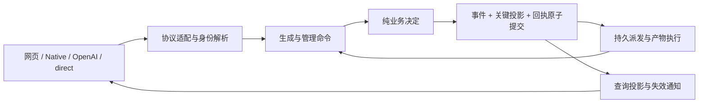

# 架构重构、事件溯源与成员生成契约计划

更新日期：2026-11-01，Asia/Taipei。

状态：**`codex/event-sourcing-member-generation` 分支的固定候选 `3eae814` 已通过独立审核和功能/发布包验收；R12 正式测量仍在进行，整体计划尚未关闭。** 本轮实施范围为单执行器、单共享 Opus、SQLite 下的架构重构、完整事件溯源和成员生成接口。多执行器、多账号/多车队调度及数据库系统迁移移至[后续扩展计划](scaling-follow-up-plan.md)，不作为本轮依赖或验收条件。代码审查基线为 `29085b8`，本轮实施基线为 `deab4db`。正式部署版本、备份及回退产物只以[发布记录](../operations/production-release.md)为准，本文件不复制一个独立维护的“当前生产版本”。

本计划承接[上一轮现代化实施记录](../history/modernization-plan.md)，已有接口、账务和恢复契约继续有效。按 2026-11-01 最新范围调整，本轮补齐前端能力描述、统一报价、成员生成及配套读取/预览契约；完整事件溯源继续实施。SQLite 内部的事件基线/schema 迁移仍属于本轮，SQLite→其他数据库系统的切换属于后续计划。完整官网编辑器、画布和项目云同步不因接口设计自动纳入本轮。

## 1. 交付目标与设计决定

本轮实施结束后，应得到：

1. 成员身份、共享资格、绑定的额度来源、请求、单图任务、执行尝试各有稳定身份和明确归属。
2. 网页、Native、OpenAI、direct 入口共用受理和结算规则，协议转换保留各自契约。
3. 查询不改变额度；简单派生字段退出独立维护；业务决定、历史证据和查询投影明确区分。
4. **分配、钱包、预留、结算、运营损耗、生成生命周期采用可重放事件作为权威来源。** 事件模型、版本演进、恢复工具和旧账本迁移都在本计划内完成，不仅追加一份审计日志。
5. 提供前端可消费的能力描述、只读统一报价及 Cookie 会话生成接口，使用同一套规范化/报价/准入规则，并明确费用确认和幂等契约。
6. 保持唯一执行器、绑定单一共享 Opus 和 SQLite；稳定 memberId/accountId、纯业务函数与明确持久化边界为后续扩展保留衔接，不提前实施选路、租约或第二数据库适配。
7. 删除已确认无用的旧路径，替换依赖源码截取的核心测试，交付可重复运行的事件重放、SQLite 基线迁移、并发请求与性能证据。

采用现有 TypeScript、Nuxt/Nitro、SQLite/better-sqlite3、Drizzle 和 Node 测试体系。事件存储先放在同一个 SQLite 数据库；业务模块直接调用明确的命令函数，不增加消息总线框架、通用 Repository、微服务拆分或第二套前端状态库。本轮并发请求的账务正确性由唯一写入路径和数据库事务保证；不能将当前版本作为多个写入执行器同时运行。

## 2. 已发现问题与证据

| 编号 | 审查时事实及证据 | 影响 | 本轮处理 |
| --- | --- | --- | --- |
| A01 | [gateway-runtime.ts](../../server/gateway-runtime.ts) 的 `createJob`、`createDirectJob`、`createNativeBatch` 各自组织幂等、准入、免费限制和任务创建 | 新准入规则容易只接入部分入口 | 共同受理命令，保留协议、缓存和批次的真实差异 |
| A02 | [fairQuotaSummary](../../server/fair-quota.ts) 内部调用 `syncFairQuota`；合成数据推进一分钟后，仅调用摘要就把输入钱包从 20 改成 20.025 | 查询者必须自己复制 settings/ledger；遗漏副本会污染业务状态 | 纯查询投影与显式恢复命令分离 |
| A03 | `anlasAvailable` 由 [fair-quota.ts](../../server/fair-quota.ts) 与 [operating-accounting.ts](../../server/operating-accounting.ts) 手工维护；成员总表也与组内成员重复表示 | 写入路径越多，同步责任越重 | 总额、成员集合、容量等由权威事实计算 |
| A04 | 快照十分钟失效、订阅有效性分布在额度、共享状态、owner 和启动器适配；免费窗口同时出现在 TS 与 SQL 触发器 | 修改期限或资格后，展示和执行可能分歧 | 共用资格结果与版本化策略；SQL 投影不再另写业务判断 |
| A05 | [store.ts](../../server/store.ts) 维护 JSON、影子列、热缓存、dirty rows，以及两段相近的提交过程；运行时另包裹 `store.update` 强制立即保存 | 原子性依赖多个调用约定；未来第二写入进程不能信任自己的热缓存 | 一个命令提交边界；事件与关键投影同事务，缓存带版本 |
| A06 | `StoreItem` 同时表示成员、账户、任务、图片等，大量字段可选 | 不同业务对象的字段和身份容易混用 | 随所属模块迁移为明确类型；外部旧 JSON 在边界转换 |
| A07 | [幂等受理测试](../../tests/integration/idempotency-admission.test.mjs)等截取运行时函数文本并注入全局变量 | 函数位置、名字和依赖变化使测试失败；不能完整验证真实装配 | 纯规则直接 import，应用命令使用真实存储，协议用 HTTP 测试 |
| A08 | `reserveCreditAndAccount`、`reserveCreditAndAccountWhenAvailable`、内部 `tryReserveCreditAndAccount` 及专用 dirty-row helper 没有外部调用 | 保留了另一套已不用的扣款路径，增加阅读与误用成本 | 删除约 79 行；移除前再次全仓检索 |
| A09 | 旧计划和发布记录各自描述“当前版本”，已有漂移 | 新会话需要拼接历史才能判断现状 | README 指向本计划；部署状态只在发布记录维护 |

扩展设计另核对了当前合理的单进程前提：`discord-auth.ts` 的 OAuth state/资格去重、`member-auth.ts` 的登录限流、runtime 的正文预算和执行控制、`member-routes.ts` 的连接计数都包含进程本地状态。它们不是当前单实例部署的已确认故障；相关跨进程迁移和证明已整体移至[后续扩展计划](scaling-follow-up-plan.md)，本轮沿用现有认证和连接生命周期。

不要把所有重复表示都当作问题：`sqlRecord()` 集中生成的影子列是查询投影；独立结算凭据和免费成功凭据用于历史清理后继续保证幂等及限额；物理上游连接与任务的逻辑状态也不是同一事实。重构保留这些职责。

六项信号的结论：跨入口修改、规则重复、手工同步已经出现；查询副作用和源码截取测试有可复现证据；文档已保存关键上下文但存在状态漂移。没有证据认定当前正在发生连续账务回归，也不能用文档或测试总量直接判断其没有价值。

## 3. 业务语言、归属与标识

### 3.1 本轮业务含义

| 名称 | 含义与身份 | 边界 |
| --- | --- | --- |
| Member | 稳定成员身份，`memberId` | Key、Discord token、用户名不作历史主键 |
| Sharing policy | 当前一份共享配置，包含分组、成员资格、政策和绑定账号 | 保持四个顶层 group，不额外建立多车队管理 |
| Group | 共享配置中的份额组织，`groupId` | 没有第二份独立可消费钱包 |
| UpstreamAccount | 绑定的真实 NAI 账号，`accountId` | PST 轮换不改变身份；本轮不做多账号选路 |
| Wallet | `(memberId, accountId, resource)` 对应的本地权益 | 与官方观测值分开；不能从总余额下降推断个人消费 |
| Request | 一次已受理规范化意图，`requestId` | 与 HTTP 连接、重试及单张图分开 |
| Job | 一张图或一个辅助操作，`jobId` | 属于 request，批次逐张结算 |
| Attempt | 一次物理上游尝试，`attemptId` | 每 job 最多一次生成尝试，不自动网络重发 |
| Artifact | 已验证的产物，`artifactId` | 不把预览或未验证文件当结果 |

新记录用稳定 ID，旧 `userToken` 只在兼容读取和迁移中匹配；成员删除保留历史归属，凭据撤销独立处理。成员 API 的身份由 Cookie 解析，账号从已绑定共享配置获取，客户端不能指定其他 member/account 或提供上游密钥。

### 3.2 本轮唯一性与扩展衔接

| 对象 | 本轮约束 |
| --- | --- |
| 生成幂等键 | 保持 `(memberId, operation, keyHash)`；成员新接口同键还绑定原费用确认，不改变旧客户端指纹 |
| request/job/attempt/artifact | 稳定 ID + 成员和账号归属；难猜 ID 不能代替授权 |
| 钱包与运营账 | 保留明确 accountId 和三类资源；新来源只能通过后续显式迁移进入 |
| 配置和查询 | 版本由共同业务模块维护，查询键包含成员/相关版本；不建立一份前端独立规则 |
| 执行与持久化 | 唯一执行器通过命令事务改状态，IO 在事务外；保留当前单账号冷却和批次公平 |

后续 fleet/membership、跨账号分配、数据库适配和 fencing 模型保存在[后续扩展计划](scaling-follow-up-plan.md)。本轮不要求新增这些 schema 或通过多执行器用例；也不把未来字段塞进当前成员接口。后续按版本化契约增量扩展，已有默认来源、事件和幂等身份须明确映射。

## 4. 事实、派生状态与表示方式

| 类别 | 权威事实 | 派生结果/缓存 |
| --- | --- | --- |
| 身份与认证 | 成员 ID、凭据摘要/版本、会话期限、Discord grant，保存在受保护认证表 | 登录展示、资格缓存；秘密不写入事件 |
| 成员资格与配置 | 资格、停用/停止接单、组份额、策略及来源分配变更事件 | 成员集合、最终个人权重、容量、当前配置视图 |
| 官方额度 | `QuotaObserved` 的采集时间、原始数字、账号和证据来源 | 是否过期、能否派发、当前估算余额 |
| 本地权益 | 期初权益及其后的恢复、分配、转移、预留、结算、退款事件 | 当前余额、预留总额、Anlas 合计、累计消费 |
| 运营账 | 注资登记/到款、聚合差额、核销和确认事件 | 待承担额、风险窗口、剩余注资收据 |
| 请求与执行 | 已受理输入引用、幂等映射、顺序、attempt、派发授权、结果和失败证据 | 批次摘要、排队位置、耗时、状态文本 |
| 产物 | 经过验证的字节、摘要、长度、归属、存储位置与发布回执 | 缩略图、下载地址、本地存在性缓存 |
| 免费限制 | 每 job 唯一的成功事实，包括退款后找回的完整免费图片 | 指定窗口成功数、在途占用、下次可用时间 |
| 运行状态 | 持久派发占用与执行证据；进程只掌握自己的真实连接 | `inFlight` 展示、内存 waiter、预览进度和 SSE 连接数 |

采用事件溯源后，钱包表是**同步事务维护的关键投影**：仍可快速读取和校验，但只能由已提交事件产生；它不再是独立业务写入点。历史结算凭据、免费成功表和幂等表也成为有明确重建来源的投影。认证秘密、请求大载荷和产物字节保存在专用存储，事件保存引用与摘要。

### 4.1 金额精度与重放

统一资源量采用十进制定点表示：内部为 BigInt 的 `10^-12` 单位，事件与数据库使用十进制字符串，DTO 兼容层继续输出现有接口要求的数值。V5 的单位是“该来源账号的百分点”，不是比例；两类 Anlas 分开计算，成员分配允许小数，而上游整数报价保持整数。该精度比目前 `1e-9` 比较容差细三个数量级。

报价公式保留已验证的系数和运算/取整顺序；金额边界集中转换，禁止任意调用者混用 Number 和 BigInt。V5 报价在最后一次转换时向上取整到最小单位；按权重分配先向下取整，再按小数余量、稳定成员 ID 顺序分配剩余单位，保证同来源总量守恒。不能用对每个人独立四舍五入代替分配。

旧库导入保存原始数值的十进制文本、规范化值和差额。按每来源、每资源整体确定总量，再分配最小单位余数；变更不混入损耗或消费。零/正负性质、原报价整数以及现有边界行为必须通过迁移对照；总额规范化差额绝对值应不大于半个最小单位，单条差额不超过一个最小单位。超出即报告对应记录和计算，不静默修正。此表示迁移与事件基线共用一次验收，避免以后再改变已落盘事件的金额语义。

事件记录实际采用的金额、分配向量、恢复区间、策略版本与舍入版本。重放只应用这些决定，不用今天的公式重新报价或重新分配。展示层的精度调整不能改变事件金额。

SQLite 中的十进制字符串不能通过 `CAST ... AS REAL` 或 `SUM(TEXT)`参与余额批准；关键汇总由 projector 用相同定点运算增量维护，SQL 负责索引、筛选和计数。Number 转换只发生在兼容 DTO/显示边界。金额表示迁移属于需要完整对照的行为改造，不当作无风险类型清理；影子比较先对旧基线做同一确定性规范化，再比较金额，不能用宽泛 epsilon 掩盖差额。

## 5. 必须持续成立的契约

| 编号 | 不变量 | 最小可运行证据 |
| --- | --- | --- |
| I01 | 相同 scope、相同键、相同意图只受理一次；换响应格式仍领取同一结果 | 并发提交、丢回执、重启、Key 轮换后，上游计数仍为 1 |
| I02 | 接受请求、保存规范化输入、建立幂等映射和子任务处于同一事务 | 任一步 SQL 失败后均不存在半份受理 |
| I03 | 同 job 的预留最多一次，终态只能结算或退款一次 | 重复及乱序完成/退款不会增加消费或余额 |
| I04 | 转移和重分不增发同来源资源；消费、恢复与注资有明确来源 | 事件前后逐来源核对，而非只核对全站总和 |
| I05 | 官方总余额下降不自动摊扣闲置成员；候选损耗不相加当实扣 | 保留净额抵消、延迟扣款、回跳等现有回归 |
| I06 | 购买 Anlas 使用需要原有明确授权和官方固定池耗尽等条件 | 任一入口不得绕过；事件保留决策时证据 |
| I07 | 停止接单、取消等待任务及退款原子完成；在途保留结算资格 | 并发提交和 stop/resume，旧批次余图不会复活 |
| I08 | 唯一执行器不并行发出绑定账号的生成请求，逻辑超时不提前释放尚在途连接 | 并发受理、串行派发、超时/关闭/重启恢复回归 |
| I09 | 不确定已发出的 attempt 不自动重新发送 | 派发意图前后强杀；没有第二次 generate |
| I10 | 完整产物有持久证据后才能成功结算；迟到结果保留原退款 | 文件和事务各故障点重启两次，结果 ID 和金额不变 |
| I11 | 领域查询不改余额/派发/删除；事件重放不访问外网或执行外部副作用 | 冻结输入、重放禁网和调用计数断言；产物读取与认证 IO 保留各自边界 |
| I12 | 同一官方恢复区间只处理一次，先处理来源债务/容量缺口再分配 | 重复时钟、重复快照、定时与手动刷新不会重复恢复 |
| I13 | 免费图片按单图成功事实计数，清理历史和迟到交付不漏计/重计 | 结算、迟到、清理、重放与窗口端点测试 |
| I14 | member/account 归属贯穿命令、查询、缓存、事件和产物 | 跨成员猜 ID、重复键、Cookie/Bearer 边界和权限变更矩阵 |
| I15 | 事件、关键投影、命令回执的可见状态一致 | 提交失败、投影失败、进程崩溃，均不能只留下其中一项 |
| I16 | 合法历史事件在升级后仍可确定性重放；未知版本不被跳过 | 固定旧事件样本、升级/降级拒绝与全量重建哈希 |
| I17 | 报价不预扣，新成员接口的提交及每个 child 派发不突破已确认资源/费用上限 | 篡改报价、排队后变化、多图中途变化、退款后迟到回归；旧协议不新增必填确认 |
| I18 | 能力描述、报价和提交来自共同规则；不能展示一个实际不可提交的受支持组合 | 能力矩阵与规范化/报价/提交的交叉契约测试 |

HTTP 断开不撤销已受理任务；没有客户端操作标识时不承诺识别两个独立请求。事件溯源不会使 NAI 的外部网络调用自动具备 exactly-once。I08 约束当前唯一执行器的派发与物理连接，上游内部是否已经完成仍按已观察证据、冷却和既有未知结果规则处理。

## 6. 模块归属和依赖方向



| 责任 | 实施位置 | 允许依赖与需要移出的内容 |
| --- | --- | --- |
| 协议适配 | `native-http`、`member-generation-http`、`generation-delivery`、`openai-models`，复用 `native-body`、`native-image`、`native-stream`、`providers` 及 Nuxt 转发 | 只转换输入、保留认证和传输契约；等待者/预览/关闭和提交后通知有实际装配测试，不自行修改钱包 |
| 通用受理 | `generation-admission.ts` | 调用身份/scope、规范化、幂等、队列政策和提交入口；共用一个命令，不创建通用命令总线 |
| 执行生命周期 | `generation-execution.ts`，复用 request/accounting/result 模块；`queue-dispatch.ts` 管理本进程在途控制和唤醒 | 派发、取消、准备/发布结果、失败、恢复均为实际导出命令；调度及产物 IO 位于事务外，提交后才通知连接 |
| 额度与恢复 | `fair-quota.ts`、`operating-accounting.ts` | 变成明确输入、显式 now、事件输出的业务决定；相应 reducer 只应用事实 |
| 共享资格与政策 | `quota-policy.ts`，复用 `free-image-policy.ts`、`shared-capacity.ts` | 统一 freshness/有效 Opus/政策判定；展示适配不能另写批准规则 |
| 官方额度观察 | `account-quota-refresh.ts` | 读取上游、限时/合并刷新、停止后续调度；观察事实与钱包同步同事务，过期请求不能覆盖新观察 |
| 查询 | `generation-queries.ts`、现有 owner/heatmap/launcher/shared-status | 只读投影，恢复估算返回预测值及 asOf，永远不提交钱包 |
| 事件契约与提交 | `event-payloads.ts`、`domain-events.ts`、`event-store.ts`、现有 schema/migrations | 写入使用具体 payload 判别联合；SQL 解码保留独立的不可信读取边界。维护版本、CAS、事务、关键 projector，不接触 HTTP |
| 数据与基础设施 | `store.ts`、SQLite 读 worker、result-files、ImageStorage | schema、SQL、受保护载荷和产物 IO；逐步移除旧通用可变业务对象与重复提交过程 |
| 认证 | `member-auth.ts`、`discord-auth.ts`、既有入口守卫 | 认证表保留 CRUD；成员资格和管理决定通过业务命令提交 |

`gateway-runtime.ts` 最终负责装配、HTTP 分流、生命周期和后台任务启动。按责任提取可独立验证的函数，不按行数机械拆文件；所有 caller、导出、构建复制规则与测试在对应工作包内一起迁移。

纯查询的会话续期是另一项明确的认证命令：可见页面触发已有续期行为，但不能借由 GET 摘要顺便恢复或重分钱包。预览和保存使用相同决定函数；预览不提交事件，保存重新读取权威版本并验证。

### 6.1 已有抽象的保留价值与维护责任

| 已有抽象 | 当前已经解决的问题 | 本轮决定及仍须承担的责任 |
| --- | --- | --- |
| Nuxt → Nitro 内部接口 | 网页重启不打断生成，凭据/写入集中在执行器 | 保留；维护内部鉴权、Host/代理链、流背压、断线和有限重试契约 |
| 普通请求、长流、事件流转发 | 不同正文、超时、重连和关闭需求 | 保留传输差异，共用头部/错误规则，不强行合成一个万能代理 |
| JsonStore + Drizzle + 读 worker | 旧库兼容、原子写入、有界历史查询 | 保留数据库与读 worker；以事件提交取代可变大对象写协议，减少 dirty scope 和重复提交责任 |
| 幂等/结算/免费成功冷表 | 历史清理后仍不重扣或绕过限制 | 作为同步关键投影保留，补齐确定性重建来源和版本 |
| state-events/SSE | 页面跟随已提交状态变化 | 继续只做过滤/合并/重连，不承担钱包权威或消息必达承诺 |
| ImageStorage/结果发布 | 本地与 R2 读取、文件故障恢复 | 保留；补 storage namespace 与主存储发布契约，不复制第二套校验逻辑 |
| 共享管理 composable/组件 | owner 和管理员复用业务操作界面 | 保留认证差异、草稿和异步响应保护；增加 scope 时扩展同一套接口 |

模型能力检查集中在规范化/能力模块，报价公式集中在 pricing；仍复用既有 Medium 参数模块。前端只展示相同规则的投影，不能维护另一份可消费报价真相。新增模型仍需必要的协议/计价/展示测试，不因为集中定义就省略真实上游能力验证。

## 7. 事件溯源的完整契约

### 7.1 聚合与事务边界

- `sharing:default`：当前共享资格、组/权重、政策、停止接单代次、绑定账号和管理决定。它是现有共享配置的聚合，不新增多车队系统；成员移除不抹去历史身份。
- `account:<accountId>`：绑定账号的官方观测、成员钱包、预留、结算、恢复游标、来源债务、运营账及冷却政策。只对当前绑定账号建立可消费来源。
- `request:<requestId>`：受理意图、幂等映射、所有 child、attempt、取消、结果和未知核对状态。
- 一个完整命令可以原子追加多个 stream：例如派发同时改变 request 与 account；转移、调整份额等校验相关 sharing/account 版本。**不以异步 saga 取代目前需要同时成功或失败的扣款事务。**

所有受影响 stream 在同一 SQLite 事务内检查并推进版本，不能由 caller 分开提交。范围内没有独立业务变更的资料不建立空 stream。已有账本规模下，account 作为资源一致性边界比逐钱包拆散后再协调更直接。

一条事件只属于一个主 stream，不能把同一事实复制到两个 stream 后各算一次。额度预留/扣退属于 account，job 生命周期属于 request，通过原事件 ID 关联；例如 `QuotaReserved(account) + DispatchAuthorized(request)`、`GenerationSettled(account) + JobCompleted(request)` 同批提交。跨 stream 投影可以读取两者，但每个实际改变的聚合必须有自己的版本推进和事实依据。

### 7.2 事件信封与数据库约束

每条事件包含：

| 字段 | 契约 |
| --- | --- |
| `eventId` | 全局唯一、生成一次；重试复用同一命令结果 |
| `commitSeq / eventIndex` | 已提交批次顺序及批内顺序；游标 API 使用十进制字符串避免 JS 整数溢出 |
| `transactionId / commandId` | 一次原子业务意图及稳定命令身份 |
| `streamKind / streamId / streamVersion` | 聚合归属和连续版本；唯一 `(streamId, streamVersion)` |
| `eventType / schemaVersion` | 已发生事实的名字及结构版本，不拿服务版本代替事件版本 |
| `accountId / memberId` | 按事件语义提供；共享配置由 streamId 标识，成员归属不使用 Key |
| `occurredAt / recordedAt` | 业务事实发生时间与数据库记录时间；时区统一 UTC，日统计继续按既有上海口径转换 |
| `actorId / actorKind` | 已验证操作者或系统任务；不采信正文指定的操作者 |
| `correlationId / causationId` | request/工作流关联和触发该事件的命令/事件；不能暴露凭据 |
| `policyVersion / pricingVersion / amountVersion` | 对该事实适用的决定版本；不适用时不填 |
| `payload` | 本类型最小充分事实、金额向量、输入引用和证据；不是整个可变 db 的 JSON diff |

在现有 schema/migrations 中增加以下明确职责的表，不另建迁移工具：

| 表 | 职责与约束 |
| --- | --- |
| `event_commits` | 命令回执、幂等 scope/hash/fingerprint、首次规范化上下文、提交序号与受影响 stream；命令键唯一，回执指向业务 ID，不保存长流正文 |
| `domain_events` | 只追加事件；eventId、streamVersion、批内序号唯一，FK 指向完整 commit |
| `event_streams` | stream 当前版本；条件更新用于竞争检测，可从事件重建 |
| `event_clock` | 单行事务内分配 commitSeq；锁保持到提交，确保游标代表提交顺序 |
| `projection_versions` | projector 名称/版本、已完整处理 commitSeq、重建 epoch；更新与该批投影原子提交 |
| `event_imports` | 旧库来源摘要、导入版本、分块清单/校验和、起止游标与完成状态；未完成基线不可作为生产来源 |

本轮派发状态继续由持久 job/attempt、绑定账号状态和唯一执行器的真实连接共同核对，不新增跨进程租约表。请求大载荷继续放在 `generation_requests`，产物继续使用已有受保护存储；一般命令幂等表不替代物理执行证据。

`commitSeq` 不能直接采用一个普通数据库 sequence 后假定所有较小值已经提交：未来多事务可能按相反顺序提交。本轮在 SQLite 短写事务内更新 `event_clock` 并提交序号；所有 projector 只消费完整 commit。当前吞吐由单 Opus 决定，这个短暂串行点有明确用途，网络与文件写入绝不占用它。

### 7.3 事件目录与充分性

| 事件族 | 必须保存的事实 | 主要重建结果 |
| --- | --- | --- |
| `SharingConfigured`、`MemberEligibilityChanged`、`MemberAdmissionChanged` | 共享配置身份、成员资格/角色、enabled/acceptingJobs、代次、操作者 | 成员资格和入口准入 |
| `AllocationChanged`、`PolicyChanged` | 完整有效配置、旧/新版本、生效时刻、涉及来源；已发生重分另含确定金额向量 | 份额、组、来源绑定、策略 |
| `AccountRegistered`、`AccountAvailabilityChanged` | 稳定物理身份引用、暂停状态和原因；不含 PST | 上游归属和可用性 |
| `QuotaObserved` | account、采集时刻、原始订阅/额度字段、观测序号、错误分类 | 来源快照和 freshness |
| `RefillApplied` | 起止恢复游标、所用快照/政策、总预算、先偿还债务/缺口的量、每钱包实发量和余量 | 余额、恢复游标、容量缺口和来源债务 |
| `FundingRegistered`、`FundingReceived`、`FundsTransferred` | 收据、来源/去向、资源、金额、确认依据和已匹配部分 | 注资、转移和未完成收据 |
| `ResourceGapObserved`、`ResourceReturnClassified`、`OperatingLossCovered` | 聚合差额或更正、原观察引用、证据等级、明确核销来源；未知实耗仍为 null | 运营风险与核销，不能推导个人扣款 |
| `RequestAccepted` | 规范化载荷引用/摘要、首次 seed/defaults、成员、键/指纹、协议意图、child ID、提交期限；新成员接口另存原费用确认/版本 | 请求、幂等映射、费用授权和子任务 |
| `CachedResultLinked` | 现有产物、读取归属、零消费事实 | 缓存交付；不产生新 attempt 或免费成功 |
| `JobQueued`、`WaitingJobsCancelled` | child、队列序号/截止、原因、接单代次；取消明确的 ID 集合 | 队列和批次公平 |
| `JobCompleted`、`JobFailed` | child/attempt、产物或失败证据、对应结算/退款事件、结束时刻 | request stream 的终态与批次结果，不独立改变钱包 |
| `QuotaReserved` | job/attempt、来源、原报价、按资源的实扣量、版本、派发前快照和候选上游计费路径 | 唯一预留与原始扣退依据 |
| `DispatchAuthorized`、`UpstreamEvidenceRecorded` | attempt、account、执行器启动标识、授权时刻、实际观察到的请求/响应证据 | 单执行器工作与未知状态；授权不等于上游已收到 |
| `ArtifactPrepared`、`ArtifactPublished` | attempt、稳定 artifactId、位置、摘要、长度、格式、验证证据 | 文件恢复描述和产物目录 |
| `GenerationSettled`、`GenerationRefunded` | 原预留引用、终态、金额、依据、释放的占用；不重报今天的价格 | 钱包与终态结算凭据 |
| `GenerationOutcomeUnknown`、`GenerationReviewClosed` | 首次未知/截止、候选估计、证据等级、原损耗引用 | 五分钟核对和可追溯估计结案 |
| `LateResultRecovered` | 原退款、attempt、产物、发现时间、退款保留 | 可领取迟到结果；不重新扣款或激活被取消 child |
| `FreeImageSucceeded` | 唯一 job、成员、成功或找回时刻、对应结果/结算引用 | 滚动免费次数；同 job 只能产生一个成功事实 |
| `CooldownChanged` | 原 attempt、失败类别/次数、确定截止与原因、上游 Retry-After | 重启后冷却，不在重放时重新计时 |
| `ArtifactArchived`、`ArtifactLocationChanged` | 相同产物的校验回执、新位置和本地删除确认 | 本地/R2 读取与归档恢复 |
| `Legacy*Imported`、`OpeningStateRecorded` | 源库摘要、原身份和原数值、已规范化期初值、历史覆盖范围 | 从切换基线开始完整重放，历史不足不造假 |

事件名字可以随实现中的类型命名统一，但上述事实及其归属不能省略。一个命令生成一个有序事件批次，例如 `ArtifactPublished + GenerationSettled + FreeImageSucceeded + CooldownChanged + JobQueued(next)` 在同一提交内生效；查询和重建不得暴露其中半批。

纯 reducer 只读取旧状态和事件，不能读取当前时钟、随机数、环境变量、最新报价、其他数据库或上游。所有必要观测由命令显式提供并记录。纠错追加关联原事件的更正/冲正事实，不覆写历史事件；对不确定扣费的更正也不能补造不存在的官方确认。

### 7.4 命令提交算法

1. 在事务外完成正文限额、协议解析和外部资格观测；保留原始随机意图、响应格式和认证 scope。
2. 打开短写事务，SQLite 使用 `BEGIN IMMEDIATE`；所有业务变更通过当前唯一执行器的提交入口。其他数据库的锁/适配在后续计划验证。
3. 查询持久命令键。已提交则核验当前访问权限，按首次 normalization context 计算指纹并返回原业务引用；冲突返回 409，不重新消耗。
4. 从权威关键投影及版本读取状态。进程内缓存只有在版本一致时可用；重新验证资格、策略、队列/载荷预算、余额、停止接单代次和目标账号。
5. 执行纯决定函数，得到完整事件批次及关键投影变更。新随机 seed/ID 在这个意图内只生成一次，竞争重试不能生成新业务意图。
6. 条件更新 stream 版本，追加事件，更新关键投影、请求载荷引用、派发占用和命令回执。发生任何失败整体回滚；不让 JS 对象残留半变更，优先用事务局部值，兼容阶段保留现有失败重载。
7. 分配/写入 commitSeq 并提交；回执只在提交成功后对外可见。与同命令竞争的 loser 读取已有回执，而不是新建任务。
8. 提交后唤醒持久工作和失效通知。通知丢失可通过游标/重连补读，不能反向回滚已经提交的业务。

网络、图片发布、R2、Discord 刷新不放进数据库事务。需要外部结果的流程拆成有事实关联的前后两个命令；业务上的预留/结算原子性仍由各自提交保证。短暂资源不足而未受理的请求不固化为永久幂等结果；重试仍需重新验证。管理修改与后台工作也使用稳定 commandId，覆盖响应丢失与重复触发。

自有网页为一次管理操作生成一次 commandId，Nuxt 原样传递，内部重试复用；旧管理客户端没有操作键时仍按独立请求处理，不因此开启无键自动重试。新成员生成接口把费用确认绑定到受理意图，具体指纹、版本及重放顺序见[成员生成接口契约](../contracts/member-generation-contract.md)；旧客户端继续按原幂等契约处理。当前前端不能选择多个账号来源。

命令判定使用一次读取的数据库时间，业务事件保存这个明确 now 与外部观测时间。恢复游标只能前进，时钟回拨不产生负区间或重复恢复；队列与冷却按原截止恢复，不用各进程墙钟重新生成期限。事件顺序由 commit/stream 版本确定，不按 occurredAt 排序。

### 7.5 查询、投影、通知与工作唤醒

| 投影 | 更新方式 | 一致性要求 |
| --- | --- | --- |
| 钱包、活动预留、终态结算、幂等映射、资格、政策、队列/派发占用 | 与事件同步提交 | 下一个命令不能基于落后的余额或配额批准请求 |
| 免费成功凭据、用于限制的窗口查询 | 成功事实与凭据同步提交，窗口按明确 asOf 查询 | 派发争抢最后一个名额只能成功一次 |
| 热力图、历史搜索、owner 汇总、资源统计 | 可按已提交 commit 批次增量更新 | 显示 asOf/游标；返回旧投影不冒充最新，不能用于账务准入 |
| 浏览器失效通知 | 提交后发布现有 SSE；丢失后重连/补读 | 只包含授权范围的刷新线索，不发原始领域事件 |
| 待执行生成与恢复工作 | 已提交 job/attempt 投影就是持久工作清单 | 唤醒可以重复或丢失，领取和执行依靠持久状态；不另造一个自动重试所有操作的队列 |

同步与离线重建使用同一个 projector，但命令决定函数与 projector 分开。`free_image_usage` 的 SQL 触发器在事件权威切换时由新迁移移除，成功/告警逻辑移到共同命令及投影；不能保留触发器和 projector 两个规则拥有者。免费政策的窗口、阈值和版本只有一份定义，警告按该成功事实生效时的政策判定，查询按当前政策展示。

批次整体成功/部分成功、查询 DTO、文件位置、生成状态、消费状态和核对状态分开投影。尤其保留“job 为 failed、退款已完成、但有迟到产物可领取”的合法组合；不为了枚举简洁将这些状态合成一个互相矛盾的大 status。

共享查询的资格结果来自共同规则，但展示可区分暂停、快照过期、冷却和额度不足。余额预测只依赖已提交基线、明确 asOf 和已知恢复参数，返回 estimated；真正恢复由 `ApplyRefill` 命令确定时间区间并生成事件。定时任务可以合并无效果的 tick，不能每次 GET 追加恢复事件。

当前 `state-events.ts` 的 EventEmitter、bootId、version 仍是传输层机制，不当作事件存储。当前唯一执行器将已提交状态转成授权 SSE；外部页面不接收全局原始游标、其他成员 ID 或原始事件。内部重连仍先鉴权并发送 resync，不能把用户当前长连接失效误判为任务取消。

### 7.6 版本、快照与重放工具

- 事件结构使用 `eventType + schemaVersion`；命令策略、报价算法、金额表示、projector 分别有版本。任何一个升级都不隐式改写其他版本的含义。
- 兼容旧结构使用纯 upcaster，输入固定旧事件、输出当前读取形态，不修改源行。业务算法改变只影响新命令；已记录的金额、时间和目标不会被 upcaster 重算。未知类型/版本中止对应重放并给出 eventId，不能跳过后继续写钱包。
- 快照是加速缓存，保存 streamVersion、最后 eventId/commitSeq、reducerVersion 和内容摘要；不替代原事件。优先复用当前关键投影作为带版本的快照，只有长 stream 的实测加载成本需要时才生成额外归档快照，避免两套常驻当前状态。
- 提供一个离线 `scripts/replay-events.mjs`：支持明确源库、输出到新临时库、指定 projector/version 和完整 commit 截止点；输出逐来源余额/预留/终态/免费次数/队列及摘要差异。默认不连接外网、不启动监听/定时器、不写源库。
- 重建按 commitSeq/eventIndex 应用完整批次，checkpoint 与目标投影一起提交。中断后续跑、重复消费相同批次都不重复计数。不能对一半事件提前推进 checkpoint。
- 在线查询投影重建使用新 epoch，先追到确定游标，再在短事务内核对新事件尾部并切换；旧 epoch 在已有读取结束后清理。关键钱包投影重建期间暂停受影响命令，完成一致性核对后才恢复，不能对旧余额继续写入。
- 重放恢复“事实和可执行状态”，不执行 provider 调用、OAuth 刷新、归档删除或通知。恢复调度是另一条显式启动流程，先验证未完成 attempt/产物再开放派发。

### 7.7 隐私、留存与修正

事件仅保存稳定业务 ID、必要数值和受保护对象的引用；PST、管理员密钥、Discord access/refresh token、Cookie、密码摘要均不进入领域事件。提示词和参考图片继续存于专用请求载荷，事件只记录引用、规范化版本及摘要。私有日志和事件查询沿用成员/owner 权限，不提供公开事件浏览接口。

删除成员不删除仍承担幂等、结算或归属责任的事实；可移除或匿名化独立身份资料。产物和大载荷的留存不等同于账务事实留存。若已按明确策略清理结果，同键仍返回原业务 ID 及既有缺失结果语义，不能重新生成。

本轮不自动删除事件。未来归档必须保留可重放的基线/事件段及校验清单，并保持冷幂等/结算查询；日常备份涵盖事件、载荷、认证表、产物目录和加密密钥恢复条件，复用[现有备份与回退流程](../operations/production-release.md)。更正通过明确命令追加反向或修正事件，关联原证据和操作者；“撤销”不能撤回已经发生的上游消费。

## 8. 前端能力、统一报价与成员生成接口

本轮实现与验收的唯一接口规范为[成员生成接口契约](../contracts/member-generation-contract.md)。接口已在本分支实现，验收依据见第 10 节，生产状态仍以发布记录为准；[现有 API 契约](../contracts/api-contract.md)继续描述需要保持兼容的行为。

| 接口 | 职责 | 关键边界 |
| --- | --- | --- |
| `GET /api/member/generation/capabilities` | 返回实际支持的模型/操作/参数、默认值、组合约束和版本 | 使用共同能力定义，不返回 PST/上游账号信息或另一份前端价格公式 |
| `POST /api/member/generation/quote` | 规范化、核价、逐张/合计资源预览及当前可提交原因 | 只读，不创建 request/预留/领域事件，不调用上游生成 |
| `POST /api/member/generation/requests` | Cookie 会话下受理完整生成/辅助操作，返回 202 | 必须带幂等键和费用确认；与 Native 等入口复用共同命令 |
| 配套请求查询、取消、输入恢复、预览和内容读取 | 完成浏览器生成闭环 | 复用持久任务、JobPreviews、授权和产物读取，不建设新的调度/素材系统 |

费用确认记录每张及整批各资源上限、购买池授权和相关规则版本。提交和每张派发均校验；同键已受理请求优先重放原意图，不能因规则变化重建任务。报价瞬间的余额/队列状态不保证后续仍可用，具体 409/402/429 等语义在接口规范中定义。

Nuxt 为新的大请求采用现有流转发能力，成员路由为新端点单独接入原有 Native 正文解析与限制，不能被旧管理 JSON 的 32 KiB 或普通受理代理的 2 MiB 上限截断，也不能全局放宽这些旧入口。预览流包含图片，不能接到仅为小型失效通知设计的 64 KiB 帧桥。

能力/报价 DTO 与 schema/type 来源由服务端业务模块拥有，前端消费对应类型。实现交付包含路由、类型、样例与合同测试；完整官网生成工作台、画布交互、云项目/素材管理仍需单独的产品任务。本轮不提前写这些 UI。

多执行器、多账号/车队及数据库系统迁移单列为[后续扩展计划](scaling-follow-up-plan.md)，保留原设计和必要验证，不进入 R00–R14 的依赖图。

## 9. 旧数据迁移与权威切换

### 9.1 历史覆盖的真实边界

旧 `ledger`、任务历史和配置 history 不是完整事件流，不能生成看似完整的往事。以一致性快照时刻 T0 建立明确的 opening baseline；旧历史作为带来源标记的历史证据导入，**从 T0 起全部核心业务变更可重放**。期初事实本身纳入事件存储，重建不能依赖一个后来可能被覆盖的旧库。

导入必须覆盖：

- 当前成员/共享资格、组/权重、绑定账号、钱包、预留及不可重复结算的历史终态凭据；不在此次导入中创建多车队业务。
- 最新官方观测、`lastRefillAt/lastSettlementAt`、尚未反映的 spent、fallbackBuffer、sharedV5Debt、未分配额、运营缺口、未归属返回和待匹配注资收据。不能只导入“当前余额”而丢掉下一次同步所需状态。
- 保留的请求和 child、首次 normalization context/seed、所有幂等映射，包含 target job/产物已经被清理的映射。
- 免费成功凭据和告警证据，包含迟到图片；导入历史不得再次触发扣款、成功通知或“新成功”计数。
- 队列序号、原截止、停止接单代次、未知尝试、resultPending、核对截止、冷却和失败次数。
- 图片/编码产物位置、摘要、R2 回执与归属；历史缺失字段保持 unknown，不补成“已验证”。

认证表和秘密仍按原受保护方式迁移，领域事件只引用身份；稳定身份迁移不使现有会话或 Key 无故失效。无法确定来源的非零钱包或冲突幂等证据，导入器列出记录与冲突，不能猜一个 account；未绑定但零余额的初始化状态可保留 pending，并由明确绑定命令继续。

### 9.2 分阶段操作

| 阶段 | 权威来源 | 做法与出口 |
| --- | --- | --- |
| M1 基线导入演练 | 旧库 | 在线一致性备份到隔离目录；分块导入 opening/legacy 事件、认证/载荷/产物引用；完成逐资源摘要及原接口对照 |
| M2 事件影子记录 | 旧业务决定 | 新事件与旧业务写入在同一 SQL 事务提交；影子 projector 写独立表/库，无网络、无派发；每种命令都能从 opening 重建到相同状态 |
| M3 权威切换准备 | 旧库 | 明确候选版本，停止接收新的生成、排空可完成在途、停止所有相关写入并取得最终一致性备份；未结争议作为事实保留，不无限等待核对 |
| M4 原子切换 | 事件流 | 导入/追平最后批次，完整校验后，在数据库原子写入 authorityVersion 与兼容版本要求；只允许事件命令路径继续写 |
| M5 恢复及验收 | 事件流 | 先恢复完整产物，再处理未完成尝试，最后开放派发；验证旧 Key、旧幂等键、结果领取、管理和实时刷新 |
| M6 删除过渡写入 | 事件流 | 旧表若仍服务旧 DTO，只由 projector 更新；删除旧直接改钱包、旧免费触发器和影子比较的运行时开关，保留离线对照工具 |

影子事件由业务决定生成，不从整个对象 diff 猜测事实。影子比较失败阻止切换，输出第一条分歧命令/事件与资源，不靠再加补丁把最终总数凑齐。影子表不能被准入或成员页面误用。

大历史按稳定主键分块，`event_imports` 记录每块范围、摘要和完成点；重新执行相同导入不重复建立期初余额。所有块完成并核对前不暴露为可写账本。不允许旧进程在权威切换后继续写入，旧二进制应根据数据库兼容标记拒绝启动。

### 9.3 回退与恢复

新增持久写入之前，可撤销切换并恢复原兼容程序；这一边界也包括会话与配置写入。事件权威已经产生新记录之后，回退只能使用能识别当前事件/schema 的兼容程序，或修复程序后从事件重建投影；不能拿 T0 前备份覆盖新消费。

事件、关键投影、请求载荷、认证资料和产物清单一起备份；恢复演练包括数据库只有备份时的全量重建、R2 暂不可达、产物缺失，以及影子阶段中断。正式发布继续遵守[既有部署授权与备份边界](../operations/production-release.md)，文档和本地重构不触发生产替换。

## 10. 可执行工作包与依赖

下面均属于本轮完整重构计划；R00 文档与目录整理已提交，R01 在 `a44ba18` 完成独立复审及验收。R02–R11 已完成实现、独立审核与功能验证，R13/R14 的构建、恢复及过渡层清理门禁已通过；最终关闭仍依赖 R12 的三轮十万历史负载/重放与单次年度容量测量。测量方法、阈值及结果统一见[性能验证记录](../history/refactor-performance-evidence.md)，不把小样本当作正式验收。跨执行器租约、多账号选路及数据库系统迁移归后续计划。

R01 的可追溯证据：`c4e72be` 的隔离 Linux 构建、SQLite integrity 与 8 个定向测试文件 127/127 通过；独立审核发现首次分组预览未显式初始化的 P2，由 `a44ba18` 修复，并增加真实 HTTP/SQLite 回归，验证预览不写原库且余额/状态与保存一致。修复快照重新构建、受影响路由 12/12 通过，原审核者复审关闭该问题。这些结论仅覆盖 R01，不代表后续金额/事件权威/成员生成已验收。实施基线 `deab4db` 的隔离 Linux 后端 574/574、web 134/134、executor 3/3、实际 Nuxt/executor 14/14 均通过且无跳过；后续按同环境比较，所有生产数据和服务未用于测试。

后续切片证据：`2d8ca83` 将事件写入改为判别联合，12 个负向类型断言持续拒绝错误 payload；`943f316` 提取实际执行命令，`0686965` 提取真实额度刷新，`b7f0572` 提取 Native 协议装配。Node 22 下命令/连接/队列直接导入测试 51/51、刷新 12/12、真实 Native HTTP 17/17 通过，均无跳过。`ebc6f8d` 处理关闭期间迟到的 SSE 注册，真实 HTTP 13/13 及独立复审通过。全量候选曾暴露开账后的旧 fixture 直接改底表、冷历史删除只作用于热缓存等问题，按事实初始化和共同退休命令修复，不能用这些定向通过代替最终 Linux 全量、重放、性能与打包结论。

R11/R14 清理依据：所有后端业务测试已退出运行时源码截取，保留的前端 DOM VM 测试不读取后端源码。TypeScript 未使用声明检查及全仓调用检索确认运行时中旧卡密/余额管理、无路由的账户导入/代理管理、旧缓存清理和 dirty helper 链没有实际 caller，删除这些私有死链；未删除现有路由、存储 API 或旧数据兼容。无产品入口的统计重置动作及其孤立测试一并删除，实际账户停用/恢复仍验证不会释放在途计数或绕过冷却。运行时只引用新的共同命令及装配模块。

公开运行时在读取配置前固定启用共享模式，生产没有非共享入口，因此 `7af2724` 继续删除只剩测试构造的旧 points 钱包、选择/重试其他账号和无任务结果写入分支。保留的是当前 Native/OpenAI/direct 共享行为和旧历史读取。批量与单账号管理共同生成 `AvailabilityChanged`；原批量管理日志随事实保存为 evidence，事件写入失败时账号、日志、事件与 commit 一起回滚。`f4f12ef` 的实际 HTTP 回归覆盖该原子性及重启，Windows 该文件 6 通过、1 个已有 SIGTERM 平台跳过；该跳过项已由下述 Linux 固定候选验证覆盖。

当前业务候选 `3eae814ef221d74e7bcd57ea1fbdae0e1d75948d` 的运行证据保存为[验收清单](../history/refactor-validation/runtime-3eae814.json)。其中 `3a3ffe1` 将只读 readiness 预检查与最终受理分开：最终事务先按原上下文回放，再同步额度、重验资格、检查费用/容量并保存新请求与回执。无效输入或最终 SQL 失败不留下独立恢复提交；成功时恢复与请求同一提交；cleanup 仍是独立维护命令。真实红例及修复后回归同时覆盖账号在两阶段之间被停用、失败恢复原游标、原回执优先于新政策及停用状态。两位审核者分别完成 26 项接口检查/Native 断言与 12 表的事件并发、回滚独立验证；当时的 676/676 全量及发布包仍保留在[3a 原清单](../history/refactor-validation/runtime-3a3ffe1.json)，不与下表新候选混写。

十万历史测量随后暴露开账逐输入 FULL 提交及私有来源变化检查缺口。`537804b`、`9f84ccf` 将每 100 条源记录的输入/产物/诊断及幂等上下文与对应 opening 块同事务提交，失败只回滚当前块，旧 orphan 输入匹配时可续跑，当前源内容冲突时拒绝；独立审核覆盖真实 SQL 故障、前块保留、重开续跑及冷映射重放。`3eae814` 让热力图先按原身份/操作筛选，再只将严格日期和状态物化一次；保留全局/owner 查询、去重、旧身份和日期边界，独立 SQL/HTTP 复审通过。原始规模数据、四项阈值触发与一次诊断均留在[性能记录](../history/refactor-performance-evidence.md)，新完整测量不拼接旧轮次。

历史候选 `f4966fd` 的[原验收清单](../history/refactor-validation/runtime-f4966fd.json)保留其当时结果：后端 674 项中 673 项通过，authority 旧断言由 `619d9eb` 修正后完整受影响文件 1/1 通过，不能改写成一次全绿执行；执行器内部金额断言由 `2d7bacf` 修正。该旧包为 52,568,771 字节，SHA-256 `a18f3947c56da01ca942caa98334deb3e1e872c9fabf3d0838315917dcc4c78c`，不作为新包的散列。

以下是新候选的 Linux x64、Node 22.23.4、隔离网络及合成数据结果，未使用生产数据或真实 NAI/Discord/R2 服务：

| 验证范围 | 固定候选结果 |
| --- | --- |
| 后端 | 本次全量 693/693 通过，0 失败、0 跳过，约 275.6 秒 |
| 网页与执行器 | web 类型检查及 139 项通过；executor 类型检查及 3 项通过；真实 Nuxt＋执行器 16/16 通过、0 跳过，包含大请求、90 KiB 预览和进程恢复 |
| 生产与发布包 | root/web/executor 生产镜像构建通过；实际生产执行器镜像和解包发布包 HTTP 各 4/4、0 跳过；包内 Node、依赖、SQL、worker、重放/断点恢复工具及 systemd 校验通过 |
| 备份与恢复 | 新包实际执行 `backup-production.py backup()`，24 张表逐行一致、源库不变；私有输入/产物/诊断重放、max1 后续跑与重复0再次通过。本次新包再次完成三笔 opening 后付费、9 张事实/回执表及余额相等的恢复验证。业务备份样本不含生成图片字节 |
| 旧版本拒绝 | 版本门槛/迁移/reducer 源码未变，沿用真正 `1427422` 进程对 `f4966fd` 的验证：监听前拒绝 v2 库，24 张表不变，已退休无 job 图片不复活。更早 `deab4db` 的 schema 拒绝亦保留原证据版本 |
| 外围兼容 | 相关源文件未变，沿用同轮隔离备份脚本 6 项与实际 Caddy HTTP 7 项通过证据 |

新发布包为 `novelai-gateway-3eae814-linux-x64.tar.gz`，52,569,294 字节，SHA-256 为 `d6fc13a6d80588e37d1727a248729892dde1b3d59e7ac962054a65cf338d778c`。清单保存各镜像 SHA、原始日志名、包位置及承接依据。先前 Windows 的一次初始 quote `fetch failed` 没有底层 cause，原因未确定；隔离文件重跑及后续两次完整 Linux 通过，不据此将其定性为无故偶发。正式性能结果单列，生产发布仍未执行。

其后 `ce3043a` 仅删除 `generation-payload.ts` 文件末尾一条空白行，全分支 diff 格式检查通过；业务验收、实际包和性能镜像仍固定为 `3eae814`，未因该空白或后续文档更新重跑业务、重建发布包，不将原证据改写为对新 HEAD 的重新执行。

| 编号 | 工作包与责任范围 | 依赖 | 具体交付与完成依据 | 当前关闭状态 |
| --- | --- | --- | --- | --- |
| R00 | 本文、README、旧计划、服务端入口说明 | 无 | 审查证据、设计、迁移、验收及版本来源落盘；链接可用，状态区分清楚 | 已关闭：文档分类、规范和证据入口已提交 |
| R01 | `fair-quota` 查询语义与旧死代码 | R00 | summary 无副作用，所有 caller 明确同步/预测；删除 A08；冻结输入测试与原 HTTP 查询回归通过 | 已关闭：`a44ba18` 独立验收，现候选全量回归覆盖 |
| R02 | 稳定身份/归属/类型与增量 schema | R00 | member/account/request/attempt 身份贯穿当前业务；旧 Key/历史归属兼容、跨成员权限通过，缩小 StoreItem 使用面；不新增多车队模型 | 已关闭：稳定归属、写入联合类型、旧输入与轮换验证 |
| R03 | 共享政策、能力描述、统一报价与金额 | R01、R02 | 实现 capabilities/quote、版本 DTO、纯核价与费用向量；12 位定点与原报价对照、舍入守恒，默认行为/购买池/期限端点通过 | 已关闭：独立金额样本、能力交叉矩阵及 HTTP 验收 |
| R04 | 统一受理与成员生成接口 | R01、R02、R03 | 实现新 Cookie 生成、202 回执、费用确认、幂等及配套输入/预览/领取；复用旧入口命令，原协议不变，大正文和权限 HTTP 回归通过 | 已关闭：共同受理、成员闭环；`3a3ffe1` 原子性复审 |
| R05 | 事件表、信封、版本、原子提交与固定样本 | R02 | 真实端到端命令验证 append+projection+receipt；单执行器并发请求、版本冲突、SQL 失败和完整提交游标测试通过 | 已关闭：事件/回执/投影 SQL 故障及并发验证 |
| R06 | 额度、恢复、分配、成员管理及运营账事件化 | R03、R05 | 所有钱包变更都有上述事件；old/new 对照覆盖净额抵消、恢复上限、fallback、转移/删除/重分；逐来源全量重放相同 | 已关闭：领域事件与独立账本、净额/回跳/资金来源对照 |
| R07 | 请求/attempt/结果事件化与单账号派发 | R04、R05、R06 | 保存原费用确认并逐张校验；描述→产物→结算、停止/关闭/重启/迟到结果完整；故障注入和单账号串行测试通过 | 已关闭：精确收费竞态、冷历史预算、结果故障点与实际 HTTP |
| R08 | 关键/查询 projector、重放工具与通知 | R06、R07 | 从 opening 删除全部可重建表后恢复余额、幂等、终态、免费次数和队列；通知与工作唤醒重复/丢失不影响事实 | 已关闭：全冷表比较、独立重建、通知与批次回滚验证 |
| R09 | 成员生成契约端到端验收 | R03、R04、R07、R08 | 能力→报价→确认→202→预览/查询→产物闭环；覆盖版本漂移、幂等、费用上限、批次、Cookie/CSRF、输入恢复及旧客户端回归 | 已关闭：成员 HTTP 与实际 Nuxt 16/16，G01–G12 覆盖 |
| R10 | opening importer、影子运行与权威切换 | R06、R07、R08、R09 | 旧历史/冷记录/未知状态完整迁移；重复导入和切换中断恢复；T0 后事件全重放一致，无双重权威 | 已关闭：开账块原子性/来源校验、保守分摊安装、v1→v2 与实际旧 writer 拒绝 |
| R11 | 测试结构与接口契约收尾 | 随 R01–R10 完成对应部分 | 已迁模块不再被源码截取；保留行为覆盖，执行器/网页实际装配、旧客户端和权限契约通过 | 已关闭：真实导出、全量 693/693 与独立装配复审 |
| R12 | SQL、缓存、事件体积和查询性能优化 | R08、R10 | 用同数据/硬件对照写事务、重放、查询、内存和磁盘；移除全库热载/无界扫描，关键路径不回归 | 未关闭：新候选独立正式序列进行中，旧触发记录保留 |
| R13 | 构建、备份、恢复、文档与候选版本 | R10、R11、R12 | 候选包包含新 SQL/worker/replay 工具；Linux 全量与恢复演练通过，形成具体发布/回退步骤 | 功能/包门禁已过；整体关闭等待 R12 |
| R14 | 过渡层清理与最终交付 | R13 | 移除旧钱包写入口、过渡 trigger、重复 commit、失效配置/测试；清理后最终提交通过 CI，逐条关闭 A01–A09 和 I01–I18，形成最终候选及发布记录 | 清理和功能复审已过；最终交付等待 R12/R13 关闭 |

主要依赖为：`R00 → R01/R02 → R03 → R04`；`R02 → R05 → R06 → R07 → R08 → R09 → R10 → R12/R13 → R14`。R11 随所属切片迁移，不等最后才修测试。R04 与事件存储准备可分别推进，但实际合并保持每个提交可运行。

R13 是打包与恢复演练候选，R14 清理后的实际提交才是完整计划的最终候选；不能把过渡写入留在已宣布完成的版本中。生产切换针对明确候选另行执行，M4/M5 在此之前通过隔离演练证明。

每个工作包使用一个或多个可独立审查的提交：写明改变的业务触发、事实拥有者、迁移影响和针对性命令。涉及字段、协议或状态的变更必须同时处理调用者、DTO、测试、fixture、schema、导出和构建；不把这些必要部分留成“后续补齐”。

### 10.1 原始问题关闭映射

下列结论对应 `3eae814` 及上面的独立验收清单，说明第 2 节的原始问题如何关闭；不把旧问题描述当作当前实现，也不将功能验收替代尚未结束的 R12。

| 编号 | 实际归属与关闭依据 |
| --- | --- |
| A01 | [共同受理](../../server/generation-admission.ts)拥有幂等、资格、免费名额、队列与请求创建；协议层只转换输入/输出。实际成员、Native、direct/OpenAI HTTP 与[受理竞争](../../tests/integration/idempotency-admission.test.mjs)覆盖共同事务。 |
| A02 | `fairQuotaSummary` 和估算只返回派生值，恢复由命令显式提交；[首次分组预览](../../tests/integration/first-group-preview.test.mjs)验证预览不写原库且与保存一致，[查询和运营账](../../tests/integration/operating-accounting.test.mjs)验证 ledger 不被读取污染。 |
| A03 | 三资源以 12 位定点保存；Anlas 总额和成员集合由明细计算，恢复/分配事件保存实际向量。[手算金额与余数](../../tests/unit/resource-amounts.test.mjs)、[领域事件](../../tests/unit/quota-events.test.mjs)及旧库 opening 分摊对照共同覆盖。 |
| A04 | [quota-policy](../../server/quota-policy.ts)维护共享资格/新鲜度，免费计数使用同一成功事实。权威切换和重放移除过渡业务 trigger；[历史免费成功时间和阈值](../../tests/integration/replay-opening.test.mjs)按原事实重建。 |
| A05 | [事件提交](../../server/event-store.ts)同事务保存事件、回执、关键投影；store 拒绝无事件的关键热/冷表变更，提交失败恢复内存。[权威切换](../../tests/integration/event-authority.test.mjs)和[SQL 原子性](../../tests/integration/event-store.test.mjs)覆盖实际写边界；第二写进程仍不在当前支持范围。 |
| A06 | [事件 payload 联合](../../server/event-payloads.ts)、生成输入/确认/费用等具体类型约束生产写入；[负向类型断言](../../tests/unit/domain-event-types.test.mjs)进入常规测试。`StoreItem` 仍是旧存储/DTO 兼容外壳，未宣称消除全部动态对象；它不再替代事件 payload 的写入契约。 |
| A07 | 已迁业务测试直接 import 实际受理、执行、刷新、查询与协议装配，或使用真实 SQLite/HTTP；后端不再截取运行时源码。Linux 后端 693 项和实际 Nuxt/执行器 16 项验证装配；前端 DOM VM 测试属于独立浏览器替身。 |
| A08 | 全仓调用检索和未使用声明检查后删除旧扣款链及不可达非共享 points/选路路径，也删除只有孤立测试的死管理动作；保留旧历史读取与现有协议回归，未为死路径另建抽象层。 |
| A09 | docs 按计划、契约、架构、运维和历史分类；本计划维护范围/关闭状态，验收 JSON 保存固定源码与原始日志，正式部署版本只由[发布记录](../operations/production-release.md)维护。 |

### 10.2 不变量验证映射

I01–I18 在当前候选的功能范围内已通过。下面链接到可直接运行的回归；全量运行、独立审核和包恢复的版本/结果以上述清单为准。真实上游不可保证 exactly-once，测试验证的是本网关不重复派发和按证据恢复的责任边界。

| 编号 | 实际验证入口与观察结果 |
| --- | --- |
| I01 | [真实幂等 HTTP](../../tests/integration/idempotency-http.test.mjs)：同键并发、断线、重启、默认值变化和 Key 轮换只保留同一请求；[成员 HTTP](../../tests/integration/member-generation-http.test.mjs)保留首个上下文与确认。 |
| I02 | [真实 SQLite 受理](../../tests/integration/idempotency-admission.test.mjs)：输入/最终 SQL 失败不留下请求、回执或独立恢复；成功时恢复游标、请求、输入引用和子任务同一提交。 |
| I03 | [冷结算凭据](../../tests/integration/fair-quota-settlements.test.mjs)与[生成账务](../../tests/integration/generation-accounting.test.mjs)：重复/乱序 reserve、退款、终态，以及清理/重启后均不重复扣退。 |
| I04 | [定点手算](../../tests/unit/resource-amounts.test.mjs)、[额度事件](../../tests/unit/quota-events.test.mjs)逐来源核对重分、转移、删除、注资和恢复；最小单位与 opening 余数可追溯。 |
| I05 | [运营账](../../tests/integration/operating-accounting.test.mjs)：延迟扣款、净额抵消、下降/回跳和注资不重复分配或自动扣闲置成员；未知收费候选与明确核销保持区分。 |
| I06 | [共享额度](../../tests/unit/fair-quota.test.mjs)和运营账购买池回归保留授权/固定池/快照条件；[最终派发](../../tests/unit/generation-execution.test.mjs)禁止把零授权资源用于 fallback。 |
| I07 | [真实请求控制](../../tests/integration/request-control-http.test.mjs)、[生命周期生产者](../../tests/integration/event-lifecycle-producers.test.mjs)：停止、等待取消与退款原子提交，取消分类和时间重放保留；在途完成不复活剩余 child。 |
| I08 | [连接生命周期 HTTP](../../tests/integration/connection-lifecycle-http.test.mjs)、[批次 HTTP](../../tests/integration/native-batch-http.test.mjs)与实际 Nuxt/执行器覆盖串行派发、物理连接未结束时保留占用、超时/关闭和重启。 |
| I09 | [结果恢复 HTTP](../../tests/integration/result-recovery-http.test.mjs)与[实际进程链路](../../web/tests/integration/executor-lifecycle.test.mjs)覆盖派发前后退出/强杀；不确定 attempt 留作核对，未自动重发。 |
| I10 | [生成核对](../../tests/integration/generation-review.test.mjs)及结果恢复覆盖描述提交失败、文件故障、重复重启、迟到产物和取消竞争；原退款保留、结果 ID 稳定、文件/金额不重复。 |
| I11 | [纯查询/事件](../../tests/unit/quota-events.test.mjs)、首次分组预览和成员报价检查无写入；禁网 Linux 重放/包恢复只应用已记录决定，不调用生成或上游刷新。 |
| I12 | 额度事件、运营账和[刷新装配](../../tests/unit/quota-refresh-runtime.test.mjs)覆盖重复区间、容量缺口/债务优先、超时后迟到观察；同区间不再次分配。 |
| I13 | [免费成功事实](../../tests/integration/free-image-policy.test.mjs)覆盖窗口端点、并发名额、清理/重启、迟到成功和计数回滚；opening/replay 保留历史毫秒时间及原告警阈值。 |
| I14 | 成员 HTTP、幂等 HTTP 和[opening 私有资料恢复](../../tests/integration/replay-opening.test.mjs)覆盖跨成员、owner、Cookie/Origin、Key 轮换及稳定 parent 所有权；秘密不进入公开事件。 |
| I15 | [事件存储](../../tests/integration/event-store.test.mjs)、权威测试和 opening 冷表比较覆盖事件/receipt/projector SQL 故障、版本竞争、完整 commit 游标、批次回滚；独立审核逐一核对 12 表。 |
| I16 | [版本演进](../../tests/integration/event-version.test.mjs)验证 v1→v2 原子安装、未知版本先拒绝和失败回滚；固定 opening 全重建与实际旧 writer 进程拒绝 v2 的证据保留原版本。 |
| I17 | 成员 HTTP 与最终派发测试覆盖只读报价、篡改确认、逐 child/累计上限和 1ms 恢复跨计费路径；[已退休 child 的冷费用](../../tests/integration/generation-budget-retention.test.mjs)仍计入原批次预算。 |
| I18 | [能力矩阵](../../tests/unit/generation-capabilities.test.mjs)、[成员规范化/报价](../../tests/unit/member-generation.test.mjs)及成员 HTTP 交叉验证普通/缓存/单张 Vibe、infill 模型与冲突组合；旧上下文使用保存的限制，新请求使用当前规则。 |

## 11. 验证矩阵与完成定义

### 11.1 必须执行的场景

| 维度 | 场景 | 成功判据 |
| --- | --- | --- |
| 协议 | 网页、direct、OpenAI、Native JSON/multipart、ZIP/JSON/SSE/MessagePack、放大/Vibe | 旧状态码/错误包络/交付格式不漂移；响应格式变化不改业务指纹 |
| 幂等 | 同键并发、丢回执、重启、默认值变化、Key 轮换、跨成员同键、费用确认冲突、结果已清理 | 已受理意图最多一份，旧确认保持，缺失结果不再生成 |
| 金额 | 三资源、分配余数、边界余额、购买池限制、fallback、费用上限、转移和删除 | 绑定来源守恒，历史规范化差额可解释，查询显示不影响扣款 |
| 账务证据 | 官方净余额回跳、延迟扣款、补充资金、未知尝试、估计结案、明确核销 | 事实/候选/估计分开，不把两个候选或聚合缺口重复相加 |
| 时间 | 重复/过期/未来快照，恢复跨政策变化，冷却重启，窗口恰好端点 | 相同区间不重复分配；截止不因重放重置 |
| 竞争 | 最后名额、最后余额、同一账号、stop/resume、并发配置变更 | 事务内只批准合法请求，当前单账号始终串行 |
| 进程 | Nuxt 重启、唯一执行器正常/异常退出、关闭超时、重复恢复 | 网页退出不取消已受理任务，发送不明不自动重试原 attempt |
| 故障点 | 事件/投影/回执写入中、产物描述后、半写、fsync、rename、最终提交后回执前 | 重启两次无半提交、重复扣退或第二份产物；完整文件可恢复 |
| 重放 | 清空投影、重复一批、从 checkpoint 续跑、历史版本、坏事件、重建时新写 | 可重建状态一致；坏事件明确定位；外网调用与生成计数为零 |
| 迁移 | 旧 typed/app_records/JSON、冷凭据、已删除任务幂等、迟到产物、未绑定零账本 | 原事实和缺失信息保持，重复导入不增发，切换前后接口可比 |
| 安全 | 跨 scope 查询/缓存/产物/SSE、owner 变更、恶意 Host/代理头、秘密扫描 | 无权限扩大、凭据回显或事件泄漏；原 CSRF/信任边界保留 |
| 成员生成契约 | Cookie/CSRF、能力矩阵、无副作用报价、费用确认、完整载荷、SSE/产物/参数恢复 | 按契约 G01–G12 验收，能力/报价/提交一致且新端点不需要暴露成员 Key |
| 备份与回退 | 从独立一致性备份启动、缺少 R2/产物、升级后有新消费 | 不覆盖新账，未具备产物证据不伪造成功，旧二进制拒绝不兼容写入 |

R05/R06 的 projector 测试不能只用同一段代码同时生成“期望”和“实际”。保留固定旧事件、手算小账本、独立 SQL 资源合计以及模拟上游计数，交叉验证决定函数和重放。核心随机序列只覆盖有价值的不变量：预留/结算/退款/转移/恢复交错后仍守恒，失败应输出可重放的最小命令序列。

### 11.2 性能验收

复用旧计划的十万条历史规模作为基线，保持当前单绑定账号并覆盖不同成员、批次和操作分布；多 fleet/account 压测归后续计划。记录机器、Node/SQLite 版本、文件系统、数据规模和冷热缓存；至少三轮相同负载比较：

- 受理和最终结算事务 P50/P95/P99、数据库 busy/冲突次数及重试数。
- 成员关键摘要、第一页历史、全年热力图、owner 统计的延迟和读取行数。
- 活动任务固定时，历史数量增长的 RSS、加载时长、事件/投影磁盘增长和 WAL checkpoint 情况。
- 从 opening 全重建、从 checkpoint 恢复及 SQLite 完整性检查的耗时。

先证明热路径成本与活动集合/查询页有关，而不是每次随全部历史增长。相同环境下关键事务或查询 P95 比基线同时增加超过 20% 且超过 10ms，或热内存增加超过 20%，必须定位并在本计划中解决或给出当前业务收益足以支持的量化取舍；不把这些阈值当作生产 SLA，也不通过放宽阈值掩盖回归。

事件量另按实际采样/任务频率测算：每分钟一个官方观测即每账号每年 525,600 条，不能只用十万条旧任务推断长期事件体积。追加至少一年该频率的观测与代表性生成批次，实测每事件字节、索引和备份占用并记录容量预算；无业务效果的恢复 tick 不写事件，但刷新得到的真实新观测不能为了省空间被伪造成从未发生。

优化顺序：使用已有索引和有界 SQL → 减少全量序列化/重复计算 → 消除无用状态 → 必要时添加有明确失效键的缓存。事件正文不复制 base64，不逐心跳追加；财务提交继续 FULL，不能靠关闭持久性提高分数。

### 11.3 统一完成标准

本计划完成时，事件必须已经是核心账本的权威来源，并能从 opening 重建关键投影；不能以“事件表建好、影子日志可看”结束。三个成员生成接口及配套闭环须通过[契约验收](../contracts/member-generation-contract.md)，不能只写 DTO/路由占位。多执行器、多账号调度、其他数据库适配不作为本轮完成条件。

交付证据包含实际命令、结果、提交号、样本覆盖、跳过项和已知限制。完整 Linux CI、真实打包产物、Nuxt＋唯一执行器 HTTP、备份恢复和 SQLite 事件基线迁移通过后，才能把对应工作包标为完成。生产发布记入唯一发布记录；文档提交、设计完成和测试环境通过分别标识。

## 12. 上下文与证据维护

本计划中的概念都有具体落点：契约/不变量对应第 5 节；Source of Truth 对应第 4、7 节；Dataflow 对应第 6 节；DDD 的限界上下文体现为成员身份、共享权益、account 来源、请求执行和运营证据的归属；CQRS 体现为命令与查询投影分开，关键投影同步提交；事件溯源覆盖第 7、9 节。原子变更与可追踪性落实为 command/commit/attempt 关联及工作包验收。上下文工程与 Harness 使用本节入口、可运行测试和重放工具；设计取舍以已经存在的复用价值、可重建性和实测维护成本判断，不用抽象层数量衡量完整性。

- README 只保留“系统做什么、当前设计计划、部署记录、接口契约”的入口，不再复述长实施过程。
- 本文维护稳定设计和 R00–R14 的完成依据；历史阶段留在旧计划，不改写其当时测量。
- 每次完成一个切片，补一个短记录：对应工作包、事实/规则归属、验证命令和结果、迁移/回退影响。无需新增一套日报、重复验收模板或多个版本表。
- 已有接口维护[API 契约](../contracts/api-contract.md)，新成员接口维护[成员生成契约](../contracts/member-generation-contract.md)，结果协议维护[结果恢复](../architecture/result-recovery.md)，共享失效 SSE 保持[通知契约](../architecture/state-events.md)。后续扩展只在[后续计划](scaling-follow-up-plan.md)维护，不混入当前完成条件。
- 新会话先读 README、本文件的目标/工作包状态及发布记录；只有处理某项细节时再读相应历史证据，不需要重读聊天史或整份旧计划。

## 13. 本次审查与文档验证记录

2026-11-01 的代码审查及合成回归基线：Node 22.23.4，15 个现有测试文件共 178 项，176 通过、0 失败、2 项 Windows 平台跳过。覆盖额度、队列、免费限制、结算、幂等受理/HTTP、结果恢复、SQL 回滚和提交事件。这是旧实现的行为基线，不是新事件架构的验收结果。

Windows PowerShell 可按以下方式复跑；先让 PATH 中的 node 与 `.node-version` 一致，避免 better-sqlite3 原生 ABI 不匹配：

```powershell
$checks = @(
  'tests/unit/fair-quota.test.mjs',
  'tests/unit/queue-policy.test.mjs',
  'tests/unit/shared-capacity.test.mjs',
  'tests/unit/shared-status.test.mjs',
  'tests/integration/store.test.mjs',
  'tests/integration/fair-quota-settlements.test.mjs',
  'tests/integration/free-image-policy.test.mjs',
  'tests/integration/idempotency-admission.test.mjs',
  'tests/integration/queue-admission.test.mjs',
  'tests/integration/generation-accounting.test.mjs',
  'tests/integration/operating-accounting.test.mjs',
  'tests/integration/result-pending-storage.test.mjs',
  'tests/integration/store-events.test.mjs',
  'tests/integration/idempotency-http.test.mjs',
  'tests/integration/result-recovery-http.test.mjs'
)
node --test --test-reporter=spec @checks
```

两项跳过分别是 Linux 目录同步后的强杀恢复及 SIGTERM 正常/超宽限退出场景。未用此次审查确认生产实时状态，没有运行新的事件存储或多车队实现。本次仅修改文档，代码测试结果引用同日已完成的审查运行，不冒充文档编辑后重新运行。

此次范围调整校验了 7 份文档、190 个本地链接、4 个 JSON 样例；9 项问题、18 条不变量、15 个当前工作包、12 项成员接口验收和 7 个后续工作包编号完整，两个计划依赖均无环。代码块及 `git diff --check` 通过；业务回归沿用上述基线，不为纯文档修订重复运行。

### 设计依据

事件不可变、版本/upcaster、投影和重放的基础依据为 [Microsoft Event Sourcing](https://learn.microsoft.com/en-us/azure/architecture/patterns/event-sourcing)；本项目选择同步提交关键投影、独立保存秘密和载荷，属于结合当前账务与恢复约束作出的设计决定。

当前数据库行为依据 [SQLite WAL](https://www.sqlite.org/wal.html) 与 [SQLite transactions](https://www.sqlite.org/lang_transaction.html)。PostgreSQL、跨进程 fencing 与切库依据集中在后续计划；这些设计不改变本轮单执行器边界，也不声称 NAI 提供远程幂等。
