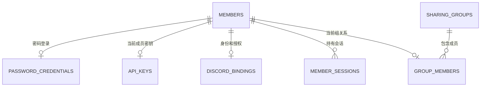
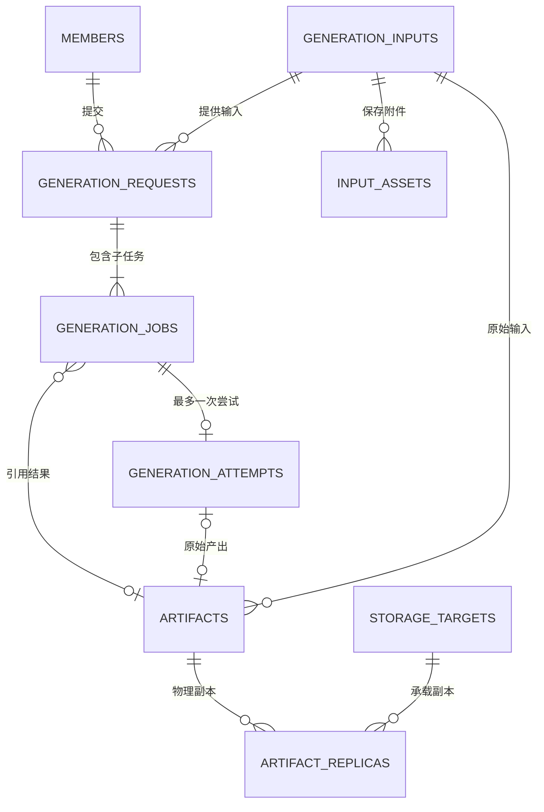
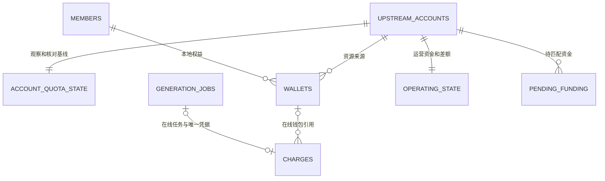
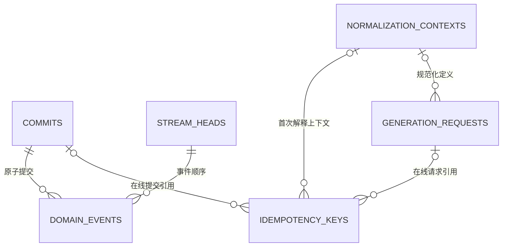

# 数据库与数据模型重构草案

更新日期：2026-11-14，Asia/Taipei。草案版本：0.15。原行为核对基线：`55e5826d80a39364b0946547a83e2a2ed2f72711`；实施基于 PR #33 的 `265793c`。初审和后续修复的历史基线保留在第 9 节；当前已合入主线为 `78887c9`，后续政策、共同回放、副本和报告正整合验证。

**状态：PR #39/#40/#43 和整合 PR #60 已按独立复审、CI 及维护者明确授权正常合入 main；#54–#58 的固定成果随 #60 完整包含。主线 `78887c9` 与受审候选 `27df31c` 同树，新增架构守卫已获维护者认可。后续整合仍须自身验证和审查；新库继续 building，现行网关尚未切换，生产未迁移。** 维护者已基本认可新模型方向；完整历史转换成本过高或无法可靠完成时，可以评估封存旧历史、从新开账基线开始。具体迁移路线依据副本试验选择，不把此授权解释为清零余额、删除原图、取消任务或抹去旧键防重。

**已确认的产品决定：D4a 卡密遗留功能、D4b 客户端自带官方 PST 的独立执行模式均淘汰；D8 仅保留为可选政策，具体留存期限后续决定。** 本轮记录决定，功能移除随重构实施；不设置新的自动归档或删除期限。

总跟踪：[#32](https://github.com/Hime-Hina/novelai-shared-gateway/issues/32)。[#30](https://github.com/Hime-Hina/novelai-shared-gateway/issues/30)、[#31](https://github.com/Hime-Hina/novelai-shared-gateway/issues/31) 保留问题证据与回归场景；它们原先的局部兼容瘦身边界不限制本次重构。后续目标规则以本草案及其评审修订为准，当前线上行为仍以已有契约和发布记录为准。

本文定义目标、实体、所有权、迁移选择和验收。API 逐字段行为、金额算法及归档 IO 协议继续由所属契约维护，实施时同步修改对应 owner，避免并行维护多套规范。

## 1. 目标与范围

采用一份业务事件历史、一套关系型当前状态和独立受保护输入。旧模型的解释与转换留在固定版本的离线迁移工具，新运行时只接受新格式。工作可以拆分评审，生产在同一候选版本完成一次格式切换。

**结构去重和模型迁移属于本轮必做范围，不属于暂缓的 D8。** D8 仅决定已有内容保留多久、何时退出在线查询或最终删除；暂缓 D8 不影响 T1-T7 的新模型、去重和一次迁移工作。

| 工作        | 具体含义                                                                                                          | 本轮范围                                         |
| ----------- | ----------------------------------------------------------------------------------------------------------------- | ------------------------------------------------ |
| 结构去重    | 同一输入正文只保存一份，任务/产物引用；同一当前状态采用唯一关系表示；移除无用途搜索正文、旧 ledger 和历史数组副本 | 必做，并验证读取、更新、重启和重放不会再生成副本 |
| 模型迁移    | 按 A 完整转换或 B 归档开账进入新 schema；稳定身份、权益、未决事项和防重按选定路线接续；旧解释器退出正常运行时     | 必做；路线与历史在线范围依据第 6 节确定          |
| D8 留存政策 | 例如将某类旧内容归档或在明确期限后删除，改变未来保留范围                                                          | 可选，后续决定；不新增期限或自动清理任务         |

“消除重复”针对职责重复的持久副本。例如一次带原图和蒙版的四图请求，保存一份输入、两份附件和四条小任务引用；结果产物各自保存。迁移需要证明字段语义相同：不同含义的提示词、不同请求意图不能仅因字符串/摘要相同就合并，真正不同的已知内容仍有明确去向。

事件保存历史决定、关系投影提供当前状态、独立备份用于恢复，各有必要职责。不能以去重为由把它们无条件合成一份或删除历史事实。迁移路线 B 封存历史属于单独明确的能力取舍，不当作无损结构去重的容量收益。

### 1.1 必须保留的需求

| 编号 | 需求                         | 数据模型要求                                       | 当前规则归属                                               |
| ---- | ---------------------------- | -------------------------------------------------- | ---------------------------------------------------------- |
| R01  | 稳定成员身份与私有访问       | 换 Key、改用户名、移除成员不改变历史归属           | `members/`、[成员会话](../architecture/member-sessions.md) |
| R02  | 密码、Discord、API Key、会话 | 凭据与业务状态隔离，撤销和过期持久生效             | `members/`                                                 |
| R03  | 分组、份额和停止接单         | 当前组关系和权重唯一；配置变更守恒且有版本         | `quota/fair-share.ts`                                      |
| R04  | 唯一执行器、当前单绑定账号   | 账号身份与凭据分离，冷却和派发占用明确             | [执行服务](../architecture/executor-service.md)            |
| R05  | 能力、只读报价、费用确认     | 共用规范化规则，受理保留首次授权                   | [成员生成契约](../contracts/member-generation-contract.md) |
| R06  | 生图、放大、Vibe 编码        | 共用持久生命周期，区分输入与产物类型               | `generation/`、`protocols/`                                |
| R07  | 批次、排队、取消和断线继续   | 父请求共享输入；子任务分别结算；取消不停止在途执行 | [请求生命周期](../architecture/request-lifecycle.md)       |
| R08  | 幂等与显式缓存               | 同键重放、不同意图冲突、活动合并和产物复用分别表达 | `generation/admission.ts`                                  |
| R09  | 三类资源账务                 | V5、订阅 Anlas、购买 Anlas 精确预扣、结算和退款    | `quota/`、`generation/accounting.ts`                       |
| R10  | 官方观察和运营核对           | 官方余额、本地权益和消费证据分开，未知保持未知     | [失败核对](../architecture/failure-accounting.md)          |
| R11  | 崩溃恢复、未知消费和迟到结果 | 不重复上游调用；迟到结果不改原退款、不复活余图     | [结果恢复](../architecture/result-recovery.md)             |
| R12  | 输入与结果恢复               | 规范化参数、实际种子、附件原字节、归属和摘要可验证 | 成员生成契约第 6 节                                        |
| R13  | Local/R2/PikPak              | 产物身份与副本位置分开，临时不可读不触发重生成     | `storage/`                                                 |
| R14  | 历史、统计和审计             | 清理展示不绕过收费、防重、免费窗口与批次授权       | `reports/`、现有查询 owner                                 |
| R15  | 备份、迁移与重放             | 事件、输入、凭据和产物形成明确恢复闭包             | [生产发布](../operations/production-release.md)            |

本次继续使用 SQLite 和单执行器。四组政策、单绑定来源及现有 Native/OpenAI/direct 成员入口保持默认范围；多车队、多执行器和多账号选路仍属于[后续扩展](scaling-follow-up-plan.md)。

### 1.2 删除目标

- 删除 `recordFields()`、通用 `app_records` 及同一实体的 `data JSON + 同义影子列` 模式。
- 删除 `event_streams.projection` 大状态 JSON；将状态迁至唯一关系投影。
- 删除 `request.jobs/state.jobs/jobs.data`、`job.request/requestPayload`、图片提示词多处正文副本。
- 删除事件内旧 ledger evidence 与独立 ledger 正文的重复表达；审计改读事件或必要的薄投影。
- 删除当前配置/账户状态中的历史数组、可直接计算的余额合计和重复成员关系。
- 删除 `user_token/image.token` 业务关联；所有权只用稳定身份。
- 删除无生产调用的旧搜索链、冗余提示词列及其索引，保留真实产品查询。
- 删除 `r2.pikpak` 嵌套模型，改为独立副本记录。
- 新运行时不再执行旧 inline、旧表、旧凭据关联或旧 reducer 的兼容分支。
- 按已确认的 D4 移除卡密业务及客户端自带官方 PST 的独立入口、队列和运行路径；历史数据通过迁移或归档处理。

独立业务功能的淘汰以第 8 节为准。结构清理不能自动授权删除还在使用的产品能力。

## 2. 数据所有权与写入规则

| 类别       | 内容                                                             | 权威与恢复边界                                                         |
| ---------- | ---------------------------------------------------------------- | ---------------------------------------------------------------------- |
| 业务事实   | 命令回执、已受理、派发授权、收费、退款、结果发布、政策及观察事件 | 追加事件；金额和历史决定不按当前算法重新计算                           |
| 受保护内容 | 规范化输入、附件、首次上下文、认证材料、必要诊断、产物字节       | 所属模块验证保存；事件仅保留引用和摘要，备份必须包含内容或可靠恢复来源 |
| 当前状态   | 成员业务状态、组关系、钱包、任务、尝试、收费凭据、产物及副本     | 事件在同一事务内更新，能够在新格式中重建                               |
| 瞬时状态   | 预览帧、HTTP waiter、SSE 连接、瞬时进度                          | 内存状态，不作为永久审计事实                                           |

稳定身份、秘密和业务状态的字段所有者须在物理 schema 中明确。凭据及会话不会因为重放业务事件而复活；需要同时提交的认证撤销和成员业务变更仍在同一存储事务完成。

命令统一校验当前授权、意图和相关版本，在一个 SQLite 事务内保存必要输入、回执、事件、关系状态及流版本。提交成功后才替换内存状态和通知。网络调用、产物上传和文件同步在事务外按既有准备/确认协议执行。

事件与当前状态之间允许必要重复：事件保存发生过的决定，状态表支持当前决策和查询。禁止多个可独立回写的完整对象副本。

## 3. 目标实体关系

下面是逻辑实体与基数；同名对象为同一实体。物理表可按独立生命周期、权限、查询需要合并，字段级 DDL 在 T1 固化。关系图不替代实际外键、唯一性和跨实体归属校验。

### 3.1 成员、认证与分组

| 实体                   | 核心字段和约束                                                                                                |
| ---------------------- | ------------------------------------------------------------------------------------------------------------- |
| `members`              | 稳定 ID、展示名、active/disabled/removed、accepting_jobs、auth_epoch、admission_epoch；业务状态与认证资料分离 |
| `password_credentials` | member_id 唯一、登录名、密码验证材料                                                                          |
| `api_keys`             | member_id 唯一、Key 摘要、按产品决定保存的可恢复秘密；当前不新增多 Key 管理功能                               |
| `discord_bindings`     | member_id、唯一 Discord 身份、授权材料、资格观察；网络失败不等于资格撤销                                      |
| `discord_invites`      | member_id、唯一邀请码摘要和到期；私有当前状态，不保存邀请码正文，不由业务回放恢复                             |
| `member_sessions`      | Token 摘要、member_id、auth_epoch、owner 绑定、固定期限                                                       |
| `sharing_groups`       | 稳定组 ID、名称、份额；当前四组作为政策约束                                                                   |
| `group_members`        | member_id 唯一、group_id、组内权重；全局有效份额计算得到                                                      |

移除成员撤销认证并执行已确认的权益转移，保留最小历史身份。转移余额不转移原请求和原图所有权。owner 继续采用现有部署配置与身份规则，本次不新增通用 RBAC。

### 3.2 输入、请求、执行与产物

| 实体                  | 目标内容                                                                                                                    |
| --------------------- | --------------------------------------------------------------------------------------------------------------------------- |
| `generation_inputs`   | 稳定 ID、member_id、schema_version、完整度、规范输入、摘要、逻辑大小；常用查询字段与模型参数 JSON 不存同义副本              |
| `input_assets`        | input_id、asset_id、MIME、原长度、SHA-256、BLOB，组合主键 `(input_id, asset_id)`                                            |
| `generation_requests` | 成员、input_id、context_id、来源、批次数、种子意图、费用授权、受理时间；不保存 child 数组                                   |
| `generation_jobs`     | request_id、sample_index、实际种子、状态、队列序号、期限、结果引用、必要成功/保留事实；不保存完整输入或 charge/attempt 对象 |
| `generation_attempts` | job_id 唯一、account_id、凭据代次、派发和实际响应证据、核对状态；有授权不等于已发送                                         |
| `artifacts`           | 所有者、原始 input_id、可空原始 attempt_id、内容摘要/长度/MIME、类型、发布和退休状态；包含图片和编码结果                    |
| `artifact_replicas`   | artifact_id、storage_target_id、对象定位、编码方式、上传确认、内容核验、删除与故障状态                                      |
| `storage_targets`     | Local/R2/PikPak、固定桶/目录/命名空间身份；认证配置独立引用                                                                 |

缓存命中可用小型任务引用已有产物，不产生新尝试。活动任务合并可让不同幂等键指向同一请求。产物的原始输入和尝试不随复用者变化。已发布内容丢失时保留身份和不可用状态，不把旧键变成新生成机会。

历史产物可以没有可证实的原始尝试。只存已知输入的 partial/unavailable 状态，不补造调用。旧 inline job 的目标请求容器映射必须明确记录来源，保留原 job ID 和原回执；无法确定归属的记录进入迁移冲突清单，不能猜当前 owner。

### 3.3 账务与上游状态

| 实体                                         | 目标内容                                                                                                                                                                      |
| -------------------------------------------- | ----------------------------------------------------------------------------------------------------------------------------------------------------------------------------- |
| `upstream_accounts` / `upstream_credentials` | 稳定账号、状态和凭据代次；PST 独立保护，轮换不新建一份余额来源                                                                                                                |
| `sharing_policy`                             | 当前绑定账号、配置版本、免费和 fallback 等政策                                                                                                                                |
| `wallets`                                    | `(account_id, member_id)` 唯一；三类资源可用额，不另存 Anlas 合计                                                                                                             |
| `charges`                                    | 原 job 标识唯一、原成员/账号归属、可空在线 job/wallet/attempt 引用、原资源金额、reserved/settled/refunded、原事件和时间；活动收费必须有在线任务和钱包，历史终态凭据可独立保留 |
| `account_quota_state`                        | 最新采用观察、恢复游标、待匹配扣款、续用债务、未分配额；不保存观察历史数组                                                                                                    |
| `operating_state`                            | 运营可用、未承担缺口、未归属返回、V5 容量差额和关联事实                                                                                                                       |
| `pending_funding`                            | 唯一业务收据、来源/归属、剩余待匹配金额和观察引用                                                                                                                             |

沿用三种明确资源，不新增任意资源 EAV 或通用复式总账。金额沿用 12 位定点 BigInt 算术及规范十进制 TEXT；不经 REAL/SUM(TEXT) 批准余额。缩放整数若采用 SQLite 64 位存储，须另行批准金额范围并检查累计量，不能默默缩小既有范围。

原预扣只能结算或按原资源退款一次。退款后找回产物保留失败与退款。官方余额、成员权益、互斥消费候选和实际消费证据分别表达，未知保持 NULL；不重算历史报价或把聚合缺口归因到单次任务。

每次明确更换上游凭据增加 credential_epoch，观察以账号、代次和请求发起序列排序。旧代次成功/失败均不能覆盖新代次，A→B→A 也不能复活旧 A 的迟到响应。失败不清空钱包，也不使旧快照无限有效。

轻量 job 核心保留免费成功时间和当时告警事实时，可合并独立免费次数投影。计数包含退款后找回的完整免费结果；若仍允许物理删除核心 job，就必须另保留相应成功凭据。历史清理不得重置滚动限额。

#### 3.3.1 观察与恢复的来源契约

以下是新格式 T4 必须满足的业务关系，实施状态见第 7.3 节。观察、恢复与分配算法仍归原 quota owner；关系存储负责保留其决定的身份、来源和事务边界。复用算法不允许在转换时用时间或 DTO fallback 猜测事件身份。

每次命令区分两种角色：**原基线**是命令开始时的 `baselineEventId`；**核对观察**是本次参与核对的有效观察，可以来自新查询，也可以是先前已保存的最新观察。事件 ID 确定身份，账号/凭据代次/发起序列决定观察是否仍有效，时间只用于有效期、恢复窗口及基线推进条件；时间相同不表示同一观察。

| 事实                                             | 来源角色与允许的状态变化                                                                                            |
| ------------------------------------------------ | ------------------------------------------------------------------------------------------------------------------- |
| `QuotaObserved`                                  | 当前账号/凭据代次下仍有效的查询结果更新最新观察；保存最新观察本身不等于采纳金融基线或增加钱包                       |
| `QuotaBaselineAdopted`                           | 引用核对观察；原 owner 的在途、结算时间、有效余额及时间推进条件成立后才替换基线，不能因序号较新便跳过这些条件       |
| `RefillApplied`                                  | 引用原基线，`from` 等于原恢复游标，`until` 不倒退且不越过原基线的有效恢复窗口；同提交若采纳新基线，原基线恢复先完成 |
| `ResourceGapObserved`                            | `beforeObservationEventId` 引用原基线，`afterObservationEventId` 引用核对观察，不按时间相等交换两者                 |
| `V5CapacityObserved` 与观察型 `ReturnClassified` | 引用核对观察；人工差额纠正引用其核对的既有基线与原差额事实，不能套用新入站观察身份                                  |
| 登记资金到账的 `FundingReceived`                 | 引用用于匹配到账的核对观察及原登记收据，保持原账号、资源和归属；部分到账只消耗原收据剩余额度                        |

`RefillApplied` 的预算、偿债、容量恢复和成员分配保存原 owner 的决定，回放验证来源、原游标、资源与金额关系，不重新运行当前政策。适配接口若只有时间而不足以确定来源，应从命令上下文显式传递角色对应的事件 ID；不能为所有事实统一设置“旧观察优先”或“新观察优先”。同时间、不同有效序号的新观察应能保存，基线是否推进仍按原条件决定（[#44](https://github.com/Hime-Hina/novelai-shared-gateway/issues/44)）。

#### 3.3.2 分配预算与有限来源消费

`AllocationApplied.sourceEventId` 必须说明分配的实际来源。`sourceResources` 如保留，是原决定的可核对预算；对已有明确金额的有限来源，它不能成为另一份独立权威。不能仅证明“分配总额不超过分配自己填写的预算”。当前直接有限来源的契约如下：

| 直接来源          | 允许用途与权威预算                                                                           |
| ----------------- | -------------------------------------------------------------------------------------------- |
| `FundingReceived` | `destination` 必须为 `members`，只允许原 `resource`；来源预算取保存的 `amount`，其他资源为零 |
| `DebitsConfirmed` | 只允许原 `resource`；成员预算取 `allocatedToMembers`，不能用确认扣款总额 `amount` 代替       |

对这两类直接来源，分配的自报预算须与来源预算相符，成员分配总额不得超过该预算；来源与分配在同一完整提交内，来源必须在前。当前每个直接来源最多关联一个成员分配列表，无分配时允许没有 `AllocationApplied`。同提交第二次绑定与新提交再次消费均拒绝；原完整提交重放则沿命令幂等路径返回，不再次增加钱包。实现可使用本次完整提交内的来源集合与事件顺序，不新增持久消费计数或另一套账本（[#45](https://github.com/Hime-Hina/novelai-shared-gateway/issues/45)）。

观察、开账与登记资金匹配需要保持各自语义，不能无差别套用上述“一来源一分配”规则：

- 初始观察开账只能在没有原基线、现有钱包权益、预扣、运营资产或未决义务时分配，保留原 owner 的未分配额/容量规则；同一观察可以分别产生三池分配。
- 常规观察的分配预算是原 owner 根据原基线与核对观察的差额，匹配待核对扣款、fallback、登记资金和待归属返回后决定的成员净额；不能把官方观察的全余额当成可再次发放的额度。
- 观察型分配必须属于同一完整提交中同账户、针对该核对观察的一次有效 `QuotaBaselineAdopted`，不能仅检查存在同名事实。核对观察本身可以在先前提交保存；分配可以先于或后于采纳事实，保持原 owner 的事件顺序。采纳继续验证第 3.3.1 节的状态与基线推进条件，因此新提交不能再次采纳并消费已经采纳的同一观察。
- 同一核对中，同一观察、同一非零预算资源只能应用一份分配决定；同时覆盖该资源的两个 `AllocationApplied` 必须拒绝，即使两者金额完全一致且都在自报预算内。按资源判断，允许首次开账同观察的三池各分配一次；没有分配时不要求生成分配事实。使用本次完整提交内的观察/资源集合即可，无需新持久状态。只检查采纳存在而不检查资源重复，或只对两类直接来源检查消费，都不足以满足此约束。
- 登记到账的 `FundingReceived` 可能只是观察或扣款确认预算的组成凭据。已计入该预算的到账不能再作为独立成员分配来源二次发放。转换必须保留“直接分配”与“参与净额计算”的角色，不能简单取最后出现的资金事件作为来源。
- `OpeningQuotaRecorded` 表达已核对的迁移开账状态，不能因其是允许的事件类型便再次发放同一权益。其与钱包开账的关系，以及未来 `redistribution` 的来源/消费边界，在对应 T4 政策或 T7 契约中先明确再接入；本节不宣称这些路径已验收。

观察型一次消费只约束 `AllocationApplied`；`RefillApplied` 仍按原基线与恢复游标分段推进。消费次数与生命周期校验不等于重新证明任意修改后的观察净额，不能据此宣称完整业务 reducer 已验收；原 owner 的预算决定与其余关系校验继续保留。

完整提交校验和业务关系校验分别执行：两份事件列表一致、数量正确，不足以证明分配合法。所有已支持来源都须明确其消费身份和有效生命周期；改成引用观察不能绕过消费约束。在线事务与回放必须在同一所属投影入口保留上述来源检查；失败被外层捕获时，事件、回执、流头、投影游标、钱包和运营状态均不得留下部分变化。原完整提交的幂等回放仍提前返回，不能与新提交再次消费旧来源混为一谈。

#### 3.3.3 上游账户与凭据命令

本节是 [#47 第一片](https://github.com/Hime-Hina/novelai-shared-gateway/issues/47) 的接入契约，实施边界见第 9.13 节。账户配置规则归 `members/owner-operations.ts`；当前仍在 `gateway-runtime.ts` 的注册与 `applyAccountConfiguration()` 按需要归回该 owner，关系存储负责原子保存。资格复用 `quota/eligibility.ts`，查询复用 `quota/account-refresh.ts` 和既有关系观察入口，物理占用继续由 `generation/queue-dispatch.ts` 的执行控制持有，不新增账户或凭据副本。

| 命令          | 权威来源、前置条件与允许变化                                                                                                                                                                                                                                                                                                                                                 |
| ------------- | ---------------------------------------------------------------------------------------------------------------------------------------------------------------------------------------------------------------------------------------------------------------------------------------------------------------------------------------------------------------------------- |
| 注册/首次绑定 | 账户 ID 是资源来源身份，PST 仅是该账户当前凭据。新注册账户保持暂停、代次从 1 开始；不能沿用旧管理员注册默认启用的行为跳过核验。首次绑定使用明确的唯一账户和当前配置版本，账户、初始空额度/运营状态及绑定事实同笔提交；绑定不等于通过 Opus 资格，不凭注册时的未知余额开账。已有绑定不能通过重复注册替换，本片不扩展任意换绑或多账号调度。                                     |
| 暂停          | 对当前绑定账户保存 `AvailabilityChanged(enabled=false)`，阻止新派发；不终止物理在途，不退款、不清空钱包、不重置冷却，也不撤销已受理批次的原授权。                                                                                                                                                                                                                            |
| 轮换凭据      | 事务内核对原账户、当前代次及实际私有 PST。真正更换凭据前，同时确认物理占用为零且不存在该账户的在途预扣；逻辑退款或任务终态不能代替物理释放。保存私有 PST、`CredentialRotated(beforeEpoch, credentialEpoch=beforeEpoch+1)` 及暂停事实；相同 PST 的重复设置不制造新代次。代次不同的旧观察不能批准启用、派发、恢复或修改新代次冷却，原钱包及未决责任仍保留。                    |
| 验证启用      | 先用当前账户、实际 PST、`credential_epoch` 和发起序列取得查询票据，在写事务外查询；保存观察和启用时重新核对当前授权、绑定及配置版本、查询前的账户可用性事实、实际 PST/代次和最新有效观察。仅接受本次仍有效的已保存 Opus 成功观察，沿用原资格和订阅期限判断；被忽略、旧代次或等待期间被新观察取代的结果不能启用；失败观察及原禁用决定仍须保存，派发受当前资格和错误状态约束。 |

操作人身份不由命令体或 `metadata.actorId` 自证。成员入口先复用现有认证事务，在同一事务内复查当前成员状态、认证 epoch、Key/Cookie 和 owner 绑定，再以当前部署 `OWNER_USER_ID` 判定 owner；管理员入口保留现有本地管理员信任边界。原回执重领同样先做当前授权，不能让已撤销会话、旧 Key 或已失去 owner 身份者凭旧命令键取得成功回执。网络等待前的授权快照不足以批准落库。

命令键和规范化意图共同决定幂等；同键同意图返回原安全回执，不再查询上游、轮换代次或重新启用，不同意图冲突。PST 只进入 `upstream_credentials` 和事务外查询所需的易失票据，不进入业务事件、回执或日志；凭据命令仍须保留同键不同意图冲突，不能通过忽略 PST 输入让不同轮换意图视为同一命令。事务异常或前置条件拒绝且被外层捕获时，私有凭据、账户状态、绑定、事实、回执、流头和投影游标全部回滚。核验取得无效 Opus、封禁或查询失败是需要保存的业务结果：原观察、原禁用/资格决定和安全失败回执同笔提交，认证事务完成后再向 HTTP 报错；重领仍先鉴权并返回同一失败，不重新查询。

启用依据必须可回放核对，不能只保存 `reason` 或比较 PST 字符串。`AvailabilityChanged` 使用可空 `observationEventId`：验证启用为所用 `QuotaObserved` 的原 ID，暂停和其他禁用为 NULL。启用投影核对该事实确属当前账户/代次、最新成功观察，并按事实时点验证 Opus 资格；不发起新查询、不采纳另一张同时间观察，也不重新计算金融分配。每个命令的账户、绑定、代次及可用性事实在同一完整提交中依原顺序应用一次，复用共同提交原语；不能过滤后分头回放同一个 commit。业务回放只恢复账户/代次和业务状态，不恢复 PST；缺少匹配当前私有快照时仍不能派发或通过完整恢复验收。

可用性票据引用原账户流中最新的注册、开账、凭据轮换或 `AvailabilityChanged` 事实 ID；按 `stream_version` 判先后，不用时间或启用布尔值代替身份。`upstream_accounts.source_event_id` 也会被冷却更新，不能将它当作可用性代次；核验期间任务正常结算不使查询失效。官方非空且不可解析的订阅期限在共同 `accountQuotaResult()` 边界作为查询失败处理，不能转换为表示无期限的 NULL；普通观察、启用和后续恢复都受同一错误资格约束。合法空期限与合法日期维持原 owner 语义；数值 `0` 规范化为无期限 NULL，字符串 `'0'` 仍为已过期的时间。

验收沿用 `owner-management`、`relational-members`、`relational-generation` 和 `relational-quota` 的真实事务入口，至少覆盖：当前 owner 撤销后重领拒绝；同键重领零查询/零写入与不同意图冲突；凭据 A→B→A 后旧 A 的成功/失败和旧尝试均无效；查询中暂停/轮换或更新观察后旧核验不能启用；只有物理占用、只有预扣以及退款但物理未结束时均拒绝轮换；SQL 故障和外层捕获后全表及私有状态不变。合法首次核验、暂停、轮换后重新核验继续通过，在线与原完整提交回放的业务状态和安全回执一致，PST 始终不进入 replay。

### 3.4 命令、事件与幂等

`commits` 保存内部 command 身份、提交序列、指纹、操作者和原安全回执。生成键保存 `(member_id, operation, key_hash)`、意图指纹和原请求/提交引用；两种指纹不可混用。当前授权先于领取旧回执，新受理资格不阻止合法领取旧结果。

图中的可空在线关联用于已归档或内容已删除的凭据：原 request/job/command 标识、原安全回执或其新格式引用、来源和 live/archived/unavailable 解析状态独立保留，不要求原在线行仍存在。新受理必须关联完整在线请求/提交，活动收费必须关联可恢复的在线任务和钱包；历史终态薄凭据可保留原身份并将在线外键置空。原标识与在线 FK 在 T1 分别定义，唯一防重仍按原业务身份，不伪造历史请求、输入或尝试，也不关闭外键绕过检查。

`domain_events` 只表达一份最小事实，不内嵌完整请求、当前账户或旧 ledger DTO。`stream_heads` 只保留 kind/version/cursor。`projection_state` 标记版本、完整提交位置和构建状态，未完成重建不能标为 ready。

`normalization_contexts` 按不可变内容复用实际首次定义，不复制整个 settings 或成员秘密。随机意图与首次实际 seed 分开，输入摘要、幂等指纹、缓存键各司其职。没有历史上下文时明确不可证明，不能用当前 defaults 冒充。

## 4. 输入附件与正文去重

### 4.1 输入附件是什么

输入附件是一次请求带给模型处理的二进制内容：图生图/重绘的源图、局部重绘蒙版、风格或角色参考图、放大所需源图，以及接口支持的参考编码数据。纯文字提示词、负面词和参数属于输入字段；生成出来的图片或 Vibe 编码结果属于 artifact。一个结果以后作为新请求输入时，在那个请求中承担附件角色。

是否为附件取决于业务内容，不取决于 HTTP 上传格式。JSON 内的 Base64 图片和 multipart 文件经规范化后应指向相同附件语义；普通纯文生图可以完全没有附件。

成员输入恢复契约只要求规范化输入、实际首次种子、批次数与附件，不要求逐字保存原 HTTP 正文或编辑器草稿。规范输入保存一种权威表示，协议适配器在边界构造出站字段。

### 4.2 规范输入与附件保存

- 消除已证明同义的 `tag/prompt/fullPrompt` 和顶层参数/`nativeParameters` 复制；实际不同的主体、画师前缀、负向词、多角色 caption 等语义继续表达。
- 展示文本与执行文本相同则不另存；确实不同且产品需要时保留明确可选字段。旧图文本不同于关联 parent 时迁移独立输入，不能覆盖。
- 缺失、NULL、空串仅在契约证明同义时合并。新请求要求完整输入，partial/unavailable 只支持诚实的查询与不可恢复说明，不能进入派发。
- 附件使用 BLOB；同一输入内按长度、摘要和实际字节相等复用。不做跨成员/跨请求全局 blob 去重，也不新增素材库产品。
- body 中的附件槽位只保存 asset 引用；写入验证引用属于同 input、存在、长度和摘要一致，无未引用附件。复用现有槽位白名单，不新增任意路径 DSL。
- 输入、附件、受理事实同事务保存；执行时才生成协议需要的 Base64。列表、排队和 SSE 状态读取不加载附件。
- 读取为“当前授权 → 原请求 → 白名单槽位 → 所属附件”，不能凭摘要或 asset ID 全局取内容。
- 分别计算磁盘字节、协议展开字节和活动输入预算；不能把更小 BLOB 字节直接当作原有载荷上限口径。

首版将输入附件保存在 SQLite，维持受理事务和一致性备份的简单边界。大型结果继续外部副本。未来是否外移输入由独立容量证据决定，不能把移动位置当作总存储减少。

## 5. 产物、存储与留存

### 5.1 副本状态

产物的摘要/原长度/归属保持稳定，Local/R2/PikPak 分别保存副本。桶或目录有稳定身份，更换凭据不等于更换数据来源。配置临时缺失或目录不符时允许原回执与合法缓存引用，读取按现有不可用语义失败，不重新生成。

上传确认、内容回读核验和源删除分别命名。当前 Local→R2 回读核验后删本地，R2→PikPak 在上传回执持久化后删 R2、领取时校验内容；本次不默默把确认上传宣称为内容已验证。若要求 PikPak 回读后才删 R2，作为增强政策单独评审和测量带宽。

### 5.2 D8：可选留存期限，不包含结构去重

D8 已确认为可选留存政策，区分三个动作：缩短在线查询窗口、将历史归档、最终删除内容。**具体期限后续决定，本轮不实施新的保留天数、自动归档或删除规则，保留现有输入、原图及账务可用性。** D8 的具体政策不作为本次模型重构完成的前置条件，也不恢复已取消的单份/总量备份硬容量限制。第 6 节的一次性历史归档开账路线独立评估，不等同于开启日常到期清理。

| 数据                                       | 本次默认                 | 未来调整前必须满足                                                         |
| ------------------------------------------ | ------------------------ | -------------------------------------------------------------------------- |
| 当前钱包、预扣、未决核对、待匹配资金、冷却 | 完整保留                 | 只能由业务事件合法结案或转移，不能按年龄删                                 |
| 幂等、防重复收费、免费窗口证据             | 保留必要核心             | 删除展示历史不得使旧键重执行、重复退款或重置限额                           |
| 已完成历史展示和可重建索引                 | 结构去重；不设新期限     | 在线窗口缩短/归档应明确页面覆盖范围，不能误报为全量历史                    |
| 输入附件和规范化参数                       | 保留                     | 若以后独立到期，要定义参数复用/补查失效和 GET 的不可用语义；不连带删除结果 |
| 原图和其他产物                             | 保留，沿现有冷热规则流转 | 如最终删除，先记录不可用事实并核验请求、旧快照和归档引用；原键不得重新生成 |
| 诊断和临时文件                             | 不新增期限               | 在途恢复、未决核对、审计依赖解除后才可依明确规则清理                       |
| 已过期/撤销会话及短期认证材料              | 沿认证生命周期处理       | 不能删除仍有效凭据，也不能由重放恢复撤销令牌                               |
| 迁移源与历史归档                           | 独立保护                 | 不放进日常轮换前缀；最终删除须有明确决定和剩余恢复证明                     |

当前日常数据库备份仍按最近七份轮换；已去掉的是旧 50 MiB 单份/500 MB 总量硬限制。生产 R2 七天后转 PikPak 描述热层停留时间，原图仍在冷层。以上都不同于“旧数据七天后永久删除”，本草案不改变这些现行规则。

若后续选择具体期限，先做只读清理清单和依赖检查，再审批范围，分批执行并留下删除事实。受保护内容有意删除后，恢复必须识别已删除标记，不能伪造内容或把预期不可用当成功。尚未完成的业务对象不得被年龄规则清理。

## 6. 一次迁移的两条路线

### 6.1 共同前置条件

1. 先在同规模一致性副本输出实体计数、正文大小、账务核对、归属/摘要冲突和预计资源消耗。只上传聚合报告，不上传真实提示词、图片或秘密。
2. 固定源提交切点、源库及必要文件/对象清单、转换器版本和 manifest。源库保持只读；若旧工具必须升级副本，另建工作副本，保留原始证据。
3. 迁移器负责历史解释；新运行时只有新契约。当前 SQL/journal 历史字节不改写，新格式初始化与版本拒绝边界单独设计；如需调整 guard/打包规则，独立评审。
4. 新 writer 拒绝旧/未完成目标，旧 writer 拒绝新库。迁移失败不能留下看似 ready 的半库。
5. 保留原业务 ID、原安全回执、已知时间、NULL 与未知。旧原文/hash 和新规范内容/hash 分别校验并建立来源映射。
6. 先停止新受理和新派发，等待并恢复在途、存储发布和归档工作；queued/pending 及仍未决记录要保留或经明确业务命令结案。原工具停止写入后才能固定最终切点。
7. 迁移期间不发 NAI 请求。切换后有新增写入或外部存储变化时，不能用旧快照覆盖账本回退。

### 6.2 路线 A：完整历史转换

旧一致性源经离线转换器形成新受保护输入、新事件契约和关系状态。保留旧逻辑提交边界、相对顺序、命令回执及可证实决策；旧事件到新事实允许明确的一对多映射。旧事件原文留在源归档，不再复制到在线 payload。

新库从转换后的 opening 和完整新事件重建。原本只有开账快照的时期仍是 opening，不补造逐笔历史；承诺范围限于原系统已有证据支持的历史范围。重放只应用保存的金额和决定，不调用当前报价、时间、网络。

输入、事件或所有权冲突不能挑一份覆盖。若某类历史无法证明转换，报告其数量、涉及权益/接口及处理选择，不无限追加在线兼容分支。

### 6.3 路线 B：封存旧历史，以新格式重新开账

维护者允许在 A 很难或无法可靠完成时考虑 B。B 将“全历史逐条转换”收敛为“核对切点仍生效的状态与凭据”。可用权益、未决责任和防重继续存在，新事件历史从明确新基线开始。

#### 必须带入新基线的内容

| 内容             | 要求                                                                                                                      |
| ---------------- | ------------------------------------------------------------------------------------------------------------------------- |
| 身份、账号、配置 | 稳定成员/账号、有效认证策略、分组和版本；已移除成员的必要历史身份                                                         |
| 钱包与资源核对   | 三资源余额、预扣、待匹配消费、债务、未分配额、运营差额、未归属返回和资金收据                                              |
| 观察与调度       | 原观察时间/有效性、凭据代次、恢复/结算游标、fallback 缓冲、冷却截止/失败计数和排队顺序；迁移不得刷新旧观察时间            |
| 活动与未决任务   | queued/pending、真实在途/未知结果、resultPending、核对截止、原批次授权和完整 child 费用证据；相关输入/附件/上下文必须可用 |
| 防重             | 旧生成键、内部管理/资金收据等必要命令回执、终态收费和退款凭据；不得因新库重建而重复执行                                   |
| 免费限制         | 切点仍影响滚动窗口的成功时间、迟到成功、在途占用及告警事实；不能只迁移一个累计数                                          |
| 结果与在线历史   | 按选定查询范围迁入小型结果/所有权/存储引用或明确的历史不可用凭据，不能把缺失当成可重生成                                  |
| 未决历史关联     | 当前核销、差额、资金登记等所引用的原事实，或经核验的新开账等价记录；新库内必须能够解析                                    |

上述基线保存为**有来源的新格式 opening facts**，可分页/分提交导入，但只有整体校验完成才安装为 ready。只把值写进当前表、不给新重放提供基线，不算完成 B。新基线和切点后事件连同新受保护内容应足以恢复新服务，无需常态运行旧 reducer。

#### 旧历史的查询边界

B 的具体选择报告必须列明：历史列表/热力图/损耗审计、旧请求查询、旧结果领取、输入复用各自仍在线、仅归档可查，或明确不可用。默认尽量保留原结果领取和小型索引；确需缩小功能范围时，将具体接口影响提交维护者决定。

迁入的历史摘要也要有可重建来源。不能导入一张不受 opening/事件覆盖的“历史查询表”，然后声称全库可重放。只保存在归档中的历史不得让新界面静默显示为完整零历史。

#### 原归档必须独立可用

- 保存旧一致性数据库、受保护输入/上下文/回执、必要配置与解密材料，以及固定版本只读审计/导出工具和 manifest。
- 当前数据库备份包不包含原图；必须同时保存匹配产物副本或经过验证的对象清单、原摘要、定位和访问恢复材料。旧数据库单文件不是完整归档。
- 归档脱离日常七份轮换。只被归档引用的 Local/R2/PikPak 对象仍受保留保护，新后台不能把它们当孤儿删除；目录和凭据变更要同步验证归档可读性。
- 如归档沿用可变外部存储，必须把这些对象及其生命周期纳入恢复闭包；仅保存一个可能失效的 URL 不构成归档。
- 旧审计工具离线/只读使用，不接上游、不启动派发、不成为新服务的长期查询 fallback。

B 承诺从新开账点重放；更早逐时点状态由原归档审计。新服务恢复与历史归档恢复分别验收。

### 6.4 路线选择与旧键

先用代表性副本评估 A 的可证明性、运行时间、峰值内存/磁盘和未能转换的类别。若历史只能依赖缺失信息、或者成本和风险不合适，可以选择 B；不为维持 A 引入永久旧解释器。选择报告附保留清单、接口变化、归档恢复演练和截止点，由维护者据此确定切换方案。

两条路线都不能只复制旧 fingerprint 就宣称旧 POST 完全可重放。可以证明的新旧意图转换继续精确比较；无法证明时保留旧键禁止再次执行，并明确返回原查询入口和冲突/不可重放语义。已有结果确实缺失仍返回既有不可用语义。错误码与接口变化在实施契约评审中确定，本草案不擅自更改生产返回值。

幂等证据有意保留为薄记录；它不要求保留一套旧运行模型。不能通过清空键空间、轮换成员 Key 或新建所有成员 ID 来绕过旧请求防重。

## 7. 数据约束、查询与验收

### 7.1 结构性约束

- 唯一 `(member_id, operation, key_hash)`、`(request_id, sample_index)`、attempt.job_id、charge.job_id、`(stream_id, stream_version)`、`(commit_seq, event_index)`。
- 私有输入/请求/产物关联验证稳定成员一致；困难历史关系进入转换报告，不通过空值默认或 token fallback 掩盖。
- 任务、尝试、收费、账户当前行不包含完整 request/charge/attempt/children/history JSON。
- 金额运算集中于既有核心，事件、当前状态和 DTO 的转换边界清楚。
- 关系状态仅由命令事务和重放器写入；外部读模块不能通用更新整个 store，DTO 不能回写成实体。
- 引用完整性、输入长度/摘要和权限在唯一所属模块验证；数据库和类型检查共同覆盖必需边界。
- 新表索引来自成员历史、父子任务、队列、在途收费、待核对和产物读取的实际查询。先测量再新增汇总缓存或全文搜索。
- 注释解释事实来源、事务先后、重试、金额单位和恢复边界；格式继续用现有 Prettier/EditorConfig，不改历史 SQL。

### 7.2 验收矩阵

| 验收           | 必须证明                                                                                     |
| -------------- | -------------------------------------------------------------------------------------------- |
| E01 身份和授权 | 换 Key、暂停、停用、移除、Discord 临时失败、跨成员访问正确                                   |
| E02 受理/幂等  | 并发同键、丢回执、重启、默认变更、不同意图、旧键受限分支均不重复生成                         |
| E03 资金       | 逐来源/逐资源钱包、预扣、终态、运营资金、未知消费一致；无宽泛 epsilon                        |
| E04 输入       | 出站参数语义、实际 seed、原附件字节和摘要一致；空/缺失/不同提示词不被覆盖                    |
| E05 恢复       | 结果准备、文件同步、发布、退款、迟到结果各崩溃窗口仍正确                                     |
| E06 存储       | Local/R2/PikPak 原字节、目录身份、确认/核验差别、临时缺配置、归档引用保护                    |
| E07 重放       | 新空库从选定 A 历史或 B 基线重建；所有承诺的业务状态及历史摘要一致                           |
| E08 不再膨胀   | 受理、查询冷输入、更新、重启、迁移及 replay 后，正文不回填任务/产物/流状态                   |
| E09 查询       | 当前历史/统计/搜索/错误详情有正确覆盖范围；清理不重置免费窗口或批次费用                      |
| E10 容量与性能 | 逻辑内容、表/索引页、WAL、输入 BLOB、压缩备份、归档总量、迁移/恢复峰值和关键查询耗时分别测量 |
| E11 切换       | 源只读、最终切点、旧 writer 拒绝、失败目标不可上线、新写入后的回退边界                       |

生产容量数据目前来自维护者报告，未在本设计工作中读取生产明细。不得把重复内容字节直接当文件释放量，也不得把外移归档当总存储消失。专项反例应能识别错误实现，再运行仓库已有完整验证和真实产物恢复门禁。

E02/E03/E07 必须包含“原目标行已缺失，仅剩旧键或终态退款凭据”的开账反例：B 仍能完成基线并阻止重复执行/扣退，不要求重新加载旧模型、伪造在线实体或关闭外键。

### 7.3 跨对象语义与反例验收

非平凡改动按 [CONTRIBUTING 的业务约束与验收](../../CONTRIBUTING.md#业务约束与验收)执行。只补本次受影响的契约，不复制业务算法或另建规范。设计先明确权威来源、允许变化和失败条件；实现将关系检查落到原 owner/投影入口；独立审查从这些约束构造不同于普通成功夹具的反例。

| 验收关系                                 | 最小反例与合法对照                                                                                                                                           | 所属入口及状态                                                                               |
| ---------------------------------------- | ------------------------------------------------------------------------------------------------------------------------------------------------------------ | -------------------------------------------------------------------------------------------- |
| 入口合法范围不被统一存储收窄             | direct/OpenAI 合法但 Native 不支持的参数可冷读还原；Native 原限制继续生效                                                                                    | 输入 owner；`relational-input.test.mjs`，#34 已修复                                          |
| 私有认证与具体凭据方式分离               | 纯 Key 注册即能认证；两个无密码同名成员都能 OAuth；业务回放仍不恢复私有认证                                                                                  | 成员 owner；`relational-members.test.mjs`，#41/#42 已修复                                    |
| 事件身份不由时间推断                     | 同时间、不同有效序号的观察成功保存；恢复仍引用原基线，游标只推进一次；不同时间及失效代次保持原行为                                                           | `RelationalQuotaStore`；`relational-quota.test.mjs`，`7025582` 复审通过 #44，待合并          |
| 直接有限来源的用途、资源、额度与一次消费 | 跨池、运营来源分给成员、同时抬高自报预算与分配额、同提交重复绑定、新提交再次消费旧来源均拒绝；合法分配和原提交重放通过                                       | 同一额度投影入口；`relational-quota.test.mjs`，`7025582` 的 #45 直接来源子集复审通过         |
| 观察型分配属于一次采纳且同资源不重复     | 原分配原样放入新提交、同一合法采纳提交内复制同池分配均拒绝；分配后采纳失败且被外层捕获仍整库不变；初始三池、先前观察、正常先分配后采纳及原提交重复零写入通过 | 同一额度投影入口；`c786f8f` 正式回归及独立原始反例通过，#45 待合入后关闭                     |
| 聚合来源保留原组成关系                   | 多收据及部分到账、两种资金归属、初始三池分配、已保存观察参与核对保持原 owner 结果；到账既计入观察/确认预算又被单独发放时拒绝                                 | 同一 quota owner；`7025582` 的上述合法/非法对照复审通过，不能替代观察型消费检查              |
| 提交完整、业务有效与失败原子性分别成立   | 两份事件列表同步修改仍须校验独立来源；被外层捕获后全表不变；合法完整提交、断点续跑和重复零写入通过                                                           | `relational-events.test.mjs` 与对应 owner 集成测试；#36 仅证明提交完整性，不替代业务关系验证 |

修复须保留同一个反例在受审旧候选失败、修复后通过的证据，并检查共同错误假设的其他表现；不以增加成功用例数量代替来源/身份断言。时间相关用例使用可控时间，失败检查使用真实事务与相关完整状态；无需真实上游、生产库或新增测试框架。

本节保留 `39d3c4b` 的[初审记录](https://github.com/Hime-Hina/novelai-shared-gateway/pull/43#pullrequestreview-5885655449)，当前状态固定到 `c786f8f` 的[独立复审](https://github.com/Hime-Hina/novelai-shared-gateway/pull/43#pullrequestreview-5893340570)。原 0.12 仅细化直接有限来源的消费规则，遗漏了观察型分配与采纳的生命周期；0.13 已补正规范，`c786f8f` 已完成相应实现，不将原规范缺项归为实现者违反既有细则。独立验证的四文件 193/193 通过，原始两个反例均被拒绝；同一额度测试在 `7025582` 上的六个重复消费子例失败、两个采纳失败/回滚对照通过，含父测试统计为 10 项中 2 通过、8 失败。[CI #156](https://github.com/Hime-Hina/novelai-shared-gateway/actions/runs/43441705229) 六个 job 成功，合并预览与候选源码 tree 一致。具体回滚、合法对照及命令证据见 [#45 复审](https://github.com/Hime-Hina/novelai-shared-gateway/issues/45#issuecomment-6856824857)。issues 待代码合入后关闭。T1 结构/提交原语通过、某个 T4 业务子集通过、T7 完整恢复通过及 T8 生产切换通过必须分别报告；CI 全绿不能替代未定义或未覆盖的业务关系。

## 8. 决策记录与 D4/D8 澄清

| 决策             | 当前记录                                                                | 尚需落实                                            |
| ---------------- | ----------------------------------------------------------------------- | --------------------------------------------------- |
| D1 历史路线      | 新模型方向基本认可；A 完整转换与 B 归档开账均可评估，A 困难时允许考虑 B | 代表性副本报告及最终切换路线                        |
| D2 不可证明旧键  | 必须继续防重；同意原则不等于批准跳过冲突检查                            | 受影响类别、数量、接口错误和原结果查询              |
| D3 历史清理      | 建议展示隐藏、保留轻量核心事实                                          | 与现有清理接口逐项确认，不能提前物理删除            |
| D4a 卡密遗留     | 已确认淘汰；不涉及成员 Key                                              | 清点未兑权益和历史，明确迁移/归档去向并移除在线结构 |
| D4b 官方凭据模式 | 已确认淘汰客户端自带 PST 的独立任务模式                                 | 移除独立入口/队列；核验历史产物归属、迁移或归档去向 |
| D5 Key 再次查看  | 默认保留现有功能，秘密独立保存                                          | 若改为仅创建时显示，单独批准 UX/认证变更            |
| D6 迁移登出      | 建议允许一次统一登出，尚未确定具体切换行为                              | 记录会话处理和用户通知，不撤销有效 API Key          |
| D7 输入附件      | 默认 SQLite BLOB，结果继续外部副本                                      | 预算、真实字节、输入恢复和备份验证                  |
| D8 留存期限      | 可选，后续决定；本轮不新增期限或自动清理规则                            | 未来按第 5.2 节评审，不阻塞本次模型重构             |

### D4 指的两个特定旧功能

1. **D4a 卡密业务**：旧 `cards` 数据模型和兑换/卡余额流程，区别于现有成员 API Key。当前共享 API 白名单不开放旧兑换入口，但移除前仍要确认生产是否存在未兑权益、需要归档的记录或外部依赖；不能仅因没有入口就丢掉余额责任。
2. **D4b 官方 PST 直连模式**：私有部署允许来访者提供自己的 NAI 官方 PST，走 `officialJobs/createOfficialJob` 独立任务路径。它区别于成员使用网关发放的 Key，由网关调度绑定 Opus 并记成员账务。

`/generate` 是接口路径；用成员 Key 调用它属于当前共享业务，仍保留。Native/OpenAI 成员入口、管理员配置绑定上游账号的 PST 也保留。D4a/D4b 已决定淘汰，目标运行时和正常发布包不保留卡密流程、`OfficialKeyJobs/createOfficialJob` 独立执行路径或重新启用开关；必要旧格式解释仅留在独立迁移/归档工具中。

维护者于 2026-11-11 明确同意淘汰 D4。当前私有模式确有官方直连分支，此项属于已确认的功能退出，不能按无调用死代码处理而遗漏入口和历史数据。历史产物保留真实归属，不自动划给现任 owner；未兑权益须有明确处置，不因删除卡表而消失。

D4 纳入 T6/T7 及 E01/E06/E09/E11 验收：成员 Native/OpenAI/direct 和绑定账号认证继续正常；各生成入口收到客户端自带 PST 时，不创建官方独立任务或发起该模式的上游生成，覆盖私有模式及管理员头绕过原公网守卫的场景；卡密/独立队列没有运行残留；历史权益与产物的迁移或归档可核对。D8 不增加实施删除任务。

## 9. 工作包与交付边界

| 工作包 | 内容和 owner                                                           | 依赖/交付                                    |
| ------ | ---------------------------------------------------------------------- | -------------------------------------------- |
| T0     | 需求、ER、决策和删除清单                                               | 设计基础已提交；评审继续                     |
| T1     | 新 schema、版本、事实/字段所有权和事件契约，`storage/` + `events/`     | T0；字段级 DDL、约束、重建来源               |
| T2     | 规范输入、BLOB、上下文和输入查询，`generation/` + `protocols/`         | T1；E04/E08，复用槽位和归一规则              |
| T3     | 稳定身份、认证隔离、成员移除，`members/`                               | T1；E01，历史归属映射                        |
| T4     | 请求/任务/尝试/收费/钱包关系状态，`generation/` + `quota/` + `events/` | T1-T3 所需接口；E02/E03/E05                  |
| T5     | 产物、副本、冷热恢复与归档引用，`storage/`                             | T1/T2/T4；E06                                |
| T6     | 历史、统计、审计、DTO、旧结构清除与 D4 两项功能退出，既有查询 owner    | T2-T5；E08/E09，实际旧路径删除清单和 D4 验收 |
| T7     | 独立迁移器、A/B 可行性报告、来源 manifest 和开账/重放                  | T1 契约冻结后可并行，最终覆盖 T2-T6；E07/E11 |
| T8     | 同规模副本、恢复、容量性能和切换报告                                   | 完整同一候选；E01-E11                        |

边界通过工作包和可审阅提交控制，不引入长期双写、运行时开关矩阵或同时在线的两套账本。只有完整候选通过验收后再安排生产切换。

T7 的处置报告须列明 D4 的未兑权益、官方模式历史产物、可验证来源及迁移/归档去向；淘汰产品模式不要求删除这些历史证据。

PR #33 本身只修改计划和导航；后续实施基于其 `265793c` 开展。PR #39/#40 已交付 T1/T2 与 T3 认证接入；T3 的成员移除/权益处置、T4 的完整业务命令/reducer 和 T5–T8 仍未完成。T4 已实现子集及 #44/#45 的修复验收由 PR #43 跟踪，本次文档补充不代替该 PR 的业务验收。当前没有切换现行 API、账本、旧 SQL/journal、CI 或生产行为，不关闭 #30/#31/#32。

### 9.1 T1 基础：物理字段、格式和生命周期契约

唯一 DDL 为 [`relational-schema.ts`](../../server/storage/relational-schema.ts)，初始化和格式门禁归 [`relational-storage.ts`](../../server/storage/relational-storage.ts)。不维护第二份 ORM DDL，不把这份新 schema 追加进旧库迁移链；它只创建离线空目标。DDL 位于编译模块内，现有后端编译/打包会一并带入，不新增需要另行复制的 SQL 资产。

格式为 `novelai-relational-v1`，writer/minimumWriter 为 5，新格式 reducer 为 1，事件 schema 为 2。现行运行时继续使用旧格式 writer/reducer 4 和事件 v1。新格式保留仅供格式识别的三项 `app_meta`，用旧 writer 已有的 `event_authority` 检查拒绝误开，不改变旧迁移 hash guard。初始化把完整 DDL、标记和 `building` 状态原子提交；非空目标一律拒绝，DDL 中断整笔回滚。这里不提供跳过核对或直接发布 ready 的接口。

`assertRelationalStorageFormat()` 只读核对格式/源码 DDL hash、实际表/索引/触发器结构和外键开启，供离线 building 目标使用。`assertRelationalStorageReady()` 另核对外键引用、reducer、ready 标记和完整提交游标。`ready` 必须由后续 T4/T7 在业务和受保护内容核对通过后安装；格式门禁本身不证明业务投影或输入摘要正确，也不代替 E07。64 位提交/流/队列序号以十进制字符串穿过 JS 边界，不能先读取为 number 再转换。

| 字段/表归属                                                     | 唯一在线表示与恢复来源                                                                                                                                 | 实际业务 owner                                                                                                   |
| --------------------------------------------------------------- | ------------------------------------------------------------------------------------------------------------------------------------------------------ | ---------------------------------------------------------------------------------------------------------------- |
| `commits` / `domain_events`                                     | 原命令、指纹、操作者和安全回执属于 commit；事件只存决定，按提交内索引及流版本唯一；提交和事件禁止 UPDATE/DELETE                                        | `events/` 的事实校验和提交入口；T4 接入业务命令                                                                  |
| `stream_heads` / `projection_state`                             | 只存版本和游标，不含状态 JSON；由同笔提交及重放构建                                                                                                    | `events/`                                                                                                        |
| `members` / 各认证表 / `member_sessions`                        | 稳定成员行与密码、可恢复 Key、Discord 授权、会话分表；`auth_epoch` 仅由当前私有快照/认证命令恢复，NULL 表示未恢复或撤销；业务事实不携带它              | `members/`，认证材料由私有备份恢复                                                                               |
| `sharing_groups` / `group_members` / `sharing_policy`           | 成员唯一当前组，组关系不再复制到成员数组；份额/权重保留原 number 语义；免费、fallback、告警各有明确字段                                                | `quota/`，T4 接入配置、开账及政策 reducer                                                                        |
| `upstream_accounts` / `upstream_credentials`                    | 账号唯一身份、当前 credential_epoch、冷却及失败次数；PST 只在凭据表，换凭据不新建钱包来源                                                              | `quota/` + `members/`                                                                                            |
| `generation_inputs` / `input_assets` / `normalization_contexts` | 不可变正文/上下文和每个 input 的附件 BLOB；事件保留引用/摘要。SQL 验证格式和附件长度，T2 验证实际摘要、槽位、语义去重及逻辑字节预算                    | `generation/relational-input.ts` 和 `storage/relational-input-store.ts`，复用 `protocols/`；内容从受保护备份恢复 |
| `generation_requests` / `generation_jobs`                       | parent 保存一次输入/上下文引用和确认；child 保存索引、实际 seed、状态、顺序、结果及免费成功事实，无 children/request/charge JSON                       | `generation/`，受理和生命周期事件重建                                                                            |
| `generation_attempts`                                           | job 唯一尝试；响应证据、互斥候选、未知实际消费、核对和待发布描述各自命名。旧凭据代次允许 NULL，不以当前代次补造历史                                    | `generation/accounting.ts` 的新格式接入，T4                                                                      |
| `wallets` / `charges`                                           | 钱包只有三类可用额；原预扣金额在 charge 唯一保存，终态不能再次结算或退款；不另存 Anlas 合计                                                            | `quota/`，金额继续由 `resource-amounts.ts` 计算                                                                  |
| `account_quota_state` / `operating_state` / `pending_funding`   | 最新观察与对账基线分别引用；待匹配扣款、fallback 缓冲、债务、运营差额、剩余资金独立保存，无历史数组。恢复/发放累计和展示合计由保存事实计算，不额外复制 | `quota/`，T4 接入观察、恢复、资金及开账 reducer                                                                  |
| `artifacts` / `artifact_replicas` / `storage_targets`           | 产物稳定所有者、原 input/attempt 和内容身份；副本定位不嵌套。uploaded/verified/deleted 分列，上传确认不冒充内容核验                                    | `storage/`，T5 接入发布与冷热事实；字节独立恢复                                                                  |
| `idempotency_keys`                                              | 原成员/请求/job/命令身份与可空在线 FK 分开；live 必须有当前请求/job、首次上下文和原 commit，归档可只保留原回执和来源，仍按原成员/操作/键唯一           | `generation/admission.ts` 的新格式接入，T4/T7                                                                    |
| `generation_diagnostics`                                        | 错误详情及摘要单独保护，事件只引用；不混入公开响应或普通列表                                                                                           | `generation/` + `storage/`                                                                                       |

`charges` 的 `original_*` 是不可变业务身份；`job_id`、钱包二元键及 `attempt_id` 是在线外键。活动收费必须关联真实任务和同成员钱包；归档终态可将在线外键置空，原 ID、金额、终态、来源和新 opening 事件引用仍在。生成旧键同样分离 `original_*` 和在线引用；有在线 commit 时读取其原回执，不再复制一份 JSON；没有该 commit 的历史薄记录才保存 `archived_receipt`。不能把缺行解释为可重新执行。旧键具体 HTTP 分支仍由 D2/T7 的接口评审落实。

跨成员输入/request、job/artifact、artifact/原尝试和 charge/job 关系由 FK 与触发器共同拒绝；首次输入、成员归属、原收费和原键意图不可被普通 UPDATE 改写。活动任务需要 complete 输入和首次上下文，child 索引不能超过原批次数。新金额列为规范十进制 TEXT，保留 12 位小数和原 BigInt 范围，不转成 SQLite 64 位金额或 REAL；恢复速率和配置权重属于非金额字段。

[`relational-fact-contracts.ts`](../../server/events/relational-fact-contracts.ts) 用同一字段表生成写入类型和运行时校验，补齐生命周期、成员、分组/政策、账号/凭据代次、官方观察、恢复/分配、资金、运营、存储及分型 opening facts。未知事件、额外字段、旧 `OpeningStateRecorded`/`LegacyFactRecorded`、隐私字段、非规范金额和未知输入/上下文版本直接拒绝。opening 按实体保存明确字段和来源，不恢复旧 DTO 或通用状态包。金额仍复用原 12 位定点核心；未知官方值和历史凭据代次保留 NULL。

[`relational-events.ts`](../../server/events/relational-events.ts) 校验完整事件 envelope、固定 schema/金额版本、stream owner 及成员/账号身份；[`relational-event-store.ts`](../../server/events/relational-event-store.ts) 要求外层命令事务和明确流前置版本，在保存点内原子追加原回执、事件、流头及游标。相同命令必须匹配操作者和指纹；缺失、落后、失败或未知 reducer 的投影不能推进。重放保留原事件 ID、顺序、时间和回执，校验 history 与完整提交，断点重复必须与原提交及元数据完全相同，不重算种子、价格或调用网络。这里没有 T4 的账务/任务全量 reducer，也不安装 ready。

有区分力的结构与契约检查在 [`relational-storage.test.mjs`](../../tests/integration/relational-storage.test.mjs)、[`relational-events.test.mjs`](../../tests/unit/relational-events.test.mjs) 与[事件类型测试](../../tests/unit/domain-event-types.test.mjs)：缺失旧目标的薄凭据、重复键/重复退款终态、跨成员关联、精确金额、DDL 回滚、相互拒绝、未来格式、实际 DDL 漂移、>2^53 游标、未知/隐私事实、半提交回滚及原提交重放。它们是合成夹具和新格式原语检查，尚非 T7 迁移或真实容量报告。

### 9.2 T1 基础的本地验证（2026-11-11）

Windows，Node 22.23.4，pnpm 10.32.1；独立 Node 24.22.1 环境复用同版本 better-sqlite3 12.10.0 的 ABI137 依赖。没有重编译或替换共享依赖。结果针对本节基础代码，不能解释为 T2–T8 或 E01–E11 全部完成。

| 实际命令/检查                                                                                             | 结果                                                                                           |
| --------------------------------------------------------------------------------------------------------- | ---------------------------------------------------------------------------------------------- |
| `pnpm run architecture:check`、`pnpm run migration:check --base 55e5826d80a39364b0946547a83e2a2ed2f72711` | 通过；历史 SQL/journal、守卫和基线未改                                                         |
| `pnpm run typecheck`、`pnpm run check`、`pnpm run format:check`                                           | 通过；120 个 JS/MJS 语法检查                                                                   |
| `node --test tests/integration/relational-storage.test.mjs tests/unit/domain-event-types.test.mjs`        | 11/11 通过，保留原有事件类型断言                                                               |
| `pnpm test`                                                                                               | 772 项：767 通过、5 项平台/显式开关跳过、0 失败，约 226 秒；包含现行格式的开账、重放和恢复用例 |
| Web 与 executor 的 `typecheck`、`test`                                                                    | 类型通过；149 与 3 项单元测试通过                                                              |
| `pnpm --filter @novelai-gateway/executor build`、`test:runtime`                                           | 后端和执行器构建通过；实际 Nitro 产物 HTTP 3 通过、1 项平台跳过                                |
| `pnpm --filter @novelai-gateway/web test:executor`                                                        | 真实 Nuxt 开发/生产构建与执行器 HTTP：15 通过、1 项平台跳过                                    |
| 新格式 Node 24 专项                                                                                       | 逐文件 hash 核对的隔离源码及原迁移资产副本，10/10 通过                                         |
| 打包的新模块                                                                                              | 执行器包内编译 JS 的 DDL 与源码相同；空库初始化、building 拒绝及格式门禁 smoke 通过            |
| 文档和差异                                                                                                | 71 个本地文件链接存在，`git diff --check` 通过                                                 |

首次专项直接使用终端默认 Node 24 时，现有共享 SQLite 原生模块为 ABI127，因 ABI 不匹配而未执行结构用例；切到仓库指定 Node 22 后通过，再在独立 ABI137 依赖中验证 Node 24。原始后端、Web、执行器及 Node 24 日志位于本地 `H:\TEMP\novelai-db-model-t1-20261111`。

以上为 2026-11-11 的 T1 基础证据；当时未做 Linux/Docker/远端 CI、同规模生产副本转换、v2 业务重放或容量测量。后续 T1/T2 增量及其验收见下面两节，不能手工把原型目标标为 ready 后上线。

### 9.3 T2：统一输入、附件和首次上下文（2026-11-12）

规范化 owner 为 [`generation/relational-input.ts`](../../server/generation/relational-input.ts)，存储、受理引用和权限过滤归 [`storage/relational-input-store.ts`](../../server/storage/relational-input-store.ts)。它们复用现有 `buildNovelAiParameters()`、Native 解析/图像与 Vibe 校验、`recoveredInput()` 和附件槽位，没有再实现一套协议或价格规则。现有 API 的输入 DTO 和附件 URL 保持原契约；T3/T4 后续通过这些窄方法接入真实认证、报价和调度，不把整个 SQLite 句柄暴露给读取模块。

- **唯一正文**：input schema 固定为 1，只存实际协议正文的一种表示。实际 seed 属于 child，样本数属于 parent，兼容 DTO 和出站 Base64 仅在读取/执行边界临时展开；不存顶层参数别名、`nativeParameters` 或旧 DTO 备份。确有不同语义的展示词和原请求 steps 独立保存；已知空字符串、显式 NULL 与缺失值不互相覆盖。partial/unavailable 开账输入仅保留真实已知字段，不能派发或按当前默认值补造。
- **BLOB**：沿原图、蒙版、V3/V4 Vibe 和 V4.5 Precise 的既有槽位保存原字节，正文仅引用 input 内的 asset ID。单 input 内先比长度/SHA，再比实际字节去重；不按全局摘要跨请求或跨成员合并。读取正文只查附件元数据，不查 BLOB；附件和执行冷读取核验实际长度、SHA、MIME 与保存的原限制，事件和普通列表没有字节或全文。V5 仍沿用原协议支持范围，不放开 Vibe/Precise。
- **首次上下文**：context schema 固定为 1，按 member/native/direct 三种封闭定义保存规范化版本、原枚举/限制、随机种子意图及 direct 首次 defaults；不接受整个 settings 或认证对象。`(schema_version, sha256)` 唯一且复核内容相同后复用原 ID；事实锚定摘要。重启及当前 defaults/枚举变化不覆盖已保存定义，重试可读取首次上下文；后续改变定义结构须显式处理版本。
- **事务和预算**：调用者持有事务并先重验当前授权；当前停用、移除或私有 auth epoch 未恢复时拒绝公开读取/受理。暂停新接单允许原命令重领。首次提交原子保存输入、上下文、父子引用及四类事实；SQL 失败即使被调用者捕获也不留半笔。预算取实际展开协议字节与旧规范 DTO 字节的较大值，沿用现有单请求/活动限制，不因 Base64 改 BLOB 而扩大容量。
- **有界回放**：`replayAcceptedInput()` 从只读 source 校验并复制原输入、上下文、BLOB 和受理事实，按完整提交断点续跑，重复提交零写入。调用者先恢复稳定成员及当前私有认证快照；业务事实不携带或复活 `auth_epoch`。此入口只接受 T2 的四类事实，不代替 T4 账务/生命周期重建或 T7 A/B 转换器，完成后仍为 building。

[`relational-input.test.mjs`](../../tests/integration/relational-input.test.mjs) 覆盖 E04 和输入范围内的 E08：四图共用一份正文、相同原图/蒙版单份 BLOB；三类操作及 JSON/multipart、V3 原图/V4 编码、V4.5 Precise 和 V5 图生图；真实 HTTP mock 的出站语义/计价一致；wraparound 子 seed、首次上下文、跨成员与路径注入、隐私、预算、篡改拒绝、已退休 child、partial 开账，以及只读 source 的重开续跑和原字节回放。首轮用例识别了按当前枚举校验旧上下文、用 Native 清洗覆盖 direct 显式 NULL 的错误，现已在各自 owner 修正并保留回归断言；没有放宽原协议守卫。

本地新格式仍是未发布候选；这次完善了上下文唯一性、输入版本和私有 auth epoch 的 DDL，先前 0.5 原型文件因 schema hash 不同会被拒绝，需重新建立空目标验证，不能手工改 hash 或重写旧库。旧格式 SQL/journal 和运行时 hash guard 未改，生产、归档、D4 退出及 D8 留存未在 T2 提前变更。

### 9.4 T1/T2 增量的本地验证（2026-11-12）

Windows，Node 22.23.4、pnpm 10.32.1；Node 24.22.1 使用新建的隔离源码副本、当前精确依赖和既有 better-sqlite3 12.10.0 ABI137 构建。228 个源码/测试文件逐文件 hash 核对，包含旧迁移资产；没有重编译共享原生依赖。以下结果只覆盖已实施范围。

| 实际命令/检查                                                                                                                                                                                                         | 结果                                                                                               |
| --------------------------------------------------------------------------------------------------------------------------------------------------------------------------------------------------------------------- | -------------------------------------------------------------------------------------------------- |
| `pnpm run architecture:check`、`pnpm run migration:check` 及 `--base 55e5826d80a39364b0946547a83e2a2ed2f72711`                                                                                                        | 通过；守卫、可信基线、旧 SQL/journal 和 CI 未改                                                    |
| 根、Web、executor 的 `typecheck`；`pnpm run check`                                                                                                                                                                    | 通过；122 个 JS/MJS 语法检查                                                                       |
| 新格式专项：`node --test --test-concurrency=4 tests/unit/relational-events.test.mjs tests/integration/relational-input.test.mjs tests/unit/domain-event-types.test.mjs tests/integration/relational-storage.test.mjs` | Node 22 与隔离 Node 24 均 29/29 通过                                                               |
| `pnpm --filter @novelai-gateway/web test`、`pnpm --filter @novelai-gateway/executor test`                                                                                                                             | 149 与 3 项通过                                                                                    |
| `pnpm --filter @novelai-gateway/executor build`、`test:runtime`                                                                                                                                                       | 后端和 executor 构建通过；实际 Nitro 产物 HTTP 3 通过、1 项 Linux SIGTERM 检查在 Windows 跳过      |
| `pnpm --filter @novelai-gateway/web test:executor`                                                                                                                                                                    | 包含真实 Nuxt 开发/生产构建的联调：15 通过、1 项 Linux SIGTERM 检查在 Windows 跳过                 |
| Node 24：`node --test --test-concurrency=1 tests/integration/activity-storage.test.mjs tests/integration/activity-heatmap-http.test.mjs`                                                                              | 12/12 通过，保留现行读取 worker 验证                                                               |
| executor 包内编译 JS 专项                                                                                                                                                                                             | DDL 与源码相同；唯一输入/BLOB/上下文提交、冷读取出站参数、精确回放、重复零写入及 building 拒绝通过 |

源码定稿后的 `pnpm test`：790 项，785 通过、5 项原有平台/开关条件跳过、0 失败，约 214 秒。之后仅扩充同一附件用例的 V4.5 Precise/V5 夹具，Node 22 和 Node 24 均重新完成上述 29 项专项。`pnpm run format:check`、78 个本地文档文件链接及 `git diff --check` 通过。

首轮 Node 24 验证复用的旧依赖目录缺少当前 `webdav`/`fast-xml-parser`，仅类型夹具失败；新建使用当前固定依赖的隔离目录后全项通过。原始日志、隔离副本 hash 清单和编译 JS 检查脚本保留在本地 `H:\TEMP\novelai-db-model-t2-20261112`。新上游 HTTP 检查使用本地 mock，没有调用真实 NAI。

未做本候选的 Linux/Docker/远端 CI、代表性生产副本 A/B 转换、全业务 v2 reducer 重建或物理容量/性能测量。这些仍分别属于 T4/T7/T8；本次未提交生产切换，也未改源生产库、归档或备份。

### 9.5 独立审查收尾（#34–#38）

审查固定在 T1 `5ea8c58`、T2 `e13a8ca`，原专项全绿不能证明接口没有遗漏。以下为修复候选的自验状态；不据此宣称独立审查通过或安装 ready。

| 问题                                                                                  | owner 和修复边界                                                                                                                           | 当前状态                                                                              |
| ------------------------------------------------------------------------------------- | ------------------------------------------------------------------------------------------------------------------------------------------ | ------------------------------------------------------------------------------------- |
| [#34](https://github.com/Hime-Hina/novelai-shared-gateway/issues/34) 入口兼容         | `generation/relational-input.ts` 保存入口 owner 已规范化的执行语义，不再重新套用 Native 业务范围；Native/member 自身的原守卫继续生效       | 修复并通过 direct/OpenAI 两个反例的落盘、重开、出站参数和计价对照                     |
| [#35](https://github.com/Hime-Hina/novelai-shared-gateway/issues/35) 账户流身份       | `events/relational-events.ts` 对全部 account 流要求非空 envelope 账户且与 stream 对齐；payload 的 `accountId`/`originalAccountId` 仍须一致 | 修复并覆盖结算、退款、原预扣及归档开账；T4 仍须在事务中核对真实 job/charge/原预扣关系 |
| [#36](https://github.com/Hime-Hina/novelai-shared-gateway/issues/36) 原提交边界       | `events/relational-event-store.ts` 保留 source `event_count`，先核对两个事件列表的原长度，再验证连续索引和元数据；断点比较同样携带原事件数 | 修复并覆盖两个列表同时截短、单列表截短、重复零写入；提交/事实/流头/游标均不留半笔     |
| [#37](https://github.com/Hime-Hina/novelai-shared-gateway/issues/37) 活动预算历史扫描 | `storage/relational-input-store.ts` 和唯一 DDL；从活动 child 索引起查，按 parent 去重，不新增计数器                                        | 修复并通过 4096 个终态 parent 的结果对照及活动覆盖索引计划检查                        |
| [#38](https://github.com/Hime-Hina/novelai-shared-gateway/issues/38) 新写入口门禁     | 现有 `scripts/check-architecture.mjs`，补齐新事件/输入追加及回放能力，保留合法窄读取和命令 owner                                           | 修复并通过 20 种错误用法和合法读取/命令对照；守卫修改仍须维护者复核                   |

正确性反例先在现有用例中失败（direct 两种参数各 422，错账户及截短提交缺少预期拒绝），修复后新格式四文件专项 33/33 通过。回归入口为 [`relational-input.test.mjs`](../../tests/integration/relational-input.test.mjs) 和 [`relational-events.test.mjs`](../../tests/unit/relational-events.test.mjs)。事件的磁盘字段和版本未改；新增 `eventCount` 只属于离线传递对象，不能由过滤后的列表重算，也不要求给受信源对象另建签名协议。完整原提交验证后，各 owner 才能分派各自投影。

第一阶段（#34–#36）本地验证：Node 22/24 四文件专项各 33/33；`pnpm test` 794 项，789 通过、5 项原有条件跳过、0 失败，约 220 秒。后端类型、架构、可信 `55e5826` 基线迁移历史、122 个 JS/MJS 语法和全仓格式检查通过。日志位于本地 `H:\TEMP\novelai-db-model-review-20261112`；此时 #37/#38 和实现 PR 的远端验收尚待完成。

第二阶段（#37/#38）的失败对照确认原预算计划扫描所有 parent，且查询/协议层的 20 种新写入口用法均被旧守卫放行。修复后，五文件专项 65/65 通过（新格式 34 项、架构 31 项）。预算查询从 `idx_jobs_active_request(request_id,status)` 的活动局部覆盖索引去重 parent，再按主键读取 request/input；四 child、混合状态、两个 parent 共享 input 和全部终态仍维持原计数口径，没有新增预算缓存。验收看执行计划和结果，不设置机器负载相关的毫秒阈值。

新门禁覆盖事件追加/回放、输入受理/回放及初始化的运行时写能力：命名/别名/命名空间、动态导入、require、重导出和直接/下标写调用均有失败对照。读取使用现有 store 的 type-only `Pick`，合法读取、规范化函数、命令和离线导入正常通过。该修改响应 #38 的明确要求，仍须维护者随 PR 复核；未改可信迁移基线、旧 SQL/journal、CI 或远端保护规则，也不把静态守卫称为权限沙箱。新增活动索引改变未发布新格式的 schema hash，旧候选目标应从空库重建验证，不能手工改 hash；现行生产格式不受影响。

第二阶段同一候选本地验证：五文件专项 65/65；隔离 Node 24 新格式 34/34、读取 worker 12/12；`pnpm test` 815 项，810 通过、5 项原有条件跳过、0 失败，约 220 秒。三包类型、Web 149 项和 executor 3 项单元测试、后端/executor 构建、实际 Nitro HTTP（3 通过、1 项 Windows 平台跳过）及编译 JS 的输入/回放检查通过。架构、默认及可信 `55e5826` 基线迁移历史、122 个 JS/MJS 语法、格式和差异检查通过；242 个源码/脚本/测试文件与 Node 24 隔离副本逐文件 hash 相同。此时未在本地重跑 Nuxt HTTP/Docker 全链，远端验收应以实现 PR 的同一提交检查结果为准；不把上述自验写成独立审查通过。

架构反例及合法读取对照见 [`architecture-boundaries.test.mjs`](../../tests/unit/architecture-boundaries.test.mjs)。后续新增写入口仍在同一守卫的写能力集合和依赖检查补齐，入口参数范围继续只在各协议 owner 维护。

### 9.6 T3/T4：稳定身份、私有凭据和会话事务

基线固定为已独立复审的 `2bde9d0`；[PR #39 的复审](https://github.com/Hime-Hina/novelai-shared-gateway/pull/39#pullrequestreview-5870504666)及 [CI #142](https://github.com/Hime-Hina/novelai-shared-gateway/actions/runs/43139044145) 通过。本轮使用独立 `codex/database-model-t3` 分支，不追加提交到已审查的 PR #39；新格式仍为 building，T4 的完整账务/调度和 T7/T8 迁移切换未因此完成。

第一阶段把 [`authentication.ts`](../../server/members/authentication.ts) 的会话 owner 从通用 `update(db.users)` 改为同步的 `memberSessionTransaction()` 窄接口：只读取当前稳定成员、会话和 owner 配置，提交签发、续期或撤销。规则仍在原 owner，包括派生认证后的再次核对、1/7 天期限、owner A→B→A 撤销、时钟回拨和失败不发 Cookie。会话领域字段不再依赖旧 Drizzle 表类型；[`sqlite-store.ts`](../../server/storage/sqlite-store.ts) 在旧运行时边界映射原 SQL 字段，旧表、迁移和通知行为不变。管理命令的排队后授权也读取同一会话视图，未移除再校验。

测试夹具复用实际旧存储适配方法，没有复制会话规则；门禁补上对查询/协议直接调用新事务写入口的拒绝。认证/Discord/会话/HTTP/架构六文件专项 71 项（70 通过、1 项平台跳过），完整后端 817 项（812 通过、5 项原有条件跳过），后端类型、架构、可信迁移历史和语法检查通过。日志在本地 `H:\TEMP\novelai-db-model-t3-20261112`。此阶段是 owner 接口收敛；新关系成员/私有凭据表的接入接续在下一阶段，不能将其写成完整 T3 验收。

第二阶段接入 [`relational-member-store.ts`](../../server/storage/relational-member-store.ts)：稳定成员事实与关系行、私有密码/Key、私有 auth epoch 和会话分别保存。密码派生仍由现有认证 owner 在写事务外完成，提交时按原 epoch 重新核对目标；用户名唯一性由 SQL 保证，凭据变化和会话撤销同事务提交。Key 和用户名变化不改变成员、输入和历史归属；新 Key 保存摘要及 D5 已确认的私有可恢复值，普通成员读取和业务事实均不带认证材料。

`handleMemberAuthenticationRoutes()` 是旧运行时与新格式共用的真实登录/退出 HTTP 入口，复用原同源、32KiB JSON、限流和 Cookie 处理；现有完整成员路由委托此入口。新格式的 Cookie/Key 命令回调在鉴权仍有效的同一个 SQLite 事务里执行，已与 T2 受理实际串联；Cookie 路径还要求真实 SQL 事务断言，旧运行时的串行队列不能冒充此能力。业务回放只恢复稳定身份和业务状态，不恢复密码、Key、私有 epoch、owner 配置或会话。

新增 `member_auth_state` 两列保存私有 owner 配置，解决跨重启 A→B→A 撤销；这是认证当前状态，不进入业务事件或三项格式 `app_meta`。旧 SQL/journal 未变；未发布新格式的 schema hash 改变，旧候选目标须从空库重建。新格式/认证/门禁六文件专项 85/85 通过，包含真实 SQLite 和 HTTP、关闭重开、凭据与外层事务回滚、错误授权零受理、普通/owner 期限、停用未决工作守卫、10000 会话上限和业务回放不复活认证。完整后端 835 项（830 通过、5 项原有条件跳过、0 失败），后端类型、架构、可信迁移历史、123 个 JS/MJS 语法及全仓格式通过。客户端 IP 测试的密码 store 夹具同步实现窄登录接口，原认证失败及限流断言不变。此阶段提交 `948d951`，已推送。

第三阶段把 Discord 的当前身份、邀请码和授权也接入同一关系存储。原 [`discord-auth.ts`](../../server/members/discord-auth.ts) 保留 Host/state/Cookie、邀请有效期、重复绑定、刷新去重、网络错误和资格撤销规则，存储只实现同步 `discordAuthenticationTransaction()`。旧适配继续写原 v1 事件，新格式保存既定 v2 `MemberEligibilityChanged` 的非秘密字段。OAuth 成功在同事务保存绑定、更新私有 epoch、撤销旧会话、消费邀请码和提交资格事实；只有之后的会话签发成功，真实 HTTP callback 才发成功 Cookie。无密码成员能直接获邀，不补造密码材料；已有密码在 OAuth 登录后清空 salt/hash，用户名继续保留占用，因此新格式密码表允许且只允许二者同时为空。

新 `discord_invites` 只保存私有摘要和到期。刷新先提交轮换凭据，再进行成员资格查询；随后 503 不写虚假的资格撤销，关闭重开保留新 refresh token。确认资格丢失才提交否定观察、轮换 epoch 并撤销会话。T4 的网络验证使用原 owner 在写事务外完成；Key 通过 `authenticateMemberApiKey()` 读取已核对的身份后调用同一 Discord owner，Cookie/Key 命令再在同一真实 SQL 事务内复用同一五分钟缓存规则检查当前绑定/资格，失败不进入输入受理。完整成员 HTTP 与新格式共用原 start/callback handler，没有并行 OAuth 协议或新凭据缓存。

回放验证见 [`relational-members.test.mjs`](../../tests/integration/relational-members.test.mjs)：保留原完整提交和回执、重复零写入，但不从身份/资格事件恢复私有密码、Key、Discord 绑定/授权、邀请、epoch、owner 配置或会话。这些仍需 T7 的受保护当前快照恢复；没有在此阶段宣称备份恢复或完整 reducer 已验收。新写入口按 #38 的共同规则补入原架构守卫，查询/协议的直接 Discord 写和邀请写均拒绝，合法读取和 owner 继续通过；此守卫增量须维护者复核，未改 CI、远端保护或可信迁移基线。旧 SQL/journal 未变，新候选 schema hash 再次改变，旧原型仍须空库重建。

第三阶段最终本地验证：完整后端 850 项，845 通过、5 项原有条件跳过、0 失败，约 218 秒。关系成员专项 15/15、架构 51/51；三包类型、Web 单元 149/149、executor 单元 3/3、后端与执行器构建通过。实际 Nuxt HTTP 15 通过/1 项 Windows 平台跳过，Nitro 产物 HTTP 3 通过/1 项 Windows 平台跳过；直接加载最终编译 JavaScript 的成员专项 15/15。Node 24 隔离新格式 48/48、架构 51/51、读取 worker 12/12；244 个源码/脚本/测试文件逐文件 hash 与候选一致，未重编共享原生依赖。架构、默认及可信 `55e5826` 基线迁移历史、123 个 JS/MJS 语法、格式和差异检查通过。日志在本地 `H:\\TEMP\\novelai-db-model-t3-20261112`；远端 Linux/Docker 和独立审查以本阶段实现 PR 的同一候选为准，不能把本地结果写成独立审查通过。

### 9.7 PR #40 独立审查收尾（#41/#42）

[独立审查](https://github.com/Hime-Hina/novelai-shared-gateway/pull/40#pullrequestreview-5877694398)固定在 `22dbc5e`，确认主体拆分可继续，但发现两种可选凭据组合的缺口。[#41](https://github.com/Hime-Hina/novelai-shared-gateway/issues/41) 是真实注册省略密码时没有初始化当前私有 epoch；[#42](https://github.com/Hime-Hina/novelai-shared-gateway/issues/42) 是把 OAuth 的展示名回退值错误保存为唯一密码用户名。本轮按两个修复阶段分别验证、提交和推送；解除 Draft 以两项反例、完整新候选 CI 均通过为条件，不把自验写成独立复审，也不扩大到完整 T4 或迁移切换。

#41 修复落在 `RelationalMemberStore.registerMember()`：带密码继续使用派生凭据的 epoch，未带密码则在同一真实注册事务生成独立 epoch。Key/会话和准备密码的 epoch 守卫保持；原回执提前返回，重复注册不重新生成 epoch；`applyMemberEvents()` 及业务回放继续只写 NULL。没有密码不再意味着缺失当前认证状态，也没有为纯 Key 成员补造密码。

回归在原 `22dbc5e` 上 2/2 失败，显示 Key 不能鉴权和 NULL epoch；修复后新格式/输入/成员/事件/架构五文件 101/101 通过。新增用例覆盖无 Discord 配置的纯 Key 鉴权与真实 T2 受理、首次设置密码后身份/Key/输入归属稳定、重领注册回执不改变 epoch 或撤销 Cookie、注册 SQL/外层失败整笔回滚，以及纯业务回放不恢复私有认证。用例继续位于 [`relational-members.test.mjs`](../../tests/integration/relational-members.test.mjs)，没有改动认证 owner、schema、旧迁移、架构守卫或 CI。

#41 阶段完整后端 852 项（847 通过、5 项原有条件跳过、0 失败），后端类型、架构、默认及可信 `55e5826` 基线迁移历史、123 个 JS/MJS 语法、全仓格式和差异检查通过。日志在本地 `H:\\TEMP\\novelai-pr40-fixes-20261113`。本修复不回填原型中的 NULL epoch：它也代表尚未恢复的私有认证，不能根据业务事实批量激活；building 原型应从空库验证，现行生产格式未变。

#42 修复落在同一存储 owner 的 `saveDiscordAuthentication()`：OAuth 登录只 UPDATE 当前成员已有密码行，将 salt/hash 同时清空，保留原用户名；原本没有密码行则继续没有。共享 Discord owner 为旧运行时保留的展示性用户名回退不再被新存储转成密码身份。绑定、epoch 变化、会话撤销、邀请码消费及资格事实仍在同一事务，既有 schema 和旧迁移不变。

新增两项真实 OAuth HTTP 回归分别覆盖两个无密码成员重名、无密码展示名与他人真实密码用户名相同；都能完成不同 Discord 身份的合法邀请登录，稳定 ID、Key 和原凭据保持。已有用例继续核对 OAuth 清除旧密码及撤销 Cookie，增加原密码用户名仍被唯一占用的检查；故障注入同时覆盖私有密码 UPDATE 和资格事实 INSERT，整库字节不变、旧 Cookie 仍有效，成功后才撤销。修复后五文件 103/103 通过。

独立负对照使用 `git archive 22dbc5e` 的隔离源码、同版本依赖和完全相同的当前测试文件：19 项中 15 通过、4 失败，失败只对应 #41 的 Key/NULL epoch 和 #42 的两种用户名冲突。该测试文件 SHA-256 为 `475f5b53b50c5c409326f6d61c74481dd1bc8bd962f8e0dc36d8910982798cf2`。因此反例确实识别原错误实现；没有通过删除 epoch 守卫、修改展示名或放宽唯一约束解决问题。以后增加可选凭据仍在现有认证 owner 与本存储方法维护，当前认证状态与具体凭据、展示名与登录名分别保持独立。

#41 已提交推送为 `25794f0`，[CI #144](https://github.com/Hime-Hina/novelai-shared-gateway/actions/runs/43260666845) 成功。#42 最终本地完整后端 854 项（849 通过、5 项原有条件跳过、0 失败），后端类型、架构、默认及可信迁移历史、123 个 JS/MJS 语法、格式和差异检查通过。直接加载编译 JavaScript 的成员专项 19/19；隔离 Node 24 五文件 103/103，244 个源码/脚本/测试文件逐文件 hash 与候选一致，没有重编共享原生依赖。日志仍位于本地 `H:\\TEMP\\novelai-pr40-fixes-20261113`。最终 Linux、三包及发布包 CI 的同一候选结果在 PR #40 更新，不把此前 `22dbc5e` 的绿色 CI 沿用为新候选证明。

### 9.8 T4：账务与任务事务闭环

按维护者要求，PR #39 以 `226c480` 合入 main，PR #40 改为以 main 为 base 后，以 `4161ea5` 合入。main 的严格保护要求先同步分支；同步提交 `2a88c82` 的 tree 与受审 `8fa030c` 完全相同，随后 [CI #147](https://github.com/Hime-Hina/novelai-shared-gateway/actions/runs/43265617105) 六项 job 通过，再按正常保护合并，没有修改 required checks 或使用绕过。T4 使用独立 `codex/database-model-t4` 分支，新格式仍为 building。

第一阶段复用 `quota/fair-share.ts` 的 `planFairQuotaReservation()`：从原预扣 owner 提取收费规划及守卫，原 `reserveFairQuota()` 立即使用同一函数，后续新存储传入当前钱包、官方观察和活动预留的窄视图。V5 保留边界、恢复估算、fallback、固定/购买池隔离和明确购买授权仍在此 owner；总额仅为瞬时算术输入，没有增加持久计数或新的金额算法。`generation/accounting.ts` 的资源与上游互斥候选构造也由原 owner 导出复用。

T4 的同一业务提交需要将退款和核对事实互相引用，因此新事实输入允许命令预先分配事件 ID，省略时仍由原追加原语生成。磁盘事件字段、版本和完整提交回放不变；空身份、重复身份和失败仍原子拒绝。当前回归验证原预扣与窄规划一致、规划不修改输入，以及同提交事件引用的原身份重放。四文件收费/结算/尝试/事实专项 104/104 通过；完整后端 856 项（851 通过、5 项原有条件跳过），类型、架构、默认及可信 `4161ea5` 基线迁移历史、123 个 JS/MJS 语法、格式和差异检查通过。日志在本地 `H:\\TEMP\\novelai-db-model-t4-20261113`。本阶段尚未接入新关系表的实际扣退和任务终态。

第二阶段由 [`storage/relational-generation-store.ts`](../../server/storage/relational-generation-store.ts) 承担真实关系事务，使用 T3 的认证事务和 T2 的唯一输入，不把旧 `users`/`fairQuota` DTO 再存一份，也不双写 `JsonStore`。受理在同一事务检查当前成员、接单版本、活动任务上限和原确认，保存整批意图；派发冷读原输入，并用当前钱包、绑定、分组、观察及凭据代次调用共享收费 owner。Cookie 成员受理先由 `previewFairQuotaReservations()` 在瞬时窄状态中模拟整批，复用同一预扣规则及原 `member-contract.ts` 的单张/整批上限和版本检查；超限整笔回滚，预览不写真实预扣。专项对照真实连续预扣，覆盖 V5、fallback 和固定/购买池。实际派发再次检查并累计原已结算收费，资源路径变化也不能突破原上限。队列序号和观察序号以十进制字符串/BigInt 传递，三资源金额不经 number 求和。

`dispatchGeneration()` 要求调用者提供现有执行 owner 的派发开关和实时物理占用。忙碌时不写预扣或回执；只有第一次提交同时写入预扣、唯一尝试和 running，并返回易失的 PST/凭据代次快照。原回执不含 PST，重领返回 `dispatch: null`，不能据此重发。逻辑失败和退款也不能替物理执行 owner 释放仍未结束的槽。当前没有把新库接到运行时 HTTP 或启用新派发器；实际执行器切换仍要经过完整恢复和 ready 核对。

结果继续使用 `storage/result-files.ts` 的描述符校验和发布 owner：先单独保存准备描述，在 SQL 事务外验证/发布字节，再在同一关系事务提交产物元数据、原收费结算、任务终态、免费成功及下一 child 激活。下一张领取队尾序号、沿用原期限；失败则退款原池并取消待派发 siblings。未知消费保留互斥候选和 `actual_consumption = NULL`，原五分钟核对窗口在首次退款提交保存，重复回执不延长。退款后找回结果保留原失败与退款，不再扣成员、不复活批次；免费完整结果仍计入滚动限额。完整文件启动恢复、副本/归档和本地副本可用性核对属于 T5/T7，本片的文件发布回归不能替代它们。

完成冷却继续调用 `quota/shared-capacity.ts`，没有新增退避算法。新格式 `CooldownChanged` 补齐可空 `attemptId`/`completionKind`，分别表达管理变更与有来源的完成决定，使同一尝试的物理结束、逻辑失败和成功纠正复用原去重规则；原决定从该请求的已保存事实读取，不另存冷却状态副本。旧凭据尝试不能修改新凭据代次的冷却。它是未发布新格式的契约补全；本轮不转换旧原型目标，应从空 building 库重建验证，现行 v1 事件和旧迁移历史均不改写。

`replayGenerationCommit()` 只接受本片列明的完整开账/账务/任务提交，保留原 ID、金额、时间、边界及回执。它复用同一关系投影，校验实际 job、member、account、attempt 和原预扣关系；不能接收其他 owner 的事实、过滤后的半提交或再次结算终态凭据。财务开账必须引用已登记来源；历史目标缺失时允许独立的终态薄收费凭据，不补造在线成员/任务。业务回放不恢复私有 epoch、Key、Cookie 或 PST，不能激活鉴权，也不安装 ready；这不是完整业务 reducer、A/B 转换器或私有快照恢复。

验收入口为 [`relational-generation.test.mjs`](../../tests/integration/relational-generation.test.mjs)：真实 Key 鉴权受理和文件发布、三资源及 fallback 的精确扣退、购买授权、费用确认与累计上限、当前授权/观察/物理槽、预扣/退款/终态故障回滚、A1→B→A2、原期限、免费迟到结果、冷却去重与旧代次隔离、>2^53 序号、12 位大额、原提交回放及缺失目标的薄凭据。故障被外层事务捕获后核对全表内容，回执重领和重复回放另核对整库字节零变化；SQLite 文件头的提交计数不当作业务回滚失败。查询/协议新写能力加入原架构守卫，并加入拒绝与合法窄读取用例；该门禁增量的明确需求是保护本片新增能力，仍需维护者复核，不变更 CI、可信基线或远端权限。

本地最终后端 902 项（897 通过、5 项原有条件跳过、0 失败）；直接执行编译 JavaScript 的本片专项 20/20；隔离 Node 24 六文件 150/150、0 跳过，375 个源码/脚本/测试及配套文件逐文件 SHA-256 与候选一致，未重编共享原生依赖。Web 单元 149/149、executor 单元 3/3、三包类型和 executor 构建通过。原 `ce80838` 架构守卫运行相同当前用例时，旧 51 项通过、新 26 项按预期失败；当前守卫 77/77，证明新增检查可以识别原缺口。架构、默认及可信 main `4161ea5` 基线迁移历史、124 个 JS/MJS 语法和差异检查通过。日志仍在 `H:\\TEMP\\novelai-db-model-t4-20261113`；最终同候选 Linux/三包/发布包 CI 随 PR 更新，不把自验标为独立审查通过。

本阶段当时未接入的账户观察/恢复/资金命令见第 9.9 节；政策命令、成员移除及权益处理、完整业务 reducer、T5 产物恢复和 T7 迁移核对仍待完成。新库保持 building，D4 退出与 D8 暂缓的边界不变，未操作生产环境。

### 9.9 T4：额度观察、恢复与资金事务

本轮继续在 PR #43 的 `00d5cbf` 上推进，新库保持 building，不切换现行运行时或生产。第一阶段从原 `syncFairQuota()` 提取 `syncBoundFairQuota()`，原绑定/升级入口立即调用同一 owner；已绑定账户只需要当前金融窄视图，不加载旧配置历史、任务正文或认证数据。恢复精度、旧基线十分钟上限、先偿还 fallback 债务、再抵消容量缺口、最后按未满额成员分配，以及普通扣款/回跳/外部收据匹配均保持原规则。运营资金 owner 同步收窄其实际所需状态类型，没有增加另一套算法或持久计数。

`account-refresh.ts` 的原网络查询、失败字段更新和发起顺序分别由 `createAccountQuotaQuery()`、`accountQuotaPatch()` 和 `createQuotaObservationOrder()` 复用，旧实际刷新入口直接使用。失败保留上次有效余额/检查时间，封禁才按原规则停用；字符串票号支持原发起顺序与 >2^53 高水位。新窄同步写能力同时进入原架构守卫，维护者需复核该新增能力的拒绝用例；未更改 CI、可信迁移基线或旧断言。

第一阶段专项覆盖原刷新乱序、挂起超时、封禁、运营资金和生成事务，并补充窄视图的精确恢复、重复游标、失败保留及 64 位票号边界。第一阶段五文件专项 134/134，完整后端 909 项（904 通过、5 项原有条件跳过、0 失败），后端类型、架构、可信 main `4161ea5` 基线迁移历史、124 文件语法、完整格式和差异检查通过。日志在本地 `H:\\TEMP\\novelai-db-model-t4-20261113`。关系表中的观察、恢复、资金事务与回放接入属于下一阶段；本段不将 owner 提取标为新库接入完成。

第二阶段由 [`storage/relational-quota-store.ts`](../../server/storage/relational-quota-store.ts) 接入当前关系状态：读取当前分组、三资源钱包、活动预扣、最新观察/对账基线、运营账及至多 100 条待匹配收据，在原 owner 的窄金融视图上收集业务决定，再映射为 v2 事实和关系投影。使用原命令收集器，不重建旧 users/jobs 或加载旧配置/账本历史；Anlas 合计仅在瞬时算术视图计算，不增加磁盘金融 DTO、累计计数或第二套算法。生成终态改用此处唯一额度列映射，原预扣/退款约束继续保留。

`beginQuotaObservation()` 取得当前 PST、凭据代次、精确票号和实际发起时间，原 `createAccountQuotaQuery()` 在事务外取数；`recordQuotaObservation()` 在事务内再次核对最新票、当前凭据和持久高水位。过期票零写入，同一提交回执不再次发起网络请求，PST 不进事件或回执。后台执行与人工 owner 刷新复用原授权入口，普通成员不能提交观察或恢复命令。失败仅保存原查询 owner 的安全状态码，保留上次有效余额与时间；未知值仍为 NULL，封禁按原规则停用。最新观察与账务基线分别引用，所有预扣结清且观察不早于结算后才推进基线；不会把在途余额下降归因于任一任务。

恢复由原 owner 限定旧窗口、固定精度和来源容量，保存原起止游标、来源观察、预算、偿债、容量缺口及分配决定，重复执行不重发。运营 V5 也占来源容量，满额期间不储蓄恢复预算。空基线只有在钱包、运营资产、预扣及待核对状态确实为空时才能首次分配；已有权益或不完整基线不会被重新开账。旧原型或迁移的未知基线需要 T7 明确处置，不在这里猜测并激活。

资金命令复用 T3 认证事务和原 `manageOperatingFunding()`：本人划入的来源固定部署 `OWNER_USER_ID`，客户端不能指定他人；登记不等于到账，实际新增先按原登记顺序匹配收据，剩余才按原份额分配。同毫秒登记从源事件的 commit/index 恢复先后，不按收据名排序，也不增加持久队列号。原普通扣款跨同值观察保留，人工确认后才释放净充值；聚合缺口、未归属返回、明确新增及快照纠正各自记录，只用同资源运营可用核销当前差额。未知任务实耗不被这些聚合决定改为已知。

资金回执保留原 owner 的规范化收据决定，以支持离线及在线 pending 行消失后的同键语义核对；它与事实在同一提交保存，不新增收据状态表或可变历史副本。原 owner 的请求比较改用已有 canonical JSON：对象键顺序不属于收据语义，关闭重开后的规范序列化不能制造冲突。覆盖金额从完整持久事实读取；新增 `idx_quota_loss_coverage` 局部覆盖索引支持按原差额查核销，不从有限热 ledger 或另存累计额推断。

未发布 v2 契约补齐 `QuotaStatusChanged`、分配的来源及预算、V5 本人划入和有符号待归属回落；外部凭据仍不能创造 V5，人工差额纠正仍须正数。新索引改变新格式 schema hash，旧原型目标必须从空 building 库重建验证，不改现行 v1 事件、旧 SQL/journal 或运行时 hash guard。新写能力和底层投影方法加入原架构守卫，保留合法 type-only 窄读取；这些增量仍需维护者复核，未改变 CI、可信基线或远端合并保护。

[`relational-quota.test.mjs`](../../tests/integration/relational-quota.test.mjs) 覆盖真实查询与认证事务、乱序/代次/时间、未知余额、在途观察、恢复优先级及运营容量、fallback 延迟匹配、同毫秒收据顺序、确认净充值、纠正与同池核销、冷收据、SQL 故障及外层捕获回滚、12 位大额和原完整提交回放。测试逐步对照原实际同步/资金 owner 的钱包与运营账；混合 T3/T2/生成/金融历史保留原回执并支持断点重复零写入，拒绝错误来源、超预算、重复成员和两个列表同时截短。回放不访问上游，不恢复私有 epoch/Key/Cookie/PST，目标继续为 building。

本轮最终本地完整后端 957 项（952 通过、5 项原有条件跳过、0 失败）；新额度/资金专项 23/23，直接执行编译 JavaScript 的生成/金融专项 43/43；隔离 Node 24 七文件 202/202、0 跳过，378 个源码/脚本/测试及配套文件逐文件 hash 与候选一致，未重编共享原生依赖。原 `a5b1a24` 比较 owner 运行同一当前冷收据用例时在原业务断言失败，当前通过；原守卫运行同一当前架构用例时旧 81 项通过、新 24 项按预期失败，当前 105/105。架构、后端类型、默认/可信 main `4161ea5` 基线迁移历史、126 个 JS/MJS 语法、完整格式和差异检查通过。第一阶段已提交推送 `a5b1a24`，其 [CI #150](https://github.com/Hime-Hina/novelai-shared-gateway/actions/runs/43348074882) 成功；第二阶段最终同候选 CI 与发布包证据随 PR #43 更新。日志仍位于本地 `H:\\TEMP\\novelai-db-model-t4-20261113`，本段均为自验，不标为独立审查通过。

本片没有实现新格式 HTTP/调度切换、政策/成员权益 owner、全部业务 reducer、T5 副本/文件恢复或 T7 A/B 转换及 ready 安装；未操作生产环境。D4 退出与 D8 暂缓边界保持不变。

### 9.10 PR #43 审查收尾（#44/#45）

本轮修复遵循 [PR #46 固定提交的观察来源契约与跨对象验收](https://github.com/Hime-Hina/novelai-shared-gateway/blob/f605b0fb9e7fa781c581bc50e83d42ac10916706/docs/plans/database-model-redesign.md#331-观察与恢复的来源契约)，文档 PR 保持独立，不在本分支合并或改写。来源身份、预算与消费边界分别由既有事实和完整提交约束，规则继续归原 quota owner，关系转换和投影负责保留及核对这些关系。

#44 修复限于 `RelationalQuotaStore.convert()`：恢复和差额前值显式引用命令开始时的原基线；基线采纳、容量核对、观察型返回和登记到账引用实际核对观察，后者可以是新查询或先前已保存的观察。时间仅核对所选角色的原时间，不再通过时间相等选择事件 ID。原投影的身份、游标和凭据守卫保留，事实契约、DDL、旧迁移及运行时 hash guard 均未修改。

新增回归在 `39d3c4b` 上复现同毫秒观察的原 409；仅相差 1ms 的合法对照通过。修复后两种观察均保存，最新观察及高水位推进，恢复只引用原基线且游标推进一次；同键重领、相同恢复窗口和原完整提交重复回放零写入，在线与回放全表内容一致。验收入口仍为 [`relational-quota.test.mjs`](../../tests/integration/relational-quota.test.mjs)。#45 的有限来源和组合预算修复接续完成；此阶段不宣称该问题已解决。新库仍为 building，PR #43 保持 Draft 等待复审。

#44 阶段本地额度专项 26/26，完整后端 960 项（955 通过、5 项既有条件跳过、0 失败）；架构、类型、默认及可信 main `4161ea5` 的迁移历史、126 文件语法和完整格式检查通过。隔离 `git archive 39d3c4b` 上运行 SHA-256 相同的当前测试，0ms 反例仍在原业务断言失败，1ms 合法对照通过。日志位于 `H:\TEMP\novelai-pr43-fixes-20261113`；完整恢复及生产切换未在本阶段验收。

#45 在同一额度投影入口核对直接有限来源：`FundingReceived` 必须是用于成员的明确新增凭据，预算严格等于原资源的 `amount`；`DebitsConfirmed` 的预算严格等于原资源的 `allocatedToMembers`。其他池为零，实际分配不超预算。来源须在同一完整提交内先于分配，本次调用内的集合拒绝第二次消费；原提交仍走原幂等返回，没有新增持久计数。原账户、配置版本、成员唯一性、金额精度及保存点回滚检查保留。

登记到账的 `registered_external_funding` 已有明确来源类型，只作为观察或扣款确认净额的组成，不能再独立成为分配来源；转换不再因没有新查询而选择最后一张到账收据。这样保留已保存观察参与核对、多收据、部分到账和两种归属的原语义，不新增事件字段或重跑当前政策。`OpeningQuotaRecorded` 不再被该入口当成可再次发放的来源；迁移开账及未来再分配仍由后续 T4/T7 明确关系后接入。新格式 schema 与现行旧迁移均未改写，旧未发布错误原型不增加兼容路径。

新增反例同步变异两份事件列表，分别检查跨池、上下调整自报预算、确认总额误作成员预算、运营用途、前向引用、同提交重复和新提交复用，以及到账既进入聚合预算又被独立发放。拒绝发生在真实外层事务内，捕获后核对全表不变，再应用原合法提交并验证重复零写入。合法对照覆盖初始观察三池分配、已保存观察的净额核对和多收据分批到账；原来源身份和逐资源钱包/运营额都有断言，完整提交回放与在线全表一致。

#45 阶段额度专项 48/48，完整后端 982 项（977 通过、5 项既有条件跳过、0 失败）；编译 JavaScript 的生成/额度专项 68/68，108 个编译 server 文件逐文件一致；隔离 Node 24 七文件 227/227、零跳过，388 个源码及配套文件 SHA-256 与候选一致，未重编共享原生依赖。架构、类型、默认/可信 main `4161ea5` 迁移历史、126 文件语法、完整格式和差异检查通过。

最终相同测试文件在隔离 `39d3c4b` 上的负对照：16 项有限来源/组合预算拒绝子例均因旧代码未拒绝而失败，已保存观察的来源身份断言失败，同毫秒观察仍复现原 409；1ms 与初始三池/分批到账合法对照通过。包含父测试统计为 25 项中 2 通过、23 失败，失败均来自预期业务断言。#44 已提交推送 `975e5bd`，其 [CI #153](https://github.com/Hime-Hina/novelai-shared-gateway/actions/runs/43373457747) 成功；第二阶段同候选 Linux/三包/发布包 CI 证据随 PR #43 更新。本节只报告已接入业务关系与回放的自验，T7 完整恢复、T8 生产切换及独立复审仍未完成。

### 9.11 #45：观察型分配的消费生命周期

对 `7025582` 的独立复审确认 #44、直接有限来源和组合到账修复通过，但观察型分配仍可在新提交及同提交内重复消费。本轮依据 [PR #46 的补正契约 `928960b` 第 3.3.2 节](https://github.com/Hime-Hina/novelai-shared-gateway/blob/928960b38db2c24b60f134160109622cb8bdee3e/docs/plans/database-model-redesign.md#332-分配预算与有限来源消费) 补齐，文档 PR 继续独立保持 Draft，不在本分支合并。

规则仍落在 `RelationalQuotaStore.applyQuotaEvents()`：引用 `QuotaObserved` 的分配必须在同一完整提交中关联同账户、同观察的 `QuotaBaselineAdopted`。整个投影仍执行原最新观察、凭据代次、有效额度、在途预扣、结算时间及基线推进检查；采纳失败由所属命令保存点回滚，不能仅靠列表中存在同名事实通过。分配与采纳的相对顺序不变，核对观察本身也允许来自先前提交。

本次投影内按观察 ID 和非零预算资源记录消费，同观察同资源的第二份分配拒绝；初始观察的三池各一次仍合法。直接有限来源沿用原资源、权威预算、同提交顺序和一次消费检查；`RefillApplied` 仍依原基线及游标分段推进。没有新增持久计数、事件字段、DDL 或当前政策重算，现行旧迁移与运行时 hash guard 保留；旧未发布错误原型不增加兼容路径。

新增回归保留原 owner 分配的来源 ID、金额和资源，仅在新提交复用或同提交采纳前/后复制；初始三池分别检查同资源重复。两项有效采纳检查对照在先分配后采纳的情况下，分别用旧时间观察或再次采纳旧观察触发原守卫。临时 SQLite 触发器确认两个钱包已经实际写入，外层捕获错误后全表内容仍不变；合法原提交随后回放成功，重复零写入。既有初始三池、先前保存观察、多收据、部分到账和混合用途对照继续运行，验收入口仍为 [`relational-quota.test.mjs`](../../tests/integration/relational-quota.test.mjs)。本节只验证消费身份与生命周期，不将任意修改的观察净额或完整 T4/T7/T8 验收包含在内。

本阶段本地额度专项 58/58，完整后端 992 项（987 通过、5 项既有条件跳过、0 失败）；编译 JavaScript 生成/额度专项 78/78，108 个编译 server 文件逐文件一致；隔离 Node 24 七文件 237/237、零跳过，388 个源码及配套文件 SHA-256 与候选一致，未重编共享原生依赖。架构、类型、默认/可信 main `4161ea5` 迁移历史、126 文件语法、完整格式和差异检查通过。

隔离 `git archive 7025582` 的负对照使用相同当前测试文件（SHA-256 `5b0d0fe300f1e891df09dcc3496183586a7fd2b44818c3530d812a73a4360434`）：六项重复消费拒绝子例因旧代码未拒绝而失败，两项采纳失败及保存点回滚对照通过；包含父测试统计为 10 项中 2 通过、8 失败，均为预期业务断言。日志位于 `H:\TEMP\novelai-pr43-observation-20261113`；最终同候选 CI 与发布包证据随 PR #43 更新，PR 仍为 Draft，等待独立复审。新库继续 building，未操作生产。

### 9.12 独立复审通过与文档整合

[`c786f8f` 的独立复审](https://github.com/Hime-Hina/novelai-shared-gateway/pull/43#pullrequestreview-5893340570)已确认本批 T4 增量及 #44/#45 修复通过，具备进入维护者最终合并审核的条件；第 9.8–9.11 节保留各阶段当时的实现、验证与待审状态。#44/#45 等待修复合入后关闭，#32 总计划继续开放。

本次将 [PR #46 的 `4741707`](https://github.com/Hime-Hina/novelai-shared-gateway/commit/4741707c809d66c3f355168ec0103b90f6bc8f77) 整合进 PR #43 分支，完整保留其开发要求、第 3.3.1/3.3.2 节来源契约及第 7.3 节跨对象验收，也保留 PR #43 的第 9.8–9.11 节实施证据和双方版本记录。整合只涉及四份文档；产品代码、测试、schema、旧迁移、依赖与 CI 均与受审的 `c786f8f` 一致。整合验证和同候选 CI 随 PR #43 更新，PR #46 本身保持独立 Draft，两个 PR 尚未合入 main。

本轮通过范围是已审查的 T4 子集，不包含完整业务 reducer、T7 完整恢复或 T8 生产切换；新库继续 building，现行运行时及生产保持原状态。

2026-11-14（Asia/Taipei），维护者明确授权按门禁合并固定候选 `c6d6245`；PR #43 已正常合入 `main@1f60907`，两者 tree 相同，#44/#45 自动关闭。确认 #46 的 `4741707` 及全部契约/证据已包含后，按已包含关闭该独立 Draft。后续账户命令和本地结果恢复从实际 main 建独立分支；[#48 首轮盘点](../history/database-model-preflight.md)已取得获准的线上一致性副本，但完整迁移路线、恢复及生产切换仍待验收。

### 9.13 #47 第一片：上游账户与凭据生命周期

正式实现基于 PR #43 合入后的 `main@1f60907eedc53726d28044000581f0c312d22f50`。`members/owner-operations.ts` 的 `ownerAccountCommand()` 复用当前认证事务，先查原回执，再在事务外核验，提交时重核当前 owner/epoch、绑定/配置、实际凭据/代次及可用性事实。`storage/relational-account-store.ts` 只接入唯一账户注册/首次绑定、暂停、凭据轮换和验证启用；注册保持暂停和未知余额，不借迁移 opening facts 创建在线账户。现有未绑定政策须先已初始化，本片不增加政策、分组或多账号命令。

凭据变更的物理占用/预扣拒绝断言归回原账户 owner，旧 `gateway-runtime.ts` 与新关系命令共用；物理槽来自原执行控制，退款终态不等于物理释放。轮换更新代次、暂停并撤销旧私有 PST，在线命令最后在同笔事务写入新值；业务回放不恢复秘密。重复命令先重验授权，不重查上游、换代次或恢复启用；不同 PST 属于不同命令意图。

启用复用同一个 `RelationalQuotaStore` 的观察顺序器及 `planQuotaObservation()`，不复制金融算法。`QuotaObserved`、引用原观察 ID 的启用事实、原金融决定和回执只追加一次完整提交；回放共用同一额度投影并保留原顺序、金额、身份和回执。新增账户状态只用既有关系行，注册派生未知观察、零义务/运营及当前组成员零钱包，核验后才由原 owner 开账分配。未知事实、旧代次、无效首绑或错误启用来源拒绝，保存点保证异常被外层捕获后仍整笔回滚；目标继续 building。

独立检查复现并修复三类关系问题：已启用账户重新核验遇到封禁时，失败事实必须先提交再向认证事务外报错；正常生成收尾的 `CooldownChanged` 不改变可用性身份，不能误拒合法查询或丢掉封禁观察；无效非空订阅期限不能在关系转换中降为无期限 NULL。后者在原 `accountQuotaResult()` 唯一边界修复，普通刷新和账户命令共用现有失败转换，后续恢复仍不能使错误资格复活。合法空期限（包括数值 `0`）、日期和数字字符串 tier 的原资格语义保留，字符串 `'0'` 仍按已过期处理。

[`relational-accounts.test.mjs`](../../tests/integration/relational-accounts.test.mjs) 覆盖真实 Key/Cookie 认证、首绑/核验、原回执、A→B→A、同毫秒暂停、并发刷新、生成收尾、封禁/非法期限、物理占用/预扣、私有凭据及后续钱包故障、外层捕获回滚和混合生成/退款/迟到产物的完整提交重建。失败回执与成功回执均重领零查询；空库与断点重复回放不调用上游或文件上传，不恢复成员认证或 PST。共享边界反例同时进入 [`quota-refresh-runtime.test.mjs`](../../tests/unit/quota-refresh-runtime.test.mjs) 和 [`relational-quota.test.mjs`](../../tests/integration/relational-quota.test.mjs)。

本地最终候选使用 Windows / Node 22.23.4 / pnpm 10.32.1：完整后端 1058 项（1053 通过、5 项既有条件跳过、0 失败）；账户、关系额度和原刷新三文件 121/121。编译 JavaScript 的账户/生成/额度三文件 125/125，74 个发射 server 文件逐项 SHA-256 一致；隔离 Node 24.22.1 五文件 160/160、零跳过，252 个源码/fixture/manifest 文件逐项一致，未重编共享原生依赖。架构、默认及可信 main `1f60907` 基线迁移历史、后端/Web/executor 类型、127 个 JS/MJS 语法、格式和差异检查通过；Web 149/149、executor 3/3 及后端/executor 构建通过。以上编译验证不是实际 Linux 发布包或新格式 HTTP 切换验收。

最终同树前一次全量有一项既有冷历史 HTTP 场景触发原 10 秒启动超时；原用例单独重跑 1/1 通过，随后不并行构建的完整重跑得到上述 1058 项结果，没有改变时间限制或断言。完整日志、隔离源码与编译测试保存在本地 `H:\TEMP\novelai-accounts-*` 及 `H:\TEMP\novelai-accounts-validation-20261114`。隔离编译产物逐一恢复“失败核验先抛错”“整行出处当可用性身份”“非法期限降为空值”三种错误实现时，相同当前回归分别 1、3（含父测试）、1 项按预期失败；正常候选通过。独立收尾四文件 141/141 与四份原始反例均通过，11 个实现/守卫/测试文件逐项匹配独立审查 hash，最终固定提交及远端 CI 由本片 PR 记录。

新增写入口及账户 store 纳入原架构守卫，保留合法 type-only 窄读取；守卫增量需维护者复核，未改 CI、可信迁移基线、旧 SQL/journal 或运行时 hash guard。本片补全未发布事实的启用观察引用，旧原型应从空 building 库重建，不增加在线旧事件兼容分支。现行 HTTP/调度仍未切换；完整政策/权益、T5/T6、T7 私有恢复/ready 及 T8 同规模/生产验收继续按总计划推进。本片不授权生产操作。

### 9.14 T5 首片：本地准备结果恢复

本片从已合入 PR #43 的实际 main `1f60907` 接续。准备描述以原完整提交中的 `ArtifactPrepared` 为权威，任务、成员、输入、操作、尝试和内容身份必须与当前关系行一致；不能从文件名、当前默认政策或现有文件推测准备来源。查询按 job ID 有界分页，只读取尚未关联产物的准备尝试；逐项恢复前复用输入 owner 的 `readJobInput()` 冷读核对原请求、归属、输入/附件和首次上下文摘要，不回写正文或修改账务。缺失受保护输入不靠现存图片补造来源，报告未解决并保留证据。

恢复在唯一执行器监听和派发前串行运行，且不持有跨文件 IO 的 SQLite 事务。复用 `publishStoredResult()` 核验并同步原 final 或完整 `.part`，成功后才在所属事务调用 `completeGeneration()`；新事实沿用准备时的政策/计价版本，以原准备事件确定恢复命令身份和因果来源。终态 SQL 故障即使被外层捕获，事实、钱包、原回执及下一 child 均回滚，已发布字节留给下次恢复。同准备的重试不重扣、不重新生成。

缺失字节报告 `file_missing`，损坏、冲突及提交失败报告 `unresolved`，均保留准备事实和当前收费，不自动退款或制造成功。已退款任务找到原图仍由原 owner 保留 failed/退款及批次停止，只记录迟到可领取；恢复不重置原期限或当前认证，不调用 NAI/Discord，也不恢复秘密。完整提交重放仍使用原生成 owner，不执行文件 IO。

验收入口为 `relational-result-recovery.test.mjs`：真实准备提交后分别留下 final、完整 part、缺失或损坏字节，关闭重开后恢复；注入终态 SQL 故障并在外层捕获，再验证全表回滚、原图保留及重试一次成功；核对退款迟到、分批读取、原来源冲突和重复零写入。源库保持 building，本片不安装 ready，也未接入真实 HTTP/启动调度。副本生命周期、归档引用及现行 PikPak Brotli 的编码表示仍属 #49 后续片，不把本地恢复等同完整 T5/T7/T8。

实际实现由 `storage/relational-generation-store.ts` 拥有有界准备查询和来源核验，`storage/relational-result-recovery.ts` 只编排既有文件发布及终态事务；后续本地恢复规则继续在这两个 owner 中维护。原 `result-files.ts`、业务事实/投影、DDL、旧 SQL/journal 和运行时 hash guard 均未修改。新恢复入口有写能力，现有架构守卫因此新增函数及模块阻断，并留下 query/protocol 的别名导入、动态导入及直接调用六项反例；原合法 generation 调用保留，该守卫增量需维护者复核。

本轮 Windows / Node 22.23.4 自验：恢复专项 16/16，编译后端 JavaScript 的相同专项 16/16；完整后端 1014 项，1009 通过、5 项既有条件跳过、0 失败。专项包含 101 条真实准备命令的跨页扫描，缺失或失败条目不会阻断下一页。架构专项 111/111；实际 main `1f60907` 的原守卫执行相同断言时，原 105 项通过、新六项因未拦截而失败。编译代码仅移除冷输入核验的负对照，在相同私有输入损坏用例中错误发布成功，按预期触发业务断言失败；恢复该句后通过，未改 source 或放宽断言。架构、默认及可信 main `1f60907` 迁移历史、后端类型、127 文件语法、完整格式和差异检查通过。日志位于本地 `H:\TEMP\novelai-db-recovery-20261114`；未访问真实上游/远端存储、未验证 Linux 发布包或安装 ready，同候选 CI 和独立审查另行记录。

### 9.15 T6：成员请求与结果的只读关系查询

本片按 #31 接入请求状态、分页历史、结果引用与原输入冷读取，详细外部语义继续归成员生成契约第 6 节。HTTP/调度装配、管理统计及历史退休命令仍在后续，不因窄查询可用而声明线上路径已切换。

| 事实与边界 | 本片规则                                                                                                                                                                                                                   |
| ---------- | -------------------------------------------------------------------------------------------------------------------------------------------------------------------------------------------------------------------------- |
| 来源       | 稳定成员归属来自 request/member 关系；状态、原收费和结果引用来自同笔投影，原模型来自首次规范输入，原估算标志来自预扣规划决定。                                                                                             |
| 当前授权   | 调用者先经过既有 Key/Cookie 认证 owner，在同一读取事务中复核身份；读取 owner 继续拒绝停用/移除或缺少当前私有 epoch 的成员，停止接单不拦截历史。                                                                            |
| 小摘要     | request 保存一次 model，RequestAccepted/OpeningRequestRecorded 同步保存且与受保护输入核对；charges 的 estimated 来自原 QuotaReserved，历史开账未知保留 NULL。它们是当前状态 DTO 必需字段，不新增完整 request/charge JSON。 |
| 读取       | 状态/分页只读薄关系列与小事实，禁止读取 generation_inputs.body 或 input_assets.bytes；完整输入/附件仅复用 RelationalInputStore 的按请求授权冷读、来源及摘要验证，不回写 DTO。                                              |
| 结果       | 稳定成员只能领取本人的真实产物引用；当前 job 关联不能覆盖产物原 input/attempt，未知和退休保持真实状态。读取不触发生成、退款、恢复或对象迁移。                                                                              |
| 验收       | 交叉成员、撤销凭据、停用、损坏输入及错误摘要/模型、NULL 估算标志、原图来源与迟到退款、分页索引、重开及完整提交回放后无正文回填；所有读取前后数据库状态相同。                                                               |

当前实现由 `storage/relational-request-store.ts` 的窄只读能力和既有 `generation/request-queries.ts` 的 `publicGenerationRequest()` 共同完成。后者只接收展示必需的结构类型，不持有关系写入能力；`RelationalInputStore` 继续拥有规范输入、附件和首次上下文的唯一冷读/校验。

| 实际接口/消费方                                                         | 既有 owner → 新关系来源 → 返回作用域                                                                               | 本片覆盖                                                                          |
| ----------------------------------------------------------------------- | ------------------------------------------------------------------------------------------------------------------ | --------------------------------------------------------------------------------- |
| `GET /api/member/requests/:id`、Bearer request 状态和 SSE 初始/终态快照 | `publicGenerationRequest()` → `readMemberRequest()` 的 request/job/charge/artifact 薄行 → 原状态/费用/revision DTO | 直接调用真实查询 owner 验证，HTTP/SSE 装配属 #52                                  |
| 请求历史页                                                              | `readMemberRequests()` → `idx_requests_member_time` 上 `(accepted_at,id)` 游标 → 有界请求状态                      | 同毫秒稳定分页、成员隔离及 EXPLAIN 无扫描/临时排序；现有历史搜索/统计尚待后片     |
| `/requests/:id/input`、`/inputs/:slot`                                  | 既有 T2 `readMemberInput()` / `readMemberAsset()` → 唯一输入/附件/上下文 → 原输入 DTO/字节                         | 复用原 owner，不新增正文副本或新的输入恢复算法                                    |
| `/jobs/:id/content`                                                     | `readMemberResult()` → 产物原 input/attempt 与描述符 → IO owner 所需引用                                           | 只验证归属/就绪/失败/迟到/退休语义，实际 Local/R2/PikPak 字节及 HTTP 留给 #49/#52 |

独立审查的两类反例不是展示问题：同一合法受理提交的两份列表同时改变 `operation` 或增大 `sampleCount`，原回放仍接受，造成状态与输入/child 集合矛盾。修复落回 T2 的共同 `assertAcceptedEvents()`，在线 persist 与完整提交 replay 共用：原规范输入的 model/operation、唯一受理与 input/context 关联、完整 child 数量和连续 sample index、稳定成员/请求归属、保存的 seedMode/首次上下文及 actual seed 序列一起核对。输入正文按原去重设计不含 seed/n_samples，数量与种子从原受理/child 事实核验，不读取当前默认或重新报价。重复 ID/FK 仍由原数据库约束负责；partial/未知 Opening 不套在线受理校验。

`relational-queries.test.mjs` 保留六组同步变异、外层捕获全表不变、合法原提交重试和重复零写入，另以合法随机输入/旧辅助操作作为对照；其他用例覆盖当前 Key/Cookie、换 Key、停用与停止接单、原图来源、退款迟到、输入损坏、NULL 估算标志、分页、重开和业务回放不恢复私有 epoch。移除 replay 中这一共同关系校验后，相同测试的六项拒绝子例均因未拒绝而失败，随机合法对照通过。

本地最终后端 1006 项：1001 通过、5 项原有条件跳过、0 失败。Node 24.22.1 隔离七文件 128/128、零跳过，237 个 server/tests 文件 SHA-256 与工作树一致，使用既有 ABI137 依赖且未重编共享原生模块；直接执行编译 JavaScript 的查询专项 14/14。后端类型/编译、架构、默认及可信 main `1f60907` 迁移历史、127 文件语法、完整格式和差异检查通过。原操作/单图改双图独立脚本已拒绝且目标全表不变；移除共同 replay 校验的负对照为 8 项中 1 通过、7 失败（含父测试），失败来自六项预期拒绝断言，合法随机对照通过。日志和隔离源码位于本地 `H:\TEMP\novelai-queries-20261114-validation` 及 `H:\TEMP\novelai-queries-*.log`；远端 CI/同候选实际发布包验收仍由实现 PR 和最终联合候选提供。

本片仍未实现管理/统计/损耗审计查询、历史写命令、完整恢复或 HTTP/调度切换，不关闭 #31。新格式仍未发布，新增必需字段只改变其 schema hash；已有未发布目标须从空 building 库重建，不重写旧 SQL/journal，不增加旧原型兼容分支。

### 9.16 私有当前快照恢复前置

本片属于 #50，范围只限新格式业务重放后的当前私有状态恢复。来源是已选定并校验摘要的受保护 SQLite 一致性备份，不另造秘密导出格式；部署环境、输入/BLOB、诊断和原图仍需各自恢复，不以本片通过宣称完整闭包或 ready。

| 约束     | 来源、允许变化与验收                                                                                                                                                                         |
| -------- | -------------------------------------------------------------------------------------------------------------------------------------------------------------------------------------------- |
| 选定切点 | 调用者提供受保护备份 manifest 中的源库 SHA-256；源库封存、只读且没有 WAL/SHM/journal，读取前后均核对原字节。相同业务提交号可能有不同私有状态，不能用提交号代替快照身份。                     |
| 业务前置 | 目标必须为 building；源/目标 history、reducer、完整提交边界、全部原提交及成员业务身份、账户代次/当前身份一致。未知格式、漏提交、同号不同事实或未恢复身份均拒绝。                             |
| 私有归属 | `members.auth_epoch`、密码、成员 Key、Discord 绑定/邀请、会话、owner 当前绑定及上游 PST 只取所选快照当前值。业务事件不参与生成秘密，不重算期限、不按当前时间续期；部署私有配置不在这些表中。 |
| 防止复活 | 目标私有状态须全空；非空目标只接受与同一快照完全一致的零写入重试。部分恢复或不同当前凭据均拒绝，不用旧快照覆盖已撤销 Key/Cookie/PST。                                                        |
| 原子性   | 私有表与成员 epoch 在一个命令保存点恢复；任何错误即使被外层捕获也全部回滚，源库不变。成功仍为 building，不增加持久“核对成功”标记，也不调用外部服务。                                         |

验收覆盖同切点业务重放后认证恢复、轮换/退出后旧认证仍无效、原会话期限与 owner 绑定、同业务切点但不同私有快照拒绝、不同 history/事实/账户代次及不完整目标拒绝、SQL 中途故障外层捕获后的全表回滚、重复零写入和源字节/目录不变。该窄入口供后续 #50 的全库核对/安装与 #51 的正式迁移器复用，不提供 HTTP 接入或 ready 捷径。

实现为 `storage/relational-private-restore.ts` 的 `restoreRelationalPrivateSnapshot()`，使用源只读连接和目标保存点；按 128 条提交分页复用 `readRelationalCommit()`，逐笔核对原事件与回执，私有表按稳定键比较和逐行恢复。恢复过程中若源原字节被外部改动，最后的摘要检查仍使目标整笔回滚。摘要证明的是选定备份身份，不证明它是生产最新快照；最终切换必须使用停写后的真实切点。后续新增私有认证表由本入口的显式表清单和相应认证 owner 一起接入，不从业务事实猜测秘密。

[`relational-private-restore.test.mjs`](../../tests/integration/relational-private-restore.test.mjs) 新专项 16/16；连现认证与架构三文件在 Node 22.23.4 和隔离 Node 24.22.1 均为 146/146、零跳过。编译 JavaScript 专项 16/16；将编译实现中的完整提交内容比较去掉后，同号不同回执/事件的两个子例均按预期失败（含父测试为 10 项中 7 通过、3 失败），原实现恢复后保留原断言。最终完整后端 1,014 项（1,009 通过、5 项既有条件跳过、0 失败）；架构、类型、默认及实际 main `1f60907` 基线迁移历史、127 文件语法、全库格式、后端构建和差异检查通过。日志位于本地 `H:\TEMP\novelai-private-restore-20261114`。

新写入口加入原架构守卫，并增加 query/protocol 的静态别名、动态导入和直接调用六项拒绝反例；没有减少旧断言，增量随本片接受维护者复核。没有修改新格式 DDL/事实、旧 SQL/journal、依赖或 CI；当前未发布原型仍按原 hash guard 拒绝不兼容 schema。以上是本片自验，不代表独立复审、全业务重建、受保护输入/对象/部署环境恢复或合法 ready 安装通过；没有操作生产或真实外部端点。

### 9.17 T5 副本首片：目标、确认与内容核验

本片叠加固定 `7a75afd`，不向 PR #55 添加功能。`artifacts` 的原发布/开账事实决定稳定成员、输入、操作、原长度和 SHA；`storage_targets` 的 kind/namespace 决定真实数据来源，部署私有凭据只用于当前 IO，不进入业务事件、回执或回放。Local namespace 为部署数据根下的 `images`；R2 namespace 包含原 account/bucket；PikPak namespace 为无认证信息的规范目录 URL。更换秘密不改变对象来源，配置缺失或 namespace 不同不能把旧对象当成新来源。

目标登记和副本状态属于独立 storage owner，只接受唯一执行器的 system 后台命令，并在命令/重领回执前重核当前空闲资格及实际配置。票据由该 owner 在内存签发，绑定原 artifact/source、target/source、当前副本 source 和私有配置；IO 在事务外，提交确认前重核票据，不能用客户端自报 namespace、摘要或布尔值代替事实身份。写事实、回执和副本投影同一保存点提交，外层捕获错误后不留半笔；跨 IO 的各确认步骤是独立可续跑命令，不宣称网络和 SQLite 原子提交。

R2/PikPak 的实际 IO owner 在构造时复制并冻结配置，PikPak 客户端由同一不可变快照构造，绑定属性也不可替换。目录或凭据轮换通过替换整个配置实例进行；票据仍在提交前核对当前实例实际来源。不能修改公开 `config` 自报 B 而继续让固定 WebDAV client 请求 A，调用方后来修改构造参数的别名也不能改变已安装来源。

副本保留 reserved、uploaded、verified 和故障的独立含义：Local 字节经原文件 owner 核验后登记；R2 复用原 put/get，上传回执先持久化，原字节回读后才记录 verified；PikPak 复用原 Brotli put/get，上传确认不填写 verified，后续实际回读核对后才可填写。新格式补 `br`，保留既有 `identity`/`gzip` 表达；当前在线 IO writer 只写 Local/R2 identity 和 PikPak br，不把 gzip 当成 identity。完整业务提交回放只恢复原身份、状态、时间和回执，绝不调用文件或网络 IO，也不恢复私有配置。

现行 PikPak 按原 SHA 命名 `.br`，不同 artifact/成员可合法引用同一对象。保留 `(artifact_id, storage_target_id)` 主键，将原 `(storage_target_id, object_key)` 唯一限制改为查询索引；同一对象所有有效引用必须具有相同原 SHA、长度和 encoding，引用数按关系查询派生，不增加内容库或持久计数。新未发布 schema hash 改变，旧原型从空 building 库重建；旧 SQL/journal 原字节不变。

本片保留全部源副本，不暴露删除能力。最终源删除仍须核对替代副本、所有在线对象引用、独立归档清单和配置竞态；当前没有选定归档 manifest，不能将“尚未删除”写成归档引用保护已验收。D8 不增加期限，新库不安装 ready，实际 HTTP/调度接入与真实端点验收仍在后续。

实现入口为 `storage/relational-replica-store.ts` 的目标/副本命令和完整提交回放，以及 `storage/relational-replica-io.ts` 的复制/回读编排。复用原 R2/PikPak 传输、Brotli、长度/摘要及文件发布校验，未复制上传协议或增加依赖。架构守卫新增这些写能力的模块/函数边界及二十项 query/protocol 拒绝反例，仍需维护者复核。

Windows / Node 22.23.4 副本专项 18/18，直接编译 JavaScript 同专项 18/18；最终完整后端 1055 项，1050 通过、5 项既有条件跳过、0 失败。架构专项 131/131；默认及可信 main `1f60907` 迁移历史、类型、128 文件语法、完整格式及后端构建通过。测试使用真实 IO 类和 mock fetch，覆盖原 Local 文件、真实 Brotli 字节、上传/核验分离、跨成员共享对象、源保留、丢回执、SQL/读回故障、重开零上传、系统资格及配置竞态和无 IO 完整提交回放；不称为真实存储端点验收。

相同 DDL 检查放回原 `7a75afd` schema，分别在 br CHECK 和共享对象 UNIQUE 约束失败；当前通过。编译代码仅移除同对象引用核对时，相同错误编码拒绝用例因未拒绝而失败；恢复原核对后通过。原架构守卫运行相同断言为原 111 项通过、新二十项预期失败。日志位于 `H:\TEMP\novelai-db-replicas-20261114`。

独立复审先复现可变 `PikPak.config.url` 自报 B、固定 WebDAV client 实际仍请求 A，却把 B 标为 verified 的反例；修复落在既有 IO owner 的不可变配置/客户端绑定，并核对 R2 同类别名。修复后的独立五文件与四项额外反例 71/71，十二个产品/守卫/测试文件 hash 与最终候选逐一一致，原失败和合法实例轮换证据保存在 `H:\TEMP\novelai-replicas-independent-review`。远端同候选 CI 和维护者最终审核另行记录。该技术通过范围不含 OpeningReplica/gzip 字节恢复、归档引用与源删除、自动冷热调度、ready、实际发布包或生产切换；#49 继续开放。

### 9.19 跨 owner 完整提交回放前置

本片从固定整合基线 `2774984` 接续 #50，只汇总已实际支持的事实。当前 74 类事实中，member 5 类、input/context/受理 4 类、generation 25 类、quota 13 类及账户注册/首绑/轮换 3 类共 50 类有实际投影；其余 24 类政策/分组/权益、历史退休、副本及其他 opening 仍拒绝，不通过保存原始事件冒充已重建。覆盖清单直接复用所属 owner 的事实集合，后续新命令须在同批加入自己的投影与回放反例。

同一原提交只调用一次完整提交原语，依原事件顺序进入所属投影；所有 owner、事实、回执、流头和投影游标受同一个保存点保护，任何后段错误即使被外层捕获也全笔回滚。额度投影的来源、采纳关系、有限来源及观察资源消费集合按完整提交建立一次，不随单事件分派重置；退款核对仍看到原提交的完整 `ReviewOpened` 事实。不得按 owner 排序、过滤成多个提交或调用多个公开 replay。

受保护输入由原 input owner 校验来源完整提交、归属、正文/BLOB/首次上下文及摘要，并按原事实顺序复制；不能从另一段历史取同名输入，也不能为重复回放修补缺失的内容。重复完整提交先核对原 checkpoint，业务投影不再应用，输入内容仍核验。新统一入口只向没有当前私有认证的业务 checkpoint 推进新提交，复用第 9.16 节的显式私有表判断；私有恢复后的原提交重复仍为零写入，但推进新事实必须拒绝。原 member replay 对停用/移除或资格明确失效事实只清空 epoch、撤销 Cookie；后续 active/资格恢复不能生成 epoch 或复活旧认证，在线 owner 保留原随机轮换行为。业务回放不调用 NAI/Discord/上传/删除、不恢复认证秘密；私有当前状态只由第 9.16 节入口恢复。目标仍为 building，本片不安装 ready，也不宣称尚缺 owner 的事实已通过完整恢复。

验收包括成员接单/状态与等待任务取消的真实跨 owner 混合提交、第二个 owner 写入后故障的全表回滚、额度同提交消费上下文不重置、退款/核对原关联、输入来源及摘要冲突、完整提交缺失/重排/checkpoint 冲突、未知 owner、重复零写入和零外部调用。

实际入口为 `storage/relational-replay.ts` 的具体 `RelationalCommitReplayer`：`replayCommit(stored, sourceInputs?)` 负责一次原完整提交持久化及业务 checkpoint 边界；`appendCommit(command, sourceInputs?)` 在同一保存点实际追加命令后进入共同私有投影，核对已保存提交的数量、原事件顺序与回执。调用者不能提交自报 `replayed` 的结果或再次提交一个已保存的新写入结果。生成 owner 的在线命令调用 `appendCommit()`；原 `replayGenerationCommit()` 委托共同类中同名的受控窄入口，只接受原生成/账务白名单并保留原私有 checkpoint 语义，不放宽全业务回放的私有边界。现有授权、准备/发布和 `owned` 事务仍由原命令持有；新增命令不得先独立保存原事实再调用另一投影入口。构造可传入现有 generation 实例避免递归，不引入可插拔 owner 注册、applied 旁表或另一套分派。输入存在时的 `sourceInputs` 是原 `RelationalInputStore`，不接旧 JSON fallback。

前置实现 `8f76278` 的验收入口为 [`relational-replay.test.mjs`](../../tests/integration/relational-replay.test.mjs)：Node 22.23.4 当时专项 15/15，完整 `pnpm test` 为 1,158 项（1,153 通过、5 项既有条件跳过、0 失败）。同次后端构建的 JavaScript 运行同一专项 15/15；只在编译产物中分别将额度上下文改成每事件重建、移除 member 回放清空 epoch，观察/有限资金重复消费及停用/资格恢复两个子例分别准确失败，两轮均为 3 项失败（含父测试）。恢复原产物后专项再次 15/15。日志在本地 `H:\TEMP\novelai-common-replay-20261114`，负控入口分别为 `node --test --test-name-pattern='额度来源消费上下文'` 和 `node --test --test-name-pattern='旧 member replay'`。

独立复核随后以同一时间的真实资金贡献证明，接受调用者自报的结果可以再次扣款，伪造 `replayed: true` 也能跳过新接单事实的首次投影。本轮删除公开结果投影入口，改由上述受控追加/回放调用唯一的 JavaScript `#applyCommit`。新回归分别拒绝这两条原路径，合法原命令重领仍零写入；在线第二 owner 已写后发生 SQL 故障，即使外层捕获并提交，事实、回执、流头、游标与业务表仍全表回滚。修复后 common、generation、recovery 和架构四文件 189/189；此前完整测试和编译证据只属于前置版本，修复版的完整及发布候选验证须重新记录，不能沿用前置绿色结果。

架构、默认及可信 `2774984` 基线迁移历史、类型、134 文件语法、全库格式、后端构建和差异检查通过。架构增量保护本片新事务写入口，保留旧断言并加入 query/protocol 的别名、动态导入和直接调用拒绝反例，仍须维护者复核；未修改 DDL、事实格式、旧 SQL/journal、依赖或 CI。本片自验不代表尚缺 owner、Node 24、真实 HTTP/调度接入、完整恢复、ready 安装或生产切换验收；这些检查随整合后的同一候选继续执行，没有操作生产或真实外部端点。

### 9.20 #47 简单政策命令契约

本片在固定账户候选 `13cc15c` 上接入当前自动转 Anlas、免费图片和损耗告警政策；不包含分组、权益转移、成员移除或跨 owner 的停止接单。规则分别继续归 `fair-share.ts`、`free-image-policy.ts`、`failure-accounting.ts`；关系命令只读取 `sharing_policy` 的当前字段，复用原 owner 的验证和决定，不构造钱包、任务或旧 DTO 的政策副本。

| 政策         | 权威来源与允许变化                                                                                                                                                                                                                                                      |
| ------------ | ----------------------------------------------------------------------------------------------------------------------------------------------------------------------------------------------------------------------------------------------------------------------- |
| 自动转 Anlas | 当前 `sharing_policy.auto_anlas_fallback` 与现有 `config_version`。沿原管理入口只接受布尔值且共享账本已启用；一次保存 `FallbackPolicyChanged`，携带当时组配置版本供回放核对，不增加组版本或新的客户端版本参数。旧 HTTP 的内联规则归回原 quota owner，两条真实路径共用。 |
| 免费图片     | 当前 `free_policy_version`、enabled、warning/hard threshold；原 `configureFreeImages()` 要求 expectedVersion 匹配并验证完整三字段，每次合法新命令按原 owner 增一版。阈值 NULL 与正整数语义不变，不清零已保存的免费成功/在途事实。                                       |
| 损耗告警     | 当前 `loss_policy_version` 与四个阈值；原 `updateLossAlertPolicy()` 核对 expectedVersion，合法新命令增一版。V5 阈值保留原有限非负 number 的比较语义，Anlas 与次数沿原安全整数约束；告警不批准、扣减或分配余额。                                                         |

V5 告警阈值只参与原 owner 的只读统计比较，不属于可消费金额。未发布模型原先将它套用 12 位金额 TEXT 会拒绝合法的 `1e-15` 或长小数；本片将 `LossPolicyChanged.v5_24h`、`OpeningPolicyRecorded.lossV5_24h` 及 `sharing_policy.loss_v5_24h` 改为有限非负 number/REAL，按原 JavaScript number 保真保存。Anlas 告警阈值和次数仍是原安全整数，钱包、预扣、扣退及所有真实资源金额仍为 TEXT/12 位定点。该唯一 DDL 改变新格式 schema hash，旧未发布目标须从空 building 库重建；旧 SQL/journal 与运行时 hash guard 均不改写，不增加兼容解释分支。

命令在原 Key/Cookie 当前鉴权事务内重核当前 owner/认证 epoch，管理员仍经过原本地管理信任边界；metadata、客户端 actorId 或旧回执不能代替当前授权。账户和政策两个真实命令仅共用最小当前 owner 断言，不增加通用 store 或授权状态副本。先做当前授权，再按原命令键和规范化意图重领回执；同键不重写值、增版本或追加事实，不同意图冲突。

每次只保存一个原完整提交，在同一保存点更新政策、事实、回执、流头及投影游标。SQL/投影失败被外层捕获时整笔不变。三类事实使用 `sharing:default`，由同一额度投影读取原保存决定；免费/损耗按原版本前进一次，fallback 核对当前组版本，回放不调用当前配置 owner 或默认值重新决定。与成员、输入或生成事实混合的提交仍交给统一完整提交分派，不拆成多个过滤后的 commit。

政策只影响后续现有判断；不改写已受理请求的原 confirmation、首次上下文、报价版本、免费成功凭据、在途尝试、原收费或退款。新受理与派发继续走原能力/确认/免费资格 owner；损耗告警和免费 warning 变化不能因额外版本体系改变不相关的历史授权。

验收入口为关系政策专项及已有账户、额度、免费、损耗和管理 HTTP 用例：覆盖原 owner 合法/拒绝对照、当前 owner/Key/Cookie/epoch 撤销后重领拒绝、同键零写入、陈旧版本、NULL/零阈值及安全上限、真实 SQL 保存点回滚、政策变化前受理后的派发判断，以及原完整提交恢复和重复零新增。目标仍 building，未接入新格式 HTTP 总装配、ready 或生产。

本片当前实现位于 `RelationalQuotaStore.configureQuotaPolicy()`；三事实进入现有 `relationalQuotaFacts` 与同一投影，未新增政策表或持久历史数组。账户与政策共用 `members/authentication.ts` 的 `assertCurrentOwnerCommand()`，原 Cookie/Key 事务仍持有凭据复核；旧 HTTP fallback 规则已抽入 `configureAnlasFallback()`，免费/损耗 owner 仅收窄实际所读类型，免费事实使用命令原时间。事实字段的 Anlas 阈值校验同步限制原安全整数，不放宽其他金额约束。

当前定向 [`relational-policies.test.mjs`](../../tests/integration/relational-policies.test.mjs) 48/48，含五种 opening 阈值保真/重复回放；账户/额度/架构与早期政策测试合跑 278/278，原免费/管理/成员路由 18/18、原损耗管理 HTTP 1/1。独立复核额外四场景通过，包括最低/最高有限 number、非 12 位小数、原 owner 对照和同提交第二事实失败后的真实全表回滚；新增 opening 五场景及父测试独立 6/6。类型、架构、迁移历史、受影响文件格式与差异检查已通过。完整后端、最终编译/Node 24 及远端同候选 CI 尚待执行，以上定向证据不代表整体重构、HTTP 切换或 ready 验收。

固定候选 `fbd6d477aaba7c6485d749e0df9c56112d03da5b` 随后完成 Windows / Node 22.23.4 的完整后端：1114 项、1109 通过、5 项既有跳过、0 失败（228.9 秒），未改变并发、等待阈值或断言。隔离全源码副本 474 个 tracked 文件逐项 SHA-256 一致，后端构建通过；编译 JavaScript 的政策/账户/额度三文件 153/153，74 个 server 产物逐项一致。隔离 Node 24.22.1 的政策/账户/额度/新库/原 SQLite worker 五文件 173/173，254 个源与 fixture/manifest 文件逐项一致，未重编共享原生依赖。日志、候选哈希清单和验证 JSON 位于本地 `H:\TEMP\novelai-policies-validation-20261114` 与 `H:\TEMP\novelai-policies-*.log`。远端同候选 CI、实际 Linux 发布包及新格式 HTTP/ready 验收仍由后续完整闭环记录。

### 9.21 T6：关系用量、owner 统计与调用热力图

本片继续 #31 的只读报告路径。`summarizeOwnerUsage()` 保有统计/展示规则，`readActivityHeatmap()` 保有窗口、参数和成员范围规则；关系 store 只提供这两个 owner 所需的窄 SQL 读取，不调用旧 JsonStore 或回填正文。HTTP 接入仍属 #52，历史写命令由其实际 owner 交付。

| 事实/接口      | 来源与不可变语义                                                                                                                                                                                                                                                                       |
| -------------- | -------------------------------------------------------------------------------------------------------------------------------------------------------------------------------------------------------------------------------------------------------------------------------------- |
| child 创建时间 | 普通 `JobAccepted.occurred_at` 是该 child 原受理时刻；`OpeningJobRecorded` 新增可空 `createdAt` 保存有来源的原实体创建时间，未知为 NULL。opening header 是开账事实时间，不能当创建时间，也不能改用父 accepted_at、迁移时刻或 0 哨兵。                                                  |
| 当前状态/收费  | job 的状态、取消原因和退休行，charges 的原状态/三资源；只统计原本符合 owner 口径的成功已结算本地费用，退款/迟到保持原分类，不猜上游实际消费。                                                                                                                                          |
| 等待/生成耗时  | attempt.authorized_at 作为派发授权起点，upstream_started_at/completed_at 为实际保存的上游时间；缺失仍为 NULL，不填现在或完成时刻。                                                                                                                                                     |
| 展示身份       | 稳定成员 ID 归组；现 display_name 仅作为兼容 DTO 的 username 展示标签，不作为密码登录身份。相同展示名不合并成员。                                                                                                                                                                      |
| 金额/覆盖      | 现定点 owner 精确累加后，兼容 DTO 末端才转 number；旧 number 沿原账务 nearest 读取规则，新关系字符串保持 exact。v5/fixed/purchased 在原金额未知或 DTO 无法表示时为 NULL。成功但缺少收费事实且没有明确缓存交付事实，也不能当零消费。范围始终是 retained-records，空历史不是完整零历史。 |
| 授权与只读     | HTTP 的 Key/Cookie/owner/admin 身份检查继续由既有入口承担；成员热力图参数只允许本人，owner 可过滤历史已移除成员。读取不改变任何业务/私有状态，不发网络、恢复、核销或对象迁移。                                                                                                         |

创建时间角色只由数据库中的同一事实读取表达式拥有，请求 DTO、owner 行和热力图共用；不用独立 job.createdAt 投影维持另一份状态。必要时间局部索引由实际 EXPLAIN 验证，不追加旧 SQL/journal。真实 admin 摘要的旧 cost/stats_excluded 等字段没有新来源时不猜值，错误/损耗读取仍须按现事实单独接入。

`RelationalReportStore` 提供 `readOwnerJobRows()` 和 `readActivityDays()`，每次只读事务取得所需的薄行/聚合；原统计和热力图 owner 保持唯一业务规则。明确同请求、同 job、同 artifact 的 `CachedResultLinked` 只生成瞬时 `knownNoCharge`，使已证明的缓存零扣款与缺少历史收费事实的未知值分开，不持久化第二份收费状态。兼容管理 DTO 的金额及原创建时间允许 NULL；界面沿用“未知”格式，并在分池相加、未知模型筛选及缺少收费事实时保留该语义。

实际 EXPLAIN 证明热力图时间范围命中唯一新增 `idx_job_created_time`，按日 GROUP BY 使用临时排序；在隔离副本删除该索引后同一范围退为事件扫描。请求详情借视图的 stream_id 复用已有 `(stream_id,stream_version)` 索引，不因新增时间角色而逐请求扫描全历史。视图只解释小事实，不读取规范输入正文/附件 BLOB，也不回填 DTO、正文或统计缓存。

反例在 `relational-reports.test.mjs`：实际受理/派发/成功、原资源退款及迟到结果、明确缓存引用；原 owner 合法合成金额对照、0.1+0.2 和 >2^53 精确累加、未知金额/耗时/日期、同名不同成员、三操作及取消、跨成员与 Key 轮换、父/child 不同时间、上海毫秒边界和左闭右开、退休过滤、SQL 薄读取、重开及只读不膨胀。普通受理历史通过原 T2 完整提交回放建立；Opening 时间测试仅构造有来源的开账事实与相符查询行，不将它称为完整 T7 投影/私有联合恢复。负对照把 opening header 当创建时间时两个时间子例均失败；换回原浮点累加时 0.1+0.2 得到 0.30000000000000004，精确断言失败。

独立复审发现共享展示 owner 对旧 number 使用 exact 会拒绝真实旧 JsonStore 合法的多于 12 位小数金额。修复回到共同读取边界，按现账务 owner 的 number-nearest/string-exact 规则同时服务汇总与最近记录，不改写原存储或事实；新增实际旧读取链反例及新关系超精度字符串拒绝对照。原失败脚本与报告/owner/free 三文件 25/25，额外两项时间/成员/未知池反例 2/2、网络调用 0，独立技术复审通过；11 个受审实现/测试文件在完整验证后仍逐字一致。

本地最终后端 1016 项：1011 通过、5 项原有条件跳过、0 失败；定向七文件 80/80、原 owner 合法汇总及 SQL 读取对照 2/2。Web 全量 150/150、执行器单元 3/3、三包类型与构建通过；实际 Nitro 产物回归 3 通过/1 原有条件跳过，真实 Nuxt→执行器集成 15 通过/1 原有条件跳过。Node 24.22.1 隔离八文件 82/82、零跳过，239 个源/测试/夹具逐文件 SHA-256 与候选相同，未重编共享依赖。实际执行器发布包的编译 JavaScript 查询/报告专项 24/24，75 个后端编译文件与包内版本完全一致，专项目录无 TypeScript 源码。架构、默认及可信 `fcc770f` 基线迁移历史、128 文件语法、完整格式和差异检查通过。

日志及隔离反例位于本地 `H:\\TEMP\\novelai-reports-*.log` 与 `H:\\TEMP\\novelai-reports-20261114-validation`，独立复审证据位于 `H:\\TEMP\\novelai-reports-independent-review`。既有运行时的产物/HTTP 回归证明当前路径没有被本片破坏；新关系报告仍未接入 HTTP，不把它们写成新格式端点验收。本片不表示 #31、迁移、ready 或真实容量验收完成，最终联合候选与远端 CI 继续补同版本上线证据。新格式仍未发布，schema hash 变化要求从空 building 目标重建，不重写旧迁移或增加旧原型兼容分支。

### 9.22 T5：发布完成与 Local 副本同笔提交

本片从固定 `7e8ae8f` 接续，PR #59 保持原候选。结果仍先由原文件 owner 在 SQL 外校验并发布，命令只接收与原 `ArtifactPrepared` 完全一致的规范描述符；不在 SQL 内重读文件，也不以额外布尔值或新目录配置证明发布。Local 目标继续使用既有 storage owner 的 `images` 逻辑 namespace，身份和副本定位规则只在该 owner 维护。

新成功/退款迟到完成提交的事实顺序为：首次需要时登记 Local 目标；原 `ArtifactPublished`；紧接 Local `ArtifactReplicaRecorded`；原结算或迟到结果、免费/核对/冷却及批次后继。目标先于副本，产物先于副本，全部共享原命令 ID、回执、事务及保存点。普通发布、final/完整 part 恢复都走同一入口；任何后续终态写入失败，目标/产物/Local/收费及后继均回滚，已发布字节保留待重试。不会出现该新命令只提交产物而缺少 Local 事实的窗口。

实际调用链中的准备/完成都属于执行器 IO，只接受 `system/null`，且重领回执前也复核；这仅收紧未发布存储 API 的 `prepareGenerationResult`/`completeGeneration`，不改变管理取消等其他命令。成员停用、凭据撤销或退款不改变原结果归属，系统仍可恢复原结果；退款及批次停止保持原 owner 语义。没有已确认的 admin 结果完成入口，不为这一未接入能力扩展 Replica 授权例外。

在线与离线使用同一完整提交 coordinator，按原顺序委托生成及 Replica owner 的真实单事实投影；不分割原提交、多次写同一 commit 或复制副本规则。历史准备/完成事实仍保留原 actor 和回执，重放不调用新命令的当前授权，也不替旧历史补造不存在的 Local 事实；这些不完整恢复目标保持 building，由完整恢复闭包另行核对。无外部复制/删除、无 ready 安装。

接入第 9.19 节修复后的受控 `appendCommit()` 与私有投影边界；窄 generation replay 的白名单只额外纳入真实 Replica owner 已有的两类事实，仍拒绝其他 owner，不改变全业务入口的私有 checkpoint 限制。共同覆盖由 50/74 增至 52/74；OpeningArtifact/OpeningStorageTarget/OpeningReplica、gzip 字节恢复及其他尚缺 owner 的事实继续显式拒绝，不能据此宣称完整开账恢复通过。

`relational-local-publication.test.mjs` 覆盖普通两张发布与唯一目标复用、admin/member 和非空 system actor 拒绝、SQL 副本或终态中途失败后外层捕获的全表回滚、final/完整 part 重开恢复、退款迟到、混合完整提交原序回放、错误 Local 定位/编码/成员及截断拒绝、重复零写入和旧 admin 历史原样恢复。前六组同样用例在原 `7e8ae8f` 上 10/10 失败，失败来自缺少 Local 事实或未拒绝越权的业务断言；新增旧 admin 对照不计入这次修复前运行。

独立反例通过真实 append 重新生成一致的事件索引/流版本，两种错误业务顺序仍被真实 owner 拒绝并全表回滚；已有 images 目标错误指向 ArtifactPublished 时，完成拒绝、字节保留，修正原来源后重试成功且不重复目标；成员停用/撤销并清除当前 Key 后，system 仍能保存原图归属，不恢复认证或启动下一 child。该三项与本片 11 项同次 14/14、零跳过、外部调用零次，独立证据保存在 `H:\TEMP\novelai-local-publication-independent-review`。本片未新增 schema、事实种类、旧 SQL/journal 或依赖；新增 planner 写能力守卫和 query/protocol 拒绝反例随实现接受维护者复核。

接入共同边界修复后的固定业务候选 `53c4676`，完整后端 1,213 项（1,208 通过、5 项既有条件跳过、0 失败）；由同次后端构建的实际 JavaScript 运行 Local/replica/common 三文件 45/45，隔离 Node 24.22.1 同组三文件 45/45、零跳过，122 个源码、包描述、用例及 fixture 文件 hash 与候选一致，未重编共享原生模块。独立复核比较原八个受审文件的增量，Replica store/IO 逐字未变，生成/共同入口只接入受控追加与真实两事实白名单，历史 admin 对照继续保留原 command；三项独立反例与 Local 再次 14/14，证据绑定同一业务 SHA。原 planner 守卫在相同 query/protocol 两项反例下因未拒绝而 2/2 失败，当前完整后端保留这些断言通过。以上日志保存在 `H:\TEMP\novelai-db-replicas-20261114`，独立固定文件清单和运行日志保存在 `H:\TEMP\novelai-local-publication-independent-review`。真实存储端点、全部冗余健康、归档引用/删除、合法 ready 与同候选发布切换仍未验收，#49 保持开放。

同一候选的架构、类型、后端构建、默认及实际 main `78887c9` 迁移历史、136 文件语法与全库格式检查通过。没有修改迁移基线、旧 SQL/journal、hash guard 或 CI；守卫新增内容接受维护者复核，仓库内检查不代替远端审查/合并保护。

### 9.23 #50 离线完整核对与 ready 安装契约

`storage/relational-ready.ts` 的 `verifyAndInstallRelationalStorage(target, source)` 仅接收离线 building 目标和明确选定的受保护一致性源：源路径及 SHA-256、history ID、非零完整最终提交切点和实际副本读取配置。源为封存的只读单文件，不能与目标同一文件；开始、私有恢复和最终安装都核对原 SHA。当前入口不定义全新空服务 bootstrap，不把格式、外键或游标相等当作完整恢复证明，也不自动转换旧库。

在临时磁盘 shadow 从空库依原完整提交顺序重建，复用唯一业务回放、输入及私有恢复 owner。实际源包含任何尚无投影的事实，或包含尚无恢复 owner 的非空诊断，都整体拒绝；不忽略未知类别、不把原始事件存下就当业务已恢复。重建源与 shadow、目标与 shadow 均逐表、逐主键有界比较，覆盖当前 DDL 全部表；metadata 精确核对，projection 状态只容许 building 到 ready 的这一步变化。业务行不能缺少或多出，原 queued/未决责任、期限及 NULL 保持；私有全空只放宽私有集合，不能替代业务核对。目标私有若非空必须与选定快照完全一致，同 public commitSeq 的另一份私有快照不能覆盖。

SQL 事务外，依具体 replica owner 有界枚举每个非退休产物，至少一份 active 候选必须经实际 Local/R2/PikPak 定位、配置和字节验证。Local/R2 保留原 verified 门禁；PikPak 按第 5.1 节原政策允许已确认 uploaded 的候选，但每次必须实际 GET、限量解压并核验原 SHA、长度、MIME 和前后票据/配置，不能要求原先已有 verified 标记而拒绝合法的冷层原图。上传回执或 verified 时间本身都不能代替本次读取，也不因读取成功补写 verified 事实或改变原删除政策。若一个候选坏但另一份原事实/配置/字节均合法，可继续恢复。这只证明每个承诺在线产物至少一份可读，不宣称每份冗余或独立归档闭包全健康。准备结果还须由生成 owner 核验原准备事实和输入，并由只读 result-files owner 核验存在的 final/part；至少一份完整字节且无原 owner 认定的冲突，才能安装。不会调用 publisher、补发布、退款或重新请求上游。

对象 IO 前仅保留私有状态的瞬时有界指纹；IO 后在最终写事务重新核对选定源、完整切点、全部业务表及当前私有状态，才调用原私有恢复并安装 ready。最终状态更新失败时私有恢复与状态一并回滚。没有长期 applied/核对通过标记，没有其他原始 ready 写入口，也不允许 SQL 事务跨异步对象 IO。目标若在 IO 期间变化，安装者拒绝且不覆盖其他写入。完整候选的专项、独立审查和发布证据随实现固定后记录，本契约不代表未实现事实或生产切换验收已通过。

### 9.24 #52 成员生成受理桥（2026-11-14，未装配 HTTP）

本片以 `5207f7562e7dbdfad9ffa28573793322d5150a16` 为基线，只提供随后真实成员 HTTP 可直接调用的 `createRelationalMemberGenerationAdmission()`。规范继续归[成员生成契约第 5 节](../contracts/member-generation-contract.md#5-费用确认受理与幂等)，不启动 building 新库、不改 ready、不替换现行运行时；HTTP 路由/同源/正文读取、调度、发布包端点和切换验收仍未完成。

| 约束             | 本片权威来源及行为                                                                                                                                                                                                                                                                                                                                                                    |
| ---------------- | ------------------------------------------------------------------------------------------------------------------------------------------------------------------------------------------------------------------------------------------------------------------------------------------------------------------------------------------------------------------------------------- |
| 身份与代次       | 原 `withAuthenticatedMemberSession()` / `withAuthenticatedMemberApiKey()` 在关系成员 owner 的同一 immediate 事务内重验当前凭据、auth epoch 与 Discord 资格；正文不能指定 memberId、账户或费用来源。原回执也先经过当前认证。                                                                                                                                                           |
| 意图与首次上下文 | 原 `readGenerationIdempotencyKey()`、键摘要、`normalizeMemberGeneration()` 和确认规范化共同服务旧/新 caller。先按 `(memberId, operation, keyHash)` 查映射，再按已保存上下文比较意图和原确认；最新默认值/政策、取消、队列和余额不覆盖已受理操作。随机意图保留，首次实际 uint32 seed 只在新受理时 materialize，child 沿原规则派生。                                                     |
| 薄键事实         | 复用已有 `RequestAliasRegistered`，补充原指纹所需的显式 `noCache` 决定，与 Context/Input/Request/Job 在同一提交保存；Input owner 核对同成员、操作、请求、首 child、上下文、原 command/fingerprint 和完整回执。`idempotency_keys` 只投影关联和摘要，不复制请求正文、首次上下文或完整回执。归档/不可用映射明确返回 410，不生成第二批。OpeningIdempotency 的迁移投影仍属后续离线 owner。 |
| 当前准入与原子性 | 新请求由既有 `acceptGeneration()` 校验当前接单 epoch/队列、能力/计价版本、指纹、实际逐图收费与免费次数；上限不足或任何 SQL 失败回滚事实、正文/BLOB、薄键、回执和任务。外层捕获异常也不能保留半笔受理。临时 payload claim 在同一同步受理后由 SQL 活动输入接管，失败/重放释放。物理在途占用仍由调用方传入原 payload budget 的活动字节读取 owner。                                       |
| 完整恢复与边界   | 共同 `RelationalCommitReplayer` 按原完整提交和受保护输入应用 RequestAliasRegistered，重复核对映射后零写入；不调用上游，不恢复当前私有认证，目标仍 building。只读能力描述复用原 capabilities owner 和已有关系 policyView，不构造通用旧 JsonStore 副本；新格式 quote 端点尚待接入。                                                                                                     |

新增受理 factory/命令加入既有架构写能力守卫，查询/协议不得直接取得该写能力；这是 #52 的具体装配需求，须与本片代码一起经维护者复核。现行旧 caller 仅把同一键摘要提成共享小函数，没有改变旧受理和事件/SQL 历史。

初版专项 11 组及相关七文件 279/279 通过后，独立审查发现 P2：同时把原 A 的 command、alias 和薄键指纹换成合法 B 的指纹，完整回放仍接受，随后 B 可凭原键领取 A 回执。修复回到同一事实关系：正文、附件 BLOB、首次 context 与首 child 实际 seed 重建原执行参数；seedMode、sampleCount 和原确认来自 RequestAccepted；noCache 明确来自 RequestAliasRegistered。先调用原 `generationRequestFingerprint()` 核对原确认的 requestFingerprint，再调用原成员确认意图 owner，与 alias/command 比较；不通过几份摘要互相相等代替原输入证明，不按当前默认值、政策或重新报价解释历史。Member 随机/固定意图已由 seedMode 与首次 context 区分，不能从相同的实际 seed 倒猜；requestedSteps 属保存的原展示语义，原指纹 owner 使用实际执行 steps，没有补造新请求。

同一 `assertAcceptedEvents()` 同时服务新受理、完整提交回放和当前授权后的原回执重领，并反向核对 alias 的 keyHash/sourceEventId。缺少薄键而确定性 command 尚有回执也明确拒绝 410，不能绕开映射直接领取。未发布 alias 事实补充 noCache 后继续严格拒绝缺字段的旧原型事实，不增加长期兼容分支、不改旧 SQL/journal 或 DDL；旧 building 原型须从空目标重建。

当前受理专项 16 项通过，新增只改摘要/连原确认一起改两种 A→伪 B、同实际 seed 的 random/fixed 合法对照、Direct 原 clamp/scale 与 noCache 真/假、薄键逆向/缺失映射反例。联合输入、生成、共同回放、真实旧成员 HTTP、旧幂等受理、事实契约及架构守卫八文件 296/296，类型、架构、历史迁移和差异检查通过；日志 `H:\TEMP\novelai-runtime-admission-fix-regression.log`。独立复审同树 38/38、零跳过、fetch 调用 0，原 P2 两变体在回放和真实 Key 原键重领均拒绝；另外覆盖真实密码 epoch 重置、NULL 归档目标、合法 envelope 关系变异、SQL alias 插入后的附件预算交接故障及原子回滚。11 个实现/守卫/测试文件的独立审查 hash 位于 `H:\TEMP\novelai-runtime-admission-independent-review\reviewed-files.json`，固定提交后继续逐文件绑定。

TEMP 负对照脚本 `H:\TEMP\novelai-runtime-admission-negative-controls.mjs` 在隔离源码副本分别改用当前上下文、延迟预算移交、删除首 child 关系守卫和原输入指纹绑定，四个检查均明确失败；日志证明合法旧键被错误拒绝、第二笔被重复预算阻塞、伪造首 child 或 B 意图被错误接受，未把加载/依赖错误当成业务反例。同树实际编译 JavaScript 的受理专项 16/16，完整格式及默认/可信 `78887c9` 迁移基线检查通过，日志 `H:\TEMP\novelai-runtime-admission-fix-compiled.log`。本片完整后端检查由整合候选继续补齐，不表示 #52、新格式 HTTP、合法 ready 安装、迁移或生产切换已验收。

### 9.25 T6：错误与损耗的共同展示入口

当前片先从既有实际调用链提取展示 owner，供整合后的关系读取接入。管理错误来自 gateway 的已鉴权摘要，选择窗口/分类后才冷读请求；损耗来自 `queryFailureAccounting()` 的原 SQL 读取，告警、互斥候选与聚合差额分开展示的规则继续归 `quota/failure-accounting.ts`。本片不写诊断、事实、钱包或私有内容，也不提前接入另一套关系查询。

错误 DTO 只展示原来源已保存的字段：缺少 accountRouteId/retryCount/cost/accountCost/queueTotal、原时间、诊断或请求字段时保留 NULL；数值 0 与空字符串是明确值，不当未知。原 requestedSteps 缺少时不能用 routed steps 冒充，完成时间缺少时不能拿 updatedAt 冒充。安全错误文案和诊断长度继续复用 `http/public-errors.ts`，共享容量错误分类移回这个既有错误 owner，执行与查询共用。原规范输入、首次上下文和诊断的正确来源及私有校验仍由实际输入/generation owner 负责。

损耗展示入口只接收已读取的窄数据，保留原尝试风险、聚合差额、成员频率、资金和历史分页含义；不会读取数据库或重新聚合另一套账目。关系格式的精确金额、原事件次序/游标、未知责任及诊断读取将在实际整合 SHA 上接入，不把旧 SQL 的结构当新格式事实。反例需覆盖已知零/未知、原字段缺失、隐私白名单、非相加告警和现有真实调用路径。

实际入口是 `reports/generation-errors.ts` 的选择和白名单 DTO、原 `public-errors.ts` 的共同错误分类，以及 `quota/failure-accounting.ts` 的 `publicFailureEvent()` / `failureAccountingAlerts()`。gateway 在现有管理鉴权之后只适配原行、脱敏标签与选中请求的冷读取。损耗原 SQL、资金转换、分页及告警算法保留，关系读取尚未添加。耗时继续归 `generation/request-queries.ts`，终态只使用原 completedAt；没有足够原时间时返回 NULL，所有展示调用共用这一修正。

`report-assemblers.test.mjs` 区分未知与已知零、保留合法旧 number/数字文本、原步数与路由步数、真实 timestamp 0、完整白名单和不相加告警；原 `native-http.test.mjs` 的真实 HTTP 诊断回归另断言缺字段 NULL 与原步数来源。固定 `12a8585` 已独立复核完整差异、全部耗时调用、原容量分类及损耗 SQL/告警/白名单，并以额外 3/3 反例和原展示 6/6 复核未知时间、原 number、步数和隐私边界，未发现确认问题。业务文件在下述验证期间保持该候选原字节。

最终后端 1022 项：1017 通过、5 项原有条件跳过、0 失败，包含新增真实 Native HTTP 断言；定向六文件 44/44、Web 全量 150/150、执行器单元 3/3、三包类型和 backend/executor 构建通过。实际 Nitro 产物回归为 3 通过/1 原有条件跳过；实际执行器包内编译 JavaScript 的 Native HTTP 加展示专项 24/24、零跳过，专项目录没有 TypeScript 源码，76 个后端编译文件与包内版本完全一致。Node 24.22.1 隔离九实际文件 58/58，241 个源/测试/夹具逐文件 SHA-256 与候选相同，未重编共享依赖。架构、默认及可信 `3f5c164` 迁移历史、129 文件语法、完整格式和差异检查通过。

日志及隔离产物位于本地 `H:\\TEMP\\novelai-assembler-*.log`、`H:\\TEMP\\novelai-report-assemblers-*.log` 与 `H:\\TEMP\\novelai-assembler-validation`；独立复现脚本/证据为 `H:\\TEMP\\novelai-assembler-independent.test.mjs/.log`。本片证明当前真实旧 HTTP 和实际编译包继续遵守可空字段及隐私契约，仍未接入新关系错误/损耗查询或诊断保存，不表示新格式 HTTP、联合恢复、ready 或最终切换完成。

### 9.26 #47 成员停止与恢复接单契约

本片基于共同完整提交 owner，接入原 `generation/queue-policy.ts` 的 `setMemberAdmission()`，只改变稳定成员 ID 对应的接单状态，不扩展分组、转移或移除。`members.accepting_jobs` 与 `admission_epoch` 是当前权威值：只有接单中变为停止时增加一次安全整数代次；重复停止和恢复保持原代次。同毫秒停止再恢复也不能让旧请求继续提交；安全整数上界不能因 number 精度重用代次。

命令在原 Key/Cookie 鉴权事务中先重核当前 owner、认证 epoch 或本地管理员边界，再按原命令键及完整意图重领回执。新命令调用原 queue owner 的窄成员/等待任务视图，保留原回执、错误文案与事件顺序；不会重新规范化历史 confirmation、收费或授权。目标成员的 queued/pending 意图全部取消，running、原预扣及物理槽继续由原生成 owner 收尾。新模型预扣发生在派发时，等待意图出现 charge/attempt 属于不一致并整笔拒绝，不能补造退款。

一次完整提交先保存 member 流的 `AdmissionChanged`，再保存原 request 流的 `WaitingJobsCancelled`；通过共同 `appendCommit()` 在同一 owner 保存点追加和投影。成员 owner 在投影前一次核对完整接单决定：`member_stopped` 取消必须非空、关联本提交前置的最新暂停、原 owner 原因、409 和原命令时间；实际接单回执的成员、布尔结果及有序取消 ID 必须等于该完整决定。成员投影再验证合法代次及当时所有等待意图的完整取消集合，生成 owner 保留其原未派发/无预扣尝试条件。缺失、重复、跨成员、错流、逆序、伪造代次或分叉回执均拒绝。失败被外层捕获时事实、回执、流头、游标和业务行全部不变。恢复接单不会恢复已取消任务、私有凭据或撤销的认证。

验收入口为关系接单专项及原队列 owner 用例：原 owner 对照、多个请求与同名成员、同毫秒停止/恢复、旧请求与新请求、当前授权撤销后的回执重领、保存点中途故障、混合派发/结算/接单的完整提交恢复与重复零新增。目标仍 building；此处不代表新格式 HTTP 装配、ready、生产迁移或切换验收。

当前实现为 `RelationalMemberStore.changeMemberAdmission()`，复用原领域命令事实收集与当前 owner 断言；共同回放向原成员 owner 显式传入该次完整提交。`assertMemberAdmissionCommit()` 持有完整决定证明，原停止文案只在 queue owner 的 `MEMBER_STOPPED_MESSAGE` 维护。不把原批次的 `cancellationReason=batch_stopped`、`reason=member_stopped` 当作管理暂停；认证撤销后的真实批次收尾与回放继续合法。架构守卫新增接单写入口/完整决定校验及查询/协议负例；原共同回放的合成 stop fixture 同步使用真实 owner 的取消代码和文案，未修改既有历史 SQL 或事实字段。原 owner 安全上界反例已实际复现：MAX_SAFE_INTEGER 后两次暂停会重用同一不安全 number；修复在首次溢出前拒绝，合法末代的重复停止与恢复保留。

产品候选固定为 `27ef3fd40b0605df9db6a5702ac9a4d0f4f77c17`。本地初步接单与原队列专项 26/26，另与成员、共同回放及架构五文件首轮 246/246（新增等待异常/disabled 对照前）；类型、架构及迁移历史检查通过。故障用例在真实成员和第一任务已落行后令第二 SQL 写入失败，外层捕获仍核对全表原切点；未新增 trigger 或绕过格式/hash guard。独立审查、完整后端、编译/Node 24 和远端同候选 CI 仍待完成，后续证据继续附在本节。

独立审查在该初始候选复现两例：只改停止原因仍写入伪造错误；删除暂停事实并保留空取消时，回执声称停止但成员与等待意图未改变。修复候选 `79d80f1780436189e8019ad6141105968aef3784` 将证明收回上述完整决定边界，删除仅凭当前任务状态的局部补丁。原审查脚本在旧候选 0/2、修后 2/2；本地与接单/队列/共同回放合跑 55/55，另架构负例 187/187、类型与架构检查通过。新增回归包含伪造原因、无前置暂停的空/非空取消、伪装普通批次取消、时间/回执成员/状态/集合篡改及原批次合法对照。固定修复后的独立复审、全后端和产物/Node 24 证据待同候选补齐；此前证据不替代修复候选验收。

同一产品候选随后独立复审通过：原两例及合法 envelope 的遗漏、逆序、跨暂停、原原因/时间/409 和回执篡改矩阵，连同真实原序重复零写、第二 SQL 故障保持运行预扣、末代暂停/恢复对照，额外 18/18；源接单/队列/共同回放 53/53。独立审查确认原 P2 闭环，无新增 finding；日志位于本地 `H:\TEMP\novelai-admission-independent-review\admission-fixed-79d80f1.log` 与 `source-79d80f1.log`。完整后端、产物、Node 24 及远端 CI 仍待协调后验证。

与 Local 发布片真实整合后发现普通请求取消也返回 `cancelledJobIds`，仅凭该公共字段会误拒合法的成员取消。`0f8a102eb47cb502eba8ecf1bd256f768255dc0d` 按接单的 `acceptingJobs` 或成员 `id` 与取消列表组合判别，原普通请求的 `requestId` 回执继续归原生成 owner。新增非 owner 成员真实 Key 取消、原 actor/回执、重复零写及完整恢复正对照；接单/Local/共同回放 61/61，原独立反例矩阵 18/18 与类型检查通过，未修改 Local 合法调用断言。该修复后的独立复核与完整候选验证继续由后续整合记录。

### 9.27 T5：只读产物内容与恢复字节核对

本片提供 ready 核对及后续 HTTP 领取共同使用的具体只读 owner，不签发成员权限；HTTP 调用者仍须在所属认证/查询 owner 核对当前成员和结果归属。产物原 SHA、长度、MIME、操作及成员/输入来自原发布事实和关系行；Local/R2 候选须为同一产物的 active、uploaded 且 verified 副本，PikPak 沿第 5.1 节以 active、uploaded 为尝试读取的前置。定位只使用真实目标 namespace、object key 和 encoding，不按当前默认目录猜测旧来源。

`readRelationalArtifactContent(sqlite, artifactId, {dataDir,r2?,pikpak?})` 在 Local、R2、PikPak 候选中读取至少一份实际合法原字节，返回原 descriptor、buffer 和实际 storageTargetId。坏候选可回退其他合法副本，所有候选缺失/损坏、配置不符或尚无上传确认时拒绝；不把 uploaded/verified 时间替代真实读取。PikPak 每次都必须真实 GET、解压、原 SHA/长度及媒体校验，通过后也不写持久 verified 事实，单独上传标记不能使读取或 ready 通过。只支持现实际 writer 的 Local/R2 identity 与 PikPak br，未知/其他编码显式拒绝。IO 前后核对产物、副本、目标来源及当前实际客户端配置；退休或并发变化不能返回旧读取成功。读取不依赖后台空闲资格，不发起上传/删除，不写副本事实、错误状态或私有认证。

`readRecoverableArtifacts(afterId, limit)` 按严格产物 ID 游标和显式上界枚举非退休产物，供完整安装有界核对；不复制全表 DTO 或输入正文。`readStoredResultContent(dataDir, descriptor)` 只核对最终文件；`readPreparedStoredResultContent(dataDir, descriptor)` 核对所有存在的 final/part，任一损坏均拒绝，至少一份完整才返回内容，否则返回 null。两者复用原内容算法，使用只读文件句柄，不同步、重命名、补写、自动完成或退款。prepared 字节存在不意味着已发布，不据此伪造 Local 事实或 ready。

验收覆盖真实 Local/R2/PikPak owner 和 mock 网络、uploaded-only/错误编码/缺失坏字节、namespace/凭据及来源在 IO 等待中变化、读取前后数据库和原文件保持不变、严格分页与退休排除，以及只读准备文件的 final/part 组合、损坏和只读权限。至少一份可读只证明该产物可恢复，不宣称全部冗余健康、归档闭包、真实端点或最终切换通过。

实现复用 `relational-replica-store.ts` 的来源/定位规则、原易失票据及实际 R2/PikPak IO owner；读票据与后台票据保持明确作用域，读票据不能提交任何状态，后台命令仍复核 idle。`result-files.ts` 抽取同一内容校验和只读文件读取，原 publisher 的 `r+`/sync/rename 顺序保留。独立审查发现原 MIME owner 会接受 boxed String 的 binary MIME，已在共同 `resultFile()` 先要求 primitive string，所有描述符、发布和只读调用复用这一修复，不在新入口增加兼容分支。

前置 MIME 修复版 `0abb473`：Node 22.23.4 的结果文件/reader 两文件 25 项（24 通过、1 项原 Windows 文件 symlink 条件跳过）；实际编译 JavaScript 的 reader/result-files/replicas/Local 四文件 54 项（53 通过、同一旧跳过），隔离 Node 24.22.1 同组同结果。123 个源码、包描述、用例与 fixture 文件 hash 相同，使用既有 ABI137 依赖，未重编共享原生模块。Windows images junction 拒绝用例实际运行通过，不将其计入旧文件 symlink 跳过。原始两轮测试夹具错误（SQLite transaction 返回 Promise、零字节写被 Node 短路及只读连接关闭顺序）日志保留，修正仅在测试工具，不计为产品反例。这些前置结果不证明随后调整的 PikPak 候选边界已验收。

负控只改隔离副本：移除读取后票据核对时，五类配置/来源/退休竞态均因未拒绝而失败（含父测试 6 项失败）；只把只读 open 改为 r+ 时，相同文件句柄反例失败；移除 primitive MIME 校验时，相同 boxed MIME 断言失败。原产品未改，隔离副本各次恢复。实现与日志位于 `H:\TEMP\novelai-db-replicas-20261114`，不使用失败的 setup 结果冒充业务反例。

独立复审在同一修复 SHA 上重放原 MIME 两项反例并通过；额外验证 R2 GET 等待中经真实 owner 写入新副本失败事实后，旧票据丢弃并回退原 verified PikPak，reader 不追加写；PikPak WebDAV 等待中轮换客户端/凭据时旧成功拒绝，新请求合法，原图、远端对象及 SQL 不变；非法 primitive/boxed/Symbol kind 拒绝。固定两文件加四项独立反例共 29 项（28 通过、1 项原跳过），五个受审产品/测试文件 hash 与候选一致，证据在 `H:\TEMP\novelai-artifact-reader-independent`。本片完整后端由包含该固定 reader 的 ready 联合候选承担，最终发布包/切换另行验收，不能沿用第 9.22 节的旧完整后端结果；ready 安装由第 9.23 节的具体工具和独立验收负责，本片没有安装 ready。

同一修复版的类型、架构、默认及可信 main `78887c9` 迁移历史、137 文件语法、全库格式及后端构建通过。没有新增 DDL、事件、持久派生状态、依赖、迁移基线或 CI。编译验证的测试副本仍是 ignored 生成文件，最终发布包须在干净构建中核对实际 tar 内容，不把本地专项目录当成已验收发布产物。

对照旧真实 `ImageStorage.read()` 后，撤回未获产品批准的“PikPak 也必须预先持久 verified”限制；保持第 5.1 节既有上传回执后释放 R2、领取时真实 GET 校验的政策，不因新 owner 接口使仅剩合法 PikPak 原图的恢复全部拒绝，也不强制源删除前新增一次 GET。修改只放在候选 owner 的 kind 条件；原定位、真实 IO、内容、来源与配置票据检查不变。回归明确区分：仅上传的 PikPak 有合法字节时实际读成功、verified 仍为 NULL、SQL 零写入；同一上传回执遇到缺失/坏压缩字节时拒绝。完整及实际产物验证须针对对齐后的候选重新记录，不沿用前置绿色结果。

对齐后 Node 22.23.4 四文件 54 项（53 通过、1 项原文件 symlink 跳过），类型及架构检查通过。保留旧 preverified PikPak 谓词的隔离副本运行同一新用例，在真实可读、仅上传的 PikPak 对照上以 `ARTIFACT_CONTENT_UNAVAILABLE` 失败，证明前置限制会收窄现有领取政策。日志为 `reader-pik-aligned-source.log`、`reader-negative-preverified-pik.log`；对齐后的编译、Node 24 和完整后端由 ready 联合候选依次完成。

对齐固定 `9f74a0c` 的独立增量复核通过：原结果文件/reader 两文件，加原 MIME、来源/客户端并发及仅上传 PikPak 的真实实读反例，共 30 项（29 通过、1 项原跳过）。实际 GET 好字节成功而 verified 仍为 NULL、缺失/坏 Brotli 拒绝，Local/R2 原候选门槛、内容检查及 post-ticket 逻辑未放宽，SQL 与源对象不变。固定文件 hash 和日志为原独立目录的 `fixed-files-9f74.json`、`fixed-9f74.log`，不称为真实存储端点验收。

### 9.28 接续候选的联合验证

本次接续以实际 `main@78887c9` 为已合入基线，保留政策 `fbd6d47`、薄报告 `3f5c164`、副本 `7e8ae8f`、共同回放根因修复 `27375d6` 和 Local 同提交 `53c4676` 的固定成果。整合业务固定为 `bb016ba`，随后 `68f23ab` 与 `e013cbb` 仅更新文档。生成/共同回放逐字等最后 Local 候选；额度闭包保留政策分支的单事实 return 及完整提交共享来源上下文，未重新实现 owner。

独立集成复核比较 40 文件及八个来源增量：31 文件逐字相同，其余仅为真实交叉点/主线既有字段并集；事实字段、loss REAL、原任务时间视图/索引、Brotli/共享对象约束均完整。架构写能力集合是已审并集，撤掉的公开 applyCommit 没有留下调用通道；架构 183/183。共同支持 55 类事实并明确拒绝其余 19 类；未把事实白名单当作全库恢复率。

独立跨 owner 五项反例、共同/Local 定向 14/14 通过；父任务六文件联合 287/287。`e013cbb` 同次完整后端为 1,280 项（1,275 通过、5 项既有条件跳过、0 失败），约 229.7 秒；类型、架构、可信实际 main 迁移历史、全库格式、138 文件语法及后端构建通过。日志在本地 `H:\TEMP\novelai-next-*.log`，独立整合证据在 `H:\TEMP\novelai-replay-independent-review\next-*.log`；隔离 Node 24、编译发布物和远端同候选检查随整合 PR 留证，不沿用分片通过数代替联合结果。

维护者对 #60 的授权只覆盖该固定候选；本批新增守卫仍需最终复核后正常合并。接单、分组/权益、诊断/历史命令、真实内容领取、合法 ready、迁移和新 HTTP/调度仍继续推进；这份联合测试不表示它们已完成，也不表示生产上线或真实端点全量闭包通过。

### 9.33 #48/#31：partial 输入的已知内容读取

历史输入缺少首次 Native 定义时保持 partial / `recoverable=false`，不因此丢弃已知正文或附件；准确语义补在[成员输入契约第 6 节](../contracts/member-generation-contract.md#6-查询预览参数复用与领取)。现有 Web 只有请求查询、取消和结果领取，没有输入恢复 DTO/编辑器调用，因此本片不加能力字段、持久状态或 UI。已知 `input` 字段和 `assets` 白名单 URL 可供客户端读取/显式复制为新意图，再按当前规则报价确认并使用新键。

规则仅落在 `RelationalInputStore.readMemberAsset()`：当前成员、原请求/input 事实归属及内容摘要、槽位、同 input 的 BLOB 长度/SHA 仍是必经边界。完整输入保留已保存首次上下文校验；partial 图片用现有安全解码核对真实 PNG/JPEG/WebP MIME，opaque 已知字节只允许 application/octet-stream。它不解释 Native/Vibe 执行语义、不补 action/seed/sampleCount/当前默认，也不放宽 `readJobInput()`、原 POST 重放或旧费用授权。

反例沿原输入测试入口增加有来源 partial 正文/附件：空串/NULL/缺省不变；合法图片和短 opaque 原字节可领取；错误 MIME、非白名单槽位、跨成员、同长度坏 SHA、当前认证撤销均拒绝；缺首次上下文仍不能冷派发。全部只读结果和拒绝核对数据库不变，fixture 只构造 opening 事实及相符保护行，不将它称为完整迁移或 opening owner 回放。

Node 22.23.4 输入/关系查询/现成员 HTTP 三文件 44/44；架构、后端类型、默认及可信 `29924b9` 基线的旧迁移历史、受影响文件格式和差异检查通过。临时恢复旧 complete-only 门槛后，同一新增反例在合法 partial 图片领取处明确失败，修正后通过；日志保存在本地 `H:\TEMP\novelai-partial-inputs-review`。完整后端与独立审查待统一安排，不把现旧 HTTP 回归称为新格式 partial 端点验收。

本片仅交付读取能力与契约补正，不选择 A/B、不打开旧库 fallback、不迁移历史、安装 ready 或进行生产切换。

### 9.30 T6：真实关系错误/损耗读取与受保护诊断

本片从联合 `8c3c7e9` 接续。原执行诊断经 `errorDetailMessage()` 收敛/限长，再由旧受保护内容机制保存；新 `failGeneration()` 尚固定 diagnosticId=NULL，`DiagnosticRecorded` 没有业务投影 owner，ready 因而明确拒绝诊断。本片先在实际 generation 事务和既有 `RelationalInputStore` 受保护内容边界闭合该缺口，再接复用 `publicErrorLog()` / `publicFailureEvent()` / `failureAccountingAlerts()` 的窄关系读取；不接 HTTP 总装配或其他开账命令。

诊断捕获只接受 system/null 及该 generation owner 首次 dispatch 返回的不可变私有对象。当前 physical owner 没有新关系派发票据来源，故仅为这个已有 dispatch 对象增加私有 WeakMap→原 DispatchAuthorized eventId 绑定；它不保存 applied 状态，不拥有强引用或持久化记录，生命周期随在途对象释放。每次捕获和原回执重领均核对原完整已提交的派发事实、唯一 attempt、原账户及 credentialEpoch，拒绝伪造、另一 owner/任务、外层回滚留下的幽灵对象。账户 A1→B→A2 不撤销原 A1 在途失败、原资源退款或合法诊断；现有冷却代次隔离保持。业务历史恢复不生成或依赖此在线能力，也不重建原 PST。

实际捕获 PST 只在原 `errorDetailMessage(error, knownSecrets)` owner 中精确替换，先脱敏后沿用 4000 字符限制；原单参行为保留，不猜测秘密格式。空收敛结果沿原语义不产生诊断。正文只进入 `generation_diagnostics`，事件只引用原 job、稳定诊断 ID、SHA-256、UTF-8 byteLength 和原 createdAt；原 job 对应唯一原 attempt。字段与失败事实同一提交，正文写入或任何投影失败由外层保存点全部回滚，幂等重领不重处理 error 或再次写正文。

受保护内容仍归 `RelationalInputStore`，只新增诊断专用 stage/read/project 能力；不增加通用 store 或回调。完整提交回放要求相同的 protected source：先核对源完整原提交，再核诊断所属 job、摘要/长度/时间及对应同笔 JobFailed，按原序复制正文并应用失败；重复回放只比较原内容，缺失/损坏不能补成成功。诊断正文不是当前认证，恢复不写 Key、Cookie、epoch 或 PST；仅完整支持并通过原逐表核对后取消 ready 的无诊断 owner 拒绝。

只读报告的详情、旧 route/count/cost 和原请求字段缺失时保留 NULL，不补当前报价或旧默认；普通聚合不读输入正文/附件，诊断只在已鉴权管理详情按需校验读取，报告不回写。后续关系损耗金额在现定点 owner 内准确计算，到兼容 DTO 才转 number，互斥候选和聚合责任继续分别展示。反例覆盖真实票据/幽灵/轮换/幂等、外层 catch 全表回滚、完整提交和保护内容损坏/错源、恢复不复活认证，以及报告原时间/金额/分页/零写入。

诊断首片已用真实 owner 专项 12/12 验证上述捕获、同笔原子性和事件/私有快照联合恢复的合法 ready；连同原 generation、共同 replay、ready、公开错误和架构专项共 284/284，零跳过。真实账户 owner 仍拒绝 reserved 期间轮换：旧在途 epoch 隔离反例明确沿既有 generation 测试以外部恢复后状态表示，另用退款后真实 A1→B→A2 命令核对原回执重领零写，不把前者称为线上轮换。架构守卫仅将两个新投影写方法纳入既有禁止查询/协议层调用集合，并添加相应拒绝反例；这项守卫扩展需维护者复核。关系错误/损耗 SQL 及本候选独立复审、完整发布验证仍接续，不沿用旧批次数量宣称完成。

独立审查反例发现原 owner 的 trim→slice 可能在 4000 字符处保留截断末尾空白；保护内容不能擅自要求再次 trim 而阻止失败退款。stage/read 共同去掉这一多余表示限制，保留原收敛字节、非空、长度和摘要校验，追加真实失败/退款/完整恢复反例后诊断专项 13/13。修复没有改动原单参 `errorDetailMessage()` 的语义或历史正文。

同一表示边界的 Unicode 反例进一步确认：合法 emoji 被 UTF-16 长度限制切半后，Node 摘要编码与 SQLite TEXT 绑定会产生不同字节。保护内容 owner 在新正文摘要/长度/INSERT 之前仅做一次标准 Buffer UTF-8 编码/解码，确保三者使用同一有效 UTF-8 文本，并适用现有 TypeScript lib；公共错误收敛函数和历史持久正文不变，read 不放宽校验或补写。追加半 surrogate、完整 emoji、CJK、换行和原不完整 surrogate 五类实际退款及完整恢复反例后，诊断/公开错误两文件 21/21，零跳过。

### 9.36 #52：成员生成 HTTP 的关系 owner 接入

本片从 `29924b9` 继续，保持[成员生成契约](../contracts/member-generation-contract.md)与[成员会话](../architecture/member-sessions.md)的 Cookie、同源、正文预算和不续期规则。`createMemberGenerationHttp()` 只拥有路径、JSON/multipart 读取、公开错误、私有响应和原两段 SSE；其窄能力由 `relational-member-http.ts` 绑定真实 Member/Input/Generation/Request owner 与 `readRelationalArtifactContent()`。旧运行时暂经 `legacy-member-http.ts` 使用同一 transport，原状态/取消 DTO 仍由旧成员路由返回；没有 `JsonStore` 兼容对象、按格式回退或可任意切旧库的配置。

身份和凭据由 MemberStore 的当前私有会话事务决定，读取、取消及受理不能凭外层旧快照提交。受理继续把原 Cookie、原正文和原头交给第 9.24 节受理桥；首次上下文、随机 seed、确认指纹与薄键仍只由原 owner 维护。新 HTTP 不接受 Native/Direct 的 API Key 代替 Cookie，也不扩大 owner 跨成员读取权限。取消仅调用 GenStore 的等待任务命令，读取 DTO 仍来自 RequestStore；完整输入/BLOB 与附件归 InputStore，结果领取实际读取并校验原 Local/R2/PikPak 字节。

统一报价 DTO、预算、队列和免费次数检查从原 `quoteMemberGeneration()` 窄提取，收费决定与瞬时整批推进继续共用 `fair-share.ts`，HTTP 不维护另一套费用或幂等规则。关系报价在 QuotaStore 现有独立金融视图上调用原 `syncBoundFairQuota()` 估算恢复，仅返回收费所需六项状态，不提交事实或更新游标。复现反例为：原钱包 V5 为零、当前时点已可恢复，报价允许后原受理仍返回 402；日志 `H:\TEMP\member-http-recovery-before.log` 保留修复前结果。共同修复在 GenStore 新成员受理的授权/receipt/意图/队列校验后，以及实际派发的容量/冷却前置允许后调用原 `refillQuota()`；确定性 system 子命令绑定父命令 ID、原指纹、账号和时点，两次提交共用最外层 SQL 事务，后续失败连恢复事实一起回滚，原 receipt 重放与忙碌派发仍零写入。同点报价→受理→派发正常、恢复只应用一次的反例在新专项通过，不新增另一套恢复公式或 controller hook。

HTTP 与实际协调器必须注入同一 payload budget，`activeBytes()` 只调用该预算原事实读取函数；最终装配须把物理仍持有的 parent 输入也计入，不能在逻辑退款后提早释放。提交/取消的失效通知在当前凭据最外事务完成后发到共同临时 emitter；通知不是事实源，监听失败不会回滚或伪装已提交命令。原扣退专项中五处不测试恢复的 fixture 显式固定 `seconds: 0`，保留原精确钱包/资源/回滚断言；两处完整回放改用现共同 replayer，以包含自动恢复产生的真实 quota 提交，未放宽 generation-only 白名单。

factory 在返回 handler 前严格 `assertRelationalStorageReady()`，不负责安装 ready 或启动监听。新增真实 localhost 专项先通过真实生成 owner 发布文件，再由唯一 `verifyAndInstallRelationalStorage()` 完整 shadow、33 表、私有认证及实际字节核对入口安装；不手写 ready 标记。覆盖同键并发和确认篡改、首次 seed/context、JSON/multipart 与唯一 BLOB 附件、本人/他人结果、等待取消、SSE 状态/预览/撤销、慢正文中撤销凭据，以及输入 SQL 中途失败被 HTTP 捕获后的整笔回滚；合法受理完整提交再回放到 building 新库，私有会话不随业务回放恢复。

Node 22.23.4 十三文件联合 273/273（含新关系 HTTP 7、旧 HTTP 15、原受理桥/生成/成员契约及 ready、共同回放、额度、输入、查询和副本），架构、类型及以 `29924b9f23363b4dadcf1ea52d901d1bec4f9ad9` 为可信基线的迁移历史检查通过；本片未改既有 SQL/journal、事实格式、ready 门禁或检查基线。完整后端、发布物和其他工作包汇合后的验证由父任务统一排期，不以本片通过代替完整 #52、T8 或生产切换。真实上游排队执行由第 9.31 节协调器另行接入，本片仍未替换生产总入口、管理分组或全 Native/OpenAI。

父任务独立复核固定 `1c79a34` 的 transport、授权事务、原收费 helper 提取及测试配置变更；另以真实 localhost/owner 反例 3/3 核对：恢复后的输入插入失败整笔回滚、健康重试只恢复一次及原键零写；物理忙派发不恢复、预扣 SQL 失败回滚后正常重试；较晚时点重领原回执不再次恢复。隔离副本仅移除受理恢复调用，同一反例准确重现 402 而非 202，其他两例仍通过，未改候选原字节。证据为 `H:\TEMP\novelai-member-http-independent.log` 与 `-mutant.log`。与诊断片汇合后，五处只验证诊断/退款的 fixture 也显式固定 `seconds: 0`，保留原精确退款断言；时间恢复由实际 HTTP 和上述独立反例验证。联合 HTTP/诊断/输入/共同回放四文件 58/58，零跳过；这仍是本地源码整合证据。

## 10. 事实依据与修订

本草案的当前行为依据固定在 `55e5826`，未来实施需重新核实实际 main：

- [既有领域和不变量](architecture-refactor-plan.md#3-业务语言归属与标识)、[API 契约](../contracts/api-contract.md)、[成员生成契约](../contracts/member-generation-contract.md#6-查询预览参数复用与领取)。
- [通用记录字段和流状态列](../../server/storage/sqlite-schema.ts)、[事件/投影/旧输入开账](../../server/events/event-store.ts)、[尝试与旧 evidence](../../server/generation/accounting.ts)。
- [提示词和出站参数](../../server/protocols/novelai-client.ts)、[Native 输入](../../server/protocols/native-image.ts)、[附件槽位与输入恢复](../../server/generation/member-contract.ts)。
- [API 白名单](../../server/http/api-surface.ts)、[私有官方凭据分支](../../server/gateway-runtime.ts)、[冷存储顺序](../../server/storage/cold-images.ts)。
- [日常备份和轮换](../../scripts/r2-backup.mjs)、[备份包内容](../../scripts/backup-production.py)、[生产存储配置](../operations/production-release.md)。

| 版本 | 日期       | 变更                                                                                                                                        |
| ---- | ---------- | ------------------------------------------------------------------------------------------------------------------------------------------- |
| 0.1  | 2026-11-11 | 会话提出新模型、ER、工作包和 D1-D8；未写入运行规范                                                                                          |
| 0.2  | 2026-11-11 | 落实仓库评审草案；澄清 D4/D8/附件；加入获准评估的归档开账路线与恢复闭包；明确未批准的数据删除和产品取舍                                     |
| 0.3  | 2026-11-11 | 记录维护者确认：淘汰 D4a/D4b，并纳入迁移及退出验收；D8 可选、后续决定，本轮不新增期限或清理任务                                             |
| 0.4  | 2026-11-11 | 澄清结构去重与模型迁移为本轮必做；D8 仅为可选留存政策，暂缓 D8 不暂缓主体重构；补充去重例子及必要冗余边界                                   |
| 0.5  | 2026-11-11 | 按 PR #33 开始实施 T1；加入新格式 DDL、初始化/拒绝边界、生命周期类型及结构用例，明确字段归属与未接入范围                                    |
| 0.6  | 2026-11-12 | 补齐 T1 事实契约与提交/回放原语；完成 T2 新格式统一输入、BLOB、首次上下文和受理/冷读取；仍不切换现行网关                                    |
| 0.7  | 2026-11-12 | 记录 #34–#38 独立审查收尾；先修入口兼容、账户流身份和原提交事件数，区分主体实现、自验与待完成验收                                           |
| 0.8  | 2026-11-12 | T3/T4 接入稳定成员、私有密码/Key/Discord 和真实会话事务；复用认证 owner 与 HTTP，目标仍为 building                                          |
| 0.9  | 2026-11-13 | 修复 PR #40 审查 #41/#42 的可选凭据约束；独立初始化 epoch，OAuth 仅清除既有密码，加入旧源码负对照                                           |
| 0.10 | 2026-11-13 | 依次合并 PR #39/#40；分阶段接入 T4 共享收费 owner 与账务/任务关系事务、有界回放和写能力门禁，保持 building                                  |
| 0.11 | 2026-11-13 | T4 继续复用原额度观察、恢复和资金 owner；窄化当前金融视图，接入关系事务并保持 building                                                      |
| 0.12 | 2026-11-13 | 在 main 补齐观察角色、分配来源及消费边界，加入跨对象反例验收；0.10/0.11 的 T4 实施记录见未合并 PR #43，#44/#45 仍待修复                     |
| 0.13 | 2026-11-13 | 记录 `7025582` 复审；补齐观察型分配与有效基线采纳、同观察同资源一次消费的关系，保留先前观察和初始三池；#44 通过待合并，#45 观察型消费待修复 |
| 0.14 | 2026-11-13 | 记录 `c786f8f` 独立复审通过、原始反例拒绝及旧源码负对照；#44/#45 待合入后关闭，新库和完整恢复边界保持不变                                   |
