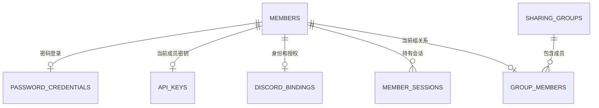
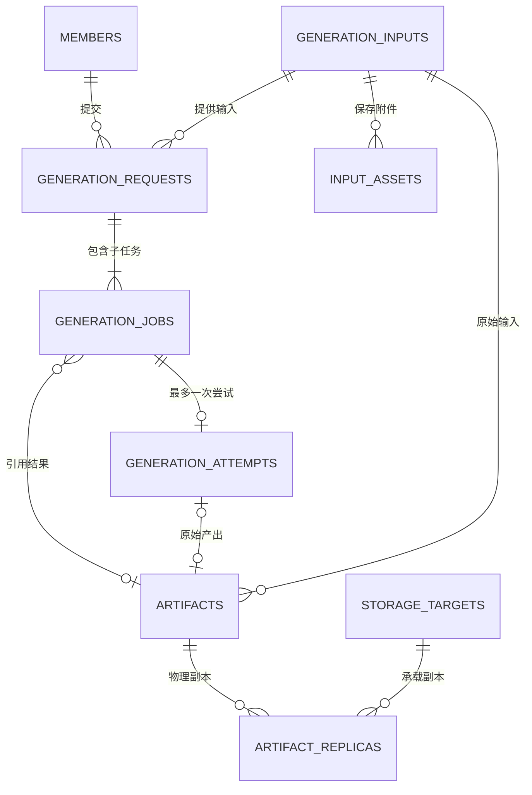
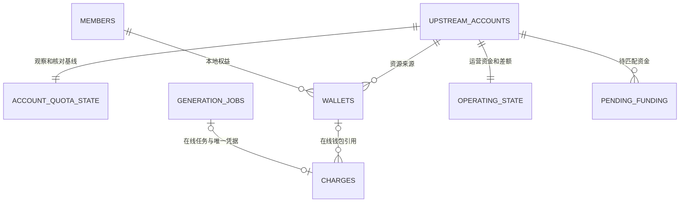
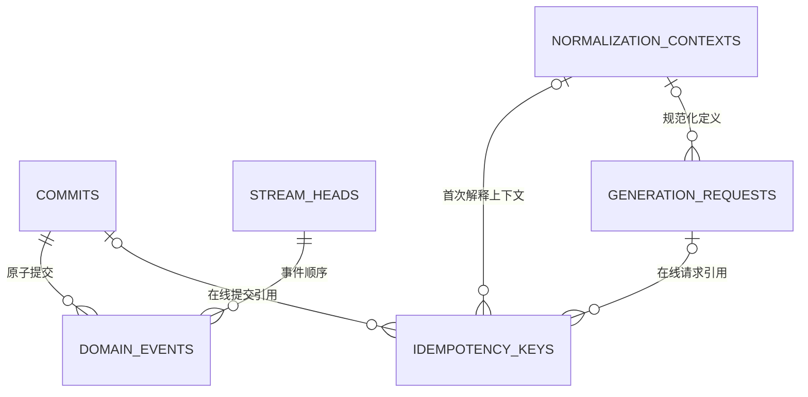

# 数据库与数据模型重构

更新日期：2026-11-16，Asia/Taipei。设计版本：0.17。本文维护目标模型、有效契约与剩余验收；进行中状态统一见 [#32 顶部状态](https://github.com/Hime-Hina/novelai-shared-gateway/issues/32)。

维护者已确认 [B 路线及四项产品选择](#64-路线选择与旧键)。核心与 B 迁移沿现有 [#72](https://github.com/Hime-Hina/novelai-shared-gateway/pull/72)、[#73](https://github.com/Hime-Hina/novelai-shared-gateway/pull/73) 交付；各候选的失败、审查和执行证据保留在[原第 9 章实施记录](../history/database-model-execution-records.md#9-工作包与交付边界)。权益、未决责任、防重、原图与审计来源继续保全，生产操作按第 7.4 节验收并另行授权。

**已确认的产品决定：D4a 卡密遗留功能、D4b 客户端自带官方 PST 的独立执行模式均淘汰；D8 仅保留为可选政策，具体留存期限后续决定。** 本轮记录决定，功能移除随重构实施；不设置新的自动归档或删除期限。

[#30](https://github.com/Hime-Hina/novelai-shared-gateway/issues/30)、[#31](https://github.com/Hime-Hina/novelai-shared-gateway/issues/31) 保留问题证据与回归场景；它们原先的局部兼容瘦身边界不限制本次重构。目标规则以本文及其评审修订为准，实际运行版本以[发布记录](../operations/production-release.md)为准。

本文定义目标、实体、所有权、迁移选择和验收。API 逐字段行为、金额算法及归档 IO 协议继续由所属契约维护，实施时同步修改对应 owner，避免并行维护多套规范。

## 1. 目标与范围

采用一份业务事件历史、一套关系型当前状态和独立受保护输入。旧模型的解释与转换留在固定版本的离线迁移工具，新运行时只接受新格式。工作可以拆分评审，生产在同一候选版本完成一次格式切换。

**结构去重和模型迁移属于本轮必做范围，不属于暂缓的 D8。** D8 仅决定已有内容保留多久、何时退出在线查询或最终删除；暂缓 D8 不影响 T1-T7 的新模型、去重和一次迁移工作。

| 工作        | 具体含义                                                                                                          | 本轮范围                                         |
| ----------- | ----------------------------------------------------------------------------------------------------------------- | ------------------------------------------------ |
| 结构去重    | 同一输入正文只保存一份，任务/产物引用；同一当前状态采用唯一关系表示；移除无用途搜索正文、旧 ledger 和历史数组副本 | 必做，并验证读取、更新、重启和重放不会再生成副本 |
| 模型迁移    | 按 A 完整转换或 B 归档开账进入新 schema；稳定身份、权益、未决事项和防重按选定路线接续；旧解释器退出正常运行时     | 必做；路线与历史在线范围依据第 6 节确定          |
| D8 留存政策 | 例如将某类旧内容归档或在明确期限后删除，改变未来保留范围                                                          | 可选，后续决定；不新增期限或自动清理任务         |

“消除重复”针对职责重复的持久副本。例如一次带原图和蒙版的四图请求，保存一份输入、两份附件和四条小任务引用；结果产物各自保存。迁移需要证明字段语义相同：不同含义的提示词、不同请求意图不能仅因字符串/摘要相同就合并，真正不同的已知内容仍有明确去向。

事件保存历史决定、关系投影提供当前状态、独立备份用于恢复，各有必要职责。不能以去重为由把它们无条件合成一份或删除历史事实。迁移路线 B 封存历史属于单独明确的能力取舍，不当作无损结构去重的容量收益。

### 1.1 必须保留的需求

| 编号 | 需求                         | 数据模型要求                                       | 当前规则归属                                               |
| ---- | ---------------------------- | -------------------------------------------------- | ---------------------------------------------------------- |
| R01  | 稳定成员身份与私有访问       | 换 Key、改用户名、移除成员不改变历史归属           | `members/`、[成员会话](../architecture/member-sessions.md) |
| R02  | 密码、Discord、API Key、会话 | 凭据与业务状态隔离，撤销和过期持久生效             | `members/`                                                 |
| R03  | 分组、份额和停止接单         | 当前组关系和权重唯一；配置变更守恒且有版本         | `quota/fair-share.ts`                                      |
| R04  | 唯一执行器、当前单绑定账号   | 账号身份与凭据分离，冷却和派发占用明确             | [执行服务](../architecture/executor-service.md)            |
| R05  | 能力、只读报价、费用确认     | 共用规范化规则，受理保留首次授权                   | [成员生成契约](../contracts/member-generation-contract.md) |
| R06  | 生图、放大、Vibe 编码        | 共用持久生命周期，区分输入与产物类型               | `generation/`、`protocols/`                                |
| R07  | 批次、排队、取消和断线继续   | 父请求共享输入；子任务分别结算；取消不停止在途执行 | [请求生命周期](../architecture/request-lifecycle.md)       |
| R08  | 幂等与显式缓存               | 同键重放、不同意图冲突、活动合并和产物复用分别表达 | `generation/admission.ts`                                  |
| R09  | 三类资源账务                 | V5、订阅 Anlas、购买 Anlas 精确预扣、结算和退款    | `quota/`、`generation/accounting.ts`                       |
| R10  | 官方观察和运营核对           | 官方余额、本地权益和消费证据分开，未知保持未知     | [失败核对](../architecture/failure-accounting.md)          |
| R11  | 崩溃恢复、未知消费和迟到结果 | 不重复上游调用；迟到结果不改原退款、不复活余图     | [结果恢复](../architecture/result-recovery.md)             |
| R12  | 输入与结果恢复               | 规范化参数、实际种子、附件原字节、归属和摘要可验证 | 成员生成契约第 6 节                                        |
| R13  | Local/R2/PikPak              | 产物身份与副本位置分开，临时不可读不触发重生成     | `storage/`                                                 |
| R14  | 历史、统计和审计             | 清理展示不绕过收费、防重、免费窗口与批次授权       | `reports/`、现有查询 owner                                 |
| R15  | 备份、迁移与重放             | 事件、输入、凭据和产物形成明确恢复闭包             | [生产发布](../operations/production-release.md)            |

本次继续使用 SQLite 和单执行器。四组政策、单绑定来源及现有 Native/OpenAI/direct 成员入口保持默认范围；多车队、多执行器和多账号选路仍属于[后续扩展](scaling-follow-up-plan.md)。

### 1.2 删除目标

- 删除 `recordFields()`、通用 `app_records` 及同一实体的 `data JSON + 同义影子列` 模式。
- 删除 `event_streams.projection` 大状态 JSON；将状态迁至唯一关系投影。
- 删除 `request.jobs/state.jobs/jobs.data`、`job.request/requestPayload`、图片提示词多处正文副本。
- 删除事件内旧 ledger evidence 与独立 ledger 正文的重复表达；审计改读事件或必要的薄投影。
- 删除当前配置/账户状态中的历史数组、可直接计算的余额合计和重复成员关系。
- 删除 `user_token/image.token` 业务关联；所有权只用稳定身份。
- 删除无生产调用的旧搜索链、冗余提示词列及其索引，保留真实产品查询。
- 删除 `r2.pikpak` 嵌套模型，改为独立副本记录。
- 新运行时不再执行旧 inline、旧表、旧凭据关联或旧 reducer 的兼容分支。
- 按已确认的 D4 移除卡密业务及客户端自带官方 PST 的独立入口、队列和运行路径；历史数据通过迁移或归档处理。

独立业务功能的淘汰以第 8 节为准。结构清理不能自动授权删除还在使用的产品能力。

## 2. 数据所有权与写入规则

| 类别       | 内容                                                             | 权威与恢复边界                                                         |
| ---------- | ---------------------------------------------------------------- | ---------------------------------------------------------------------- |
| 业务事实   | 命令回执、已受理、派发授权、收费、退款、结果发布、政策及观察事件 | 追加事件；金额和历史决定不按当前算法重新计算                           |
| 受保护内容 | 规范化输入、附件、首次上下文、认证材料、必要诊断、产物字节       | 所属模块验证保存；事件仅保留引用和摘要，备份必须包含内容或可靠恢复来源 |
| 当前状态   | 成员业务状态、组关系、钱包、任务、尝试、收费凭据、产物及副本     | 事件在同一事务内更新，能够在新格式中重建                               |
| 瞬时状态   | 预览帧、HTTP waiter、SSE 连接、瞬时进度                          | 内存状态，不作为永久审计事实                                           |

稳定身份、秘密和业务状态的字段所有者须在物理 schema 中明确。凭据及会话不会因为重放业务事件而复活；需要同时提交的认证撤销和成员业务变更仍在同一存储事务完成。

命令统一校验当前授权、意图和相关版本，在一个 SQLite 事务内保存必要输入、回执、事件、关系状态及流版本。提交成功后才替换内存状态和通知。网络调用、产物上传和文件同步在事务外按既有准备/确认协议执行。

事件与当前状态之间允许必要重复：事件保存发生过的决定，状态表支持当前决策和查询。禁止多个可独立回写的完整对象副本。

## 3. 目标实体关系

下面是逻辑实体与基数；同名对象为同一实体。物理表可按独立生命周期、权限、查询需要合并，字段级 DDL 在 T1 固化。关系图不替代实际外键、唯一性和跨实体归属校验。

### 3.1 成员、认证与分组

| 实体                   | 核心字段和约束                                                                                                                 |
| ---------------------- | ------------------------------------------------------------------------------------------------------------------------------ |
| `members`              | 稳定 ID、展示名、active/disabled/removed、accepting_jobs、auth_epoch、admission_epoch；私有 note_json 与认证资料由选定快照恢复 |
| `password_credentials` | member_id 唯一、登录名、密码验证材料                                                                                           |
| `api_keys`             | member_id 唯一、Key 摘要、按产品决定保存的可恢复秘密；当前不新增多 Key 管理功能                                                |
| `discord_bindings`     | member_id、唯一 Discord 身份、授权材料、资格观察；网络失败不等于资格撤销                                                       |
| `discord_invites`      | member_id、唯一邀请码摘要和到期；私有当前状态，不保存邀请码正文，不由业务回放恢复                                              |
| `member_sessions`      | Token 摘要、member_id、auth_epoch、owner 绑定、固定期限                                                                        |
| `sharing_groups`       | 稳定组 ID、名称、份额；当前四组作为政策约束                                                                                    |
| `group_members`        | member_id 唯一、group_id、组内权重；全局有效份额计算得到                                                                       |

移除成员撤销认证并执行已确认的权益转移，保留最小历史身份。转移余额不转移原请求和原图所有权。owner 继续采用现有部署配置与身份规则，本次不新增通用 RBAC。

私有备注 `note_json` 保存 JSON string，以保留原 JS UTF-16 和已知空字符串；SQL NULL 表示未知或未恢复。备注、认证 epoch 与凭据属于所选私有快照，公共业务回放不恢复它们。注册、重置与目录字段遵守[管理接口](../contracts/api-contract.md#门户与管理的迁移边界)，私有空态、精确选源及复制归[离线恢复](../operations/relational-recovery.md#格式完整提交与私有恢复)。

### 3.2 输入、请求、执行与产物

| 实体                  | 目标内容                                                                                                                    |
| --------------------- | --------------------------------------------------------------------------------------------------------------------------- |
| `generation_inputs`   | 稳定 ID、member_id、schema_version、完整度、规范输入、摘要、逻辑大小；常用查询字段与模型参数 JSON 不存同义副本              |
| `input_assets`        | input_id、asset_id、MIME、原长度、SHA-256、BLOB，组合主键 `(input_id, asset_id)`                                            |
| `generation_requests` | 成员、input_id、context_id、来源、批次数、种子意图、费用授权、受理时间；不保存 child 数组                                   |
| `generation_jobs`     | request_id、sample_index、实际种子、状态、队列序号、期限、结果引用、必要成功/保留事实；不保存完整输入或 charge/attempt 对象 |
| `generation_attempts` | job_id 唯一、account_id、凭据代次、派发和实际响应证据、核对状态；有授权不等于已发送                                         |
| `artifacts`           | 所有者、原始 input_id、可空原始 attempt_id、内容摘要/长度/MIME、类型、发布和退休状态；包含图片和编码结果                    |
| `artifact_replicas`   | artifact_id、storage_target_id、对象定位、编码方式、上传确认、内容核验、删除与故障状态                                      |
| `storage_targets`     | Local/R2/PikPak、固定桶/目录/命名空间身份；认证配置独立引用                                                                 |

缓存命中可用小型任务引用已有产物，不产生新尝试。活动任务合并可让不同幂等键指向同一请求。产物的原始输入和尝试不随复用者变化。已发布内容丢失时保留身份和不可用状态，不把旧键变成新生成机会。

历史产物可以没有可证实的原始尝试。只存已知输入的 partial/unavailable 状态，不补造调用。旧 inline job 的目标请求容器映射必须明确记录来源，保留原 job ID 和原回执；无法确定归属的记录进入迁移冲突清单，不能猜当前 owner。

终态 Opening 的原 parent/source/operation/受理时间、sampleIndex/admissionEpoch、完成/发布时间均按证据允许 NULL，已知 0 保留为 0。当前 request/input 可以只是结构容器；`generation_request_origins` 与原接受事实证明原 parent，不能由 ID 形状、创建时间、单个 child 或文件 MIME 推断。parentless 结果可按原归属领取，但容器不授予 parent 查询、输入、取消或 live/alias 权限。正常受理、活动任务、派发、准备和发布仍要求完整已知元数据；[输入恢复](../contracts/member-generation-contract.md#6-查询预览参数复用与领取)继续独立核对正文完整度、原数量、context 与 seed。

### 3.3 账务与上游状态

| 实体                                         | 目标内容                                                                                                                                                                      |
| -------------------------------------------- | ----------------------------------------------------------------------------------------------------------------------------------------------------------------------------- |
| `upstream_accounts` / `upstream_credentials` | 稳定账号、状态和凭据代次；PST 独立保护，轮换不新建一份余额来源                                                                                                                |
| `sharing_policy`                             | 当前绑定账号、配置版本、免费和 fallback 等政策                                                                                                                                |
| `wallets`                                    | `(account_id, member_id)` 唯一；三类资源可用额，不另存 Anlas 合计                                                                                                             |
| `charges`                                    | 原 job 标识唯一、原成员/账号归属、可空在线 job/wallet/attempt 引用、原资源金额、reserved/settled/refunded、原事件和时间；活动收费必须有在线任务和钱包，历史终态凭据可独立保留 |
| `account_quota_state`                        | 最新采用观察、恢复游标、待匹配扣款、续用债务、未分配额；不保存观察历史数组                                                                                                    |
| `operating_state`                            | 运营可用、未承担缺口、未归属返回、V5 容量差额和关联事实                                                                                                                       |
| `pending_funding`                            | 唯一业务收据、来源/归属、剩余待匹配金额和观察引用                                                                                                                             |

沿用三种明确资源，不新增任意资源 EAV 或通用复式总账。金额沿用 12 位定点 BigInt 算术及规范十进制 TEXT；不经 REAL/SUM(TEXT) 批准余额。缩放整数若采用 SQLite 64 位存储，须另行批准金额范围并检查累计量，不能默默缩小既有范围。

原预扣只能结算或按原资源退款一次。退款后找回产物保留失败与退款。官方余额、成员权益、互斥消费候选和实际消费证据分别表达，未知保持 NULL；不重算历史报价或把聚合缺口归因到单次任务。

每次明确更换上游凭据增加 credential_epoch，观察以账号、代次和请求发起序列排序。旧代次成功/失败均不能覆盖新代次，A→B→A 也不能复活旧 A 的迟到响应。失败不清空钱包，也不使旧快照无限有效。

轻量 job 核心保留免费成功时间和当时告警事实时，可合并独立免费次数投影。计数包含退款后找回的完整免费结果；若仍允许物理删除核心 job，就必须另保留相应成功凭据。历史清理不得重置滚动限额。

#### 3.3.1 观察与恢复的来源契约

以下是新格式 T4 必须满足的业务关系，反例入口见第 7.3 节。观察、恢复与分配算法仍归原 quota owner；关系存储负责保留其决定的身份、来源和事务边界。复用算法不允许在转换时用时间或 DTO fallback 猜测事件身份。

每次命令区分两种角色：**原基线**是命令开始时的 `baselineEventId`；**核对观察**是本次参与核对的有效观察，可以来自新查询，也可以是先前已保存的最新观察。事件 ID 确定身份，账号/凭据代次/发起序列决定观察是否仍有效，时间只用于有效期、恢复窗口及基线推进条件；时间相同不表示同一观察。

| 事实                                             | 来源角色与允许的状态变化                                                                                            |
| ------------------------------------------------ | ------------------------------------------------------------------------------------------------------------------- |
| `QuotaObserved`                                  | 当前账号/凭据代次下仍有效的查询结果更新最新观察；保存最新观察本身不等于采纳金融基线或增加钱包                       |
| `QuotaBaselineAdopted`                           | 引用核对观察；原 owner 的在途、结算时间、有效余额及时间推进条件成立后才替换基线，不能因序号较新便跳过这些条件       |
| `RefillApplied`                                  | 引用原基线，`from` 等于原恢复游标，`until` 不倒退且不越过原基线的有效恢复窗口；同提交若采纳新基线，原基线恢复先完成 |
| `ResourceGapObserved`                            | `beforeObservationEventId` 引用原基线，`afterObservationEventId` 引用核对观察，不按时间相等交换两者                 |
| `V5CapacityObserved` 与观察型 `ReturnClassified` | 引用核对观察；人工差额纠正引用其核对的既有基线与原差额事实，不能套用新入站观察身份                                  |
| 登记资金到账的 `FundingReceived`                 | 引用用于匹配到账的核对观察及原登记收据，保持原账号、资源和归属；部分到账只消耗原收据剩余额度                        |

`RefillApplied` 的预算、偿债、容量恢复和成员分配保存原 owner 的决定，回放验证来源、原游标、资源与金额关系，不重新运行当前政策。适配接口若只有时间而不足以确定来源，应从命令上下文显式传递角色对应的事件 ID；不能为所有事实统一设置“旧观察优先”或“新观察优先”。同时间、不同有效序号的新观察应能保存，基线是否推进仍按原条件决定（[#44](https://github.com/Hime-Hina/novelai-shared-gateway/issues/44)）。

官方展示原值与金融 V5 定点值分别表达。`QuotaObserved` 和 `OpeningQuotaRecorded` 必填可空 `v5UsagePercent: number | null`、`v5UsageIsNegative: boolean | null`，保存原查询归一化 owner 决定后的官方标量；80/true 与 0/false 虽有相同金融 0，仍须可逆区分。既有 `v5` / `observedV5`、钱包和金融决定维持原规则，不把官方 number 当作 12 位钱包金额或在回放时重算后覆盖事实。Opening 无原证据时明确 NULL，不从金融符号、0、当前默认值或后来的观察补造 false/0。

失败查询遵守原 `accountQuotaPatch`：保留此前实际已知官方值及原观察时点，事实仍标记失败，不宣称取得新成功观察。金融视图不能用金额正负反推原 negative：真实原 JsonStore 成功保存 -5/false 后遇到网络失败仍保留该值；新命令必须一致，不能延续有损适配把金融 -5 改成 0。金融 snapshot 本身负责数值边界；不改写已存历史事实，也不增加新的分配规则。完整提交按本事实之前的原账户流切点核对此保留来源，不能借同笔后来观察或金融 0 冒充原官方值。`readOfficialQuotaV5(accountId)` 只读原事实两个标量，SharedSource 薄绑定，不增派生投影列、状态缓存或 settings 副本。本必填契约使用明确预发布事件 4→5 格式门禁，正确旧 v4 完整 DDL/hash 也必须零写拒绝；输入/context 各自 schema 版本不变，旧 SQL/journal 不改。

#### 3.3.2 分配预算与有限来源消费

`AllocationApplied.sourceEventId` 必须说明分配的实际来源。`sourceResources` 如保留，是原决定的可核对预算；对已有明确金额的有限来源，它不能成为另一份独立权威。不能仅证明“分配总额不超过分配自己填写的预算”。当前直接有限来源的契约如下：

| 直接来源          | 允许用途与权威预算                                                                           |
| ----------------- | -------------------------------------------------------------------------------------------- |
| `FundingReceived` | `destination` 必须为 `members`，只允许原 `resource`；来源预算取保存的 `amount`，其他资源为零 |
| `DebitsConfirmed` | 只允许原 `resource`；成员预算取 `allocatedToMembers`，不能用确认扣款总额 `amount` 代替       |

对这两类直接来源，分配的自报预算须与来源预算相符，成员分配总额不得超过该预算；来源与分配在同一完整提交内，来源必须在前。当前每个直接来源最多关联一个成员分配列表，无分配时允许没有 `AllocationApplied`。同提交第二次绑定与新提交再次消费均拒绝；原完整提交重放则沿命令幂等路径返回，不再次增加钱包。实现可使用本次完整提交内的来源集合与事件顺序，不新增持久消费计数或另一套账本（[#45](https://github.com/Hime-Hina/novelai-shared-gateway/issues/45)）。

观察、开账与登记资金匹配需要保持各自语义，不能无差别套用上述“一来源一分配”规则：

- 初始观察开账只能在没有原基线、现有钱包权益、预扣、运营资产或未决义务时分配，保留原 owner 的未分配额/容量规则；同一观察可以分别产生三池分配。
- 常规观察的分配预算是原 owner 根据原基线与核对观察的差额，匹配待核对扣款、fallback、登记资金和待归属返回后决定的成员净额；不能把官方观察的全余额当成可再次发放的额度。
- 观察型分配必须属于同一完整提交中同账户、针对该核对观察的一次有效 `QuotaBaselineAdopted`，不能仅检查存在同名事实。核对观察本身可以在先前提交保存；分配可以先于或后于采纳事实，保持原 owner 的事件顺序。采纳继续验证第 3.3.1 节的状态与基线推进条件，因此新提交不能再次采纳并消费已经采纳的同一观察。
- 同一核对中，同一观察、同一非零预算资源只能应用一份分配决定；同时覆盖该资源的两个 `AllocationApplied` 必须拒绝，即使两者金额完全一致且都在自报预算内。按资源判断，允许首次开账同观察的三池各分配一次；没有分配时不要求生成分配事实。使用本次完整提交内的观察/资源集合即可，无需新持久状态。只检查采纳存在而不检查资源重复，或只对两类直接来源检查消费，都不足以满足此约束。
- 登记到账的 `FundingReceived` 可能只是观察或扣款确认预算的组成凭据。已计入该预算的到账不能再作为独立成员分配来源二次发放。转换必须保留“直接分配”与“参与净额计算”的角色，不能简单取最后出现的资金事件作为来源。
- `OpeningQuotaRecorded` 表达已核对的迁移开账状态，不是额外预算。首配只在原 `baselineEventId` 为 NULL、全部原钱包/预扣/运营资产及未决责任为零、原 `observationEventId` 指向同账户且原观察时间、凭据代次与三池余额满足既有同步 owner 时，才允许原 initial 分配；NULL 或 import envelope 时间不能补造官方观察。已有基线继续原净观察/恢复流程，有权益而无基线明确拒绝。分配仍需同笔有效基线采纳、原资源净预算及同观察单次消费，不能因新增共享绑定再次发放既有 Opening 权益。此窄入口不代替转换器的完整来源核对或整体迁移验收。

观察型一次消费只约束 `AllocationApplied`；`RefillApplied` 仍按原基线与恢复游标分段推进。消费次数与生命周期校验不等于重新证明任意修改后的观察净额，不能据此宣称完整业务 reducer 已验收；原 owner 的预算决定与其余关系校验继续保留。

完整提交校验和业务关系校验分别执行：两份事件列表一致、数量正确，不足以证明分配合法。所有已支持来源都须明确其消费身份和有效生命周期；改成引用观察不能绕过消费约束。在线事务与回放必须在同一所属投影入口保留上述来源检查；失败被外层捕获时，事件、回执、流头、投影游标、钱包和运营状态均不得留下部分变化。原完整提交的幂等回放仍提前返回，不能与新提交再次消费旧来源混为一谈。

#### 3.3.3 上游账户与凭据命令

账户配置规则归 `members/owner-operations.ts`，关系存储负责原子保存。资格复用 `quota/eligibility.ts`，查询复用 `quota/account-refresh.ts` 和既有关系观察入口，物理占用继续由 `generation/queue-dispatch.ts` 的执行控制持有，不新增账户或凭据副本。

| 命令          | 权威来源、前置条件与允许变化                                                                                                                                                                                                                                                                                                                                                 |
| ------------- | ---------------------------------------------------------------------------------------------------------------------------------------------------------------------------------------------------------------------------------------------------------------------------------------------------------------------------------------------------------------------------- |
| 注册/首次绑定 | 账户 ID 是资源来源身份，PST 仅是该账户当前凭据。新注册账户保持暂停、代次从 1 开始；不能沿用旧管理员注册默认启用的行为跳过核验。首次绑定使用明确的唯一账户和当前配置版本，账户、初始空额度/运营状态及绑定事实同笔提交；绑定不等于通过 Opus 资格，不凭注册时的未知余额开账。已有绑定不能通过重复注册替换，本片不扩展任意换绑或多账号调度。                                     |
| 暂停          | 对当前绑定账户保存 `AvailabilityChanged(enabled=false)`，阻止新派发；不终止物理在途，不退款、不清空钱包、不重置冷却，也不撤销已受理批次的原授权。                                                                                                                                                                                                                            |
| 轮换凭据      | 事务内核对原账户、当前代次及实际私有 PST。真正更换凭据前，同时确认物理占用为零且不存在该账户的在途预扣；逻辑退款或任务终态不能代替物理释放。保存私有 PST、`CredentialRotated(beforeEpoch, credentialEpoch=beforeEpoch+1)` 及暂停事实；相同 PST 的重复设置不制造新代次。代次不同的旧观察不能批准启用、派发、恢复或修改新代次冷却，原钱包及未决责任仍保留。                    |
| 验证启用      | 先用当前账户、实际 PST、`credential_epoch` 和发起序列取得查询票据，在写事务外查询；保存观察和启用时重新核对当前授权、绑定及配置版本、查询前的账户可用性事实、实际 PST/代次和最新有效观察。仅接受本次仍有效的已保存 Opus 成功观察，沿用原资格和订阅期限判断；被忽略、旧代次或等待期间被新观察取代的结果不能启用；失败观察及原禁用决定仍须保存，派发受当前资格和错误状态约束。 |

操作人身份不由命令体或 `metadata.actorId` 自证。成员入口先复用现有认证事务，在同一事务内复查当前成员状态、认证 epoch、Key/Cookie 和 owner 绑定，再以当前部署 `OWNER_USER_ID` 判定 owner；管理员入口保留现有本地管理员信任边界。原回执重领同样先做当前授权，不能让已撤销会话、旧 Key 或已失去 owner 身份者凭旧命令键取得成功回执。网络等待前的授权快照不足以批准落库。

命令键和规范化意图共同决定幂等；同键同意图返回原安全回执，不再查询上游、轮换代次或重新启用，不同意图冲突。PST 只进入 `upstream_credentials` 和事务外查询所需的易失票据，不进入业务事件、回执或日志；凭据命令仍须保留同键不同意图冲突，不能通过忽略 PST 输入让不同轮换意图视为同一命令。事务异常或前置条件拒绝且被外层捕获时，私有凭据、账户状态、绑定、事实、回执、流头和投影游标全部回滚。核验取得无效 Opus、封禁或查询失败是需要保存的业务结果：原观察、原禁用/资格决定和安全失败回执同笔提交，认证事务完成后再向 HTTP 报错；重领仍先鉴权并返回同一失败，不重新查询。

启用依据必须可回放核对，不能只保存 `reason` 或比较 PST 字符串。`AvailabilityChanged` 使用可空 `observationEventId`：验证启用为所用 `QuotaObserved` 的原 ID，暂停和其他禁用为 NULL。启用投影核对该事实确属当前账户/代次、最新成功观察，并按事实时点验证 Opus 资格；不发起新查询、不采纳另一张同时间观察，也不重新计算金融分配。每个命令的账户、绑定、代次及可用性事实在同一完整提交中依原顺序应用一次，复用共同提交原语；不能过滤后分头回放同一个 commit。业务回放只恢复账户/代次和业务状态，不恢复 PST；缺少匹配当前私有快照时仍不能派发或通过完整恢复验收。

可用性票据引用原账户流中最新的注册、开账、凭据轮换或 `AvailabilityChanged` 事实 ID；按 `stream_version` 判先后，不用时间或启用布尔值代替身份。`upstream_accounts.source_event_id` 也会被冷却更新，不能将它当作可用性代次；核验期间任务正常结算不使查询失效。官方非空且不可解析的订阅期限在共同 `accountQuotaResult()` 边界作为查询失败处理，不能转换为表示无期限的 NULL；普通观察、启用和后续恢复都受同一错误资格约束。合法空期限与合法日期维持原 owner 语义；数值 `0` 规范化为无期限 NULL，字符串 `'0'` 仍为已过期的时间。

验收沿用 `owner-management`、`relational-members`、`relational-generation` 和 `relational-quota` 的真实事务入口，至少覆盖：当前 owner 撤销后重领拒绝；同键重领零查询/零写入与不同意图冲突；凭据 A→B→A 后旧 A 的成功/失败和旧尝试均无效；查询中暂停/轮换或更新观察后旧核验不能启用；只有物理占用、只有预扣以及退款但物理未结束时均拒绝轮换；SQL 故障和外层捕获后全表及私有状态不变。合法首次核验、暂停、轮换后重新核验继续通过，在线与原完整提交回放的业务状态和安全回执一致，PST 始终不进入 replay。

#### 3.3.4 B 切点的金融来源与独立历史观察

旧 v4 的各 account 流金融投影是对应账户的开账来源，不仅是当前共享绑定账户。钱包三池、原预扣/冷热终态、fallback 缓冲/待匹配消费/共享负债、运营余额和待到账收据不重新分配；金额复用原 12 位 amount owner，不能经 DTO number 绕行。旧归档保留已消费来源、完整人工资金收据、核销和原历史组成；缺少新在线防重或后续处理所需角色时，converter 报告阻塞并保持 building，不能因样本为 0 而丢弃类别。

旧 `quota.snapshot` 金融基线与账户最后官方观察可不同时。`OpeningQuotaObservationRecorded` 只保存该次开账引用的不可变原值、原观察时间（未知 NULL）及原来源；不更新金融投影，不构成在线查询、启用、同步或派发票据。v4 没有原凭据代次/查询序号，因此该事实的 `credentialEpoch` 与 `sequence` 显式 NULL，不能借本次安装账户的首代 1 补造。`OpeningQuotaRecorded` 的 latest/baseline 分别引用同笔先行、同账户、同 ImportSource 的观察；原值和时点相同可共用。latest 字段须与所引事实逐项一致；原金融游标及未决余额只开账一次，不重演 `QuotaBaselineAdopted`。baseline 的金额只存在于其原观察，不另存一份供相互自证；converter reconciliation 仍须从封存旧源独立重建核对，来源事实的闭包验证不等于凭公共事件反推出未提供的旧库字节。

新事实随未发布 event 7→8，writer 5/reducer 1 不变；唯一 DDL 的事件 CHECK 与 hash 由常量自然改变，不修改旧 SQL/journal或保留兼容开关。旧格式在读、写、监听前拒绝。回放仍按原完整提交顺序、同一保存点消费事实，不查询外部额度或恢复私有认证。

金融 mapper 仅接收主 converter 已盘点的 readonly/query_only 单一快照事务和统一 ID resolver，返回事实草稿、核对期望与安全 blocking findings；不另建 CLI、目标 SQL 写入器或迁移模式。观察与额度须在同一基线提交，运行态 Job→Attempt→Charge 须在原请求的同一完整开账提交；主 converter 负责组装并阻止含 finding 的结果安装 ready。免费滚动窗的原 succeeded_at/warning_threshold 交给同一个 Job mapper，不推算当前政策或清空；缺少可保留原任务关系时明确阻塞。

旧源到新目标的金融核对复用 `assertLegacyFinanceProjection(target, expected)`：在同一目标快照事务只读比较完整主键集合、规范金额、NULL/已知 0、观察、原核对责任和免费窗口，不经 DTO number、不再运行分配或结算。它比较旧源 mapper 的期望与真实投影/原事实字段；唯一 installer 仍独立证明新完整事实到投影、保护内容与私有选源，两个方向不能互相替代。

`OpeningOperatingGapRecorded` 保存切点各原资源池尚未承担的责任，不把旧累计缺口或已核销金额再次加到账上。原 gap ID/type/time 有证据才保存，否则为 NULL；origin 对应本账户切点。`OpeningOperatingRecorded` 每个非零责任必须引用同一完整提交先行、同账户/同 ImportSource/同原账户、资源和金额相等的唯一 gap；孤立、重复、换池或乱序拒绝。后续核销继续走原 owner，只能消耗当前 gap 的剩余责任及运营可用余额；开账事实不伪称本次观察到的损失或任务消费。

`OpeningFundingReceiptRecorded` 与待到账 `OpeningFundingRecorded` 分离：前者保存原 `operating-receipt:<token>` 业务身份、稳定账户、原类型、可证原时间/数量、闭合规范请求及安全原回执；后者只保存原剩余待到账责任。仅该 Receipt 的统一 event-ID resolver 保留原业务 ID，其他实体继续同源 digest。每个 pending opening 必须有同笔先行、同账户/来源/token/资源/登记时点的原 Receipt，已知原数量不得小于剩余数量，已知原请求的归属必须一致。只有 pending 状态而原 audit 不在时，原登记角色/时点可以证明，原数量/请求/结果明确 NULL，不能以 current remaining 或当前钱包冒充原结果。已完成的 Receipt 不要求 pending；缺原规范意图的业务 ID 明确 410 归档拒绝，不冲突重算或重新入账。正常命令仍先复核当前 owner/epoch，再领取当前 command 回执或辨识原业务重复；私有 PST 未恢复时允许原同步 owner 的安全 unavailable 状态决定，不能把它与资金重复消费混为一谈。

`.quota` 投影缺失不等于历史金融来源不存在。首次金融初始化仅接受已审计封存源中可证明从未开账的账户：无 `QuotaAccountOpened`/其他原金融 account facts、无 `OpeningStateRecorded.state.quota` 原金融切点、无本账户冷热预扣/任务尝试、资金/差额 audit（包括仅剩不可变 LegacyFact/settlement 的来源），且不是当前共享绑定账户。该检查按原 reducer 排除纯官方观察与非 quota 的可用性 metadata；只读汇集原身份，不重演金额。任何来源存在、投影为非法值或不能证明初始性，仍明确 blocking 并保持 building，不能因缓存/ledger 查询行缺失而默认全零。

证明成立时，mapper 复用当前 `initialAccountQuota()` 的同一纯初态，建立新的未启用金融状态；这些零是本次合法初始化的值，不冒充旧源余额。原官方标量及其不可变观察仍按既有 owner 保留，已知 0/未知 NULL 区分；金融 baseline/refill/settlement cursor、原凭据 epoch/sequence 保持 NULL，不造钱包或 Operating 零行，不从 header 时间补观察时点，也不授予查询/启用/同步/派发权限。一般来源关联校验与唯一 ready installer 不放宽；mapper 的局部 absence 证明不替代主 converter 的原完整事件/投影及 cold facts 审计。

#### 3.3.5 政策、分组与成员权益变更

政策、分组和权益决定复用 `fair-share.ts`、`free-image-policy.ts`、`failure-accounting.ts` 的原 owner。fallback 只改当前布尔政策并保留组版本；免费与损耗政策分别核对自己的 expectedVersion、合法新命令各增一版，不清除免费成功/在途事实。V5 告警阈值是有限非负 number/REAL，只用于比较；Anlas 阈值和次数沿安全整数约束，真实资源金额仍为 12 位定点 TEXT。

组配置须核原 configVersion、四组/份额/权重、成员唯一位置、停用成员留原组、至少一名共享成员和最多 100 人，并满足排队/运行/预扣及真实物理控制的 idle 条件。有余额成员不直接移除。先以旧组执行原同步，再改变后续配置；没有显式 `redistributeRemaining` 时保留原钱包，显式重分仅重排原组现有三池总额，不增发或重算历史消费。原成员全局顺序来自对应配置/移除事实或有来源的连续唯一零基 Opening ordinal，未知 NULL 不按组拼接或 ID 排序补造。

一次完整提交保留原同步事实在前，随后单条 `SharingConfigured` 记录原 owner 完整配置决定，最后保存原 owner 决定的重分。组内每名成员以稳定 ID/权重对保存一次，不同时保存成员列表和另一份权重键。`SharingConfigured.redistributeRemaining` 保存这次显式意图，防止删光重分事实后仍将改组当作成功；它不新增持久派生状态。每条 `GroupBalancesRedistributed` 引用同次先行配置 ID 和组 ID，预算必须等于该账户该组当时原钱包资源总额，分配只能覆盖该组当前成员且每个来源只消费一次。原 owner 的 `allocateFairGroupAmount()` 同时服务真实配置和回放核对：只用该次保存的权重、三资源预算及原舍入规则，拒绝守恒但违反原份额的分配，不用后来权重或默认值重决定，也不以新算值替换错误事实。显式重分必须完整紧接配置事实，不能夹入其他钱包变化来替换原预算。缺组、错版本、重复成员、错误来源/资源/预算、重复消费、漏分或分叉回执均拒绝。新初始政策和旧政策下改组共用一个命令与同一额度投影，不保留双写或兼容模式。

转账、删除和只读预览共用 `manageFairMember` 的同步后决定。转账保持组拓扑并增一次 configVersion；移除按原全局份额将源权益转给显式接收者，已分组接收者允许原规则的暂时超容量，启用且未分组者继承原位置/权重。绑定存在时有唯一同笔、同账户、不可交换源/目标的资金子事实；真正未绑定零权益删除不造钱包来源。删除核源成员全部账户权益，不能把其他账户非零余额搬进当前池；原身份、请求、图片、收费、输入、免费窗口和审计来源保留，源钱包清零留行，私有认证同笔撤销。

当前授权和认证 epoch 先于原回执，新决定再核版本与原队列/预扣、物理 promise、未发布准备和未决核对责任。owner 不删除或预览删除本人，本机管理员保留原应急边界。预览只改独立 view，零事实、回执、游标或私有写入；提交失败即使被外层捕获，全部事实、钱包、回执与投影均回滚。外部字段与回包归[管理接口](../contracts/api-contract.md#门户与管理的迁移边界)。

恢复与分配须核完整原决定，只有总额守恒不足以授权改变受益成员或净预算。在原观察、组变更前或人工资金首事实的切点，以原绑定、配置、钱包、预扣、基线/游标、待扣和运营状态建立独立 view，复用原同步/分配 owner 核原序、权重、稳定尾数、容量截断及收据组成；恢复的未满水位算法与组重分不同。核对后仍应用已保存事实，错误事实不得用重算结果覆盖；不联网、不恢复秘密或增加持久派生账。

### 3.4 命令、事件与幂等

`commits` 保存内部 command 身份、提交序列、指纹、操作者和原安全回执。生成键保存 `(member_id, operation, key_hash)`、意图指纹和原请求/提交引用；两种指纹不可混用。当前授权先于领取旧回执，新受理资格不阻止合法领取旧结果。

图中的可空在线关联用于已归档或内容已删除的凭据：原 request/job/command 标识、原安全回执或其新格式引用、来源和 live/archived/unavailable 解析状态独立保留，不要求原在线行仍存在。新受理必须关联完整在线请求/提交，活动收费必须关联可恢复的在线任务和钱包；历史终态薄凭据可保留原身份并将在线外键置空。原标识与在线 FK 在 T1 分别定义，唯一防重仍按原业务身份，不伪造历史请求、输入或尝试，也不关闭外键绕过检查。

`domain_events` 只表达一份最小事实，不内嵌完整请求、当前账户或旧 ledger DTO。`stream_heads` 只保留 kind/version/cursor。`projection_state` 标记版本、完整提交位置和构建状态，未完成重建不能标为 ready。

`normalization_contexts` 按不可变内容复用实际首次定义，不复制整个 settings 或成员秘密。随机意图与首次实际 seed 分开，输入摘要、幂等指纹、缓存键各司其职。没有历史上下文时明确不可证明，不能用当前 defaults 冒充。

完整提交独立保存 event_count，提交、流版本和队列序号以规范十进制字符串穿过 JS 边界，使用 BigInt 进入 SQL。回放保留原 ID、时间、回执、相关/因果与金额版本，核对完整事件列表、顺序和对应 protected source；各 owner 按原事件序在同一保存点应用，不能排序、拆开混合提交或让调用者自报 replayed 跳过投影。重复提交仍核保护内容，损坏或缺失不自愈；全业务续放要求私有状态未恢复，选定私有切点最后恢复。

所有 Opening 均引用唯一、无成员/账户冒名的 `ImportSourceRegistered`，按 commit_seq/event_index 先行；时间相同或同笔未来登记不能背书。依赖顺序为来源登记→保护 Input/Context→Request→Job→Attempt/Charge→Artifact→Replica，最后核幂等来源。origin.originalId 由独立转换器对获准旧源和清单证明，新在线 owner 不解释旧 JSON。事务后通知与当前鉴权归[状态通知](../architecture/state-events.md#验证与后续边界)，不作为权威日志或持久回放游标。

## 4. 输入附件与正文去重

### 4.1 输入附件是什么

输入附件是一次请求带给模型处理的二进制内容：图生图/重绘的源图、局部重绘蒙版、风格或角色参考图、放大所需源图，以及接口支持的参考编码数据。纯文字提示词、负面词和参数属于输入字段；生成出来的图片或 Vibe 编码结果属于 artifact。一个结果以后作为新请求输入时，在那个请求中承担附件角色。

是否为附件取决于业务内容，不取决于 HTTP 上传格式。JSON 内的 Base64 图片和 multipart 文件经规范化后应指向相同附件语义；普通纯文生图可以完全没有附件。

成员输入恢复契约只要求规范化输入、实际首次种子、批次数与附件，不要求逐字保存原 HTTP 正文或编辑器草稿。规范输入保存一种权威表示，协议适配器在边界构造出站字段。

### 4.2 规范输入与附件保存

- 消除已证明同义的 `tag/prompt/fullPrompt` 和顶层参数/`nativeParameters` 复制；实际不同的主体、画师前缀、负向词、多角色 caption 等语义继续表达。
- 展示文本与执行文本相同则不另存；确实不同且产品需要时保留明确可选字段。旧图文本不同于关联 parent 时迁移独立输入，不能覆盖。
- 缺失、NULL、空串仅在契约证明同义时合并。新请求要求完整输入，partial/unavailable 只支持诚实的查询与不可恢复说明，不能进入派发。
- 附件使用 BLOB；同一输入内按长度、摘要和实际字节相等复用。不做跨成员/跨请求全局 blob 去重，也不新增素材库产品。
- body 中的附件槽位只保存 asset 引用；写入验证引用属于同 input、存在、长度和摘要一致，无未引用附件。复用现有槽位白名单，不新增任意路径 DSL。
- 输入、附件、受理事实同事务保存；执行时才生成协议需要的 Base64。列表、排队和 SSE 状态读取不加载附件。
- 读取为“当前授权 → 原请求 → 白名单槽位 → 所属附件”，不能凭摘要或 asset ID 全局取内容。
- 分别计算磁盘字节、协议展开字节和活动输入预算；不能把更小 BLOB 字节直接当作原有载荷上限口径。

首版将输入附件保存在 SQLite，维持受理事务和一致性备份的简单边界。大型结果继续外部副本。未来是否外移输入由独立容量证据决定，不能把移动位置当作总存储减少。

### 4.3 当前规范化配置

`RelationalConfigurationStore` 只接受 building 中明确 system/null 初始化，给出 originRef、三个顶层默认值、八项 defaults 及公共地址回退值；null/false/0/空串保留。相同命令和完整意图可重领，新命令不覆盖已有配置；profile、事实、回执、current singleton 同一保存点回滚。当前无线上配置修改或 PromptAPI 执行/秘密恢复入口；未来修改须有对应的具体版本化命令，不能借任意 settings 写入。

闭合 `{kind:'normalization-defaults',values:...}` profile 共享 `normalization_contexts` 保护载体和摘要，原画师/负向正文不进事件/回执。`GatewayConfigurationInitialized` 仅留 ID/SHA、地址与来源，单例留引用；它不发 `ContextRegistered`，不充当缺 Native 的首次生成 context。新请求取当前 values 后捕获本次 Native 定义，旧键始终用自己的原 context。读取重核原单事件、指纹/回执、singleton、profile 类型和实际 SHA；无 current 时明确不可用，不能从最近请求、程序默认或整个旧 settings 补造。字段和地址回退规则见 [API 契约](../contracts/api-contract.md#证据与使用边界)。

## 5. 产物、存储与留存

### 5.1 副本状态

产物的摘要/原长度/归属保持稳定，Local/R2/PikPak 分别保存副本。桶或目录有稳定身份，更换凭据不等于更换数据来源。配置临时缺失或目录不符时允许原回执与合法缓存引用，读取按现有不可用语义失败，不重新生成。

上传确认、内容回读核验和源删除分别命名。当前 Local→R2 回读核验后删本地，R2→PikPak 在上传回执持久化后删 R2、领取时校验内容；本次不默默把确认上传宣称为内容已验证。若要求 PikPak 回读后才删 R2，作为增强政策单独评审和测量带宽。

未删除副本的 uploadedAt 或 verifiedAt 任一已知表示原存在承诺，0 是已知值；历史 upload 未知不能变成新 PUT。普通 reserved→首次 verified 仍须真实上传前态。未知 artifact operation 仅供可读描述符核实际字节，未知 publishedAt 不取得年龄资格；正常 publisher、prepared/complete 和 ready 保留严格执行前置。原存储位置/namespace、IO 后票据及实际内容复核、复制重试与保留依赖见[结果恢复](../architecture/result-recovery.md#关系副本与保留依赖)。

### 5.2 D8：可选留存期限，不包含结构去重

D8 已确认为可选留存政策，区分三个动作：缩短在线查询窗口、将历史归档、最终删除内容。**具体期限后续决定，本轮不实施新的保留天数、自动归档或删除规则，保留现有输入、原图及账务可用性。** D8 的具体政策不作为本次模型重构完成的前置条件，也不恢复已取消的单份/总量备份硬容量限制。第 6 节的一次性历史归档开账路线独立评估，不等同于开启日常到期清理。

| 数据                                       | 本次默认                 | 未来调整前必须满足                                                         |
| ------------------------------------------ | ------------------------ | -------------------------------------------------------------------------- |
| 当前钱包、预扣、未决核对、待匹配资金、冷却 | 完整保留                 | 只能由业务事件合法结案或转移，不能按年龄删                                 |
| 幂等、防重复收费、免费窗口证据             | 保留必要核心             | 删除展示历史不得使旧键重执行、重复退款或重置限额                           |
| 已完成历史展示和可重建索引                 | 结构去重；不设新期限     | 在线窗口缩短/归档应明确页面覆盖范围，不能误报为全量历史                    |
| 输入附件和规范化参数                       | 保留                     | 若以后独立到期，要定义参数复用/补查失效和 GET 的不可用语义；不连带删除结果 |
| 原图和其他产物                             | 保留，沿现有冷热规则流转 | 如最终删除，先记录不可用事实并核验请求、旧快照和归档引用；原键不得重新生成 |
| 诊断和临时文件                             | 不新增期限               | 在途恢复、未决核对、审计依赖解除后才可依明确规则清理                       |
| 已过期/撤销会话及短期认证材料              | 沿认证生命周期处理       | 不能删除仍有效凭据，也不能由重放恢复撤销令牌                               |
| 迁移源与历史归档                           | 独立保护                 | 不放进日常轮换前缀；最终删除须有明确决定和剩余恢复证明                     |

当前日常数据库备份仍按最近七份轮换；已去掉的是旧 50 MiB 单份/500 MB 总量硬限制。生产 R2 七天后转 PikPak 描述热层停留时间，原图仍在冷层。以上都不同于“旧数据七天后永久删除”，本草案不改变这些现行规则。

若后续选择具体期限，先做只读清理清单和依赖检查，再审批范围，分批执行并留下删除事实。受保护内容有意删除后，恢复必须识别已删除标记，不能伪造内容或把预期不可用当成功。尚未完成的业务对象不得被年龄规则清理。

## 6. 一次迁移的两条路线

### 6.1 共同前置条件

1. 先在同规模一致性副本输出实体计数、正文大小、账务核对、归属/摘要冲突和预计资源消耗。只上传聚合报告，不上传真实提示词、图片或秘密。
2. 固定源提交切点、源库及必要文件/对象清单、转换器版本和 manifest。源库保持只读；若旧工具必须升级副本，另建工作副本，保留原始证据。
3. 迁移器负责历史解释；新运行时只有新契约。当前 SQL/journal 历史字节不改写，新格式初始化与版本拒绝边界单独设计；如需调整 guard/打包规则，独立评审。
4. 新 writer 拒绝旧/未完成目标，旧 writer 拒绝新库。迁移失败不能留下看似 ready 的半库。
5. 保留原业务 ID、原安全回执、已知时间、NULL 与未知。旧原文/hash 和新规范内容/hash 分别校验并建立来源映射。
6. 先停止新受理和新派发，等待并恢复在途、存储发布和归档工作；queued/pending 及仍未决记录要保留或经明确业务命令结案。原工具停止写入后才能固定最终切点。
7. 迁移期间不发 NAI 请求。切换后有新增写入或外部存储变化时，不能用旧快照覆盖账本回退。

### 6.2 路线 A：完整历史转换

旧一致性源经离线转换器形成新受保护输入、新事件契约和关系状态。保留旧逻辑提交边界、相对顺序、命令回执及可证实决策；旧事件到新事实允许明确的一对多映射。旧事件原文留在源归档，不再复制到在线 payload。

新库从转换后的 opening 和完整新事件重建。原本只有开账快照的时期仍是 opening，不补造逐笔历史；承诺范围限于原系统已有证据支持的历史范围。重放只应用保存的金额和决定，不调用当前报价、时间、网络。

输入、事件或所有权冲突不能挑一份覆盖。若某类历史无法证明转换，报告其数量、涉及权益/接口及处理选择，不无限追加在线兼容分支。

### 6.3 路线 B：封存旧历史，以新格式重新开账

维护者允许在 A 很难或无法可靠完成时考虑 B。B 将“全历史逐条转换”收敛为“核对切点仍生效的状态与凭据”。可用权益、未决责任和防重继续存在，新事件历史从明确新基线开始。

#### 必须带入新基线的内容

| 内容             | 要求                                                                                                                      |
| ---------------- | ------------------------------------------------------------------------------------------------------------------------- |
| 身份、账号、配置 | 稳定成员/账号、有效认证策略、分组和版本；已移除成员的必要历史身份                                                         |
| 钱包与资源核对   | 三资源余额、预扣、待匹配消费、债务、未分配额、运营差额、未归属返回和资金收据                                              |
| 观察与调度       | 原观察时间/有效性、凭据代次、恢复/结算游标、fallback 缓冲、冷却截止/失败计数和排队顺序；迁移不得刷新旧观察时间            |
| 活动与未决任务   | queued/pending、真实在途/未知结果、resultPending、核对截止、原批次授权和完整 child 费用证据；相关输入/附件/上下文必须可用 |
| 防重             | 旧生成键、内部管理/资金收据等必要命令回执、终态收费和退款凭据；不得因新库重建而重复执行                                   |
| 免费限制         | 切点仍影响滚动窗口的成功时间、迟到成功、在途占用及告警事实；不能只迁移一个累计数                                          |
| 结果与在线历史   | 按选定查询范围迁入小型结果/所有权/存储引用或明确的历史不可用凭据，不能把缺失当成可重生成                                  |
| 未决历史关联     | 当前核销、差额、资金登记等所引用的原事实，或经核验的新开账等价记录；新库内必须能够解析                                    |

上述基线保存为**有来源的新格式 opening facts**，可分页/分提交导入，但只有整体校验完成才安装为 ready。只把值写进当前表、不给新重放提供基线，不算完成 B。新基线和切点后事件连同新受保护内容应足以恢复新服务，无需常态运行旧 reducer。

#### 旧历史的查询边界

B 的具体选择报告必须列明：历史列表/热力图/损耗审计、旧请求查询、旧结果领取、输入复用各自仍在线、仅归档可查，或明确不可用。默认尽量保留原结果领取和小型索引；确需缩小功能范围时，将具体接口影响提交维护者决定。

迁入的历史摘要也要有可重建来源。不能导入一张不受 opening/事件覆盖的“历史查询表”，然后声称全库可重放。只保存在归档中的历史不得让新界面静默显示为完整零历史。

#### 原归档必须独立可用

- 保存旧一致性数据库、受保护输入/上下文/回执、必要配置与解密材料，以及固定版本只读审计/导出工具和 manifest。
- 当前数据库备份包不包含原图；必须同时保存匹配产物副本或经过验证的对象清单、原摘要、定位和访问恢复材料。旧数据库单文件不是完整归档。
- 归档脱离日常七份轮换。只被归档引用的 Local/R2/PikPak 对象仍受保留保护，新后台不能把它们当孤儿删除；目录和凭据变更要同步验证归档可读性。
- 如归档沿用可变外部存储，必须把这些对象及其生命周期纳入恢复闭包；仅保存一个可能失效的 URL 不构成归档。
- 旧审计工具离线/只读使用，不接上游、不启动派发、不成为新服务的长期查询 fallback。

B 承诺从新开账点重放；更早逐时点状态由原归档审计。新服务恢复与历史归档恢复分别验收。

### 6.4 路线选择与旧键

2026-11-15，维护者依据[盘点和决策报告](../history/database-model-migration-decision.md)确认 B：薄在线历史与独立完整归档；13 个首次意图无法证明的原键返回 410 且永不重执行，只保留切点仍有效的当前代次会话，原图暂不可读统一 503 及原安全文案。实现只沿 B 开账，生产迁移、删除及切换仍需具体授权；下述 A/B 评估过程保留为选择依据。

先用代表性副本评估 A 的可证明性、运行时间、峰值内存/磁盘和未能转换的类别。若历史只能依赖缺失信息、或者成本和风险不合适，可以选择 B；不为维持 A 引入永久旧解释器。选择报告附保留清单、接口变化、归档恢复演练和截止点，由维护者据此确定切换方案。

两条路线都不能只复制旧 fingerprint 就宣称旧 POST 完全可重放。可以证明的新旧意图转换继续精确比较；无法证明时保留旧键禁止再次执行，并明确返回原查询入口和冲突/不可重放语义。已有结果确实缺失仍返回既有不可用语义。错误码与接口变化在实施契约评审中确定，本草案不擅自更改生产返回值。

幂等证据有意保留为薄记录；它不要求保留一套旧运行模型。不能通过清空键空间、轮换成员 Key 或新建所有成员 ID 来绕过旧请求防重。

### 6.5 B 转换器与开账接合

转换器组合原 owner：独立历史观察、运营缺口和资金原回执归 Quota；任务顺序/展示费用归 Gen/Report 薄来源；诊断归 InputStore 的原保护正文与 Opening 事实，不模拟新失败或退款。旧键未知原 request/command 明确 NULL，live 仍要求完整引用；alias 保留自己的首次 context，不借后来定义补 parent，不为退休任务重建可执行旧键。

原副本上传、验证、删除和 artifact 退休分别保留原值，NULL 与 0 不互换。只有迁移实际复制且经共同 reader 核 SHA/长度的 Local 对象，才建立新的当前验证基线；目录候选不补历史 promise/verified。Raw Key、密码与 Cookie 分别由原认证 owner 决定资格，新建 Key epoch 不能使未知旧密码/会话有效。原四项产品决定继续适用第 6.4 节。

主 converter 在同一只读旧快照、统一 ID resolver 和完整来源审计下，组合保护内容和完整开账提交；含 blocking finding 保持 building。旧→新 reconciliation 与新公共事实→投影/保护内容/私有选源是两个独立核对方向。独立迁移包从固定 Git 输入编译，按实际物理路径核包内链接边界；正常在线包不加载旧解释器或加入迁移开关。格式以所选候选的实际 DDL/hash/event/writer/reducer 常量核对，历史 SQL/journal 原字节保留。

## 7. 数据约束、查询与验收

### 7.1 结构性约束

- 唯一 `(member_id, operation, key_hash)`、`(request_id, sample_index)`、attempt.job_id、charge.job_id、`(stream_id, stream_version)`、`(commit_seq, event_index)`。
- 私有输入/请求/产物关联验证稳定成员一致；困难历史关系进入转换报告，不通过空值默认或 token fallback 掩盖。
- 任务、尝试、收费、账户当前行不包含完整 request/charge/attempt/children/history JSON。
- 金额运算集中于既有核心，事件、当前状态和 DTO 的转换边界清楚。
- 关系状态仅由命令事务和重放器写入；外部读模块不能通用更新整个 store，DTO 不能回写成实体。
- 引用完整性、输入长度/摘要和权限在唯一所属模块验证；数据库和类型检查共同覆盖必需边界。
- 新表索引来自成员历史、父子任务、队列、在途收费、待核对和产物读取的实际查询。先测量再新增汇总缓存或全文搜索。
- 注释解释事实来源、事务先后、重试、金额单位和恢复边界；格式继续用现有 Prettier/EditorConfig，不改历史 SQL。

### 7.2 验收矩阵

| 验收           | 必须证明                                                                                     |
| -------------- | -------------------------------------------------------------------------------------------- |
| E01 身份和授权 | 换 Key、暂停、停用、移除、Discord 临时失败、跨成员访问正确                                   |
| E02 受理/幂等  | 并发同键、丢回执、重启、默认变更、不同意图、旧键受限分支均不重复生成                         |
| E03 资金       | 逐来源/逐资源钱包、预扣、终态、运营资金、未知消费一致；无宽泛 epsilon                        |
| E04 输入       | 出站参数语义、实际 seed、原附件字节和摘要一致；空/缺失/不同提示词不被覆盖                    |
| E05 恢复       | 结果准备、文件同步、发布、退款、迟到结果各崩溃窗口仍正确                                     |
| E06 存储       | Local/R2/PikPak 原字节、目录身份、确认/核验差别、临时缺配置、归档引用保护                    |
| E07 重放       | 新空库从选定 A 历史或 B 基线重建；所有承诺的业务状态及历史摘要一致                           |
| E08 不再膨胀   | 受理、查询冷输入、更新、重启、迁移及 replay 后，正文不回填任务/产物/流状态                   |
| E09 查询       | 当前历史/统计/搜索/错误详情有正确覆盖范围；清理不重置免费窗口或批次费用                      |
| E10 容量与性能 | 逻辑内容、表/索引页、WAL、输入 BLOB、压缩备份、归档总量、迁移/恢复峰值和关键查询耗时分别测量 |
| E11 切换       | 源只读、最终切点、旧 writer 拒绝、失败目标不可上线、新写入后的回退边界                       |

生产容量数据目前来自维护者报告，未在本设计工作中读取生产明细。不得把重复内容字节直接当文件释放量，也不得把外移归档当总存储消失。专项反例应能识别错误实现，再运行仓库已有完整验证和真实产物恢复门禁。

E02/E03/E07 必须包含“原目标行已缺失，仅剩旧键或终态退款凭据”的开账反例：B 仍能完成基线并阻止重复执行/扣退，不要求重新加载旧模型、伪造在线实体或关闭外键。

### 7.3 跨对象语义与反例验收

非平凡改动按 [CONTRIBUTING 的业务约束与验收](../../CONTRIBUTING.md#业务约束与验收)执行。只补本次受影响的契约，不复制业务算法或另建规范。设计先明确权威来源、允许变化和失败条件；实现将关系检查落到原 owner/投影入口；独立审查从这些约束构造不同于普通成功夹具的反例。

| 验收关系                                 | 最小反例与合法对照                                                                                                                                           | 所属 owner 与检查入口                                                            |
| ---------------------------------------- | ------------------------------------------------------------------------------------------------------------------------------------------------------------ | -------------------------------------------------------------------------------- |
| 入口合法范围不被统一存储收窄             | direct/OpenAI 合法但 Native 不支持的参数可冷读还原；Native 原限制继续生效                                                                                    | 输入 owner；`relational-input.test.mjs`                                          |
| 私有认证与具体凭据方式分离               | 纯 Key 注册即能认证；两个无密码同名成员都能 OAuth；业务回放仍不恢复私有认证                                                                                  | 成员 owner；`relational-members.test.mjs`                                        |
| 事件身份不由时间推断                     | 同时间、不同有效序号的观察成功保存；恢复仍引用原基线，游标只推进一次；不同时间及失效代次保持原行为                                                           | `RelationalQuotaStore`；`relational-quota.test.mjs`                              |
| 直接有限来源的用途、资源、额度与一次消费 | 跨池、运营来源分给成员、同时抬高自报预算与分配额、同提交重复绑定、新提交再次消费旧来源均拒绝；合法分配和原提交重放通过                                       | 同一额度投影入口；`relational-quota.test.mjs`                                    |
| 观察型分配属于一次采纳且同资源不重复     | 原分配原样放入新提交、同一合法采纳提交内复制同池分配均拒绝；分配后采纳失败且被外层捕获仍整库不变；初始三池、先前观察、正常先分配后采纳及原提交重复零写入通过 | 同一额度投影入口                                                                 |
| 聚合来源保留原组成关系                   | 多收据及部分到账、两种资金归属、初始三池分配、已保存观察参与核对保持原 owner 结果；到账既计入观察/确认预算又被单独发放时拒绝                                 | 同一 quota owner；原组合到账检查与观察型消费检查分别成立                         |
| 提交完整、业务有效与失败原子性分别成立   | 两份事件列表同步修改仍须校验独立来源；被外层捕获后全表不变；合法完整提交、断点续跑和重复零写入通过                                                           | `relational-events.test.mjs` 与对应 owner 集成测试；提交完整性与业务关系分别验证 |

修复须保留同一个反例在受审旧候选失败、修复后通过的证据，并检查共同错误假设的其他表现；不以增加成功用例数量代替来源/身份断言。时间相关用例使用可控时间，失败检查使用真实事务与相关完整状态；无需真实上游、生产库或新增测试框架。

### 7.4 剩余交付与验收

以下四项是收口条件，执行进展统一记录在 [#32 顶部状态](https://github.com/Hime-Hina/novelai-shared-gateway/issues/32)。局部绿、字段覆盖数或自洽新库不能替代对应验收。

| 剩余工作           | 必须交付的证据                                                                                                                                                |
| ------------------ | ------------------------------------------------------------------------------------------------------------------------------------------------------------- |
| 唯一 B 转换入口    | 固定旧源/cut/工具/manifest、完整公共事实与保护/私有材料转换、逐实体来源映射和旧→新 reconciliation；困难类别、旧键、责任与 SQL 尾错拒绝后全回滚                |
| 完整同规模联合恢复 | 全部承诺实体/金额/责任/键/回执与真实产物字节闭包，公共重放不复活认证，选定私有源、唯一 installer、重开与失败重试；缺项保持 building                           |
| 同候选发布与容量   | 固定实际发行物/SHA，完成独立审查和修复、所需 CI、真实 HTTP/调度/恢复与三包闭环；分别测量 DB/索引/WAL/BLOB/备份/外存物理量及转换/恢复/关键读取峰值             |
| 具体生产操作       | 在可审操作单中停止新受理/派发、处置在途与未决、停止旧 writer、固定最终 cut、转换核对和切换/故障处置，再取得明确执行授权；新事实或外存变化后禁止旧快照覆盖回退 |

## 8. 决策记录与 D4/D8 澄清

| 决策             | 当前记录                                            | 尚需落实                                             |
| ---------------- | --------------------------------------------------- | ---------------------------------------------------- |
| D1 历史路线      | 已确认 B：薄在线历史与独立完整归档                  | 按第 6 节完成转换、恢复与最终切点核对                |
| D2 不可证明旧键  | 不可证明旧键明确 410 archived/unavailable，继续防重 | 按原键逐项证明意图/回执与原结果查询，禁止再次执行    |
| D3 历史清理      | 建议展示隐藏、保留轻量核心事实                      | 与现有清理接口逐项确认，不能提前物理删除             |
| D4a 卡密遗留     | 已确认淘汰；不涉及成员 Key                          | 清点未兑权益和历史，明确迁移/归档去向并移除在线结构  |
| D4b 官方凭据模式 | 已确认淘汰客户端自带 PST 的独立任务模式             | 移除独立入口/队列；核验历史产物归属、迁移或归档去向  |
| D5 Key 再次查看  | 默认保留现有功能，秘密独立保存                      | 若改为仅创建时显示，单独批准 UX/认证变更             |
| D6 迁移登出      | 已确认保留切点仍有效的当前代次会话                  | 保原期限/owner绑定，不恢复撤销、过期、停用或移除身份 |
| D7 输入附件      | 默认 SQLite BLOB，结果继续外部副本                  | 预算、真实字节、输入恢复和备份验证                   |
| D8 留存期限      | 可选，后续决定；本轮不新增期限或自动清理规则        | 未来按第 5.2 节评审，不阻塞本次模型重构              |

### D4 指的两个特定旧功能

1. **D4a 卡密业务**：旧 `cards` 数据模型和兑换/卡余额流程，区别于现有成员 API Key。当前共享 API 白名单不开放旧兑换入口，但移除前仍要确认生产是否存在未兑权益、需要归档的记录或外部依赖；不能仅因没有入口就丢掉余额责任。
2. **D4b 官方 PST 直连模式**：私有部署允许来访者提供自己的 NAI 官方 PST，走 `officialJobs/createOfficialJob` 独立任务路径。它区别于成员使用网关发放的 Key，由网关调度绑定 Opus 并记成员账务。

`/generate` 是接口路径；用成员 Key 调用它属于当前共享业务，仍保留。Native/OpenAI 成员入口、管理员配置绑定上游账号的 PST 也保留。D4a/D4b 已决定淘汰，目标运行时和正常发布包不保留卡密流程、`OfficialKeyJobs/createOfficialJob` 独立执行路径或重新启用开关；必要旧格式解释仅留在独立迁移/归档工具中。

维护者于 2026-11-11 明确同意淘汰 D4。当前私有模式确有官方直连分支，此项属于已确认的功能退出，不能按无调用死代码处理而遗漏入口和历史数据。历史产物保留真实归属，不自动划给现任 owner；未兑权益须有明确处置，不因删除卡表而消失。

D4 纳入 T6/T7 及 E01/E06/E09/E11 验收：成员 Native/OpenAI/direct 和绑定账号认证继续正常；各生成入口收到客户端自带 PST 时，不创建官方独立任务或发起该模式的上游生成，覆盖私有模式及管理员头绕过原公网守卫的场景；卡密/独立队列没有运行残留；历史权益与产物的迁移或归档可核对。D8 不增加实施删除任务。

## 9. 实现入口与历史证据

### 9.1 规则 owner 与执行入口

| 范围                | 当前事实/实现 owner                                                                                                                                         | 有效契约                                                                                                                                                                             |
| ------------------- | ----------------------------------------------------------------------------------------------------------------------------------------------------------- | ------------------------------------------------------------------------------------------------------------------------------------------------------------------------------------ |
| DDL、格式、完整提交 | `storage/relational-schema.ts`、`relational-storage.ts`；`events/relational-fact-contracts.ts`、`relational-event-store.ts`、`storage/relational-replay.ts` | [所有权与写入](#2-数据所有权与写入规则)、[命令与完整提交](#34-命令事件与幂等)、[离线恢复](../operations/relational-recovery.md#格式完整提交与私有恢复)                               |
| 成员与私有授权      | `members/authentication.ts`、`discord-auth.ts`、`storage/relational-member-store.ts`                                                                        | [成员会话](../architecture/member-sessions.md)、[管理接口](../contracts/api-contract.md#门户与管理的迁移边界)                                                                        |
| 输入、受理与缓存    | `generation/relational-input.ts`、`storage/relational-input-store.ts`、`relational-generation-store.ts`；原 admission/member/queue owners                   | [成员生成](../contracts/member-generation-contract.md)、[接单与缓存](../architecture/request-lifecycle.md#关系格式的接单与缓存)、[当前配置](#43-当前规范化配置)                      |
| 资金、账户与政策    | 原 `quota/` / `members/owner-operations.ts`；关系 Quota/Account stores                                                                                      | [金融来源](#33-账务与上游状态)、[政策与成员权益](#335-政策分组与成员权益变更)、[失败核对](../architecture/failure-accounting.md)                                                     |
| 结果、副本与保留源  | 原 `result-files.ts` / R2/PikPak IO；关系 Gen/Replica stores；`retained-sources.ts`                                                                         | [结果恢复](../architecture/result-recovery.md)、[保留源登记](../operations/production-release.md#保留源登记工具)                                                                     |
| 查询、管理与通知    | 关系 Request/Report/HTTP 薄绑定；原 `reports/`、共享 StateEvent/SSE                                                                                         | [API 契约](../contracts/api-contract.md)、[状态通知](../architecture/state-events.md)                                                                                                |
| 初始化、恢复与启动  | `scripts/bootstrap.mjs`、`restore-relational.mjs`、唯一 `relational-ready.ts`；`gateway-runtime.ts` 的两个替代入口                                          | [新空库初始化](../operations/relational-recovery.md#新空库初始化)、[恢复 CLI](../operations/relational-recovery.md)、[启动与关闭](../architecture/result-recovery.md#事件权威与启动) |
| B 迁移与归档        | 独立旧解释工具、主 converter 与原业务 mapper                                                                                                                | [B 迁移约束](#6-一次迁移的两条路线)、[固定旧归档工具](../operations/legacy-archive-lookup.md)                                                                                        |

完整事实注册表按所选候选逐项覆盖唯一 owner；字段、提交结构、业务关系、保护字节及完整恢复分别验收。新增规则修改所属契约与 owner，历史执行记录只追加证据。

### 9.2 历史执行记录

原第 9 章的实施、失败、复审、逐轮命令和日志已[完整移存 history](../history/database-model-execution-records.md#9-工作包与交付边界)，保留固定来源和全部原锚点。旧计划深链接在此保留兼容落点；仓库内引用已区分当前规则与对应历史节。进行中状态见 [#32 顶部状态](https://github.com/Hime-Hina/novelai-shared-gateway/issues/32)，剩余收口条件见[第 7.4 节](#74-剩余交付与验收)。

## 10. 事实依据与修订

本设计起点的行为依据固定在 `55e5826`；实际运行与进行中状态分别以发布记录和 #32 为准：

- [既有领域和不变量](architecture-refactor-plan.md#3-业务语言归属与标识)、[API 契约](../contracts/api-contract.md)、[成员生成契约](../contracts/member-generation-contract.md#6-查询预览参数复用与领取)。
- [通用记录字段和流状态列](../../server/storage/sqlite-schema.ts)、[事件/投影/旧输入开账](../../server/events/event-store.ts)、[尝试与旧 evidence](../../server/generation/accounting.ts)。
- [提示词和出站参数](../../server/protocols/novelai-client.ts)、[Native 输入](../../server/protocols/native-image.ts)、[附件槽位与输入恢复](../../server/generation/member-contract.ts)。
- [API 白名单](../../server/http/api-surface.ts)、[私有官方凭据分支](../../server/gateway-runtime.ts)、[冷存储顺序](../../server/storage/cold-images.ts)。
- [日常备份和轮换](../../scripts/r2-backup.mjs)、[备份包内容](../../scripts/backup-production.py)、[生产存储配置](../operations/production-release.md)。

| 版本 | 日期       | 变更                                                                                                                                        |
| ---- | ---------- | ------------------------------------------------------------------------------------------------------------------------------------------- |
| 0.1  | 2026-11-11 | 会话提出新模型、ER、工作包和 D1-D8；未写入运行规范                                                                                          |
| 0.2  | 2026-11-11 | 落实仓库评审草案；澄清 D4/D8/附件；加入获准评估的归档开账路线与恢复闭包；明确未批准的数据删除和产品取舍                                     |
| 0.3  | 2026-11-11 | 记录维护者确认：淘汰 D4a/D4b，并纳入迁移及退出验收；D8 可选、后续决定，本轮不新增期限或清理任务                                             |
| 0.4  | 2026-11-11 | 澄清结构去重与模型迁移为本轮必做；D8 仅为可选留存政策，暂缓 D8 不暂缓主体重构；补充去重例子及必要冗余边界                                   |
| 0.5  | 2026-11-11 | 按 PR #33 开始实施 T1；加入新格式 DDL、初始化/拒绝边界、生命周期类型及结构用例，明确字段归属与未接入范围                                    |
| 0.6  | 2026-11-12 | 补齐 T1 事实契约与提交/回放原语；完成 T2 新格式统一输入、BLOB、首次上下文和受理/冷读取；仍不切换现行网关                                    |
| 0.7  | 2026-11-12 | 记录 #34–#38 独立审查收尾；先修入口兼容、账户流身份和原提交事件数，区分主体实现、自验与待完成验收                                           |
| 0.8  | 2026-11-12 | T3/T4 接入稳定成员、私有密码/Key/Discord 和真实会话事务；复用认证 owner 与 HTTP，目标仍为 building                                          |
| 0.9  | 2026-11-13 | 修复 PR #40 审查 #41/#42 的可选凭据约束；独立初始化 epoch，OAuth 仅清除既有密码，加入旧源码负对照                                           |
| 0.10 | 2026-11-13 | 依次合并 PR #39/#40；分阶段接入 T4 共享收费 owner 与账务/任务关系事务、有界回放和写能力门禁，保持 building                                  |
| 0.11 | 2026-11-13 | T4 继续复用原额度观察、恢复和资金 owner；窄化当前金融视图，接入关系事务并保持 building                                                      |
| 0.12 | 2026-11-13 | 在 main 补齐观察角色、分配来源及消费边界，加入跨对象反例验收；0.10/0.11 的 T4 实施记录见未合并 PR #43，#44/#45 仍待修复                     |
| 0.13 | 2026-11-13 | 记录 `7025582` 复审；补齐观察型分配与有效基线采纳、同观察同资源一次消费的关系，保留先前观察和初始三池；#44 通过待合并，#45 观察型消费待修复 |
| 0.14 | 2026-11-13 | 记录 `c786f8f` 独立复审通过、原始反例拒绝及旧源码负对照；#44/#45 待合入后关闭，新库和完整恢复边界保持不变                                   |
| 0.16 | 2026-11-16 | 同步实际 main、B 产品决策、核心六项 CI、80 事实 owner 的共同验证及真实副本首轮失败边界；保留独立打包、完整迁移和最终切换待验收              |

文档结构修订 0.17：原第 9 章完整移入 history，现行约束归所属契约；当前计划保留目标、所有权、已确认选择和剩余验收，进行中状态归 #32。
