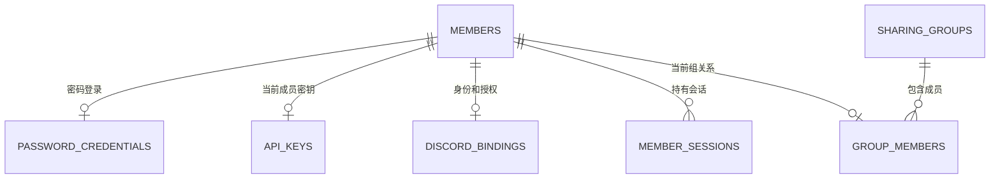
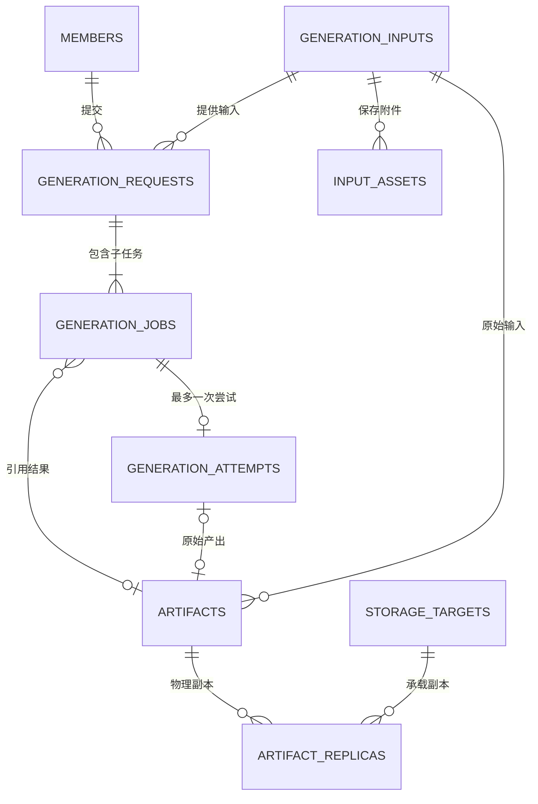
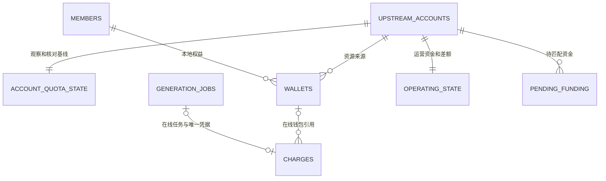
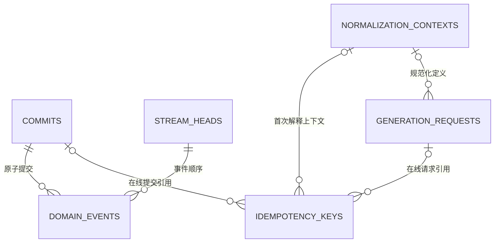

# 数据库与数据模型重构草案

更新日期：2026-11-14，Asia/Taipei。草案版本：0.15。原行为核对基线：`55e5826d80a39364b0946547a83e2a2ed2f72711`；实施基于 PR #33 的 `265793c`。初审和后续修复的历史基线保留在第 9 节；当前已合入主线为 `78887c9`，后续政策、共同回放、副本和报告正整合验证。

**状态：PR #39/#40/#43 和整合 PR #60 已按独立复审、CI 及维护者明确授权正常合入 main；#54–#58 的固定成果随 #60 完整包含。主线 `78887c9` 与受审候选 `27df31c` 同树，新增架构守卫已获维护者认可。后续整合仍须自身验证和审查；新库继续 building，现行网关尚未切换，生产未迁移。** 维护者已基本认可新模型方向；完整历史转换成本过高或无法可靠完成时，可以评估封存旧历史、从新开账基线开始。具体迁移路线依据副本试验选择，不把此授权解释为清零余额、删除原图、取消任务或抹去旧键防重。

**已确认的产品决定：D4a 卡密遗留功能、D4b 客户端自带官方 PST 的独立执行模式均淘汰；D8 仅保留为可选政策，具体留存期限后续决定。** 本轮记录决定，功能移除随重构实施；不设置新的自动归档或删除期限。

总跟踪：[#32](https://github.com/Hime-Hina/novelai-shared-gateway/issues/32)。[#30](https://github.com/Hime-Hina/novelai-shared-gateway/issues/30)、[#31](https://github.com/Hime-Hina/novelai-shared-gateway/issues/31) 保留问题证据与回归场景；它们原先的局部兼容瘦身边界不限制本次重构。后续目标规则以本草案及其评审修订为准，当前线上行为仍以已有契约和发布记录为准。

本文定义目标、实体、所有权、迁移选择和验收。API 逐字段行为、金额算法及归档 IO 协议继续由所属契约维护，实施时同步修改对应 owner，避免并行维护多套规范。

## 1. 目标与范围

采用一份业务事件历史、一套关系型当前状态和独立受保护输入。旧模型的解释与转换留在固定版本的离线迁移工具，新运行时只接受新格式。工作可以拆分评审，生产在同一候选版本完成一次格式切换。

**结构去重和模型迁移属于本轮必做范围，不属于暂缓的 D8。** D8 仅决定已有内容保留多久、何时退出在线查询或最终删除；暂缓 D8 不影响 T1-T7 的新模型、去重和一次迁移工作。

| 工作        | 具体含义                                                                                                          | 本轮范围                                         |
| ----------- | ----------------------------------------------------------------------------------------------------------------- | ------------------------------------------------ |
| 结构去重    | 同一输入正文只保存一份，任务/产物引用；同一当前状态采用唯一关系表示；移除无用途搜索正文、旧 ledger 和历史数组副本 | 必做，并验证读取、更新、重启和重放不会再生成副本 |
| 模型迁移    | 按 A 完整转换或 B 归档开账进入新 schema；稳定身份、权益、未决事项和防重按选定路线接续；旧解释器退出正常运行时     | 必做；路线与历史在线范围依据第 6 节确定          |
| D8 留存政策 | 例如将某类旧内容归档或在明确期限后删除，改变未来保留范围                                                          | 可选，后续决定；不新增期限或自动清理任务         |

“消除重复”针对职责重复的持久副本。例如一次带原图和蒙版的四图请求，保存一份输入、两份附件和四条小任务引用；结果产物各自保存。迁移需要证明字段语义相同：不同含义的提示词、不同请求意图不能仅因字符串/摘要相同就合并，真正不同的已知内容仍有明确去向。

事件保存历史决定、关系投影提供当前状态、独立备份用于恢复，各有必要职责。不能以去重为由把它们无条件合成一份或删除历史事实。迁移路线 B 封存历史属于单独明确的能力取舍，不当作无损结构去重的容量收益。

### 1.1 必须保留的需求

| 编号 | 需求                         | 数据模型要求                                       | 当前规则归属                                               |
| ---- | ---------------------------- | -------------------------------------------------- | ---------------------------------------------------------- |
| R01  | 稳定成员身份与私有访问       | 换 Key、改用户名、移除成员不改变历史归属           | `members/`、[成员会话](../architecture/member-sessions.md) |
| R02  | 密码、Discord、API Key、会话 | 凭据与业务状态隔离，撤销和过期持久生效             | `members/`                                                 |
| R03  | 分组、份额和停止接单         | 当前组关系和权重唯一；配置变更守恒且有版本         | `quota/fair-share.ts`                                      |
| R04  | 唯一执行器、当前单绑定账号   | 账号身份与凭据分离，冷却和派发占用明确             | [执行服务](../architecture/executor-service.md)            |
| R05  | 能力、只读报价、费用确认     | 共用规范化规则，受理保留首次授权                   | [成员生成契约](../contracts/member-generation-contract.md) |
| R06  | 生图、放大、Vibe 编码        | 共用持久生命周期，区分输入与产物类型               | `generation/`、`protocols/`                                |
| R07  | 批次、排队、取消和断线继续   | 父请求共享输入；子任务分别结算；取消不停止在途执行 | [请求生命周期](../architecture/request-lifecycle.md)       |
| R08  | 幂等与显式缓存               | 同键重放、不同意图冲突、活动合并和产物复用分别表达 | `generation/admission.ts`                                  |
| R09  | 三类资源账务                 | V5、订阅 Anlas、购买 Anlas 精确预扣、结算和退款    | `quota/`、`generation/accounting.ts`                       |
| R10  | 官方观察和运营核对           | 官方余额、本地权益和消费证据分开，未知保持未知     | [失败核对](../architecture/failure-accounting.md)          |
| R11  | 崩溃恢复、未知消费和迟到结果 | 不重复上游调用；迟到结果不改原退款、不复活余图     | [结果恢复](../architecture/result-recovery.md)             |
| R12  | 输入与结果恢复               | 规范化参数、实际种子、附件原字节、归属和摘要可验证 | 成员生成契约第 6 节                                        |
| R13  | Local/R2/PikPak              | 产物身份与副本位置分开，临时不可读不触发重生成     | `storage/`                                                 |
| R14  | 历史、统计和审计             | 清理展示不绕过收费、防重、免费窗口与批次授权       | `reports/`、现有查询 owner                                 |
| R15  | 备份、迁移与重放             | 事件、输入、凭据和产物形成明确恢复闭包             | [生产发布](../operations/production-release.md)            |

本次继续使用 SQLite 和单执行器。四组政策、单绑定来源及现有 Native/OpenAI/direct 成员入口保持默认范围；多车队、多执行器和多账号选路仍属于[后续扩展](scaling-follow-up-plan.md)。

### 1.2 删除目标

- 删除 `recordFields()`、通用 `app_records` 及同一实体的 `data JSON + 同义影子列` 模式。
- 删除 `event_streams.projection` 大状态 JSON；将状态迁至唯一关系投影。
- 删除 `request.jobs/state.jobs/jobs.data`、`job.request/requestPayload`、图片提示词多处正文副本。
- 删除事件内旧 ledger evidence 与独立 ledger 正文的重复表达；审计改读事件或必要的薄投影。
- 删除当前配置/账户状态中的历史数组、可直接计算的余额合计和重复成员关系。
- 删除 `user_token/image.token` 业务关联；所有权只用稳定身份。
- 删除无生产调用的旧搜索链、冗余提示词列及其索引，保留真实产品查询。
- 删除 `r2.pikpak` 嵌套模型，改为独立副本记录。
- 新运行时不再执行旧 inline、旧表、旧凭据关联或旧 reducer 的兼容分支。
- 按已确认的 D4 移除卡密业务及客户端自带官方 PST 的独立入口、队列和运行路径；历史数据通过迁移或归档处理。

独立业务功能的淘汰以第 8 节为准。结构清理不能自动授权删除还在使用的产品能力。

## 2. 数据所有权与写入规则

| 类别       | 内容                                                             | 权威与恢复边界                                                         |
| ---------- | ---------------------------------------------------------------- | ---------------------------------------------------------------------- |
| 业务事实   | 命令回执、已受理、派发授权、收费、退款、结果发布、政策及观察事件 | 追加事件；金额和历史决定不按当前算法重新计算                           |
| 受保护内容 | 规范化输入、附件、首次上下文、认证材料、必要诊断、产物字节       | 所属模块验证保存；事件仅保留引用和摘要，备份必须包含内容或可靠恢复来源 |
| 当前状态   | 成员业务状态、组关系、钱包、任务、尝试、收费凭据、产物及副本     | 事件在同一事务内更新，能够在新格式中重建                               |
| 瞬时状态   | 预览帧、HTTP waiter、SSE 连接、瞬时进度                          | 内存状态，不作为永久审计事实                                           |

稳定身份、秘密和业务状态的字段所有者须在物理 schema 中明确。凭据及会话不会因为重放业务事件而复活；需要同时提交的认证撤销和成员业务变更仍在同一存储事务完成。

命令统一校验当前授权、意图和相关版本，在一个 SQLite 事务内保存必要输入、回执、事件、关系状态及流版本。提交成功后才替换内存状态和通知。网络调用、产物上传和文件同步在事务外按既有准备/确认协议执行。

事件与当前状态之间允许必要重复：事件保存发生过的决定，状态表支持当前决策和查询。禁止多个可独立回写的完整对象副本。

## 3. 目标实体关系

下面是逻辑实体与基数；同名对象为同一实体。物理表可按独立生命周期、权限、查询需要合并，字段级 DDL 在 T1 固化。关系图不替代实际外键、唯一性和跨实体归属校验。

### 3.1 成员、认证与分组



| 实体                   | 核心字段和约束                                                                                                |
| ---------------------- | ------------------------------------------------------------------------------------------------------------- |
| `members`              | 稳定 ID、展示名、active/disabled/removed、accepting_jobs、auth_epoch、admission_epoch；业务状态与认证资料分离 |
| `password_credentials` | member_id 唯一、登录名、密码验证材料                                                                          |
| `api_keys`             | member_id 唯一、Key 摘要、按产品决定保存的可恢复秘密；当前不新增多 Key 管理功能                               |
| `discord_bindings`     | member_id、唯一 Discord 身份、授权材料、资格观察；网络失败不等于资格撤销                                      |
| `discord_invites`      | member_id、唯一邀请码摘要和到期；私有当前状态，不保存邀请码正文，不由业务回放恢复                             |
| `member_sessions`      | Token 摘要、member_id、auth_epoch、owner 绑定、固定期限                                                       |
| `sharing_groups`       | 稳定组 ID、名称、份额；当前四组作为政策约束                                                                   |
| `group_members`        | member_id 唯一、group_id、组内权重；全局有效份额计算得到                                                      |

移除成员撤销认证并执行已确认的权益转移，保留最小历史身份。转移余额不转移原请求和原图所有权。owner 继续采用现有部署配置与身份规则，本次不新增通用 RBAC。

### 3.2 输入、请求、执行与产物



| 实体                  | 目标内容                                                                                                                    |
| --------------------- | --------------------------------------------------------------------------------------------------------------------------- |
| `generation_inputs`   | 稳定 ID、member_id、schema_version、完整度、规范输入、摘要、逻辑大小；常用查询字段与模型参数 JSON 不存同义副本              |
| `input_assets`        | input_id、asset_id、MIME、原长度、SHA-256、BLOB，组合主键 `(input_id, asset_id)`                                            |
| `generation_requests` | 成员、input_id、context_id、来源、批次数、种子意图、费用授权、受理时间；不保存 child 数组                                   |
| `generation_jobs`     | request_id、sample_index、实际种子、状态、队列序号、期限、结果引用、必要成功/保留事实；不保存完整输入或 charge/attempt 对象 |
| `generation_attempts` | job_id 唯一、account_id、凭据代次、派发和实际响应证据、核对状态；有授权不等于已发送                                         |
| `artifacts`           | 所有者、原始 input_id、可空原始 attempt_id、内容摘要/长度/MIME、类型、发布和退休状态；包含图片和编码结果                    |
| `artifact_replicas`   | artifact_id、storage_target_id、对象定位、编码方式、上传确认、内容核验、删除与故障状态                                      |
| `storage_targets`     | Local/R2/PikPak、固定桶/目录/命名空间身份；认证配置独立引用                                                                 |

缓存命中可用小型任务引用已有产物，不产生新尝试。活动任务合并可让不同幂等键指向同一请求。产物的原始输入和尝试不随复用者变化。已发布内容丢失时保留身份和不可用状态，不把旧键变成新生成机会。

历史产物可以没有可证实的原始尝试。只存已知输入的 partial/unavailable 状态，不补造调用。旧 inline job 的目标请求容器映射必须明确记录来源，保留原 job ID 和原回执；无法确定归属的记录进入迁移冲突清单，不能猜当前 owner。

### 3.3 账务与上游状态



| 实体                                         | 目标内容                                                                                                                                                                      |
| -------------------------------------------- | ----------------------------------------------------------------------------------------------------------------------------------------------------------------------------- |
| `upstream_accounts` / `upstream_credentials` | 稳定账号、状态和凭据代次；PST 独立保护，轮换不新建一份余额来源                                                                                                                |
| `sharing_policy`                             | 当前绑定账号、配置版本、免费和 fallback 等政策                                                                                                                                |
| `wallets`                                    | `(account_id, member_id)` 唯一；三类资源可用额，不另存 Anlas 合计                                                                                                             |
| `charges`                                    | 原 job 标识唯一、原成员/账号归属、可空在线 job/wallet/attempt 引用、原资源金额、reserved/settled/refunded、原事件和时间；活动收费必须有在线任务和钱包，历史终态凭据可独立保留 |
| `account_quota_state`                        | 最新采用观察、恢复游标、待匹配扣款、续用债务、未分配额；不保存观察历史数组                                                                                                    |
| `operating_state`                            | 运营可用、未承担缺口、未归属返回、V5 容量差额和关联事实                                                                                                                       |
| `pending_funding`                            | 唯一业务收据、来源/归属、剩余待匹配金额和观察引用                                                                                                                             |

沿用三种明确资源，不新增任意资源 EAV 或通用复式总账。金额沿用 12 位定点 BigInt 算术及规范十进制 TEXT；不经 REAL/SUM(TEXT) 批准余额。缩放整数若采用 SQLite 64 位存储，须另行批准金额范围并检查累计量，不能默默缩小既有范围。

原预扣只能结算或按原资源退款一次。退款后找回产物保留失败与退款。官方余额、成员权益、互斥消费候选和实际消费证据分别表达，未知保持 NULL；不重算历史报价或把聚合缺口归因到单次任务。

每次明确更换上游凭据增加 credential_epoch，观察以账号、代次和请求发起序列排序。旧代次成功/失败均不能覆盖新代次，A→B→A 也不能复活旧 A 的迟到响应。失败不清空钱包，也不使旧快照无限有效。

轻量 job 核心保留免费成功时间和当时告警事实时，可合并独立免费次数投影。计数包含退款后找回的完整免费结果；若仍允许物理删除核心 job，就必须另保留相应成功凭据。历史清理不得重置滚动限额。

#### 3.3.1 观察与恢复的来源契约

以下是新格式 T4 必须满足的业务关系，实施状态见第 7.3 节。观察、恢复与分配算法仍归原 quota owner；关系存储负责保留其决定的身份、来源和事务边界。复用算法不允许在转换时用时间或 DTO fallback 猜测事件身份。

每次命令区分两种角色：**原基线**是命令开始时的 `baselineEventId`；**核对观察**是本次参与核对的有效观察，可以来自新查询，也可以是先前已保存的最新观察。事件 ID 确定身份，账号/凭据代次/发起序列决定观察是否仍有效，时间只用于有效期、恢复窗口及基线推进条件；时间相同不表示同一观察。

| 事实                                             | 来源角色与允许的状态变化                                                                                            |
| ------------------------------------------------ | ------------------------------------------------------------------------------------------------------------------- |
| `QuotaObserved`                                  | 当前账号/凭据代次下仍有效的查询结果更新最新观察；保存最新观察本身不等于采纳金融基线或增加钱包                       |
| `QuotaBaselineAdopted`                           | 引用核对观察；原 owner 的在途、结算时间、有效余额及时间推进条件成立后才替换基线，不能因序号较新便跳过这些条件       |
| `RefillApplied`                                  | 引用原基线，`from` 等于原恢复游标，`until` 不倒退且不越过原基线的有效恢复窗口；同提交若采纳新基线，原基线恢复先完成 |
| `ResourceGapObserved`                            | `beforeObservationEventId` 引用原基线，`afterObservationEventId` 引用核对观察，不按时间相等交换两者                 |
| `V5CapacityObserved` 与观察型 `ReturnClassified` | 引用核对观察；人工差额纠正引用其核对的既有基线与原差额事实，不能套用新入站观察身份                                  |
| 登记资金到账的 `FundingReceived`                 | 引用用于匹配到账的核对观察及原登记收据，保持原账号、资源和归属；部分到账只消耗原收据剩余额度                        |

`RefillApplied` 的预算、偿债、容量恢复和成员分配保存原 owner 的决定，回放验证来源、原游标、资源与金额关系，不重新运行当前政策。适配接口若只有时间而不足以确定来源，应从命令上下文显式传递角色对应的事件 ID；不能为所有事实统一设置“旧观察优先”或“新观察优先”。同时间、不同有效序号的新观察应能保存，基线是否推进仍按原条件决定（[#44](https://github.com/Hime-Hina/novelai-shared-gateway/issues/44)）。

官方展示原值与金融 V5 定点值分别表达。`QuotaObserved` 和 `OpeningQuotaRecorded` 必填可空 `v5UsagePercent: number | null`、`v5UsageIsNegative: boolean | null`，保存原查询归一化 owner 决定后的官方标量；80/true 与 0/false 虽有相同金融 0，仍须可逆区分。既有 `v5` / `observedV5`、钱包和金融决定维持原规则，不把官方 number 当作 12 位钱包金额或在回放时重算后覆盖事实。Opening 无原证据时明确 NULL，不从金融符号、0、当前默认值或后来的观察补造 false/0。

失败查询遵守原 `accountQuotaPatch`：保留此前实际已知官方值及原观察时点，事实仍标记失败，不宣称取得新成功观察。金融视图不能用金额正负反推原 negative：真实原 JsonStore 成功保存 -5/false 后遇到网络失败仍保留该值；新命令必须一致，不能延续有损适配把金融 -5 改成 0。金融 snapshot 本身负责数值边界；不改写已存历史事实，也不增加新的分配规则。完整提交按本事实之前的原账户流切点核对此保留来源，不能借同笔后来观察或金融 0 冒充原官方值。`readOfficialQuotaV5(accountId)` 只读原事实两个标量，SharedSource 薄绑定，不增派生投影列、状态缓存或 settings 副本。本必填契约使用明确预发布事件 4→5 格式门禁，正确旧 v4 完整 DDL/hash 也必须零写拒绝；输入/context 各自 schema 版本不变，旧 SQL/journal 不改。

本片完整产品固定 `ce017a3c1205176d58ee9676507b06dd9fddfee7`（含两原标量及事件 v5）。[官方原值专项](../../tests/integration/relational-official-v5.test.mjs) 覆盖真实原 JsonStore/刷新 owner 的成功→ECONNRESET 对照、80/true 与 0/false、独立 NULL/0 和 finite 精度、同毫秒来源、同完整提交失败前切点、完整/重复回放及原生后段 SQL 故障被外层捕获仍全表回滚。成功查询但金融字段不完整仍保留真实成功分类；网络失败才保留此前原值，不混淆两种角色。旧 `2704262` 把有损视图的失败金融 0 当作正向断言，已由真实原 owner 反例纠正；修复只删除四处金融符号→原 flag 推断，不改写已存事实或另外运行一套资金算法。Node 22.23.4 专项 20/20、相关七文件 205/205，类型、架构、可信 main `88d2c264` 的迁移历史与 diff 检查通过。独立复审 24/24（20 专项及 4 独立场景），确认金融值单独偷用同笔后来观察也被原子拒绝。以上为局部源码证据，尚待新 v5 并集的完整套件、编译产物、真实端点及切换验收。

#### 3.3.2 分配预算与有限来源消费

`AllocationApplied.sourceEventId` 必须说明分配的实际来源。`sourceResources` 如保留，是原决定的可核对预算；对已有明确金额的有限来源，它不能成为另一份独立权威。不能仅证明“分配总额不超过分配自己填写的预算”。当前直接有限来源的契约如下：

| 直接来源          | 允许用途与权威预算                                                                           |
| ----------------- | -------------------------------------------------------------------------------------------- |
| `FundingReceived` | `destination` 必须为 `members`，只允许原 `resource`；来源预算取保存的 `amount`，其他资源为零 |
| `DebitsConfirmed` | 只允许原 `resource`；成员预算取 `allocatedToMembers`，不能用确认扣款总额 `amount` 代替       |

对这两类直接来源，分配的自报预算须与来源预算相符，成员分配总额不得超过该预算；来源与分配在同一完整提交内，来源必须在前。当前每个直接来源最多关联一个成员分配列表，无分配时允许没有 `AllocationApplied`。同提交第二次绑定与新提交再次消费均拒绝；原完整提交重放则沿命令幂等路径返回，不再次增加钱包。实现可使用本次完整提交内的来源集合与事件顺序，不新增持久消费计数或另一套账本（[#45](https://github.com/Hime-Hina/novelai-shared-gateway/issues/45)）。

观察、开账与登记资金匹配需要保持各自语义，不能无差别套用上述“一来源一分配”规则：

- 初始观察开账只能在没有原基线、现有钱包权益、预扣、运营资产或未决义务时分配，保留原 owner 的未分配额/容量规则；同一观察可以分别产生三池分配。
- 常规观察的分配预算是原 owner 根据原基线与核对观察的差额，匹配待核对扣款、fallback、登记资金和待归属返回后决定的成员净额；不能把官方观察的全余额当成可再次发放的额度。
- 观察型分配必须属于同一完整提交中同账户、针对该核对观察的一次有效 `QuotaBaselineAdopted`，不能仅检查存在同名事实。核对观察本身可以在先前提交保存；分配可以先于或后于采纳事实，保持原 owner 的事件顺序。采纳继续验证第 3.3.1 节的状态与基线推进条件，因此新提交不能再次采纳并消费已经采纳的同一观察。
- 同一核对中，同一观察、同一非零预算资源只能应用一份分配决定；同时覆盖该资源的两个 `AllocationApplied` 必须拒绝，即使两者金额完全一致且都在自报预算内。按资源判断，允许首次开账同观察的三池各分配一次；没有分配时不要求生成分配事实。使用本次完整提交内的观察/资源集合即可，无需新持久状态。只检查采纳存在而不检查资源重复，或只对两类直接来源检查消费，都不足以满足此约束。
- 登记到账的 `FundingReceived` 可能只是观察或扣款确认预算的组成凭据。已计入该预算的到账不能再作为独立成员分配来源二次发放。转换必须保留“直接分配”与“参与净额计算”的角色，不能简单取最后出现的资金事件作为来源。
- `OpeningQuotaRecorded` 表达已核对的迁移开账状态，不能因其是允许的事件类型便再次发放同一权益。其与钱包开账的关系，以及未来 `redistribution` 的来源/消费边界，在对应 T4 政策或 T7 契约中先明确再接入；本节不宣称这些路径已验收。

观察型一次消费只约束 `AllocationApplied`；`RefillApplied` 仍按原基线与恢复游标分段推进。消费次数与生命周期校验不等于重新证明任意修改后的观察净额，不能据此宣称完整业务 reducer 已验收；原 owner 的预算决定与其余关系校验继续保留。

完整提交校验和业务关系校验分别执行：两份事件列表一致、数量正确，不足以证明分配合法。所有已支持来源都须明确其消费身份和有效生命周期；改成引用观察不能绕过消费约束。在线事务与回放必须在同一所属投影入口保留上述来源检查；失败被外层捕获时，事件、回执、流头、投影游标、钱包和运营状态均不得留下部分变化。原完整提交的幂等回放仍提前返回，不能与新提交再次消费旧来源混为一谈。

#### 3.3.3 上游账户与凭据命令

本节是 [#47 第一片](https://github.com/Hime-Hina/novelai-shared-gateway/issues/47) 的接入契约，实施边界见第 9.13 节。账户配置规则归 `members/owner-operations.ts`；当前仍在 `gateway-runtime.ts` 的注册与 `applyAccountConfiguration()` 按需要归回该 owner，关系存储负责原子保存。资格复用 `quota/eligibility.ts`，查询复用 `quota/account-refresh.ts` 和既有关系观察入口，物理占用继续由 `generation/queue-dispatch.ts` 的执行控制持有，不新增账户或凭据副本。

| 命令          | 权威来源、前置条件与允许变化                                                                                                                                                                                                                                                                                                                                                 |
| ------------- | ---------------------------------------------------------------------------------------------------------------------------------------------------------------------------------------------------------------------------------------------------------------------------------------------------------------------------------------------------------------------------- |
| 注册/首次绑定 | 账户 ID 是资源来源身份，PST 仅是该账户当前凭据。新注册账户保持暂停、代次从 1 开始；不能沿用旧管理员注册默认启用的行为跳过核验。首次绑定使用明确的唯一账户和当前配置版本，账户、初始空额度/运营状态及绑定事实同笔提交；绑定不等于通过 Opus 资格，不凭注册时的未知余额开账。已有绑定不能通过重复注册替换，本片不扩展任意换绑或多账号调度。                                     |
| 暂停          | 对当前绑定账户保存 `AvailabilityChanged(enabled=false)`，阻止新派发；不终止物理在途，不退款、不清空钱包、不重置冷却，也不撤销已受理批次的原授权。                                                                                                                                                                                                                            |
| 轮换凭据      | 事务内核对原账户、当前代次及实际私有 PST。真正更换凭据前，同时确认物理占用为零且不存在该账户的在途预扣；逻辑退款或任务终态不能代替物理释放。保存私有 PST、`CredentialRotated(beforeEpoch, credentialEpoch=beforeEpoch+1)` 及暂停事实；相同 PST 的重复设置不制造新代次。代次不同的旧观察不能批准启用、派发、恢复或修改新代次冷却，原钱包及未决责任仍保留。                    |
| 验证启用      | 先用当前账户、实际 PST、`credential_epoch` 和发起序列取得查询票据，在写事务外查询；保存观察和启用时重新核对当前授权、绑定及配置版本、查询前的账户可用性事实、实际 PST/代次和最新有效观察。仅接受本次仍有效的已保存 Opus 成功观察，沿用原资格和订阅期限判断；被忽略、旧代次或等待期间被新观察取代的结果不能启用；失败观察及原禁用决定仍须保存，派发受当前资格和错误状态约束。 |

操作人身份不由命令体或 `metadata.actorId` 自证。成员入口先复用现有认证事务，在同一事务内复查当前成员状态、认证 epoch、Key/Cookie 和 owner 绑定，再以当前部署 `OWNER_USER_ID` 判定 owner；管理员入口保留现有本地管理员信任边界。原回执重领同样先做当前授权，不能让已撤销会话、旧 Key 或已失去 owner 身份者凭旧命令键取得成功回执。网络等待前的授权快照不足以批准落库。

命令键和规范化意图共同决定幂等；同键同意图返回原安全回执，不再查询上游、轮换代次或重新启用，不同意图冲突。PST 只进入 `upstream_credentials` 和事务外查询所需的易失票据，不进入业务事件、回执或日志；凭据命令仍须保留同键不同意图冲突，不能通过忽略 PST 输入让不同轮换意图视为同一命令。事务异常或前置条件拒绝且被外层捕获时，私有凭据、账户状态、绑定、事实、回执、流头和投影游标全部回滚。核验取得无效 Opus、封禁或查询失败是需要保存的业务结果：原观察、原禁用/资格决定和安全失败回执同笔提交，认证事务完成后再向 HTTP 报错；重领仍先鉴权并返回同一失败，不重新查询。

启用依据必须可回放核对，不能只保存 `reason` 或比较 PST 字符串。`AvailabilityChanged` 使用可空 `observationEventId`：验证启用为所用 `QuotaObserved` 的原 ID，暂停和其他禁用为 NULL。启用投影核对该事实确属当前账户/代次、最新成功观察，并按事实时点验证 Opus 资格；不发起新查询、不采纳另一张同时间观察，也不重新计算金融分配。每个命令的账户、绑定、代次及可用性事实在同一完整提交中依原顺序应用一次，复用共同提交原语；不能过滤后分头回放同一个 commit。业务回放只恢复账户/代次和业务状态，不恢复 PST；缺少匹配当前私有快照时仍不能派发或通过完整恢复验收。

可用性票据引用原账户流中最新的注册、开账、凭据轮换或 `AvailabilityChanged` 事实 ID；按 `stream_version` 判先后，不用时间或启用布尔值代替身份。`upstream_accounts.source_event_id` 也会被冷却更新，不能将它当作可用性代次；核验期间任务正常结算不使查询失效。官方非空且不可解析的订阅期限在共同 `accountQuotaResult()` 边界作为查询失败处理，不能转换为表示无期限的 NULL；普通观察、启用和后续恢复都受同一错误资格约束。合法空期限与合法日期维持原 owner 语义；数值 `0` 规范化为无期限 NULL，字符串 `'0'` 仍为已过期的时间。

验收沿用 `owner-management`、`relational-members`、`relational-generation` 和 `relational-quota` 的真实事务入口，至少覆盖：当前 owner 撤销后重领拒绝；同键重领零查询/零写入与不同意图冲突；凭据 A→B→A 后旧 A 的成功/失败和旧尝试均无效；查询中暂停/轮换或更新观察后旧核验不能启用；只有物理占用、只有预扣以及退款但物理未结束时均拒绝轮换；SQL 故障和外层捕获后全表及私有状态不变。合法首次核验、暂停、轮换后重新核验继续通过，在线与原完整提交回放的业务状态和安全回执一致，PST 始终不进入 replay。

### 3.4 命令、事件与幂等



`commits` 保存内部 command 身份、提交序列、指纹、操作者和原安全回执。生成键保存 `(member_id, operation, key_hash)`、意图指纹和原请求/提交引用；两种指纹不可混用。当前授权先于领取旧回执，新受理资格不阻止合法领取旧结果。

图中的可空在线关联用于已归档或内容已删除的凭据：原 request/job/command 标识、原安全回执或其新格式引用、来源和 live/archived/unavailable 解析状态独立保留，不要求原在线行仍存在。新受理必须关联完整在线请求/提交，活动收费必须关联可恢复的在线任务和钱包；历史终态薄凭据可保留原身份并将在线外键置空。原标识与在线 FK 在 T1 分别定义，唯一防重仍按原业务身份，不伪造历史请求、输入或尝试，也不关闭外键绕过检查。

`domain_events` 只表达一份最小事实，不内嵌完整请求、当前账户或旧 ledger DTO。`stream_heads` 只保留 kind/version/cursor。`projection_state` 标记版本、完整提交位置和构建状态，未完成重建不能标为 ready。

`normalization_contexts` 按不可变内容复用实际首次定义，不复制整个 settings 或成员秘密。随机意图与首次实际 seed 分开，输入摘要、幂等指纹、缓存键各司其职。没有历史上下文时明确不可证明，不能用当前 defaults 冒充。

## 4. 输入附件与正文去重

### 4.1 输入附件是什么

输入附件是一次请求带给模型处理的二进制内容：图生图/重绘的源图、局部重绘蒙版、风格或角色参考图、放大所需源图，以及接口支持的参考编码数据。纯文字提示词、负面词和参数属于输入字段；生成出来的图片或 Vibe 编码结果属于 artifact。一个结果以后作为新请求输入时，在那个请求中承担附件角色。

是否为附件取决于业务内容，不取决于 HTTP 上传格式。JSON 内的 Base64 图片和 multipart 文件经规范化后应指向相同附件语义；普通纯文生图可以完全没有附件。

成员输入恢复契约只要求规范化输入、实际首次种子、批次数与附件，不要求逐字保存原 HTTP 正文或编辑器草稿。规范输入保存一种权威表示，协议适配器在边界构造出站字段。

### 4.2 规范输入与附件保存

- 消除已证明同义的 `tag/prompt/fullPrompt` 和顶层参数/`nativeParameters` 复制；实际不同的主体、画师前缀、负向词、多角色 caption 等语义继续表达。
- 展示文本与执行文本相同则不另存；确实不同且产品需要时保留明确可选字段。旧图文本不同于关联 parent 时迁移独立输入，不能覆盖。
- 缺失、NULL、空串仅在契约证明同义时合并。新请求要求完整输入，partial/unavailable 只支持诚实的查询与不可恢复说明，不能进入派发。
- 附件使用 BLOB；同一输入内按长度、摘要和实际字节相等复用。不做跨成员/跨请求全局 blob 去重，也不新增素材库产品。
- body 中的附件槽位只保存 asset 引用；写入验证引用属于同 input、存在、长度和摘要一致，无未引用附件。复用现有槽位白名单，不新增任意路径 DSL。
- 输入、附件、受理事实同事务保存；执行时才生成协议需要的 Base64。列表、排队和 SSE 状态读取不加载附件。
- 读取为“当前授权 → 原请求 → 白名单槽位 → 所属附件”，不能凭摘要或 asset ID 全局取内容。
- 分别计算磁盘字节、协议展开字节和活动输入预算；不能把更小 BLOB 字节直接当作原有载荷上限口径。

首版将输入附件保存在 SQLite，维持受理事务和一致性备份的简单边界。大型结果继续外部副本。未来是否外移输入由独立容量证据决定，不能把移动位置当作总存储减少。

## 5. 产物、存储与留存

### 5.1 副本状态

产物的摘要/原长度/归属保持稳定，Local/R2/PikPak 分别保存副本。桶或目录有稳定身份，更换凭据不等于更换数据来源。配置临时缺失或目录不符时允许原回执与合法缓存引用，读取按现有不可用语义失败，不重新生成。

上传确认、内容回读核验和源删除分别命名。当前 Local→R2 回读核验后删本地，R2→PikPak 在上传回执持久化后删 R2、领取时校验内容；本次不默默把确认上传宣称为内容已验证。若要求 PikPak 回读后才删 R2，作为增强政策单独评审和测量带宽。

### 5.2 D8：可选留存期限，不包含结构去重

D8 已确认为可选留存政策，区分三个动作：缩短在线查询窗口、将历史归档、最终删除内容。**具体期限后续决定，本轮不实施新的保留天数、自动归档或删除规则，保留现有输入、原图及账务可用性。** D8 的具体政策不作为本次模型重构完成的前置条件，也不恢复已取消的单份/总量备份硬容量限制。第 6 节的一次性历史归档开账路线独立评估，不等同于开启日常到期清理。

| 数据                                       | 本次默认                 | 未来调整前必须满足                                                         |
| ------------------------------------------ | ------------------------ | -------------------------------------------------------------------------- |
| 当前钱包、预扣、未决核对、待匹配资金、冷却 | 完整保留                 | 只能由业务事件合法结案或转移，不能按年龄删                                 |
| 幂等、防重复收费、免费窗口证据             | 保留必要核心             | 删除展示历史不得使旧键重执行、重复退款或重置限额                           |
| 已完成历史展示和可重建索引                 | 结构去重；不设新期限     | 在线窗口缩短/归档应明确页面覆盖范围，不能误报为全量历史                    |
| 输入附件和规范化参数                       | 保留                     | 若以后独立到期，要定义参数复用/补查失效和 GET 的不可用语义；不连带删除结果 |
| 原图和其他产物                             | 保留，沿现有冷热规则流转 | 如最终删除，先记录不可用事实并核验请求、旧快照和归档引用；原键不得重新生成 |
| 诊断和临时文件                             | 不新增期限               | 在途恢复、未决核对、审计依赖解除后才可依明确规则清理                       |
| 已过期/撤销会话及短期认证材料              | 沿认证生命周期处理       | 不能删除仍有效凭据，也不能由重放恢复撤销令牌                               |
| 迁移源与历史归档                           | 独立保护                 | 不放进日常轮换前缀；最终删除须有明确决定和剩余恢复证明                     |

当前日常数据库备份仍按最近七份轮换；已去掉的是旧 50 MiB 单份/500 MB 总量硬限制。生产 R2 七天后转 PikPak 描述热层停留时间，原图仍在冷层。以上都不同于“旧数据七天后永久删除”，本草案不改变这些现行规则。

若后续选择具体期限，先做只读清理清单和依赖检查，再审批范围，分批执行并留下删除事实。受保护内容有意删除后，恢复必须识别已删除标记，不能伪造内容或把预期不可用当成功。尚未完成的业务对象不得被年龄规则清理。

## 6. 一次迁移的两条路线

### 6.1 共同前置条件

1. 先在同规模一致性副本输出实体计数、正文大小、账务核对、归属/摘要冲突和预计资源消耗。只上传聚合报告，不上传真实提示词、图片或秘密。
2. 固定源提交切点、源库及必要文件/对象清单、转换器版本和 manifest。源库保持只读；若旧工具必须升级副本，另建工作副本，保留原始证据。
3. 迁移器负责历史解释；新运行时只有新契约。当前 SQL/journal 历史字节不改写，新格式初始化与版本拒绝边界单独设计；如需调整 guard/打包规则，独立评审。
4. 新 writer 拒绝旧/未完成目标，旧 writer 拒绝新库。迁移失败不能留下看似 ready 的半库。
5. 保留原业务 ID、原安全回执、已知时间、NULL 与未知。旧原文/hash 和新规范内容/hash 分别校验并建立来源映射。
6. 先停止新受理和新派发，等待并恢复在途、存储发布和归档工作；queued/pending 及仍未决记录要保留或经明确业务命令结案。原工具停止写入后才能固定最终切点。
7. 迁移期间不发 NAI 请求。切换后有新增写入或外部存储变化时，不能用旧快照覆盖账本回退。

### 6.2 路线 A：完整历史转换

旧一致性源经离线转换器形成新受保护输入、新事件契约和关系状态。保留旧逻辑提交边界、相对顺序、命令回执及可证实决策；旧事件到新事实允许明确的一对多映射。旧事件原文留在源归档，不再复制到在线 payload。

新库从转换后的 opening 和完整新事件重建。原本只有开账快照的时期仍是 opening，不补造逐笔历史；承诺范围限于原系统已有证据支持的历史范围。重放只应用保存的金额和决定，不调用当前报价、时间、网络。

输入、事件或所有权冲突不能挑一份覆盖。若某类历史无法证明转换，报告其数量、涉及权益/接口及处理选择，不无限追加在线兼容分支。

### 6.3 路线 B：封存旧历史，以新格式重新开账

维护者允许在 A 很难或无法可靠完成时考虑 B。B 将“全历史逐条转换”收敛为“核对切点仍生效的状态与凭据”。可用权益、未决责任和防重继续存在，新事件历史从明确新基线开始。

#### 必须带入新基线的内容

| 内容             | 要求                                                                                                                      |
| ---------------- | ------------------------------------------------------------------------------------------------------------------------- |
| 身份、账号、配置 | 稳定成员/账号、有效认证策略、分组和版本；已移除成员的必要历史身份                                                         |
| 钱包与资源核对   | 三资源余额、预扣、待匹配消费、债务、未分配额、运营差额、未归属返回和资金收据                                              |
| 观察与调度       | 原观察时间/有效性、凭据代次、恢复/结算游标、fallback 缓冲、冷却截止/失败计数和排队顺序；迁移不得刷新旧观察时间            |
| 活动与未决任务   | queued/pending、真实在途/未知结果、resultPending、核对截止、原批次授权和完整 child 费用证据；相关输入/附件/上下文必须可用 |
| 防重             | 旧生成键、内部管理/资金收据等必要命令回执、终态收费和退款凭据；不得因新库重建而重复执行                                   |
| 免费限制         | 切点仍影响滚动窗口的成功时间、迟到成功、在途占用及告警事实；不能只迁移一个累计数                                          |
| 结果与在线历史   | 按选定查询范围迁入小型结果/所有权/存储引用或明确的历史不可用凭据，不能把缺失当成可重生成                                  |
| 未决历史关联     | 当前核销、差额、资金登记等所引用的原事实，或经核验的新开账等价记录；新库内必须能够解析                                    |

上述基线保存为**有来源的新格式 opening facts**，可分页/分提交导入，但只有整体校验完成才安装为 ready。只把值写进当前表、不给新重放提供基线，不算完成 B。新基线和切点后事件连同新受保护内容应足以恢复新服务，无需常态运行旧 reducer。

#### 旧历史的查询边界

B 的具体选择报告必须列明：历史列表/热力图/损耗审计、旧请求查询、旧结果领取、输入复用各自仍在线、仅归档可查，或明确不可用。默认尽量保留原结果领取和小型索引；确需缩小功能范围时，将具体接口影响提交维护者决定。

迁入的历史摘要也要有可重建来源。不能导入一张不受 opening/事件覆盖的“历史查询表”，然后声称全库可重放。只保存在归档中的历史不得让新界面静默显示为完整零历史。

#### 原归档必须独立可用

- 保存旧一致性数据库、受保护输入/上下文/回执、必要配置与解密材料，以及固定版本只读审计/导出工具和 manifest。
- 当前数据库备份包不包含原图；必须同时保存匹配产物副本或经过验证的对象清单、原摘要、定位和访问恢复材料。旧数据库单文件不是完整归档。
- 归档脱离日常七份轮换。只被归档引用的 Local/R2/PikPak 对象仍受保留保护，新后台不能把它们当孤儿删除；目录和凭据变更要同步验证归档可读性。
- 如归档沿用可变外部存储，必须把这些对象及其生命周期纳入恢复闭包；仅保存一个可能失效的 URL 不构成归档。
- 旧审计工具离线/只读使用，不接上游、不启动派发、不成为新服务的长期查询 fallback。

B 承诺从新开账点重放；更早逐时点状态由原归档审计。新服务恢复与历史归档恢复分别验收。

### 6.4 路线选择与旧键

先用代表性副本评估 A 的可证明性、运行时间、峰值内存/磁盘和未能转换的类别。若历史只能依赖缺失信息、或者成本和风险不合适，可以选择 B；不为维持 A 引入永久旧解释器。选择报告附保留清单、接口变化、归档恢复演练和截止点，由维护者据此确定切换方案。

两条路线都不能只复制旧 fingerprint 就宣称旧 POST 完全可重放。可以证明的新旧意图转换继续精确比较；无法证明时保留旧键禁止再次执行，并明确返回原查询入口和冲突/不可重放语义。已有结果确实缺失仍返回既有不可用语义。错误码与接口变化在实施契约评审中确定，本草案不擅自更改生产返回值。

幂等证据有意保留为薄记录；它不要求保留一套旧运行模型。不能通过清空键空间、轮换成员 Key 或新建所有成员 ID 来绕过旧请求防重。

## 7. 数据约束、查询与验收

### 7.1 结构性约束

- 唯一 `(member_id, operation, key_hash)`、`(request_id, sample_index)`、attempt.job_id、charge.job_id、`(stream_id, stream_version)`、`(commit_seq, event_index)`。
- 私有输入/请求/产物关联验证稳定成员一致；困难历史关系进入转换报告，不通过空值默认或 token fallback 掩盖。
- 任务、尝试、收费、账户当前行不包含完整 request/charge/attempt/children/history JSON。
- 金额运算集中于既有核心，事件、当前状态和 DTO 的转换边界清楚。
- 关系状态仅由命令事务和重放器写入；外部读模块不能通用更新整个 store，DTO 不能回写成实体。
- 引用完整性、输入长度/摘要和权限在唯一所属模块验证；数据库和类型检查共同覆盖必需边界。
- 新表索引来自成员历史、父子任务、队列、在途收费、待核对和产物读取的实际查询。先测量再新增汇总缓存或全文搜索。
- 注释解释事实来源、事务先后、重试、金额单位和恢复边界；格式继续用现有 Prettier/EditorConfig，不改历史 SQL。

### 7.2 验收矩阵

| 验收           | 必须证明                                                                                     |
| -------------- | -------------------------------------------------------------------------------------------- |
| E01 身份和授权 | 换 Key、暂停、停用、移除、Discord 临时失败、跨成员访问正确                                   |
| E02 受理/幂等  | 并发同键、丢回执、重启、默认变更、不同意图、旧键受限分支均不重复生成                         |
| E03 资金       | 逐来源/逐资源钱包、预扣、终态、运营资金、未知消费一致；无宽泛 epsilon                        |
| E04 输入       | 出站参数语义、实际 seed、原附件字节和摘要一致；空/缺失/不同提示词不被覆盖                    |
| E05 恢复       | 结果准备、文件同步、发布、退款、迟到结果各崩溃窗口仍正确                                     |
| E06 存储       | Local/R2/PikPak 原字节、目录身份、确认/核验差别、临时缺配置、归档引用保护                    |
| E07 重放       | 新空库从选定 A 历史或 B 基线重建；所有承诺的业务状态及历史摘要一致                           |
| E08 不再膨胀   | 受理、查询冷输入、更新、重启、迁移及 replay 后，正文不回填任务/产物/流状态                   |
| E09 查询       | 当前历史/统计/搜索/错误详情有正确覆盖范围；清理不重置免费窗口或批次费用                      |
| E10 容量与性能 | 逻辑内容、表/索引页、WAL、输入 BLOB、压缩备份、归档总量、迁移/恢复峰值和关键查询耗时分别测量 |
| E11 切换       | 源只读、最终切点、旧 writer 拒绝、失败目标不可上线、新写入后的回退边界                       |

生产容量数据目前来自维护者报告，未在本设计工作中读取生产明细。不得把重复内容字节直接当文件释放量，也不得把外移归档当总存储消失。专项反例应能识别错误实现，再运行仓库已有完整验证和真实产物恢复门禁。

E02/E03/E07 必须包含“原目标行已缺失，仅剩旧键或终态退款凭据”的开账反例：B 仍能完成基线并阻止重复执行/扣退，不要求重新加载旧模型、伪造在线实体或关闭外键。

### 7.3 跨对象语义与反例验收

非平凡改动按 [CONTRIBUTING 的业务约束与验收](../../CONTRIBUTING.md#业务约束与验收)执行。只补本次受影响的契约，不复制业务算法或另建规范。设计先明确权威来源、允许变化和失败条件；实现将关系检查落到原 owner/投影入口；独立审查从这些约束构造不同于普通成功夹具的反例。

| 验收关系                                 | 最小反例与合法对照                                                                                                                                           | 所属入口及状态                                                                               |
| ---------------------------------------- | ------------------------------------------------------------------------------------------------------------------------------------------------------------ | -------------------------------------------------------------------------------------------- |
| 入口合法范围不被统一存储收窄             | direct/OpenAI 合法但 Native 不支持的参数可冷读还原；Native 原限制继续生效                                                                                    | 输入 owner；`relational-input.test.mjs`，#34 已修复                                          |
| 私有认证与具体凭据方式分离               | 纯 Key 注册即能认证；两个无密码同名成员都能 OAuth；业务回放仍不恢复私有认证                                                                                  | 成员 owner；`relational-members.test.mjs`，#41/#42 已修复                                    |
| 事件身份不由时间推断                     | 同时间、不同有效序号的观察成功保存；恢复仍引用原基线，游标只推进一次；不同时间及失效代次保持原行为                                                           | `RelationalQuotaStore`；`relational-quota.test.mjs`，`7025582` 复审通过 #44，待合并          |
| 直接有限来源的用途、资源、额度与一次消费 | 跨池、运营来源分给成员、同时抬高自报预算与分配额、同提交重复绑定、新提交再次消费旧来源均拒绝；合法分配和原提交重放通过                                       | 同一额度投影入口；`relational-quota.test.mjs`，`7025582` 的 #45 直接来源子集复审通过         |
| 观察型分配属于一次采纳且同资源不重复     | 原分配原样放入新提交、同一合法采纳提交内复制同池分配均拒绝；分配后采纳失败且被外层捕获仍整库不变；初始三池、先前观察、正常先分配后采纳及原提交重复零写入通过 | 同一额度投影入口；`c786f8f` 正式回归及独立原始反例通过，#45 待合入后关闭                     |
| 聚合来源保留原组成关系                   | 多收据及部分到账、两种资金归属、初始三池分配、已保存观察参与核对保持原 owner 结果；到账既计入观察/确认预算又被单独发放时拒绝                                 | 同一 quota owner；`7025582` 的上述合法/非法对照复审通过，不能替代观察型消费检查              |
| 提交完整、业务有效与失败原子性分别成立   | 两份事件列表同步修改仍须校验独立来源；被外层捕获后全表不变；合法完整提交、断点续跑和重复零写入通过                                                           | `relational-events.test.mjs` 与对应 owner 集成测试；#36 仅证明提交完整性，不替代业务关系验证 |

修复须保留同一个反例在受审旧候选失败、修复后通过的证据，并检查共同错误假设的其他表现；不以增加成功用例数量代替来源/身份断言。时间相关用例使用可控时间，失败检查使用真实事务与相关完整状态；无需真实上游、生产库或新增测试框架。

本节保留 `39d3c4b` 的[初审记录](https://github.com/Hime-Hina/novelai-shared-gateway/pull/43#pullrequestreview-5885655449)，当前状态固定到 `c786f8f` 的[独立复审](https://github.com/Hime-Hina/novelai-shared-gateway/pull/43#pullrequestreview-5893340570)。原 0.12 仅细化直接有限来源的消费规则，遗漏了观察型分配与采纳的生命周期；0.13 已补正规范，`c786f8f` 已完成相应实现，不将原规范缺项归为实现者违反既有细则。独立验证的四文件 193/193 通过，原始两个反例均被拒绝；同一额度测试在 `7025582` 上的六个重复消费子例失败、两个采纳失败/回滚对照通过，含父测试统计为 10 项中 2 通过、8 失败。[CI #156](https://github.com/Hime-Hina/novelai-shared-gateway/actions/runs/43441705229) 六个 job 成功，合并预览与候选源码 tree 一致。具体回滚、合法对照及命令证据见 [#45 复审](https://github.com/Hime-Hina/novelai-shared-gateway/issues/45#issuecomment-6856824857)。issues 待代码合入后关闭。T1 结构/提交原语通过、某个 T4 业务子集通过、T7 完整恢复通过及 T8 生产切换通过必须分别报告；CI 全绿不能替代未定义或未覆盖的业务关系。

## 8. 决策记录与 D4/D8 澄清

| 决策             | 当前记录                                                                | 尚需落实                                            |
| ---------------- | ----------------------------------------------------------------------- | --------------------------------------------------- |
| D1 历史路线      | 新模型方向基本认可；A 完整转换与 B 归档开账均可评估，A 困难时允许考虑 B | 代表性副本报告及最终切换路线                        |
| D2 不可证明旧键  | 必须继续防重；同意原则不等于批准跳过冲突检查                            | 受影响类别、数量、接口错误和原结果查询              |
| D3 历史清理      | 建议展示隐藏、保留轻量核心事实                                          | 与现有清理接口逐项确认，不能提前物理删除            |
| D4a 卡密遗留     | 已确认淘汰；不涉及成员 Key                                              | 清点未兑权益和历史，明确迁移/归档去向并移除在线结构 |
| D4b 官方凭据模式 | 已确认淘汰客户端自带 PST 的独立任务模式                                 | 移除独立入口/队列；核验历史产物归属、迁移或归档去向 |
| D5 Key 再次查看  | 默认保留现有功能，秘密独立保存                                          | 若改为仅创建时显示，单独批准 UX/认证变更            |
| D6 迁移登出      | 建议允许一次统一登出，尚未确定具体切换行为                              | 记录会话处理和用户通知，不撤销有效 API Key          |
| D7 输入附件      | 默认 SQLite BLOB，结果继续外部副本                                      | 预算、真实字节、输入恢复和备份验证                  |
| D8 留存期限      | 可选，后续决定；本轮不新增期限或自动清理规则                            | 未来按第 5.2 节评审，不阻塞本次模型重构             |

### D4 指的两个特定旧功能

1. **D4a 卡密业务**：旧 `cards` 数据模型和兑换/卡余额流程，区别于现有成员 API Key。当前共享 API 白名单不开放旧兑换入口，但移除前仍要确认生产是否存在未兑权益、需要归档的记录或外部依赖；不能仅因没有入口就丢掉余额责任。
2. **D4b 官方 PST 直连模式**：私有部署允许来访者提供自己的 NAI 官方 PST，走 `officialJobs/createOfficialJob` 独立任务路径。它区别于成员使用网关发放的 Key，由网关调度绑定 Opus 并记成员账务。

`/generate` 是接口路径；用成员 Key 调用它属于当前共享业务，仍保留。Native/OpenAI 成员入口、管理员配置绑定上游账号的 PST 也保留。D4a/D4b 已决定淘汰，目标运行时和正常发布包不保留卡密流程、`OfficialKeyJobs/createOfficialJob` 独立执行路径或重新启用开关；必要旧格式解释仅留在独立迁移/归档工具中。

维护者于 2026-11-11 明确同意淘汰 D4。当前私有模式确有官方直连分支，此项属于已确认的功能退出，不能按无调用死代码处理而遗漏入口和历史数据。历史产物保留真实归属，不自动划给现任 owner；未兑权益须有明确处置，不因删除卡表而消失。

D4 纳入 T6/T7 及 E01/E06/E09/E11 验收：成员 Native/OpenAI/direct 和绑定账号认证继续正常；各生成入口收到客户端自带 PST 时，不创建官方独立任务或发起该模式的上游生成，覆盖私有模式及管理员头绕过原公网守卫的场景；卡密/独立队列没有运行残留；历史权益与产物的迁移或归档可核对。D8 不增加实施删除任务。

## 9. 工作包与交付边界

| 工作包 | 内容和 owner                                                           | 依赖/交付                                    |
| ------ | ---------------------------------------------------------------------- | -------------------------------------------- |
| T0     | 需求、ER、决策和删除清单                                               | 设计基础已提交；评审继续                     |
| T1     | 新 schema、版本、事实/字段所有权和事件契约，`storage/` + `events/`     | T0；字段级 DDL、约束、重建来源               |
| T2     | 规范输入、BLOB、上下文和输入查询，`generation/` + `protocols/`         | T1；E04/E08，复用槽位和归一规则              |
| T3     | 稳定身份、认证隔离、成员移除，`members/`                               | T1；E01，历史归属映射                        |
| T4     | 请求/任务/尝试/收费/钱包关系状态，`generation/` + `quota/` + `events/` | T1-T3 所需接口；E02/E03/E05                  |
| T5     | 产物、副本、冷热恢复与归档引用，`storage/`                             | T1/T2/T4；E06                                |
| T6     | 历史、统计、审计、DTO、旧结构清除与 D4 两项功能退出，既有查询 owner    | T2-T5；E08/E09，实际旧路径删除清单和 D4 验收 |
| T7     | 独立迁移器、A/B 可行性报告、来源 manifest 和开账/重放                  | T1 契约冻结后可并行，最终覆盖 T2-T6；E07/E11 |
| T8     | 同规模副本、恢复、容量性能和切换报告                                   | 完整同一候选；E01-E11                        |

边界通过工作包和可审阅提交控制，不引入长期双写、运行时开关矩阵或同时在线的两套账本。只有完整候选通过验收后再安排生产切换。

T7 的处置报告须列明 D4 的未兑权益、官方模式历史产物、可验证来源及迁移/归档去向；淘汰产品模式不要求删除这些历史证据。

PR #33 本身只修改计划和导航；后续实施基于其 `265793c` 开展。PR #39/#40 已交付 T1/T2 与 T3 认证接入；T3 的成员移除/权益处置、T4 的完整业务命令/reducer 和 T5–T8 仍未完成。T4 已实现子集及 #44/#45 的修复验收由 PR #43 跟踪，本次文档补充不代替该 PR 的业务验收。当前没有切换现行 API、账本、旧 SQL/journal、CI 或生产行为，不关闭 #30/#31/#32。

### 9.1 T1 基础：物理字段、格式和生命周期契约

唯一 DDL 为 [`relational-schema.ts`](../../server/storage/relational-schema.ts)，初始化和格式门禁归 [`relational-storage.ts`](../../server/storage/relational-storage.ts)。不维护第二份 ORM DDL，不把这份新 schema 追加进旧库迁移链；它只创建离线空目标。DDL 位于编译模块内，现有后端编译/打包会一并带入，不新增需要另行复制的 SQL 资产。

格式为 `novelai-relational-v1`，writer/minimumWriter 为 5，新格式 reducer 为 1，事件 schema 为 2。现行运行时继续使用旧格式 writer/reducer 4 和事件 v1。新格式保留仅供格式识别的三项 `app_meta`，用旧 writer 已有的 `event_authority` 检查拒绝误开，不改变旧迁移 hash guard。初始化把完整 DDL、标记和 `building` 状态原子提交；非空目标一律拒绝，DDL 中断整笔回滚。这里不提供跳过核对或直接发布 ready 的接口。

`assertRelationalStorageFormat()` 只读核对格式/源码 DDL hash、实际表/索引/触发器结构和外键开启，供离线 building 目标使用。`assertRelationalStorageReady()` 另核对外键引用、reducer、ready 标记和完整提交游标。`ready` 必须由后续 T4/T7 在业务和受保护内容核对通过后安装；格式门禁本身不证明业务投影或输入摘要正确，也不代替 E07。64 位提交/流/队列序号以十进制字符串穿过 JS 边界，不能先读取为 number 再转换。

| 字段/表归属                                                     | 唯一在线表示与恢复来源                                                                                                                                 | 实际业务 owner                                                                                                   |
| --------------------------------------------------------------- | ------------------------------------------------------------------------------------------------------------------------------------------------------ | ---------------------------------------------------------------------------------------------------------------- |
| `commits` / `domain_events`                                     | 原命令、指纹、操作者和安全回执属于 commit；事件只存决定，按提交内索引及流版本唯一；提交和事件禁止 UPDATE/DELETE                                        | `events/` 的事实校验和提交入口；T4 接入业务命令                                                                  |
| `stream_heads` / `projection_state`                             | 只存版本和游标，不含状态 JSON；由同笔提交及重放构建                                                                                                    | `events/`                                                                                                        |
| `members` / 各认证表 / `member_sessions`                        | 稳定成员行与密码、可恢复 Key、Discord 授权、会话分表；`auth_epoch` 仅由当前私有快照/认证命令恢复，NULL 表示未恢复或撤销；业务事实不携带它              | `members/`，认证材料由私有备份恢复                                                                               |
| `sharing_groups` / `group_members` / `sharing_policy`           | 成员唯一当前组，组关系不再复制到成员数组；份额/权重保留原 number 语义；免费、fallback、告警各有明确字段                                                | `quota/`，T4 接入配置、开账及政策 reducer                                                                        |
| `upstream_accounts` / `upstream_credentials`                    | 账号唯一身份、当前 credential_epoch、冷却及失败次数；PST 只在凭据表，换凭据不新建钱包来源                                                              | `quota/` + `members/`                                                                                            |
| `generation_inputs` / `input_assets` / `normalization_contexts` | 不可变正文/上下文和每个 input 的附件 BLOB；事件保留引用/摘要。SQL 验证格式和附件长度，T2 验证实际摘要、槽位、语义去重及逻辑字节预算                    | `generation/relational-input.ts` 和 `storage/relational-input-store.ts`，复用 `protocols/`；内容从受保护备份恢复 |
| `generation_requests` / `generation_jobs`                       | parent 保存一次输入/上下文引用和确认；child 保存索引、实际 seed、状态、顺序、结果及免费成功事实，无 children/request/charge JSON                       | `generation/`，受理和生命周期事件重建                                                                            |
| `generation_attempts`                                           | job 唯一尝试；响应证据、互斥候选、未知实际消费、核对和待发布描述各自命名。旧凭据代次允许 NULL，不以当前代次补造历史                                    | `generation/accounting.ts` 的新格式接入，T4                                                                      |
| `wallets` / `charges`                                           | 钱包只有三类可用额；原预扣金额在 charge 唯一保存，终态不能再次结算或退款；不另存 Anlas 合计                                                            | `quota/`，金额继续由 `resource-amounts.ts` 计算                                                                  |
| `account_quota_state` / `operating_state` / `pending_funding`   | 最新观察与对账基线分别引用；待匹配扣款、fallback 缓冲、债务、运营差额、剩余资金独立保存，无历史数组。恢复/发放累计和展示合计由保存事实计算，不额外复制 | `quota/`，T4 接入观察、恢复、资金及开账 reducer                                                                  |
| `artifacts` / `artifact_replicas` / `storage_targets`           | 产物稳定所有者、原 input/attempt 和内容身份；副本定位不嵌套。uploaded/verified/deleted 分列，上传确认不冒充内容核验                                    | `storage/`，T5 接入发布与冷热事实；字节独立恢复                                                                  |
| `idempotency_keys`                                              | 原成员/请求/job/命令身份与可空在线 FK 分开；live 必须有当前请求/job、首次上下文和原 commit，归档可只保留原回执和来源，仍按原成员/操作/键唯一           | `generation/admission.ts` 的新格式接入，T4/T7                                                                    |
| `generation_diagnostics`                                        | 错误详情及摘要单独保护，事件只引用；不混入公开响应或普通列表                                                                                           | `generation/` + `storage/`                                                                                       |

`charges` 的 `original_*` 是不可变业务身份；`job_id`、钱包二元键及 `attempt_id` 是在线外键。活动收费必须关联真实任务和同成员钱包；归档终态可将在线外键置空，原 ID、金额、终态、来源和新 opening 事件引用仍在。生成旧键同样分离 `original_*` 和在线引用；有在线 commit 时读取其原回执，不再复制一份 JSON；没有该 commit 的历史薄记录才保存 `archived_receipt`。不能把缺行解释为可重新执行。旧键具体 HTTP 分支仍由 D2/T7 的接口评审落实。

跨成员输入/request、job/artifact、artifact/原尝试和 charge/job 关系由 FK 与触发器共同拒绝；首次输入、成员归属、原收费和原键意图不可被普通 UPDATE 改写。活动任务需要 complete 输入和首次上下文，child 索引不能超过原批次数。新金额列为规范十进制 TEXT，保留 12 位小数和原 BigInt 范围，不转成 SQLite 64 位金额或 REAL；恢复速率和配置权重属于非金额字段。

[`relational-fact-contracts.ts`](../../server/events/relational-fact-contracts.ts) 用同一字段表生成写入类型和运行时校验，补齐生命周期、成员、分组/政策、账号/凭据代次、官方观察、恢复/分配、资金、运营、存储及分型 opening facts。未知事件、额外字段、旧 `OpeningStateRecorded`/`LegacyFactRecorded`、隐私字段、非规范金额和未知输入/上下文版本直接拒绝。opening 按实体保存明确字段和来源，不恢复旧 DTO 或通用状态包。金额仍复用原 12 位定点核心；未知官方值和历史凭据代次保留 NULL。

[`relational-events.ts`](../../server/events/relational-events.ts) 校验完整事件 envelope、固定 schema/金额版本、stream owner 及成员/账号身份；[`relational-event-store.ts`](../../server/events/relational-event-store.ts) 要求外层命令事务和明确流前置版本，在保存点内原子追加原回执、事件、流头及游标。相同命令必须匹配操作者和指纹；缺失、落后、失败或未知 reducer 的投影不能推进。重放保留原事件 ID、顺序、时间和回执，校验 history 与完整提交，断点重复必须与原提交及元数据完全相同，不重算种子、价格或调用网络。这里没有 T4 的账务/任务全量 reducer，也不安装 ready。

有区分力的结构与契约检查在 [`relational-storage.test.mjs`](../../tests/integration/relational-storage.test.mjs)、[`relational-events.test.mjs`](../../tests/unit/relational-events.test.mjs) 与[事件类型测试](../../tests/unit/domain-event-types.test.mjs)：缺失旧目标的薄凭据、重复键/重复退款终态、跨成员关联、精确金额、DDL 回滚、相互拒绝、未来格式、实际 DDL 漂移、>2^53 游标、未知/隐私事实、半提交回滚及原提交重放。它们是合成夹具和新格式原语检查，尚非 T7 迁移或真实容量报告。

### 9.2 T1 基础的本地验证（2026-11-11）

Windows，Node 22.23.4，pnpm 10.32.1；独立 Node 24.22.1 环境复用同版本 better-sqlite3 12.10.0 的 ABI137 依赖。没有重编译或替换共享依赖。结果针对本节基础代码，不能解释为 T2–T8 或 E01–E11 全部完成。

| 实际命令/检查                                                                                             | 结果                                                                                           |
| --------------------------------------------------------------------------------------------------------- | ---------------------------------------------------------------------------------------------- |
| `pnpm run architecture:check`、`pnpm run migration:check --base 55e5826d80a39364b0946547a83e2a2ed2f72711` | 通过；历史 SQL/journal、守卫和基线未改                                                         |
| `pnpm run typecheck`、`pnpm run check`、`pnpm run format:check`                                           | 通过；120 个 JS/MJS 语法检查                                                                   |
| `node --test tests/integration/relational-storage.test.mjs tests/unit/domain-event-types.test.mjs`        | 11/11 通过，保留原有事件类型断言                                                               |
| `pnpm test`                                                                                               | 772 项：767 通过、5 项平台/显式开关跳过、0 失败，约 226 秒；包含现行格式的开账、重放和恢复用例 |
| Web 与 executor 的 `typecheck`、`test`                                                                    | 类型通过；149 与 3 项单元测试通过                                                              |
| `pnpm --filter @novelai-gateway/executor build`、`test:runtime`                                           | 后端和执行器构建通过；实际 Nitro 产物 HTTP 3 通过、1 项平台跳过                                |
| `pnpm --filter @novelai-gateway/web test:executor`                                                        | 真实 Nuxt 开发/生产构建与执行器 HTTP：15 通过、1 项平台跳过                                    |
| 新格式 Node 24 专项                                                                                       | 逐文件 hash 核对的隔离源码及原迁移资产副本，10/10 通过                                         |
| 打包的新模块                                                                                              | 执行器包内编译 JS 的 DDL 与源码相同；空库初始化、building 拒绝及格式门禁 smoke 通过            |
| 文档和差异                                                                                                | 71 个本地文件链接存在，`git diff --check` 通过                                                 |

首次专项直接使用终端默认 Node 24 时，现有共享 SQLite 原生模块为 ABI127，因 ABI 不匹配而未执行结构用例；切到仓库指定 Node 22 后通过，再在独立 ABI137 依赖中验证 Node 24。原始后端、Web、执行器及 Node 24 日志位于本地 `H:\TEMP\novelai-db-model-t1-20261111`。

以上为 2026-11-11 的 T1 基础证据；当时未做 Linux/Docker/远端 CI、同规模生产副本转换、v2 业务重放或容量测量。后续 T1/T2 增量及其验收见下面两节，不能手工把原型目标标为 ready 后上线。

### 9.3 T2：统一输入、附件和首次上下文（2026-11-12）

规范化 owner 为 [`generation/relational-input.ts`](../../server/generation/relational-input.ts)，存储、受理引用和权限过滤归 [`storage/relational-input-store.ts`](../../server/storage/relational-input-store.ts)。它们复用现有 `buildNovelAiParameters()`、Native 解析/图像与 Vibe 校验、`recoveredInput()` 和附件槽位，没有再实现一套协议或价格规则。现有 API 的输入 DTO 和附件 URL 保持原契约；T3/T4 后续通过这些窄方法接入真实认证、报价和调度，不把整个 SQLite 句柄暴露给读取模块。

- **唯一正文**：input schema 固定为 1，只存实际协议正文的一种表示。实际 seed 属于 child，样本数属于 parent，兼容 DTO 和出站 Base64 仅在读取/执行边界临时展开；不存顶层参数别名、`nativeParameters` 或旧 DTO 备份。确有不同语义的展示词和原请求 steps 独立保存；已知空字符串、显式 NULL 与缺失值不互相覆盖。partial/unavailable 开账输入仅保留真实已知字段，不能派发或按当前默认值补造。
- **BLOB**：沿原图、蒙版、V3/V4 Vibe 和 V4.5 Precise 的既有槽位保存原字节，正文仅引用 input 内的 asset ID。单 input 内先比长度/SHA，再比实际字节去重；不按全局摘要跨请求或跨成员合并。读取正文只查附件元数据，不查 BLOB；附件和执行冷读取核验实际长度、SHA、MIME 与保存的原限制，事件和普通列表没有字节或全文。V5 仍沿用原协议支持范围，不放开 Vibe/Precise。
- **首次上下文**：context schema 固定为 1，按 member/native/direct 三种封闭定义保存规范化版本、原枚举/限制、随机种子意图及 direct 首次 defaults；不接受整个 settings 或认证对象。`(schema_version, sha256)` 唯一且复核内容相同后复用原 ID；事实锚定摘要。重启及当前 defaults/枚举变化不覆盖已保存定义，重试可读取首次上下文；后续改变定义结构须显式处理版本。
- **原注册绑定**：每条 `ContextRegistered` / `InputRegistered` 必须是该 stream 唯一的原注册 event，并逐条复核本次 schema、SHA 与 input 字节计数；不能借同 ID 的首条事实替后来矛盾或重复注册背书。普通 v3 受理反例见 [`relational-content-registration.test.mjs`](../../tests/integration/relational-content-registration.test.mjs)：当前 Key 事务捕获错误后全库不变，完整业务回放同样拒绝，原合法提交仍可继续并重复零写入。修复前同摘要重复 context 与错误摘要 context 均被接受；重复 input 在旧 v3 仅撞底层 UNIQUE，现由同一 Input owner 在复制前拒绝。未改事件格式、DDL 或旧 SQL。
- **seed 来源边界**：旧 Direct 实际 GET 的 localhost 探针确认 0、-1、-2、1.5、4294967296 逐值受理、保存并下发，不取模；非有限值被原有限事实门禁整笔拒绝。新格式唯一 `actual_seed` 因此用有限 Number 的 REAL 表示，JobAccepted/OpeningJobRecorded 的公共基型只验证有限数或未知 NULL。`relationalChildSeed()` 依据已保存 context 保持 Direct 单 child 恒等语义，Native/member 仍验证 uint32 并复用原批次回绕；prepare、实际 child 事实、输入证明、冷执行恢复与完整回放共用该规则。Direct 的 -1 不改成 Native 随机意图，Native 原 -1 仍先由原 parser/物化 owner 处理。未知或 partial 不补上下文和当前默认。未发布事件仍为 v4，唯一 DDL hash 随 REAL 自然变化，正确旧整数 v4 DDL/hash 也在 read/write/listen 前拒绝；精确 fixture 来自 `e7cf9675ebbde690615b1b8ac7ba07fadc4a3a01`，不重写旧 SQL/journal 或加入兼容开关。
- **事务和预算**：调用者持有事务并先重验当前授权；当前停用、移除或私有 auth epoch 未恢复时拒绝公开读取/受理。暂停新接单允许原命令重领。首次提交原子保存输入、上下文、父子引用及四类事实；SQL 失败即使被调用者捕获也不留半笔。预算取实际展开协议字节与旧规范 DTO 字节的较大值，沿用现有单请求/活动限制，不因 Base64 改 BLOB 而扩大容量。
- **有界回放**：`replayAcceptedInput()` 从只读 source 校验并复制原输入、上下文、BLOB 和受理事实，按完整提交断点续跑，重复提交零写入。调用者先恢复稳定成员及当前私有认证快照；业务事实不携带或复活 `auth_epoch`。此入口只接受 T2 的四类事实，不代替 T4 账务/生命周期重建或 T7 A/B 转换器，完成后仍为 building。

[`relational-input.test.mjs`](../../tests/integration/relational-input.test.mjs) 覆盖 E04 和输入范围内的 E08：四图共用一份正文、相同原图/蒙版单份 BLOB；三类操作及 JSON/multipart、V3 原图/V4 编码、V4.5 Precise 和 V5 图生图；真实 HTTP mock 的出站语义/计价一致；wraparound 子 seed、首次上下文、跨成员与路径注入、隐私、预算、篡改拒绝、已退休 child、partial 开账，以及只读 source 的重开续跑和原字节回放。首轮用例识别了按当前枚举校验旧上下文、用 Native 清洗覆盖 direct 显式 NULL 的错误，现已在各自 owner 修正并保留回归断言；没有放宽原协议守卫。

本地新格式仍是未发布候选；这次完善了上下文唯一性、输入版本和私有 auth epoch 的 DDL，先前 0.5 原型文件因 schema hash 不同会被拒绝，需重新建立空目标验证，不能手工改 hash 或重写旧库。旧格式 SQL/journal 和运行时 hash guard 未改，生产、归档、D4 退出及 D8 留存未在 T2 提前变更。

Direct seed 表示反例沿既有 [`relational-queue-runtime.test.mjs`](../../tests/integration/relational-queue-runtime.test.mjs) 的真实 GenStore 受理、正式 installer、单协调器、localhost HTTP 客户端及 Local 发布验证八个有限值（含最大值与最小次正规值），并检查同键零写重领、原产物缓存复用不新增 attempt/charge、冷读与完整共同回放逐值一致。原候选八值中仅 0 通过，另外七值在 prepare 错误拒绝；修后非有限/Native 非法 seed 仍在当前 Key 事务拒绝且全表不变，Native 最大 uint32 的两 child 保持 `[4294967295,0]`，末段 SQL 故障外层捕获后也完整回滚。物理 REAL/有限事实/正确旧格式门禁与这些定向用例合计 15/15。原旧 Direct GET 探针和新协调器测试都仅证明本地网关边界，不宣称真实 NAI 接受这些 seed；新 Direct transport 的全链装配仍由后续工作承担。

该片源码八文件联合 153/153、零跳过，backend type、architecture、可信 main `88d2c26` migration、改动格式和差异检查通过。证据为 `H:\TEMP\novelai-direct-seed-before.log`、`novelai-direct-seed-focused.log`、`novelai-direct-seed-regression.log`；实际旧 GET 的原链和有限额外值分别见 `novelai-direct-seed-owner-4n0d3L/REVIEW.md` 与 `novelai-direct-seed-owner-6dIATb/SEED-REPRESENTATION-PLAN.md`。没有执行 full、原生模块重编、生产迁移或切换；父整合候选还须与配置和 Opening 的完整内容校验一起复核。

### 9.4 T1/T2 增量的本地验证（2026-11-12）

Windows，Node 22.23.4、pnpm 10.32.1；Node 24.22.1 使用新建的隔离源码副本、当前精确依赖和既有 better-sqlite3 12.10.0 ABI137 构建。228 个源码/测试文件逐文件 hash 核对，包含旧迁移资产；没有重编译共享原生依赖。以下结果只覆盖已实施范围。

| 实际命令/检查                                                                                                                                                                                                         | 结果                                                                                               |
| --------------------------------------------------------------------------------------------------------------------------------------------------------------------------------------------------------------------- | -------------------------------------------------------------------------------------------------- |
| `pnpm run architecture:check`、`pnpm run migration:check` 及 `--base 55e5826d80a39364b0946547a83e2a2ed2f72711`                                                                                                        | 通过；守卫、可信基线、旧 SQL/journal 和 CI 未改                                                    |
| 根、Web、executor 的 `typecheck`；`pnpm run check`                                                                                                                                                                    | 通过；122 个 JS/MJS 语法检查                                                                       |
| 新格式专项：`node --test --test-concurrency=4 tests/unit/relational-events.test.mjs tests/integration/relational-input.test.mjs tests/unit/domain-event-types.test.mjs tests/integration/relational-storage.test.mjs` | Node 22 与隔离 Node 24 均 29/29 通过                                                               |
| `pnpm --filter @novelai-gateway/web test`、`pnpm --filter @novelai-gateway/executor test`                                                                                                                             | 149 与 3 项通过                                                                                    |
| `pnpm --filter @novelai-gateway/executor build`、`test:runtime`                                                                                                                                                       | 后端和 executor 构建通过；实际 Nitro 产物 HTTP 3 通过、1 项 Linux SIGTERM 检查在 Windows 跳过      |
| `pnpm --filter @novelai-gateway/web test:executor`                                                                                                                                                                    | 包含真实 Nuxt 开发/生产构建的联调：15 通过、1 项 Linux SIGTERM 检查在 Windows 跳过                 |
| Node 24：`node --test --test-concurrency=1 tests/integration/activity-storage.test.mjs tests/integration/activity-heatmap-http.test.mjs`                                                                              | 12/12 通过，保留现行读取 worker 验证                                                               |
| executor 包内编译 JS 专项                                                                                                                                                                                             | DDL 与源码相同；唯一输入/BLOB/上下文提交、冷读取出站参数、精确回放、重复零写入及 building 拒绝通过 |

源码定稿后的 `pnpm test`：790 项，785 通过、5 项原有平台/开关条件跳过、0 失败，约 214 秒。之后仅扩充同一附件用例的 V4.5 Precise/V5 夹具，Node 22 和 Node 24 均重新完成上述 29 项专项。`pnpm run format:check`、78 个本地文档文件链接及 `git diff --check` 通过。

首轮 Node 24 验证复用的旧依赖目录缺少当前 `webdav`/`fast-xml-parser`，仅类型夹具失败；新建使用当前固定依赖的隔离目录后全项通过。原始日志、隔离副本 hash 清单和编译 JS 检查脚本保留在本地 `H:\TEMP\novelai-db-model-t2-20261112`。新上游 HTTP 检查使用本地 mock，没有调用真实 NAI。

未做本候选的 Linux/Docker/远端 CI、代表性生产副本 A/B 转换、全业务 v2 reducer 重建或物理容量/性能测量。这些仍分别属于 T4/T7/T8；本次未提交生产切换，也未改源生产库、归档或备份。

### 9.5 独立审查收尾（#34–#38）

审查固定在 T1 `5ea8c58`、T2 `e13a8ca`，原专项全绿不能证明接口没有遗漏。以下为修复候选的自验状态；不据此宣称独立审查通过或安装 ready。

| 问题                                                                                  | owner 和修复边界                                                                                                                           | 当前状态                                                                              |
| ------------------------------------------------------------------------------------- | ------------------------------------------------------------------------------------------------------------------------------------------ | ------------------------------------------------------------------------------------- |
| [#34](https://github.com/Hime-Hina/novelai-shared-gateway/issues/34) 入口兼容         | `generation/relational-input.ts` 保存入口 owner 已规范化的执行语义，不再重新套用 Native 业务范围；Native/member 自身的原守卫继续生效       | 修复并通过 direct/OpenAI 两个反例的落盘、重开、出站参数和计价对照                     |
| [#35](https://github.com/Hime-Hina/novelai-shared-gateway/issues/35) 账户流身份       | `events/relational-events.ts` 对全部 account 流要求非空 envelope 账户且与 stream 对齐；payload 的 `accountId`/`originalAccountId` 仍须一致 | 修复并覆盖结算、退款、原预扣及归档开账；T4 仍须在事务中核对真实 job/charge/原预扣关系 |
| [#36](https://github.com/Hime-Hina/novelai-shared-gateway/issues/36) 原提交边界       | `events/relational-event-store.ts` 保留 source `event_count`，先核对两个事件列表的原长度，再验证连续索引和元数据；断点比较同样携带原事件数 | 修复并覆盖两个列表同时截短、单列表截短、重复零写入；提交/事实/流头/游标均不留半笔     |
| [#37](https://github.com/Hime-Hina/novelai-shared-gateway/issues/37) 活动预算历史扫描 | `storage/relational-input-store.ts` 和唯一 DDL；从活动 child 索引起查，按 parent 去重，不新增计数器                                        | 修复并通过 4096 个终态 parent 的结果对照及活动覆盖索引计划检查                        |
| [#38](https://github.com/Hime-Hina/novelai-shared-gateway/issues/38) 新写入口门禁     | 现有 `scripts/check-architecture.mjs`，补齐新事件/输入追加及回放能力，保留合法窄读取和命令 owner                                           | 修复并通过 20 种错误用法和合法读取/命令对照；守卫修改仍须维护者复核                   |

正确性反例先在现有用例中失败（direct 两种参数各 422，错账户及截短提交缺少预期拒绝），修复后新格式四文件专项 33/33 通过。回归入口为 [`relational-input.test.mjs`](../../tests/integration/relational-input.test.mjs) 和 [`relational-events.test.mjs`](../../tests/unit/relational-events.test.mjs)。事件的磁盘字段和版本未改；新增 `eventCount` 只属于离线传递对象，不能由过滤后的列表重算，也不要求给受信源对象另建签名协议。完整原提交验证后，各 owner 才能分派各自投影。

第一阶段（#34–#36）本地验证：Node 22/24 四文件专项各 33/33；`pnpm test` 794 项，789 通过、5 项原有条件跳过、0 失败，约 220 秒。后端类型、架构、可信 `55e5826` 基线迁移历史、122 个 JS/MJS 语法和全仓格式检查通过。日志位于本地 `H:\TEMP\novelai-db-model-review-20261112`；此时 #37/#38 和实现 PR 的远端验收尚待完成。

第二阶段（#37/#38）的失败对照确认原预算计划扫描所有 parent，且查询/协议层的 20 种新写入口用法均被旧守卫放行。修复后，五文件专项 65/65 通过（新格式 34 项、架构 31 项）。预算查询从 `idx_jobs_active_request(request_id,status)` 的活动局部覆盖索引去重 parent，再按主键读取 request/input；四 child、混合状态、两个 parent 共享 input 和全部终态仍维持原计数口径，没有新增预算缓存。验收看执行计划和结果，不设置机器负载相关的毫秒阈值。

新门禁覆盖事件追加/回放、输入受理/回放及初始化的运行时写能力：命名/别名/命名空间、动态导入、require、重导出和直接/下标写调用均有失败对照。读取使用现有 store 的 type-only `Pick`，合法读取、规范化函数、命令和离线导入正常通过。该修改响应 #38 的明确要求，仍须维护者随 PR 复核；未改可信迁移基线、旧 SQL/journal、CI 或远端保护规则，也不把静态守卫称为权限沙箱。新增活动索引改变未发布新格式的 schema hash，旧候选目标应从空库重建验证，不能手工改 hash；现行生产格式不受影响。

第二阶段同一候选本地验证：五文件专项 65/65；隔离 Node 24 新格式 34/34、读取 worker 12/12；`pnpm test` 815 项，810 通过、5 项原有条件跳过、0 失败，约 220 秒。三包类型、Web 149 项和 executor 3 项单元测试、后端/executor 构建、实际 Nitro HTTP（3 通过、1 项 Windows 平台跳过）及编译 JS 的输入/回放检查通过。架构、默认及可信 `55e5826` 基线迁移历史、122 个 JS/MJS 语法、格式和差异检查通过；242 个源码/脚本/测试文件与 Node 24 隔离副本逐文件 hash 相同。此时未在本地重跑 Nuxt HTTP/Docker 全链，远端验收应以实现 PR 的同一提交检查结果为准；不把上述自验写成独立审查通过。

架构反例及合法读取对照见 [`architecture-boundaries.test.mjs`](../../tests/unit/architecture-boundaries.test.mjs)。后续新增写入口仍在同一守卫的写能力集合和依赖检查补齐，入口参数范围继续只在各协议 owner 维护。

### 9.6 T3/T4：稳定身份、私有凭据和会话事务

基线固定为已独立复审的 `2bde9d0`；[PR #39 的复审](https://github.com/Hime-Hina/novelai-shared-gateway/pull/39#pullrequestreview-5870504666)及 [CI #142](https://github.com/Hime-Hina/novelai-shared-gateway/actions/runs/43139044145) 通过。本轮使用独立 `codex/database-model-t3` 分支，不追加提交到已审查的 PR #39；新格式仍为 building，T4 的完整账务/调度和 T7/T8 迁移切换未因此完成。

第一阶段把 [`authentication.ts`](../../server/members/authentication.ts) 的会话 owner 从通用 `update(db.users)` 改为同步的 `memberSessionTransaction()` 窄接口：只读取当前稳定成员、会话和 owner 配置，提交签发、续期或撤销。规则仍在原 owner，包括派生认证后的再次核对、1/7 天期限、owner A→B→A 撤销、时钟回拨和失败不发 Cookie。会话领域字段不再依赖旧 Drizzle 表类型；[`sqlite-store.ts`](../../server/storage/sqlite-store.ts) 在旧运行时边界映射原 SQL 字段，旧表、迁移和通知行为不变。管理命令的排队后授权也读取同一会话视图，未移除再校验。

测试夹具复用实际旧存储适配方法，没有复制会话规则；门禁补上对查询/协议直接调用新事务写入口的拒绝。认证/Discord/会话/HTTP/架构六文件专项 71 项（70 通过、1 项平台跳过），完整后端 817 项（812 通过、5 项原有条件跳过），后端类型、架构、可信迁移历史和语法检查通过。日志在本地 `H:\TEMP\novelai-db-model-t3-20261112`。此阶段是 owner 接口收敛；新关系成员/私有凭据表的接入接续在下一阶段，不能将其写成完整 T3 验收。

第二阶段接入 [`relational-member-store.ts`](../../server/storage/relational-member-store.ts)：稳定成员事实与关系行、私有密码/Key、私有 auth epoch 和会话分别保存。密码派生仍由现有认证 owner 在写事务外完成，提交时按原 epoch 重新核对目标；用户名唯一性由 SQL 保证，凭据变化和会话撤销同事务提交。Key 和用户名变化不改变成员、输入和历史归属；新 Key 保存摘要及 D5 已确认的私有可恢复值，普通成员读取和业务事实均不带认证材料。

`handleMemberAuthenticationRoutes()` 是旧运行时与新格式共用的真实登录/退出 HTTP 入口，复用原同源、32KiB JSON、限流和 Cookie 处理；现有完整成员路由委托此入口。新格式的 Cookie/Key 命令回调在鉴权仍有效的同一个 SQLite 事务里执行，已与 T2 受理实际串联；Cookie 路径还要求真实 SQL 事务断言，旧运行时的串行队列不能冒充此能力。业务回放只恢复稳定身份和业务状态，不恢复密码、Key、私有 epoch、owner 配置或会话。

新增 `member_auth_state` 两列保存私有 owner 配置，解决跨重启 A→B→A 撤销；这是认证当前状态，不进入业务事件或三项格式 `app_meta`。旧 SQL/journal 未变；未发布新格式的 schema hash 改变，旧候选目标须从空库重建。新格式/认证/门禁六文件专项 85/85 通过，包含真实 SQLite 和 HTTP、关闭重开、凭据与外层事务回滚、错误授权零受理、普通/owner 期限、停用未决工作守卫、10000 会话上限和业务回放不复活认证。完整后端 835 项（830 通过、5 项原有条件跳过、0 失败），后端类型、架构、可信迁移历史、123 个 JS/MJS 语法及全仓格式通过。客户端 IP 测试的密码 store 夹具同步实现窄登录接口，原认证失败及限流断言不变。此阶段提交 `948d951`，已推送。

第三阶段把 Discord 的当前身份、邀请码和授权也接入同一关系存储。原 [`discord-auth.ts`](../../server/members/discord-auth.ts) 保留 Host/state/Cookie、邀请有效期、重复绑定、刷新去重、网络错误和资格撤销规则，存储只实现同步 `discordAuthenticationTransaction()`。旧适配继续写原 v1 事件，新格式保存既定 v2 `MemberEligibilityChanged` 的非秘密字段。OAuth 成功在同事务保存绑定、更新私有 epoch、撤销旧会话、消费邀请码和提交资格事实；只有之后的会话签发成功，真实 HTTP callback 才发成功 Cookie。无密码成员能直接获邀，不补造密码材料；已有密码在 OAuth 登录后清空 salt/hash，用户名继续保留占用，因此新格式密码表允许且只允许二者同时为空。

新 `discord_invites` 只保存私有摘要和到期。刷新先提交轮换凭据，再进行成员资格查询；随后 503 不写虚假的资格撤销，关闭重开保留新 refresh token。确认资格丢失才提交否定观察、轮换 epoch 并撤销会话。T4 的网络验证使用原 owner 在写事务外完成；Key 通过 `authenticateMemberApiKey()` 读取已核对的身份后调用同一 Discord owner，Cookie/Key 命令再在同一真实 SQL 事务内复用同一五分钟缓存规则检查当前绑定/资格，失败不进入输入受理。完整成员 HTTP 与新格式共用原 start/callback handler，没有并行 OAuth 协议或新凭据缓存。

回放验证见 [`relational-members.test.mjs`](../../tests/integration/relational-members.test.mjs)：保留原完整提交和回执、重复零写入，但不从身份/资格事件恢复私有密码、Key、Discord 绑定/授权、邀请、epoch、owner 配置或会话。这些仍需 T7 的受保护当前快照恢复；没有在此阶段宣称备份恢复或完整 reducer 已验收。新写入口按 #38 的共同规则补入原架构守卫，查询/协议的直接 Discord 写和邀请写均拒绝，合法读取和 owner 继续通过；此守卫增量须维护者复核，未改 CI、远端保护或可信迁移基线。旧 SQL/journal 未变，新候选 schema hash 再次改变，旧原型仍须空库重建。

第三阶段最终本地验证：完整后端 850 项，845 通过、5 项原有条件跳过、0 失败，约 218 秒。关系成员专项 15/15、架构 51/51；三包类型、Web 单元 149/149、executor 单元 3/3、后端与执行器构建通过。实际 Nuxt HTTP 15 通过/1 项 Windows 平台跳过，Nitro 产物 HTTP 3 通过/1 项 Windows 平台跳过；直接加载最终编译 JavaScript 的成员专项 15/15。Node 24 隔离新格式 48/48、架构 51/51、读取 worker 12/12；244 个源码/脚本/测试文件逐文件 hash 与候选一致，未重编共享原生依赖。架构、默认及可信 `55e5826` 基线迁移历史、123 个 JS/MJS 语法、格式和差异检查通过。日志在本地 `H:\\TEMP\\novelai-db-model-t3-20261112`；远端 Linux/Docker 和独立审查以本阶段实现 PR 的同一候选为准，不能把本地结果写成独立审查通过。

### 9.7 PR #40 独立审查收尾（#41/#42）

[独立审查](https://github.com/Hime-Hina/novelai-shared-gateway/pull/40#pullrequestreview-5877694398)固定在 `22dbc5e`，确认主体拆分可继续，但发现两种可选凭据组合的缺口。[#41](https://github.com/Hime-Hina/novelai-shared-gateway/issues/41) 是真实注册省略密码时没有初始化当前私有 epoch；[#42](https://github.com/Hime-Hina/novelai-shared-gateway/issues/42) 是把 OAuth 的展示名回退值错误保存为唯一密码用户名。本轮按两个修复阶段分别验证、提交和推送；解除 Draft 以两项反例、完整新候选 CI 均通过为条件，不把自验写成独立复审，也不扩大到完整 T4 或迁移切换。

#41 修复落在 `RelationalMemberStore.registerMember()`：带密码继续使用派生凭据的 epoch，未带密码则在同一真实注册事务生成独立 epoch。Key/会话和准备密码的 epoch 守卫保持；原回执提前返回，重复注册不重新生成 epoch；`applyMemberEvents()` 及业务回放继续只写 NULL。没有密码不再意味着缺失当前认证状态，也没有为纯 Key 成员补造密码。

回归在原 `22dbc5e` 上 2/2 失败，显示 Key 不能鉴权和 NULL epoch；修复后新格式/输入/成员/事件/架构五文件 101/101 通过。新增用例覆盖无 Discord 配置的纯 Key 鉴权与真实 T2 受理、首次设置密码后身份/Key/输入归属稳定、重领注册回执不改变 epoch 或撤销 Cookie、注册 SQL/外层失败整笔回滚，以及纯业务回放不恢复私有认证。用例继续位于 [`relational-members.test.mjs`](../../tests/integration/relational-members.test.mjs)，没有改动认证 owner、schema、旧迁移、架构守卫或 CI。

#41 阶段完整后端 852 项（847 通过、5 项原有条件跳过、0 失败），后端类型、架构、默认及可信 `55e5826` 基线迁移历史、123 个 JS/MJS 语法、全仓格式和差异检查通过。日志在本地 `H:\\TEMP\\novelai-pr40-fixes-20261113`。本修复不回填原型中的 NULL epoch：它也代表尚未恢复的私有认证，不能根据业务事实批量激活；building 原型应从空库验证，现行生产格式未变。

#42 修复落在同一存储 owner 的 `saveDiscordAuthentication()`：OAuth 登录只 UPDATE 当前成员已有密码行，将 salt/hash 同时清空，保留原用户名；原本没有密码行则继续没有。共享 Discord owner 为旧运行时保留的展示性用户名回退不再被新存储转成密码身份。绑定、epoch 变化、会话撤销、邀请码消费及资格事实仍在同一事务，既有 schema 和旧迁移不变。

新增两项真实 OAuth HTTP 回归分别覆盖两个无密码成员重名、无密码展示名与他人真实密码用户名相同；都能完成不同 Discord 身份的合法邀请登录，稳定 ID、Key 和原凭据保持。已有用例继续核对 OAuth 清除旧密码及撤销 Cookie，增加原密码用户名仍被唯一占用的检查；故障注入同时覆盖私有密码 UPDATE 和资格事实 INSERT，整库字节不变、旧 Cookie 仍有效，成功后才撤销。修复后五文件 103/103 通过。

独立负对照使用 `git archive 22dbc5e` 的隔离源码、同版本依赖和完全相同的当前测试文件：19 项中 15 通过、4 失败，失败只对应 #41 的 Key/NULL epoch 和 #42 的两种用户名冲突。该测试文件 SHA-256 为 `475f5b53b50c5c409326f6d61c74481dd1bc8bd962f8e0dc36d8910982798cf2`。因此反例确实识别原错误实现；没有通过删除 epoch 守卫、修改展示名或放宽唯一约束解决问题。以后增加可选凭据仍在现有认证 owner 与本存储方法维护，当前认证状态与具体凭据、展示名与登录名分别保持独立。

#41 已提交推送为 `25794f0`，[CI #144](https://github.com/Hime-Hina/novelai-shared-gateway/actions/runs/43260666845) 成功。#42 最终本地完整后端 854 项（849 通过、5 项原有条件跳过、0 失败），后端类型、架构、默认及可信迁移历史、123 个 JS/MJS 语法、格式和差异检查通过。直接加载编译 JavaScript 的成员专项 19/19；隔离 Node 24 五文件 103/103，244 个源码/脚本/测试文件逐文件 hash 与候选一致，没有重编共享原生依赖。日志仍位于本地 `H:\\TEMP\\novelai-pr40-fixes-20261113`。最终 Linux、三包及发布包 CI 的同一候选结果在 PR #40 更新，不把此前 `22dbc5e` 的绿色 CI 沿用为新候选证明。

### 9.8 T4：账务与任务事务闭环

按维护者要求，PR #39 以 `226c480` 合入 main，PR #40 改为以 main 为 base 后，以 `4161ea5` 合入。main 的严格保护要求先同步分支；同步提交 `2a88c82` 的 tree 与受审 `8fa030c` 完全相同，随后 [CI #147](https://github.com/Hime-Hina/novelai-shared-gateway/actions/runs/43265617105) 六项 job 通过，再按正常保护合并，没有修改 required checks 或使用绕过。T4 使用独立 `codex/database-model-t4` 分支，新格式仍为 building。

第一阶段复用 `quota/fair-share.ts` 的 `planFairQuotaReservation()`：从原预扣 owner 提取收费规划及守卫，原 `reserveFairQuota()` 立即使用同一函数，后续新存储传入当前钱包、官方观察和活动预留的窄视图。V5 保留边界、恢复估算、fallback、固定/购买池隔离和明确购买授权仍在此 owner；总额仅为瞬时算术输入，没有增加持久计数或新的金额算法。`generation/accounting.ts` 的资源与上游互斥候选构造也由原 owner 导出复用。

T4 的同一业务提交需要将退款和核对事实互相引用，因此新事实输入允许命令预先分配事件 ID，省略时仍由原追加原语生成。磁盘事件字段、版本和完整提交回放不变；空身份、重复身份和失败仍原子拒绝。当前回归验证原预扣与窄规划一致、规划不修改输入，以及同提交事件引用的原身份重放。四文件收费/结算/尝试/事实专项 104/104 通过；完整后端 856 项（851 通过、5 项原有条件跳过），类型、架构、默认及可信 `4161ea5` 基线迁移历史、123 个 JS/MJS 语法、格式和差异检查通过。日志在本地 `H:\\TEMP\\novelai-db-model-t4-20261113`。本阶段尚未接入新关系表的实际扣退和任务终态。

第二阶段由 [`storage/relational-generation-store.ts`](../../server/storage/relational-generation-store.ts) 承担真实关系事务，使用 T3 的认证事务和 T2 的唯一输入，不把旧 `users`/`fairQuota` DTO 再存一份，也不双写 `JsonStore`。受理在同一事务检查当前成员、接单版本、活动任务上限和原确认，保存整批意图；派发冷读原输入，并用当前钱包、绑定、分组、观察及凭据代次调用共享收费 owner。Cookie 成员受理先由 `previewFairQuotaReservations()` 在瞬时窄状态中模拟整批，复用同一预扣规则及原 `member-contract.ts` 的单张/整批上限和版本检查；超限整笔回滚，预览不写真实预扣。专项对照真实连续预扣，覆盖 V5、fallback 和固定/购买池。实际派发再次检查并累计原已结算收费，资源路径变化也不能突破原上限。队列序号和观察序号以十进制字符串/BigInt 传递，三资源金额不经 number 求和。

`dispatchGeneration()` 要求调用者提供现有执行 owner 的派发开关和实时物理占用。忙碌时不写预扣或回执；只有第一次提交同时写入预扣、唯一尝试和 running，并返回易失的 PST/凭据代次快照。原回执不含 PST，重领返回 `dispatch: null`，不能据此重发。逻辑失败和退款也不能替物理执行 owner 释放仍未结束的槽。当前没有把新库接到运行时 HTTP 或启用新派发器；实际执行器切换仍要经过完整恢复和 ready 核对。

结果继续使用 `storage/result-files.ts` 的描述符校验和发布 owner：先单独保存准备描述，在 SQL 事务外验证/发布字节，再在同一关系事务提交产物元数据、原收费结算、任务终态、免费成功及下一 child 激活。下一张领取队尾序号、沿用原期限；失败则退款原池并取消待派发 siblings。未知消费保留互斥候选和 `actual_consumption = NULL`，原五分钟核对窗口在首次退款提交保存，重复回执不延长。退款后找回结果保留原失败与退款，不再扣成员、不复活批次；免费完整结果仍计入滚动限额。完整文件启动恢复、副本/归档和本地副本可用性核对属于 T5/T7，本片的文件发布回归不能替代它们。

完成冷却继续调用 `quota/shared-capacity.ts`，没有新增退避算法。新格式 `CooldownChanged` 补齐可空 `attemptId`/`completionKind`，分别表达管理变更与有来源的完成决定，使同一尝试的物理结束、逻辑失败和成功纠正复用原去重规则；原决定从该请求的已保存事实读取，不另存冷却状态副本。旧凭据尝试不能修改新凭据代次的冷却。它是未发布新格式的契约补全；本轮不转换旧原型目标，应从空 building 库重建验证，现行 v1 事件和旧迁移历史均不改写。

`replayGenerationCommit()` 只接受本片列明的完整开账/账务/任务提交，保留原 ID、金额、时间、边界及回执。它复用同一关系投影，校验实际 job、member、account、attempt 和原预扣关系；不能接收其他 owner 的事实、过滤后的半提交或再次结算终态凭据。财务开账必须引用已登记来源；历史目标缺失时允许独立的终态薄收费凭据，不补造在线成员/任务。业务回放不恢复私有 epoch、Key、Cookie 或 PST，不能激活鉴权，也不安装 ready；这不是完整业务 reducer、A/B 转换器或私有快照恢复。

验收入口为 [`relational-generation.test.mjs`](../../tests/integration/relational-generation.test.mjs)：真实 Key 鉴权受理和文件发布、三资源及 fallback 的精确扣退、购买授权、费用确认与累计上限、当前授权/观察/物理槽、预扣/退款/终态故障回滚、A1→B→A2、原期限、免费迟到结果、冷却去重与旧代次隔离、>2^53 序号、12 位大额、原提交回放及缺失目标的薄凭据。故障被外层事务捕获后核对全表内容，回执重领和重复回放另核对整库字节零变化；SQLite 文件头的提交计数不当作业务回滚失败。查询/协议新写能力加入原架构守卫，并加入拒绝与合法窄读取用例；该门禁增量的明确需求是保护本片新增能力，仍需维护者复核，不变更 CI、可信基线或远端权限。

本地最终后端 902 项（897 通过、5 项原有条件跳过、0 失败）；直接执行编译 JavaScript 的本片专项 20/20；隔离 Node 24 六文件 150/150、0 跳过，375 个源码/脚本/测试及配套文件逐文件 SHA-256 与候选一致，未重编共享原生依赖。Web 单元 149/149、executor 单元 3/3、三包类型和 executor 构建通过。原 `ce80838` 架构守卫运行相同当前用例时，旧 51 项通过、新 26 项按预期失败；当前守卫 77/77，证明新增检查可以识别原缺口。架构、默认及可信 main `4161ea5` 基线迁移历史、124 个 JS/MJS 语法和差异检查通过。日志仍在 `H:\\TEMP\\novelai-db-model-t4-20261113`；最终同候选 Linux/三包/发布包 CI 随 PR 更新，不把自验标为独立审查通过。

本阶段当时未接入的账户观察/恢复/资金命令见第 9.9 节；政策命令、成员移除及权益处理、完整业务 reducer、T5 产物恢复和 T7 迁移核对仍待完成。新库保持 building，D4 退出与 D8 暂缓的边界不变，未操作生产环境。

### 9.9 T4：额度观察、恢复与资金事务

本轮继续在 PR #43 的 `00d5cbf` 上推进，新库保持 building，不切换现行运行时或生产。第一阶段从原 `syncFairQuota()` 提取 `syncBoundFairQuota()`，原绑定/升级入口立即调用同一 owner；已绑定账户只需要当前金融窄视图，不加载旧配置历史、任务正文或认证数据。恢复精度、旧基线十分钟上限、先偿还 fallback 债务、再抵消容量缺口、最后按未满额成员分配，以及普通扣款/回跳/外部收据匹配均保持原规则。运营资金 owner 同步收窄其实际所需状态类型，没有增加另一套算法或持久计数。

`account-refresh.ts` 的原网络查询、失败字段更新和发起顺序分别由 `createAccountQuotaQuery()`、`accountQuotaPatch()` 和 `createQuotaObservationOrder()` 复用，旧实际刷新入口直接使用。失败保留上次有效余额/检查时间，封禁才按原规则停用；字符串票号支持原发起顺序与 >2^53 高水位。新窄同步写能力同时进入原架构守卫，维护者需复核该新增能力的拒绝用例；未更改 CI、可信迁移基线或旧断言。

第一阶段专项覆盖原刷新乱序、挂起超时、封禁、运营资金和生成事务，并补充窄视图的精确恢复、重复游标、失败保留及 64 位票号边界。第一阶段五文件专项 134/134，完整后端 909 项（904 通过、5 项原有条件跳过、0 失败），后端类型、架构、可信 main `4161ea5` 基线迁移历史、124 文件语法、完整格式和差异检查通过。日志在本地 `H:\\TEMP\\novelai-db-model-t4-20261113`。关系表中的观察、恢复、资金事务与回放接入属于下一阶段；本段不将 owner 提取标为新库接入完成。

第二阶段由 [`storage/relational-quota-store.ts`](../../server/storage/relational-quota-store.ts) 接入当前关系状态：读取当前分组、三资源钱包、活动预扣、最新观察/对账基线、运营账及至多 100 条待匹配收据，在原 owner 的窄金融视图上收集业务决定，再映射为 v2 事实和关系投影。使用原命令收集器，不重建旧 users/jobs 或加载旧配置/账本历史；Anlas 合计仅在瞬时算术视图计算，不增加磁盘金融 DTO、累计计数或第二套算法。生成终态改用此处唯一额度列映射，原预扣/退款约束继续保留。

`prepareQuotaObservation()` 只取得当前私有来源，不领号；原 query owner 已取得实际槽后，`beginQuotaObservation()` 才校对该来源并取得精确票号和实际发起时间，原 `createAccountQuotaQuery()` 在事务外取数；`recordQuotaObservation()` 在事务内再次核对最新票、当前凭据和持久高水位。过期票零写入，同一提交回执不再次发起网络请求，PST 不进事件或回执。后台执行与人工 owner 刷新复用原授权入口，普通成员不能提交观察或恢复命令。失败仅保存原查询 owner 的安全状态码，保留上次有效余额与时间；未知值仍为 NULL，封禁按原规则停用。最新观察与账务基线分别引用，所有预扣结清且观察不早于结算后才推进基线；不会把在途余额下降归因于任一任务。

恢复由原 owner 限定旧窗口、固定精度和来源容量，保存原起止游标、来源观察、预算、偿债、容量缺口及分配决定，重复执行不重发。运营 V5 也占来源容量，满额期间不储蓄恢复预算。空基线只有在钱包、运营资产、预扣及待核对状态确实为空时才能首次分配；已有权益或不完整基线不会被重新开账。旧原型或迁移的未知基线需要 T7 明确处置，不在这里猜测并激活。

资金命令复用 T3 认证事务和原 `manageOperatingFunding()`：本人划入的来源固定部署 `OWNER_USER_ID`，客户端不能指定他人；登记不等于到账，实际新增先按原登记顺序匹配收据，剩余才按原份额分配。同毫秒登记从源事件的 commit/index 恢复先后，不按收据名排序，也不增加持久队列号。原普通扣款跨同值观察保留，人工确认后才释放净充值；聚合缺口、未归属返回、明确新增及快照纠正各自记录，只用同资源运营可用核销当前差额。未知任务实耗不被这些聚合决定改为已知。

资金回执保留原 owner 的规范化收据决定，以支持离线及在线 pending 行消失后的同键语义核对；它与事实在同一提交保存，不新增收据状态表或可变历史副本。原 owner 的请求比较改用已有 canonical JSON：对象键顺序不属于收据语义，关闭重开后的规范序列化不能制造冲突。覆盖金额从完整持久事实读取；新增 `idx_quota_loss_coverage` 局部覆盖索引支持按原差额查核销，不从有限热 ledger 或另存累计额推断。

未发布 v2 契约补齐 `QuotaStatusChanged`、分配的来源及预算、V5 本人划入和有符号待归属回落；外部凭据仍不能创造 V5，人工差额纠正仍须正数。新索引改变新格式 schema hash，旧原型目标必须从空 building 库重建验证，不改现行 v1 事件、旧 SQL/journal 或运行时 hash guard。新写能力和底层投影方法加入原架构守卫，保留合法 type-only 窄读取；这些增量仍需维护者复核，未改变 CI、可信基线或远端合并保护。

[`relational-quota.test.mjs`](../../tests/integration/relational-quota.test.mjs) 覆盖真实查询与认证事务、乱序/代次/时间、未知余额、在途观察、恢复优先级及运营容量、fallback 延迟匹配、同毫秒收据顺序、确认净充值、纠正与同池核销、冷收据、SQL 故障及外层捕获回滚、12 位大额和原完整提交回放。测试逐步对照原实际同步/资金 owner 的钱包与运营账；混合 T3/T2/生成/金融历史保留原回执并支持断点重复零写入，拒绝错误来源、超预算、重复成员和两个列表同时截短。回放不访问上游，不恢复私有 epoch/Key/Cookie/PST，目标继续为 building。

本轮最终本地完整后端 957 项（952 通过、5 项原有条件跳过、0 失败）；新额度/资金专项 23/23，直接执行编译 JavaScript 的生成/金融专项 43/43；隔离 Node 24 七文件 202/202、0 跳过，378 个源码/脚本/测试及配套文件逐文件 hash 与候选一致，未重编共享原生依赖。原 `a5b1a24` 比较 owner 运行同一当前冷收据用例时在原业务断言失败，当前通过；原守卫运行同一当前架构用例时旧 81 项通过、新 24 项按预期失败，当前 105/105。架构、后端类型、默认/可信 main `4161ea5` 基线迁移历史、126 个 JS/MJS 语法、完整格式和差异检查通过。第一阶段已提交推送 `a5b1a24`，其 [CI #150](https://github.com/Hime-Hina/novelai-shared-gateway/actions/runs/43348074882) 成功；第二阶段最终同候选 CI 与发布包证据随 PR #43 更新。日志仍位于本地 `H:\\TEMP\\novelai-db-model-t4-20261113`，本段均为自验，不标为独立审查通过。

本片没有实现新格式 HTTP/调度切换、政策/成员权益 owner、全部业务 reducer、T5 副本/文件恢复或 T7 A/B 转换及 ready 安装；未操作生产环境。D4 退出与 D8 暂缓边界保持不变。

### 9.10 PR #43 审查收尾（#44/#45）

本轮修复遵循 [PR #46 固定提交的观察来源契约与跨对象验收](https://github.com/Hime-Hina/novelai-shared-gateway/blob/f605b0fb9e7fa781c581bc50e83d42ac10916706/docs/plans/database-model-redesign.md#331-观察与恢复的来源契约)，文档 PR 保持独立，不在本分支合并或改写。来源身份、预算与消费边界分别由既有事实和完整提交约束，规则继续归原 quota owner，关系转换和投影负责保留及核对这些关系。

#44 修复限于 `RelationalQuotaStore.convert()`：恢复和差额前值显式引用命令开始时的原基线；基线采纳、容量核对、观察型返回和登记到账引用实际核对观察，后者可以是新查询或先前已保存的观察。时间仅核对所选角色的原时间，不再通过时间相等选择事件 ID。原投影的身份、游标和凭据守卫保留，事实契约、DDL、旧迁移及运行时 hash guard 均未修改。

新增回归在 `39d3c4b` 上复现同毫秒观察的原 409；仅相差 1ms 的合法对照通过。修复后两种观察均保存，最新观察及高水位推进，恢复只引用原基线且游标推进一次；同键重领、相同恢复窗口和原完整提交重复回放零写入，在线与回放全表内容一致。验收入口仍为 [`relational-quota.test.mjs`](../../tests/integration/relational-quota.test.mjs)。#45 的有限来源和组合预算修复接续完成；此阶段不宣称该问题已解决。新库仍为 building，PR #43 保持 Draft 等待复审。

#44 阶段本地额度专项 26/26，完整后端 960 项（955 通过、5 项既有条件跳过、0 失败）；架构、类型、默认及可信 main `4161ea5` 的迁移历史、126 文件语法和完整格式检查通过。隔离 `git archive 39d3c4b` 上运行 SHA-256 相同的当前测试，0ms 反例仍在原业务断言失败，1ms 合法对照通过。日志位于 `H:\TEMP\novelai-pr43-fixes-20261113`；完整恢复及生产切换未在本阶段验收。

#45 在同一额度投影入口核对直接有限来源：`FundingReceived` 必须是用于成员的明确新增凭据，预算严格等于原资源的 `amount`；`DebitsConfirmed` 的预算严格等于原资源的 `allocatedToMembers`。其他池为零，实际分配不超预算。来源须在同一完整提交内先于分配，本次调用内的集合拒绝第二次消费；原提交仍走原幂等返回，没有新增持久计数。原账户、配置版本、成员唯一性、金额精度及保存点回滚检查保留。

登记到账的 `registered_external_funding` 已有明确来源类型，只作为观察或扣款确认净额的组成，不能再独立成为分配来源；转换不再因没有新查询而选择最后一张到账收据。这样保留已保存观察参与核对、多收据、部分到账和两种归属的原语义，不新增事件字段或重跑当前政策。`OpeningQuotaRecorded` 不再被该入口当成可再次发放的来源；迁移开账及未来再分配仍由后续 T4/T7 明确关系后接入。新格式 schema 与现行旧迁移均未改写，旧未发布错误原型不增加兼容路径。

新增反例同步变异两份事件列表，分别检查跨池、上下调整自报预算、确认总额误作成员预算、运营用途、前向引用、同提交重复和新提交复用，以及到账既进入聚合预算又被独立发放。拒绝发生在真实外层事务内，捕获后核对全表不变，再应用原合法提交并验证重复零写入。合法对照覆盖初始观察三池分配、已保存观察的净额核对和多收据分批到账；原来源身份和逐资源钱包/运营额都有断言，完整提交回放与在线全表一致。

#45 阶段额度专项 48/48，完整后端 982 项（977 通过、5 项既有条件跳过、0 失败）；编译 JavaScript 的生成/额度专项 68/68，108 个编译 server 文件逐文件一致；隔离 Node 24 七文件 227/227、零跳过，388 个源码及配套文件 SHA-256 与候选一致，未重编共享原生依赖。架构、类型、默认/可信 main `4161ea5` 迁移历史、126 文件语法、完整格式和差异检查通过。

最终相同测试文件在隔离 `39d3c4b` 上的负对照：16 项有限来源/组合预算拒绝子例均因旧代码未拒绝而失败，已保存观察的来源身份断言失败，同毫秒观察仍复现原 409；1ms 与初始三池/分批到账合法对照通过。包含父测试统计为 25 项中 2 通过、23 失败，失败均来自预期业务断言。#44 已提交推送 `975e5bd`，其 [CI #153](https://github.com/Hime-Hina/novelai-shared-gateway/actions/runs/43373457747) 成功；第二阶段同候选 Linux/三包/发布包 CI 证据随 PR #43 更新。本节只报告已接入业务关系与回放的自验，T7 完整恢复、T8 生产切换及独立复审仍未完成。

### 9.11 #45：观察型分配的消费生命周期

对 `7025582` 的独立复审确认 #44、直接有限来源和组合到账修复通过，但观察型分配仍可在新提交及同提交内重复消费。本轮依据 [PR #46 的补正契约 `928960b` 第 3.3.2 节](https://github.com/Hime-Hina/novelai-shared-gateway/blob/928960b38db2c24b60f134160109622cb8bdee3e/docs/plans/database-model-redesign.md#332-分配预算与有限来源消费) 补齐，文档 PR 继续独立保持 Draft，不在本分支合并。

规则仍落在 `RelationalQuotaStore.applyQuotaEvents()`：引用 `QuotaObserved` 的分配必须在同一完整提交中关联同账户、同观察的 `QuotaBaselineAdopted`。整个投影仍执行原最新观察、凭据代次、有效额度、在途预扣、结算时间及基线推进检查；采纳失败由所属命令保存点回滚，不能仅靠列表中存在同名事实通过。分配与采纳的相对顺序不变，核对观察本身也允许来自先前提交。

本次投影内按观察 ID 和非零预算资源记录消费，同观察同资源的第二份分配拒绝；初始观察的三池各一次仍合法。直接有限来源沿用原资源、权威预算、同提交顺序和一次消费检查；`RefillApplied` 仍依原基线及游标分段推进。没有新增持久计数、事件字段、DDL 或当前政策重算，现行旧迁移与运行时 hash guard 保留；旧未发布错误原型不增加兼容路径。

新增回归保留原 owner 分配的来源 ID、金额和资源，仅在新提交复用或同提交采纳前/后复制；初始三池分别检查同资源重复。两项有效采纳检查对照在先分配后采纳的情况下，分别用旧时间观察或再次采纳旧观察触发原守卫。临时 SQLite 触发器确认两个钱包已经实际写入，外层捕获错误后全表内容仍不变；合法原提交随后回放成功，重复零写入。既有初始三池、先前保存观察、多收据、部分到账和混合用途对照继续运行，验收入口仍为 [`relational-quota.test.mjs`](../../tests/integration/relational-quota.test.mjs)。本节只验证消费身份与生命周期，不将任意修改的观察净额或完整 T4/T7/T8 验收包含在内。

本阶段本地额度专项 58/58，完整后端 992 项（987 通过、5 项既有条件跳过、0 失败）；编译 JavaScript 生成/额度专项 78/78，108 个编译 server 文件逐文件一致；隔离 Node 24 七文件 237/237、零跳过，388 个源码及配套文件 SHA-256 与候选一致，未重编共享原生依赖。架构、类型、默认/可信 main `4161ea5` 迁移历史、126 文件语法、完整格式和差异检查通过。

隔离 `git archive 7025582` 的负对照使用相同当前测试文件（SHA-256 `5b0d0fe300f1e891df09dcc3496183586a7fd2b44818c3530d812a73a4360434`）：六项重复消费拒绝子例因旧代码未拒绝而失败，两项采纳失败及保存点回滚对照通过；包含父测试统计为 10 项中 2 通过、8 失败，均为预期业务断言。日志位于 `H:\TEMP\novelai-pr43-observation-20261113`；最终同候选 CI 与发布包证据随 PR #43 更新，PR 仍为 Draft，等待独立复审。新库继续 building，未操作生产。

### 9.12 独立复审通过与文档整合

[`c786f8f` 的独立复审](https://github.com/Hime-Hina/novelai-shared-gateway/pull/43#pullrequestreview-5893340570)已确认本批 T4 增量及 #44/#45 修复通过，具备进入维护者最终合并审核的条件；第 9.8–9.11 节保留各阶段当时的实现、验证与待审状态。#44/#45 等待修复合入后关闭，#32 总计划继续开放。

本次将 [PR #46 的 `4741707`](https://github.com/Hime-Hina/novelai-shared-gateway/commit/4741707c809d66c3f355168ec0103b90f6bc8f77) 整合进 PR #43 分支，完整保留其开发要求、第 3.3.1/3.3.2 节来源契约及第 7.3 节跨对象验收，也保留 PR #43 的第 9.8–9.11 节实施证据和双方版本记录。整合只涉及四份文档；产品代码、测试、schema、旧迁移、依赖与 CI 均与受审的 `c786f8f` 一致。整合验证和同候选 CI 随 PR #43 更新，PR #46 本身保持独立 Draft，两个 PR 尚未合入 main。

本轮通过范围是已审查的 T4 子集，不包含完整业务 reducer、T7 完整恢复或 T8 生产切换；新库继续 building，现行运行时及生产保持原状态。

2026-11-14（Asia/Taipei），维护者明确授权按门禁合并固定候选 `c6d6245`；PR #43 已正常合入 `main@1f60907`，两者 tree 相同，#44/#45 自动关闭。确认 #46 的 `4741707` 及全部契约/证据已包含后，按已包含关闭该独立 Draft。后续账户命令和本地结果恢复从实际 main 建独立分支；[#48 首轮盘点](../history/database-model-preflight.md)已取得获准的线上一致性副本，但完整迁移路线、恢复及生产切换仍待验收。

### 9.13 #47 第一片：上游账户与凭据生命周期

正式实现基于 PR #43 合入后的 `main@1f60907eedc53726d28044000581f0c312d22f50`。`members/owner-operations.ts` 的 `ownerAccountCommand()` 复用当前认证事务，先查原回执，再在事务外核验，提交时重核当前 owner/epoch、绑定/配置、实际凭据/代次及可用性事实。`storage/relational-account-store.ts` 只接入唯一账户注册/首次绑定、暂停、凭据轮换和验证启用；注册保持暂停和未知余额，不借迁移 opening facts 创建在线账户。现有未绑定政策须先已初始化，本片不增加政策、分组或多账号命令。

凭据变更的物理占用/预扣拒绝断言归回原账户 owner，旧 `gateway-runtime.ts` 与新关系命令共用；物理槽来自原执行控制，退款终态不等于物理释放。轮换更新代次、暂停并撤销旧私有 PST，在线命令最后在同笔事务写入新值；业务回放不恢复秘密。重复命令先重验授权，不重查上游、换代次或恢复启用；不同 PST 属于不同命令意图。

启用复用同一个 `RelationalQuotaStore` 的观察顺序器及 `planQuotaObservation()`，不复制金融算法。`QuotaObserved`、引用原观察 ID 的启用事实、原金融决定和回执只追加一次完整提交；回放共用同一额度投影并保留原顺序、金额、身份和回执。新增账户状态只用既有关系行，注册派生未知观察、零义务/运营及当前组成员零钱包，核验后才由原 owner 开账分配。未知事实、旧代次、无效首绑或错误启用来源拒绝，保存点保证异常被外层捕获后仍整笔回滚；目标继续 building。

独立检查复现并修复三类关系问题：已启用账户重新核验遇到封禁时，失败事实必须先提交再向认证事务外报错；正常生成收尾的 `CooldownChanged` 不改变可用性身份，不能误拒合法查询或丢掉封禁观察；无效非空订阅期限不能在关系转换中降为无期限 NULL。后者在原 `accountQuotaResult()` 唯一边界修复，普通刷新和账户命令共用现有失败转换，后续恢复仍不能使错误资格复活。合法空期限（包括数值 `0`）、日期和数字字符串 tier 的原资格语义保留，字符串 `'0'` 仍按已过期处理。

[`relational-accounts.test.mjs`](../../tests/integration/relational-accounts.test.mjs) 覆盖真实 Key/Cookie 认证、首绑/核验、原回执、A→B→A、同毫秒暂停、并发刷新、生成收尾、封禁/非法期限、物理占用/预扣、私有凭据及后续钱包故障、外层捕获回滚和混合生成/退款/迟到产物的完整提交重建。失败回执与成功回执均重领零查询；空库与断点重复回放不调用上游或文件上传，不恢复成员认证或 PST。共享边界反例同时进入 [`quota-refresh-runtime.test.mjs`](../../tests/unit/quota-refresh-runtime.test.mjs) 和 [`relational-quota.test.mjs`](../../tests/integration/relational-quota.test.mjs)。

本地最终候选使用 Windows / Node 22.23.4 / pnpm 10.32.1：完整后端 1058 项（1053 通过、5 项既有条件跳过、0 失败）；账户、关系额度和原刷新三文件 121/121。编译 JavaScript 的账户/生成/额度三文件 125/125，74 个发射 server 文件逐项 SHA-256 一致；隔离 Node 24.22.1 五文件 160/160、零跳过，252 个源码/fixture/manifest 文件逐项一致，未重编共享原生依赖。架构、默认及可信 main `1f60907` 基线迁移历史、后端/Web/executor 类型、127 个 JS/MJS 语法、格式和差异检查通过；Web 149/149、executor 3/3 及后端/executor 构建通过。以上编译验证不是实际 Linux 发布包或新格式 HTTP 切换验收。

最终同树前一次全量有一项既有冷历史 HTTP 场景触发原 10 秒启动超时；原用例单独重跑 1/1 通过，随后不并行构建的完整重跑得到上述 1058 项结果，没有改变时间限制或断言。完整日志、隔离源码与编译测试保存在本地 `H:\TEMP\novelai-accounts-*` 及 `H:\TEMP\novelai-accounts-validation-20261114`。隔离编译产物逐一恢复“失败核验先抛错”“整行出处当可用性身份”“非法期限降为空值”三种错误实现时，相同当前回归分别 1、3（含父测试）、1 项按预期失败；正常候选通过。独立收尾四文件 141/141 与四份原始反例均通过，11 个实现/守卫/测试文件逐项匹配独立审查 hash，最终固定提交及远端 CI 由本片 PR 记录。

新增写入口及账户 store 纳入原架构守卫，保留合法 type-only 窄读取；守卫增量需维护者复核，未改 CI、可信迁移基线、旧 SQL/journal 或运行时 hash guard。本片补全未发布事实的启用观察引用，旧原型应从空 building 库重建，不增加在线旧事件兼容分支。现行 HTTP/调度仍未切换；完整政策/权益、T5/T6、T7 私有恢复/ready 及 T8 同规模/生产验收继续按总计划推进。本片不授权生产操作。

### 9.14 T5 首片：本地准备结果恢复

本片从已合入 PR #43 的实际 main `1f60907` 接续。准备描述以原完整提交中的 `ArtifactPrepared` 为权威，任务、成员、输入、操作、尝试和内容身份必须与当前关系行一致；不能从文件名、当前默认政策或现有文件推测准备来源。查询按 job ID 有界分页，只读取尚未关联产物的准备尝试；逐项恢复前复用输入 owner 的 `readJobInput()` 冷读核对原请求、归属、输入/附件和首次上下文摘要，不回写正文或修改账务。缺失受保护输入不靠现存图片补造来源，报告未解决并保留证据。

恢复在唯一执行器监听和派发前串行运行，且不持有跨文件 IO 的 SQLite 事务。复用 `publishStoredResult()` 核验并同步原 final 或完整 `.part`，成功后才在所属事务调用 `completeGeneration()`；新事实沿用准备时的政策/计价版本，以原准备事件确定恢复命令身份和因果来源。终态 SQL 故障即使被外层捕获，事实、钱包、原回执及下一 child 均回滚，已发布字节留给下次恢复。同准备的重试不重扣、不重新生成。

缺失字节报告 `file_missing`，损坏、冲突及提交失败报告 `unresolved`，均保留准备事实和当前收费，不自动退款或制造成功。已退款任务找到原图仍由原 owner 保留 failed/退款及批次停止，只记录迟到可领取；恢复不重置原期限或当前认证，不调用 NAI/Discord，也不恢复秘密。完整提交重放仍使用原生成 owner，不执行文件 IO。

验收入口为 `relational-result-recovery.test.mjs`：真实准备提交后分别留下 final、完整 part、缺失或损坏字节，关闭重开后恢复；注入终态 SQL 故障并在外层捕获，再验证全表回滚、原图保留及重试一次成功；核对退款迟到、分批读取、原来源冲突和重复零写入。源库保持 building，本片不安装 ready，也未接入真实 HTTP/启动调度。副本生命周期、归档引用及现行 PikPak Brotli 的编码表示仍属 #49 后续片，不把本地恢复等同完整 T5/T7/T8。

实际实现由 `storage/relational-generation-store.ts` 拥有有界准备查询和来源核验，`storage/relational-result-recovery.ts` 只编排既有文件发布及终态事务；后续本地恢复规则继续在这两个 owner 中维护。原 `result-files.ts`、业务事实/投影、DDL、旧 SQL/journal 和运行时 hash guard 均未修改。新恢复入口有写能力，现有架构守卫因此新增函数及模块阻断，并留下 query/protocol 的别名导入、动态导入及直接调用六项反例；原合法 generation 调用保留，该守卫增量需维护者复核。

本轮 Windows / Node 22.23.4 自验：恢复专项 16/16，编译后端 JavaScript 的相同专项 16/16；完整后端 1014 项，1009 通过、5 项既有条件跳过、0 失败。专项包含 101 条真实准备命令的跨页扫描，缺失或失败条目不会阻断下一页。架构专项 111/111；实际 main `1f60907` 的原守卫执行相同断言时，原 105 项通过、新六项因未拦截而失败。编译代码仅移除冷输入核验的负对照，在相同私有输入损坏用例中错误发布成功，按预期触发业务断言失败；恢复该句后通过，未改 source 或放宽断言。架构、默认及可信 main `1f60907` 迁移历史、后端类型、127 文件语法、完整格式和差异检查通过。日志位于本地 `H:\TEMP\novelai-db-recovery-20261114`；未访问真实上游/远端存储、未验证 Linux 发布包或安装 ready，同候选 CI 和独立审查另行记录。

### 9.15 T6：成员请求与结果的只读关系查询

本片按 #31 接入请求状态、分页历史、结果引用与原输入冷读取，详细外部语义继续归成员生成契约第 6 节。HTTP/调度装配、管理统计及历史退休命令仍在后续，不因窄查询可用而声明线上路径已切换。

| 事实与边界 | 本片规则                                                                                                                                                                                                                   |
| ---------- | -------------------------------------------------------------------------------------------------------------------------------------------------------------------------------------------------------------------------- |
| 来源       | 稳定成员归属来自 request/member 关系；状态、原收费和结果引用来自同笔投影，原模型来自首次规范输入，原估算标志来自预扣规划决定。                                                                                             |
| 当前授权   | 调用者先经过既有 Key/Cookie 认证 owner，在同一读取事务中复核身份；读取 owner 继续拒绝停用/移除或缺少当前私有 epoch 的成员，停止接单不拦截历史。                                                                            |
| 小摘要     | request 保存一次 model，RequestAccepted/OpeningRequestRecorded 同步保存且与受保护输入核对；charges 的 estimated 来自原 QuotaReserved，历史开账未知保留 NULL。它们是当前状态 DTO 必需字段，不新增完整 request/charge JSON。 |
| 读取       | 状态/分页只读薄关系列与小事实，禁止读取 generation_inputs.body 或 input_assets.bytes；完整输入/附件仅复用 RelationalInputStore 的按请求授权冷读、来源及摘要验证，不回写 DTO。                                              |
| 结果       | 稳定成员只能领取本人的真实产物引用；当前 job 关联不能覆盖产物原 input/attempt，未知和退休保持真实状态。读取不触发生成、退款、恢复或对象迁移。                                                                              |
| 验收       | 交叉成员、撤销凭据、停用、损坏输入及错误摘要/模型、NULL 估算标志、原图来源与迟到退款、分页索引、重开及完整提交回放后无正文回填；所有读取前后数据库状态相同。                                                               |

当前实现由 `storage/relational-request-store.ts` 的窄只读能力和既有 `generation/request-queries.ts` 的 `publicGenerationRequest()` 共同完成。后者只接收展示必需的结构类型，不持有关系写入能力；`RelationalInputStore` 继续拥有规范输入、附件和首次上下文的唯一冷读/校验。

| 实际接口/消费方                                                         | 既有 owner → 新关系来源 → 返回作用域                                                                               | 本片覆盖                                                                          |
| ----------------------------------------------------------------------- | ------------------------------------------------------------------------------------------------------------------ | --------------------------------------------------------------------------------- |
| `GET /api/member/requests/:id`、Bearer request 状态和 SSE 初始/终态快照 | `publicGenerationRequest()` → `readMemberRequest()` 的 request/job/charge/artifact 薄行 → 原状态/费用/revision DTO | 直接调用真实查询 owner 验证，HTTP/SSE 装配属 #52                                  |
| 请求历史页                                                              | `readMemberRequests()` → `idx_requests_member_time` 上 `(accepted_at,id)` 游标 → 有界请求状态                      | 同毫秒稳定分页、成员隔离及 EXPLAIN 无扫描/临时排序；现有历史搜索/统计尚待后片     |
| `/requests/:id/input`、`/inputs/:slot`                                  | 既有 T2 `readMemberInput()` / `readMemberAsset()` → 唯一输入/附件/上下文 → 原输入 DTO/字节                         | 复用原 owner，不新增正文副本或新的输入恢复算法                                    |
| `/jobs/:id/content`                                                     | `readMemberResult()` → 产物原 input/attempt 与描述符 → IO owner 所需引用                                           | 只验证归属/就绪/失败/迟到/退休语义，实际 Local/R2/PikPak 字节及 HTTP 留给 #49/#52 |

独立审查的两类反例不是展示问题：同一合法受理提交的两份列表同时改变 `operation` 或增大 `sampleCount`，原回放仍接受，造成状态与输入/child 集合矛盾。修复落回 T2 的共同 `assertAcceptedEvents()`，在线 persist 与完整提交 replay 共用：原规范输入的 model/operation、唯一受理与 input/context 关联、完整 child 数量和连续 sample index、稳定成员/请求归属、保存的 seedMode/首次上下文及 actual seed 序列一起核对。输入正文按原去重设计不含 seed/n_samples，数量与种子从原受理/child 事实核验，不读取当前默认或重新报价。重复 ID/FK 仍由原数据库约束负责；partial/未知 Opening 不套在线受理校验。

`relational-queries.test.mjs` 保留六组同步变异、外层捕获全表不变、合法原提交重试和重复零写入，另以合法随机输入/旧辅助操作作为对照；其他用例覆盖当前 Key/Cookie、换 Key、停用与停止接单、原图来源、退款迟到、输入损坏、NULL 估算标志、分页、重开和业务回放不恢复私有 epoch。移除 replay 中这一共同关系校验后，相同测试的六项拒绝子例均因未拒绝而失败，随机合法对照通过。

本地最终后端 1006 项：1001 通过、5 项原有条件跳过、0 失败。Node 24.22.1 隔离七文件 128/128、零跳过，237 个 server/tests 文件 SHA-256 与工作树一致，使用既有 ABI137 依赖且未重编共享原生模块；直接执行编译 JavaScript 的查询专项 14/14。后端类型/编译、架构、默认及可信 main `1f60907` 迁移历史、127 文件语法、完整格式和差异检查通过。原操作/单图改双图独立脚本已拒绝且目标全表不变；移除共同 replay 校验的负对照为 8 项中 1 通过、7 失败（含父测试），失败来自六项预期拒绝断言，合法随机对照通过。日志和隔离源码位于本地 `H:\TEMP\novelai-queries-20261114-validation` 及 `H:\TEMP\novelai-queries-*.log`；远端 CI/同候选实际发布包验收仍由实现 PR 和最终联合候选提供。

本片仍未实现管理/统计/损耗审计查询、历史写命令、完整恢复或 HTTP/调度切换，不关闭 #31。新格式仍未发布，新增必需字段只改变其 schema hash；已有未发布目标须从空 building 库重建，不重写旧 SQL/journal，不增加旧原型兼容分支。

### 9.16 私有当前快照恢复前置

本片属于 #50，范围只限新格式业务重放后的当前私有状态恢复。来源是已选定并校验摘要的受保护 SQLite 一致性备份，不另造秘密导出格式；部署环境、输入/BLOB、诊断和原图仍需各自恢复，不以本片通过宣称完整闭包或 ready。

| 约束     | 来源、允许变化与验收                                                                                                                                                                         |
| -------- | -------------------------------------------------------------------------------------------------------------------------------------------------------------------------------------------- |
| 选定切点 | 调用者提供受保护备份 manifest 中的源库 SHA-256；源库封存、只读且没有 WAL/SHM/journal，读取前后均核对原字节。相同业务提交号可能有不同私有状态，不能用提交号代替快照身份。                     |
| 业务前置 | 目标必须为 building；源/目标 history、reducer、完整提交边界、全部原提交及成员业务身份、账户代次/当前身份一致。未知格式、漏提交、同号不同事实或未恢复身份均拒绝。                             |
| 私有归属 | `members.auth_epoch`、密码、成员 Key、Discord 绑定/邀请、会话、owner 当前绑定及上游 PST 只取所选快照当前值。业务事件不参与生成秘密，不重算期限、不按当前时间续期；部署私有配置不在这些表中。 |
| 防止复活 | 目标私有状态须全空；非空目标只接受与同一快照完全一致的零写入重试。部分恢复或不同当前凭据均拒绝，不用旧快照覆盖已撤销 Key/Cookie/PST。                                                        |
| 原子性   | 私有表与成员 epoch 在一个命令保存点恢复；任何错误即使被外层捕获也全部回滚，源库不变。成功仍为 building，不增加持久“核对成功”标记，也不调用外部服务。                                         |

验收覆盖同切点业务重放后认证恢复、轮换/退出后旧认证仍无效、原会话期限与 owner 绑定、同业务切点但不同私有快照拒绝、不同 history/事实/账户代次及不完整目标拒绝、SQL 中途故障外层捕获后的全表回滚、重复零写入和源字节/目录不变。该窄入口供后续 #50 的全库核对/安装与 #51 的正式迁移器复用，不提供 HTTP 接入或 ready 捷径。

实现为 `storage/relational-private-restore.ts` 的 `restoreRelationalPrivateSnapshot()`，使用源只读连接和目标保存点；按 128 条提交分页复用 `readRelationalCommit()`，逐笔核对原事件与回执，私有表按稳定键比较和逐行恢复。恢复过程中若源原字节被外部改动，最后的摘要检查仍使目标整笔回滚。摘要证明的是选定备份身份，不证明它是生产最新快照；最终切换必须使用停写后的真实切点。后续新增私有认证表由本入口的显式表清单和相应认证 owner 一起接入，不从业务事实猜测秘密。

[`relational-private-restore.test.mjs`](../../tests/integration/relational-private-restore.test.mjs) 新专项 16/16；连现认证与架构三文件在 Node 22.23.4 和隔离 Node 24.22.1 均为 146/146、零跳过。编译 JavaScript 专项 16/16；将编译实现中的完整提交内容比较去掉后，同号不同回执/事件的两个子例均按预期失败（含父测试为 10 项中 7 通过、3 失败），原实现恢复后保留原断言。最终完整后端 1,014 项（1,009 通过、5 项既有条件跳过、0 失败）；架构、类型、默认及实际 main `1f60907` 基线迁移历史、127 文件语法、全库格式、后端构建和差异检查通过。日志位于本地 `H:\TEMP\novelai-private-restore-20261114`。

新写入口加入原架构守卫，并增加 query/protocol 的静态别名、动态导入和直接调用六项拒绝反例；没有减少旧断言，增量随本片接受维护者复核。没有修改新格式 DDL/事实、旧 SQL/journal、依赖或 CI；当前未发布原型仍按原 hash guard 拒绝不兼容 schema。以上是本片自验，不代表独立复审、全业务重建、受保护输入/对象/部署环境恢复或合法 ready 安装通过；没有操作生产或真实外部端点。

### 9.17 T5 副本首片：目标、确认与内容核验

本片叠加固定 `7a75afd`，不向 PR #55 添加功能。`artifacts` 的原发布/开账事实决定稳定成员、输入、操作、原长度和 SHA；`storage_targets` 的 kind/namespace 决定真实数据来源，部署私有凭据只用于当前 IO，不进入业务事件、回执或回放。Local namespace 为部署数据根下的 `images`；R2 namespace 包含原 account/bucket；PikPak namespace 为无认证信息的规范目录 URL。更换秘密不改变对象来源，配置缺失或 namespace 不同不能把旧对象当成新来源。

目标登记和副本状态属于独立 storage owner，只接受唯一执行器的 system 后台命令，并在命令/重领回执前重核当前空闲资格及实际配置。票据由该 owner 在内存签发，绑定原 artifact/source、target/source、当前副本 source 和私有配置；IO 在事务外，提交确认前重核票据，不能用客户端自报 namespace、摘要或布尔值代替事实身份。写事实、回执和副本投影同一保存点提交，外层捕获错误后不留半笔；跨 IO 的各确认步骤是独立可续跑命令，不宣称网络和 SQLite 原子提交。

R2/PikPak 的实际 IO owner 在构造时复制并冻结配置，PikPak 客户端由同一不可变快照构造，绑定属性也不可替换。目录或凭据轮换通过替换整个配置实例进行；票据仍在提交前核对当前实例实际来源。不能修改公开 `config` 自报 B 而继续让固定 WebDAV client 请求 A，调用方后来修改构造参数的别名也不能改变已安装来源。

副本保留 reserved、uploaded、verified 和故障的独立含义：Local 字节经原文件 owner 核验后登记；R2 复用原 put/get，上传回执先持久化，原字节回读后才记录 verified；PikPak 复用原 Brotli put/get，上传确认不填写 verified，后续实际回读核对后才可填写。新格式补 `br`，保留既有 `identity`/`gzip` 表达；当前在线 IO writer 只写 Local/R2 identity 和 PikPak br，不把 gzip 当成 identity。完整业务提交回放只恢复原身份、状态、时间和回执，绝不调用文件或网络 IO，也不恢复私有配置。

现行 PikPak 按原 SHA 命名 `.br`，不同 artifact/成员可合法引用同一对象。保留 `(artifact_id, storage_target_id)` 主键，将原 `(storage_target_id, object_key)` 唯一限制改为查询索引；同一对象所有有效引用必须具有相同原 SHA、长度和 encoding，引用数按关系查询派生，不增加内容库或持久计数。新未发布 schema hash 改变，旧原型从空 building 库重建；旧 SQL/journal 原字节不变。

本片保留全部源副本，不暴露删除能力。最终源删除仍须核对替代副本、所有在线对象引用、独立归档清单和配置竞态；当前没有选定归档 manifest，不能将“尚未删除”写成归档引用保护已验收。D8 不增加期限，新库不安装 ready，实际 HTTP/调度接入与真实端点验收仍在后续。

实现入口为 `storage/relational-replica-store.ts` 的目标/副本命令和完整提交回放，以及 `storage/relational-replica-io.ts` 的复制/回读编排。复用原 R2/PikPak 传输、Brotli、长度/摘要及文件发布校验，未复制上传协议或增加依赖。架构守卫新增这些写能力的模块/函数边界及二十项 query/protocol 拒绝反例，仍需维护者复核。

Windows / Node 22.23.4 副本专项 18/18，直接编译 JavaScript 同专项 18/18；最终完整后端 1055 项，1050 通过、5 项既有条件跳过、0 失败。架构专项 131/131；默认及可信 main `1f60907` 迁移历史、类型、128 文件语法、完整格式及后端构建通过。测试使用真实 IO 类和 mock fetch，覆盖原 Local 文件、真实 Brotli 字节、上传/核验分离、跨成员共享对象、源保留、丢回执、SQL/读回故障、重开零上传、系统资格及配置竞态和无 IO 完整提交回放；不称为真实存储端点验收。

相同 DDL 检查放回原 `7a75afd` schema，分别在 br CHECK 和共享对象 UNIQUE 约束失败；当前通过。编译代码仅移除同对象引用核对时，相同错误编码拒绝用例因未拒绝而失败；恢复原核对后通过。原架构守卫运行相同断言为原 111 项通过、新二十项预期失败。日志位于 `H:\TEMP\novelai-db-replicas-20261114`。

独立复审先复现可变 `PikPak.config.url` 自报 B、固定 WebDAV client 实际仍请求 A，却把 B 标为 verified 的反例；修复落在既有 IO owner 的不可变配置/客户端绑定，并核对 R2 同类别名。修复后的独立五文件与四项额外反例 71/71，十二个产品/守卫/测试文件 hash 与最终候选逐一一致，原失败和合法实例轮换证据保存在 `H:\TEMP\novelai-replicas-independent-review`。远端同候选 CI 和维护者最终审核另行记录。该技术通过范围不含 OpeningReplica/gzip 字节恢复、归档引用与源删除、自动冷热调度、ready、实际发布包或生产切换；#49 继续开放。

### 9.18 T7 前置：固定旧格式的独立只读工具包

#51 的旧格式解释承接先独立于 A/B 转换准备。`scripts/package-legacy-tools.mjs` 从实际生产旧版本 `3caba3dfa0b5d9f582acabfc02e36e7db4af038f` 的 Git 对象导出源码、SQL/journal 和原 package/lock，使用固定 pnpm 的离线生产依赖及已安装的同版本原生 SQLite 绑定组装平台专属 tar。原 SQL、journal 和源码不重编、不重写；正常在线发布和 CI 未为本工具增加旧模型入口。

包保留 `SOURCE_PACKAGE.json`、`SOURCE_LOCK.yaml`；运行 package/锁文件仅裁剪成独立离线工具的生产依赖。`LEGACY_TOOLS.json` 保存固定 source commit/tree、原 metadata 摘要、Node/平台/ABI 及逐文件摘要。构建先验证独立目录，再对实际 tar 解包目录验证；不会用开发工作树 junction 的成功替代解包验收。消费方先验证发布 tar 的外部 SHA-256，再执行包内检查；清单本身不提供签名或来源认证。

构建需完整 Git 历史中已有上述对象、Node 22.23.4、pnpm 10.32.1 和已安装的同版本 SQLite 原生依赖；离线 store 缺项或原生 ABI 不符时拒绝，不回源下载。包不内置 Node，运行时必须匹配构建清单的平台、架构、Node 与 ABI。

```sh
node scripts/package-legacy-tools.mjs --output=/private/new-legacy-tools-output
tar -xzf /private/new-legacy-tools-output/novelai-legacy-tools-3caba3d-PLATFORM-ARCH.tar.gz -C /private/unpacked
node /private/unpacked/legacy-tools/scripts/audit-legacy-archive.mjs --verify-package
node /private/unpacked/legacy-tools/scripts/audit-legacy-archive.mjs --source=/sealed/library.sqlite --export=/private/new-archive-manifests
node --test tests/deployment/legacy-tools.test.mjs
```

审计只接收已封存、无 WAL/SHM/journal sidecar 的 DELETE 模式单文件快照；若备份仍为 WAL 模式，先另建工作副本并完成一致性封存，不让工具 checkpoint 或升级原始归档。SQLite 主库句柄始终为 `readonly`，旧 SQL 仅用于独立内存参考库核对表结构和原 migration journal/hash；不调用 `JsonStore.init()`。复用固定旧 owner 的 `verifyEventProjections()` 核对已有影子行、流摘要与冷凭据；该 owner 所需 TEMP 表仅在内存，核对期间暂时关闭 `query_only`，主库只读权限不变，结束立即恢复。源文件及目录前后保持不变。

包身份以实际物理根目录为边界：每个清单文件及链接的祖先解析后都必须仍在同一包内，合法的包内别名保留；先完成路径和摘要验证，再导入 SQLite 等包内依赖。导出沿用同一物理边界，解析已存在父目录后仅创建新目录，不能经包外 junction/symlink 别名把文件写入包内。摘要相同不能替代目录归属。

当前归档切点取 `event_clock` 与 `projection_versions.core` 的同值 ready 游标；完整提交必须从 1 连续到该切点，逐提交事件数/索引继续由原 `readDomainCommits()` 核对，流头还须关联该历史中的原末事件。`event_authority.commitSeq` 是原启用切点，不作为后续当前游标。缺失中间提交、clock/core 失配或非 ready 的快照均拒绝，不将仍可读取的提交列表当作完整历史。

通用记录的 SQL 稳定 ID 是当前行身份，users/accounts/cards/jobs/images/ledger 的 JSON ID 必须与之相同；业务归属继续由固定事实及原投影 owner 核对。产物清单使用 SQL ID，私有产物输入还须匹配原 artifact 流的 ID、成员、输入引用和摘要，不能把两个各自合法但关联错误的行导出为同一产物。未知 writer、格式、原资产漂移、残缺完整提交、受保护内容关系或摘要冲突均拒绝。

默认 stdout 仅给聚合与来源摘要。显式 `--export` 只写全新私有目录，输出输入/上下文/诊断的身份及摘要和 Local/R2/PikPak 声明清单；提示词、Base64、凭据与诊断原文仍在封存源内。导出的上传/核验时间是原记录声明；工具不访问网络、监听 HTTP、派发任务、上传或删除对象，也不把该清单宣称为外部原图字节核验。失败导出没有最终 `audit.json` 成功回执。

验收入口为 [`tests/deployment/legacy-tools.test.mjs`](../../tests/deployment/legacy-tools.test.mjs)：实际构建/解包后加载包内依赖，以固定旧 owner 创建合成归档，核对受保护输入和产物清单、原 SQL/journal 字节及源文件不变；新 writer 拒旧源、固定旧迁移 guard/审计工具拒新格式，损坏 writer、migration hash、输入、产物私有摘要和包内 SQL 均有拒绝反例。它只交付旧解释器与审计资产承接，不实现 A/B 转换、全库恢复、ready 安装、外部归档恢复或生产切换。

初版 8 项通过后，独立审查复现包祖先链接、导出别名、缺完整中间提交和 JSON/SQL 产物身份冲突仍被接受。本轮从上述物理路径、完整切点和稳定身份边界修正，并保留包内/包外别名、同类 users/jobs ID、私有输入归属和依赖尚未验证即执行的反例。新增回归在初版审计器 SHA-256 `a28c45d3fd4c1a7cee814cdf6ab5047661afff076096e36d918818a3ca309726` 下统计为 17 项中 7 通过、10 失败（含父项，9 个新增拒绝子例均错误接受）；修正后的最终 Windows / Node 22.23.4 实际打包、解包和反例共 19/19 通过，零跳过。

当前架构、以可信 main `1f60907` 为基线的旧迁移历史、后端类型、新文件语法和固定格式检查通过。日志保留在本机 `H:\TEMP\novelai-legacy-pre-review-fix-negative.log` 与 `H:\TEMP\novelai-legacy-review-fix-final.log`。没有重跑完整后端、取得 Linux 包证据、审计真实归档或访问外部存储；这些结果不替代后续统一候选的 CI、独立复审与恢复闭环。

维护者已授权单独增加 Linux 产物证据。后续 CI 提交在原 backend job 的 `pnpm test` 后顺序执行该 deployment 用例，不塞入并发测试 glob；浅 checkout 缺固定旧 commit 时只 fetch 上述 immutable SHA，仍缺失或取得不符即失败，不改用 main/HEAD。Linux 使用 action 已安装的 pnpm 命令并保留精确版本守卫，不要求 Corepack 在线填缓存。既有门禁、超时、旧 SQL/journal 及在线发布包均不变；此 CI 增量仍需维护者复核，实际 Linux 通过以固定新 head 的运行记录为准。

CI 小片的本地定向验证覆盖实际 workflow bootstrap：缺对象精确取回、已有对象不再 fetch、取回失败拒绝；Bash 语法和 YAML 解析通过。更新后的 Windows 包再次完成实际 tar/解包自检，审计器与 19 项验收代码均与前一固定修复提交字节相同。这些是准备证据，不能替代 Linux job 的实际执行。

### 9.19 跨 owner 完整提交回放前置

本片从固定整合基线 `2774984` 接续 #50，只汇总已实际支持的事实。当前 74 类事实中，member 5 类、input/context/受理 4 类、generation 25 类、quota 13 类及账户注册/首绑/轮换 3 类共 50 类有实际投影；其余 24 类政策/分组/权益、历史退休、副本及其他 opening 仍拒绝，不通过保存原始事件冒充已重建。覆盖清单直接复用所属 owner 的事实集合，后续新命令须在同批加入自己的投影与回放反例。

同一原提交只调用一次完整提交原语，依原事件顺序进入所属投影；所有 owner、事实、回执、流头和投影游标受同一个保存点保护，任何后段错误即使被外层捕获也全笔回滚。额度投影的来源、采纳关系、有限来源及观察资源消费集合按完整提交建立一次，不随单事件分派重置；退款核对仍看到原提交的完整 `ReviewOpened` 事实。不得按 owner 排序、过滤成多个提交或调用多个公开 replay。

受保护输入由原 input owner 校验来源完整提交、归属、正文/BLOB/首次上下文及摘要，并按原事实顺序复制；不能从另一段历史取同名输入，也不能为重复回放修补缺失的内容。重复完整提交先核对原 checkpoint，业务投影不再应用，输入内容仍核验。新统一入口只向没有当前私有认证的业务 checkpoint 推进新提交，复用第 9.16 节的显式私有表判断；私有恢复后的原提交重复仍为零写入，但推进新事实必须拒绝。原 member replay 对停用/移除或资格明确失效事实只清空 epoch、撤销 Cookie；后续 active/资格恢复不能生成 epoch 或复活旧认证，在线 owner 保留原随机轮换行为。业务回放不调用 NAI/Discord/上传/删除、不恢复认证秘密；私有当前状态只由第 9.16 节入口恢复。目标仍为 building，本片不安装 ready，也不宣称尚缺 owner 的事实已通过完整恢复。

验收包括成员接单/状态与等待任务取消的真实跨 owner 混合提交、第二个 owner 写入后故障的全表回滚、额度同提交消费上下文不重置、退款/核对原关联、输入来源及摘要冲突、完整提交缺失/重排/checkpoint 冲突、未知 owner、重复零写入和零外部调用。

实际入口为 `storage/relational-replay.ts` 的具体 `RelationalCommitReplayer`：`replayCommit(stored, sourceInputs?)` 负责一次原完整提交持久化及业务 checkpoint 边界；`appendCommit(command, sourceInputs?)` 在同一保存点实际追加命令后进入共同私有投影，核对已保存提交的数量、原事件顺序与回执。调用者不能提交自报 `replayed` 的结果或再次提交一个已保存的新写入结果。生成 owner 的在线命令调用 `appendCommit()`；原 `replayGenerationCommit()` 委托共同类中同名的受控窄入口，只接受原生成/账务白名单并保留原私有 checkpoint 语义，不放宽全业务回放的私有边界。现有授权、准备/发布和 `owned` 事务仍由原命令持有；新增命令不得先独立保存原事实再调用另一投影入口。构造可传入现有 generation 实例避免递归，不引入可插拔 owner 注册、applied 旁表或另一套分派。输入存在时的 `sourceInputs` 是原 `RelationalInputStore`，不接旧 JSON fallback。

前置实现 `8f76278` 的验收入口为 [`relational-replay.test.mjs`](../../tests/integration/relational-replay.test.mjs)：Node 22.23.4 当时专项 15/15，完整 `pnpm test` 为 1,158 项（1,153 通过、5 项既有条件跳过、0 失败）。同次后端构建的 JavaScript 运行同一专项 15/15；只在编译产物中分别将额度上下文改成每事件重建、移除 member 回放清空 epoch，观察/有限资金重复消费及停用/资格恢复两个子例分别准确失败，两轮均为 3 项失败（含父测试）。恢复原产物后专项再次 15/15。日志在本地 `H:\TEMP\novelai-common-replay-20261114`，负控入口分别为 `node --test --test-name-pattern='额度来源消费上下文'` 和 `node --test --test-name-pattern='旧 member replay'`。

独立复核随后以同一时间的真实资金贡献证明，接受调用者自报的结果可以再次扣款，伪造 `replayed: true` 也能跳过新接单事实的首次投影。本轮删除公开结果投影入口，改由上述受控追加/回放调用唯一的 JavaScript `#applyCommit`。新回归分别拒绝这两条原路径，合法原命令重领仍零写入；在线第二 owner 已写后发生 SQL 故障，即使外层捕获并提交，事实、回执、流头、游标与业务表仍全表回滚。修复后 common、generation、recovery 和架构四文件 189/189；此前完整测试和编译证据只属于前置版本，修复版的完整及发布候选验证须重新记录，不能沿用前置绿色结果。

架构、默认及可信 `2774984` 基线迁移历史、类型、134 文件语法、全库格式、后端构建和差异检查通过。架构增量保护本片新事务写入口，保留旧断言并加入 query/protocol 的别名、动态导入和直接调用拒绝反例，仍须维护者复核；未修改 DDL、事实格式、旧 SQL/journal、依赖或 CI。本片自验不代表尚缺 owner、Node 24、真实 HTTP/调度接入、完整恢复、ready 安装或生产切换验收；这些检查随整合后的同一候选继续执行，没有操作生产或真实外部端点。

### 9.20 #47 简单政策命令契约

本片在固定账户候选 `13cc15c` 上接入当前自动转 Anlas、免费图片和损耗告警政策；不包含分组、权益转移、成员移除或跨 owner 的停止接单。规则分别继续归 `fair-share.ts`、`free-image-policy.ts`、`failure-accounting.ts`；关系命令只读取 `sharing_policy` 的当前字段，复用原 owner 的验证和决定，不构造钱包、任务或旧 DTO 的政策副本。

| 政策         | 权威来源与允许变化                                                                                                                                                                                                                                                      |
| ------------ | ----------------------------------------------------------------------------------------------------------------------------------------------------------------------------------------------------------------------------------------------------------------------- |
| 自动转 Anlas | 当前 `sharing_policy.auto_anlas_fallback` 与现有 `config_version`。沿原管理入口只接受布尔值且共享账本已启用；一次保存 `FallbackPolicyChanged`，携带当时组配置版本供回放核对，不增加组版本或新的客户端版本参数。旧 HTTP 的内联规则归回原 quota owner，两条真实路径共用。 |
| 免费图片     | 当前 `free_policy_version`、enabled、warning/hard threshold；原 `configureFreeImages()` 要求 expectedVersion 匹配并验证完整三字段，每次合法新命令按原 owner 增一版。阈值 NULL 与正整数语义不变，不清零已保存的免费成功/在途事实。                                       |
| 损耗告警     | 当前 `loss_policy_version` 与四个阈值；原 `updateLossAlertPolicy()` 核对 expectedVersion，合法新命令增一版。V5 阈值保留原有限非负 number 的比较语义，Anlas 与次数沿原安全整数约束；告警不批准、扣减或分配余额。                                                         |

V5 告警阈值只参与原 owner 的只读统计比较，不属于可消费金额。未发布模型原先将它套用 12 位金额 TEXT 会拒绝合法的 `1e-15` 或长小数；本片将 `LossPolicyChanged.v5_24h`、`OpeningPolicyRecorded.lossV5_24h` 及 `sharing_policy.loss_v5_24h` 改为有限非负 number/REAL，按原 JavaScript number 保真保存。Anlas 告警阈值和次数仍是原安全整数，钱包、预扣、扣退及所有真实资源金额仍为 TEXT/12 位定点。该唯一 DDL 改变新格式 schema hash，旧未发布目标须从空 building 库重建；旧 SQL/journal 与运行时 hash guard 均不改写，不增加兼容解释分支。

命令在原 Key/Cookie 当前鉴权事务内重核当前 owner/认证 epoch，管理员仍经过原本地管理信任边界；metadata、客户端 actorId 或旧回执不能代替当前授权。账户和政策两个真实命令仅共用最小当前 owner 断言，不增加通用 store 或授权状态副本。先做当前授权，再按原命令键和规范化意图重领回执；同键不重写值、增版本或追加事实，不同意图冲突。

每次只保存一个原完整提交，在同一保存点更新政策、事实、回执、流头及投影游标。SQL/投影失败被外层捕获时整笔不变。三类事实使用 `sharing:default`，由同一额度投影读取原保存决定；免费/损耗按原版本前进一次，fallback 核对当前组版本，回放不调用当前配置 owner 或默认值重新决定。与成员、输入或生成事实混合的提交仍交给统一完整提交分派，不拆成多个过滤后的 commit。

政策只影响后续现有判断；不改写已受理请求的原 confirmation、首次上下文、报价版本、免费成功凭据、在途尝试、原收费或退款。新受理与派发继续走原能力/确认/免费资格 owner；损耗告警和免费 warning 变化不能因额外版本体系改变不相关的历史授权。

验收入口为关系政策专项及已有账户、额度、免费、损耗和管理 HTTP 用例：覆盖原 owner 合法/拒绝对照、当前 owner/Key/Cookie/epoch 撤销后重领拒绝、同键零写入、陈旧版本、NULL/零阈值及安全上限、真实 SQL 保存点回滚、政策变化前受理后的派发判断，以及原完整提交恢复和重复零新增。目标仍 building，未接入新格式 HTTP 总装配、ready 或生产。

本片当前实现位于 `RelationalQuotaStore.configureQuotaPolicy()`；三事实进入现有 `relationalQuotaFacts` 与同一投影，未新增政策表或持久历史数组。账户与政策共用 `members/authentication.ts` 的 `assertCurrentOwnerCommand()`，原 Cookie/Key 事务仍持有凭据复核；旧 HTTP fallback 规则已抽入 `configureAnlasFallback()`，免费/损耗 owner 仅收窄实际所读类型，免费事实使用命令原时间。事实字段的 Anlas 阈值校验同步限制原安全整数，不放宽其他金额约束。

当前定向 [`relational-policies.test.mjs`](../../tests/integration/relational-policies.test.mjs) 48/48，含五种 opening 阈值保真/重复回放；账户/额度/架构与早期政策测试合跑 278/278，原免费/管理/成员路由 18/18、原损耗管理 HTTP 1/1。独立复核额外四场景通过，包括最低/最高有限 number、非 12 位小数、原 owner 对照和同提交第二事实失败后的真实全表回滚；新增 opening 五场景及父测试独立 6/6。类型、架构、迁移历史、受影响文件格式与差异检查已通过。完整后端、最终编译/Node 24 及远端同候选 CI 尚待执行，以上定向证据不代表整体重构、HTTP 切换或 ready 验收。

固定候选 `fbd6d477aaba7c6485d749e0df9c56112d03da5b` 随后完成 Windows / Node 22.23.4 的完整后端：1114 项、1109 通过、5 项既有跳过、0 失败（228.9 秒），未改变并发、等待阈值或断言。隔离全源码副本 474 个 tracked 文件逐项 SHA-256 一致，后端构建通过；编译 JavaScript 的政策/账户/额度三文件 153/153，74 个 server 产物逐项一致。隔离 Node 24.22.1 的政策/账户/额度/新库/原 SQLite worker 五文件 173/173，254 个源与 fixture/manifest 文件逐项一致，未重编共享原生依赖。日志、候选哈希清单和验证 JSON 位于本地 `H:\TEMP\novelai-policies-validation-20261114` 与 `H:\TEMP\novelai-policies-*.log`。远端同候选 CI、实际 Linux 发布包及新格式 HTTP/ready 验收仍由后续完整闭环记录。

### 9.21 T6：关系用量、owner 统计与调用热力图

本片继续 #31 的只读报告路径。`summarizeOwnerUsage()` 保有统计/展示规则，`readActivityHeatmap()` 保有窗口、参数和成员范围规则；关系 store 只提供这两个 owner 所需的窄 SQL 读取，不调用旧 JsonStore 或回填正文。HTTP 接入仍属 #52，历史写命令由其实际 owner 交付。

| 事实/接口      | 来源与不可变语义                                                                                                                                                                                                                                                                       |
| -------------- | -------------------------------------------------------------------------------------------------------------------------------------------------------------------------------------------------------------------------------------------------------------------------------------- |
| child 创建时间 | 普通 `JobAccepted.occurred_at` 是该 child 原受理时刻；`OpeningJobRecorded` 新增可空 `createdAt` 保存有来源的原实体创建时间，未知为 NULL。opening header 是开账事实时间，不能当创建时间，也不能改用父 accepted_at、迁移时刻或 0 哨兵。                                                  |
| 当前状态/收费  | job 的状态、取消原因和退休行，charges 的原状态/三资源；只统计原本符合 owner 口径的成功已结算本地费用，退款/迟到保持原分类，不猜上游实际消费。                                                                                                                                          |
| 等待/生成耗时  | attempt.authorized_at 作为派发授权起点，upstream_started_at/completed_at 为实际保存的上游时间；缺失仍为 NULL，不填现在或完成时刻。                                                                                                                                                     |
| 展示身份       | 稳定成员 ID 归组；现 display_name 仅作为兼容 DTO 的 username 展示标签，不作为密码登录身份。相同展示名不合并成员。                                                                                                                                                                      |
| 金额/覆盖      | 现定点 owner 精确累加后，兼容 DTO 末端才转 number；旧 number 沿原账务 nearest 读取规则，新关系字符串保持 exact。v5/fixed/purchased 在原金额未知或 DTO 无法表示时为 NULL。成功但缺少收费事实且没有明确缓存交付事实，也不能当零消费。范围始终是 retained-records，空历史不是完整零历史。 |
| 授权与只读     | HTTP 的 Key/Cookie/owner/admin 身份检查继续由既有入口承担；成员热力图参数只允许本人，owner 可过滤历史已移除成员。读取不改变任何业务/私有状态，不发网络、恢复、核销或对象迁移。                                                                                                         |

创建时间角色只由数据库中的同一事实读取表达式拥有，请求 DTO、owner 行和热力图共用；不用独立 job.createdAt 投影维持另一份状态。必要时间局部索引由实际 EXPLAIN 验证，不追加旧 SQL/journal。真实 admin 摘要的旧 cost/stats_excluded 等字段没有新来源时不猜值，错误/损耗读取仍须按现事实单独接入。

`RelationalReportStore` 提供 `readOwnerJobRows()` 和 `readActivityDays()`，每次只读事务取得所需的薄行/聚合；原统计和热力图 owner 保持唯一业务规则。明确同请求、同 job、同 artifact 的 `CachedResultLinked` 只生成瞬时 `knownNoCharge`，使已证明的缓存零扣款与缺少历史收费事实的未知值分开，不持久化第二份收费状态。兼容管理 DTO 的金额及原创建时间允许 NULL；界面沿用“未知”格式，并在分池相加、未知模型筛选及缺少收费事实时保留该语义。

实际 EXPLAIN 证明热力图时间范围命中唯一新增 `idx_job_created_time`，按日 GROUP BY 使用临时排序；在隔离副本删除该索引后同一范围退为事件扫描。请求详情借视图的 stream_id 复用已有 `(stream_id,stream_version)` 索引，不因新增时间角色而逐请求扫描全历史。视图只解释小事实，不读取规范输入正文/附件 BLOB，也不回填 DTO、正文或统计缓存。

反例在 `relational-reports.test.mjs`：实际受理/派发/成功、原资源退款及迟到结果、明确缓存引用；原 owner 合法合成金额对照、0.1+0.2 和 >2^53 精确累加、未知金额/耗时/日期、同名不同成员、三操作及取消、跨成员与 Key 轮换、父/child 不同时间、上海毫秒边界和左闭右开、退休过滤、SQL 薄读取、重开及只读不膨胀。普通受理历史通过原 T2 完整提交回放建立；Opening 时间测试仅构造有来源的开账事实与相符查询行，不将它称为完整 T7 投影/私有联合恢复。负对照把 opening header 当创建时间时两个时间子例均失败；换回原浮点累加时 0.1+0.2 得到 0.30000000000000004，精确断言失败。

独立复审发现共享展示 owner 对旧 number 使用 exact 会拒绝真实旧 JsonStore 合法的多于 12 位小数金额。修复回到共同读取边界，按现账务 owner 的 number-nearest/string-exact 规则同时服务汇总与最近记录，不改写原存储或事实；新增实际旧读取链反例及新关系超精度字符串拒绝对照。原失败脚本与报告/owner/free 三文件 25/25，额外两项时间/成员/未知池反例 2/2、网络调用 0，独立技术复审通过；11 个受审实现/测试文件在完整验证后仍逐字一致。

本地最终后端 1016 项：1011 通过、5 项原有条件跳过、0 失败；定向七文件 80/80、原 owner 合法汇总及 SQL 读取对照 2/2。Web 全量 150/150、执行器单元 3/3、三包类型与构建通过；实际 Nitro 产物回归 3 通过/1 原有条件跳过，真实 Nuxt→执行器集成 15 通过/1 原有条件跳过。Node 24.22.1 隔离八文件 82/82、零跳过，239 个源/测试/夹具逐文件 SHA-256 与候选相同，未重编共享依赖。实际执行器发布包的编译 JavaScript 查询/报告专项 24/24，75 个后端编译文件与包内版本完全一致，专项目录无 TypeScript 源码。架构、默认及可信 `fcc770f` 基线迁移历史、128 文件语法、完整格式和差异检查通过。

日志及隔离反例位于本地 `H:\\TEMP\\novelai-reports-*.log` 与 `H:\\TEMP\\novelai-reports-20261114-validation`，独立复审证据位于 `H:\\TEMP\\novelai-reports-independent-review`。既有运行时的产物/HTTP 回归证明当前路径没有被本片破坏；新关系报告仍未接入 HTTP，不把它们写成新格式端点验收。本片不表示 #31、迁移、ready 或真实容量验收完成，最终联合候选与远端 CI 继续补同版本上线证据。新格式仍未发布，schema hash 变化要求从空 building 目标重建，不重写旧迁移或增加旧原型兼容分支。

### 9.22 T5：发布完成与 Local 副本同笔提交

本片从固定 `7e8ae8f` 接续，PR #59 保持原候选。结果仍先由原文件 owner 在 SQL 外校验并发布，命令只接收与原 `ArtifactPrepared` 完全一致的规范描述符；不在 SQL 内重读文件，也不以额外布尔值或新目录配置证明发布。Local 目标继续使用既有 storage owner 的 `images` 逻辑 namespace，身份和副本定位规则只在该 owner 维护。

新成功/退款迟到完成提交的事实顺序为：首次需要时登记 Local 目标；原 `ArtifactPublished`；紧接 Local `ArtifactReplicaRecorded`；原结算或迟到结果、免费/核对/冷却及批次后继。目标先于副本，产物先于副本，全部共享原命令 ID、回执、事务及保存点。普通发布、final/完整 part 恢复都走同一入口；任何后续终态写入失败，目标/产物/Local/收费及后继均回滚，已发布字节保留待重试。不会出现该新命令只提交产物而缺少 Local 事实的窗口。

实际调用链中的准备/完成都属于执行器 IO，只接受 `system/null`，且重领回执前也复核；这仅收紧未发布存储 API 的 `prepareGenerationResult`/`completeGeneration`，不改变管理取消等其他命令。成员停用、凭据撤销或退款不改变原结果归属，系统仍可恢复原结果；退款及批次停止保持原 owner 语义。没有已确认的 admin 结果完成入口，不为这一未接入能力扩展 Replica 授权例外。

在线与离线使用同一完整提交 coordinator，按原顺序委托生成及 Replica owner 的真实单事实投影；不分割原提交、多次写同一 commit 或复制副本规则。历史准备/完成事实仍保留原 actor 和回执，重放不调用新命令的当前授权，也不替旧历史补造不存在的 Local 事实；这些不完整恢复目标保持 building，由完整恢复闭包另行核对。无外部复制/删除、无 ready 安装。

接入第 9.19 节修复后的受控 `appendCommit()` 与私有投影边界；窄 generation replay 的白名单只额外纳入真实 Replica owner 已有的两类事实，仍拒绝其他 owner，不改变全业务入口的私有 checkpoint 限制。共同覆盖由 50/74 增至 52/74；OpeningArtifact/OpeningStorageTarget/OpeningReplica、gzip 字节恢复及其他尚缺 owner 的事实继续显式拒绝，不能据此宣称完整开账恢复通过。

`relational-local-publication.test.mjs` 覆盖普通两张发布与唯一目标复用、admin/member 和非空 system actor 拒绝、SQL 副本或终态中途失败后外层捕获的全表回滚、final/完整 part 重开恢复、退款迟到、混合完整提交原序回放、错误 Local 定位/编码/成员及截断拒绝、重复零写入和旧 admin 历史原样恢复。前六组同样用例在原 `7e8ae8f` 上 10/10 失败，失败来自缺少 Local 事实或未拒绝越权的业务断言；新增旧 admin 对照不计入这次修复前运行。

独立反例通过真实 append 重新生成一致的事件索引/流版本，两种错误业务顺序仍被真实 owner 拒绝并全表回滚；已有 images 目标错误指向 ArtifactPublished 时，完成拒绝、字节保留，修正原来源后重试成功且不重复目标；成员停用/撤销并清除当前 Key 后，system 仍能保存原图归属，不恢复认证或启动下一 child。该三项与本片 11 项同次 14/14、零跳过、外部调用零次，独立证据保存在 `H:\TEMP\novelai-local-publication-independent-review`。本片未新增 schema、事实种类、旧 SQL/journal 或依赖；新增 planner 写能力守卫和 query/protocol 拒绝反例随实现接受维护者复核。

接入共同边界修复后的固定业务候选 `53c4676`，完整后端 1,213 项（1,208 通过、5 项既有条件跳过、0 失败）；由同次后端构建的实际 JavaScript 运行 Local/replica/common 三文件 45/45，隔离 Node 24.22.1 同组三文件 45/45、零跳过，122 个源码、包描述、用例及 fixture 文件 hash 与候选一致，未重编共享原生模块。独立复核比较原八个受审文件的增量，Replica store/IO 逐字未变，生成/共同入口只接入受控追加与真实两事实白名单，历史 admin 对照继续保留原 command；三项独立反例与 Local 再次 14/14，证据绑定同一业务 SHA。原 planner 守卫在相同 query/protocol 两项反例下因未拒绝而 2/2 失败，当前完整后端保留这些断言通过。以上日志保存在 `H:\TEMP\novelai-db-replicas-20261114`，独立固定文件清单和运行日志保存在 `H:\TEMP\novelai-local-publication-independent-review`。真实存储端点、全部冗余健康、归档引用/删除、合法 ready 与同候选发布切换仍未验收，#49 保持开放。

同一候选的架构、类型、后端构建、默认及实际 main `78887c9` 迁移历史、136 文件语法与全库格式检查通过。没有修改迁移基线、旧 SQL/journal、hash guard 或 CI；守卫新增内容接受维护者复核，仓库内检查不代替远端审查/合并保护。

### 9.23 #50 离线完整核对与 ready 安装契约

`storage/relational-ready.ts` 的 `verifyAndInstallRelationalStorage(target, source)` 仅接收离线 building 目标和明确选定的受保护一致性源：源路径及 SHA-256、history ID、非零完整最终提交切点和实际副本读取配置。源为封存的只读单文件，不能与目标同一文件；开始、私有恢复和最终安装都核对原 SHA。当前入口不定义全新空服务 bootstrap，不把格式、外键或游标相等当作完整恢复证明，也不自动转换旧库。

在临时磁盘 shadow 从空库依原完整提交顺序重建，复用唯一业务回放、输入及私有恢复 owner。实际源包含任何尚无投影的事实，或包含尚无恢复 owner 的非空诊断，都整体拒绝；不忽略未知类别、不把原始事件存下就当业务已恢复。重建源与 shadow、目标与 shadow 均逐表、逐主键有界比较，覆盖当前 DDL 全部表；metadata 精确核对，projection 状态只容许 building 到 ready 的这一步变化。业务行不能缺少或多出，原 queued/未决责任、期限及 NULL 保持；私有全空只放宽私有集合，不能替代业务核对。目标私有若非空必须与选定快照完全一致，同 public commitSeq 的另一份私有快照不能覆盖。

SQL 事务外，依具体 replica owner 有界枚举每个非退休产物，至少一份 active 候选必须经实际 Local/R2/PikPak 定位、配置和字节验证。Local/R2 保留原 verified 门禁；PikPak 按第 5.1 节原政策允许已确认 uploaded 的候选，但每次必须实际 GET、限量解压并核验原 SHA、长度、MIME 和前后票据/配置，不能要求原先已有 verified 标记而拒绝合法的冷层原图。上传回执或 verified 时间本身都不能代替本次读取，也不因读取成功补写 verified 事实或改变原删除政策。若一个候选坏但另一份原事实/配置/字节均合法，可继续恢复。这只证明每个承诺在线产物至少一份可读，不宣称每份冗余或独立归档闭包全健康。准备结果还须由生成 owner 核验原准备事实和输入，并由只读 result-files owner 核验存在的 final/part；至少一份完整字节且无原 owner 认定的冲突，才能安装。不会调用 publisher、补发布、退款或重新请求上游。

对象 IO 前仅保留私有状态的瞬时有界指纹；IO 后在最终写事务重新核对选定源、完整切点、全部业务表及当前私有状态，才调用原私有恢复并安装 ready。最终状态更新失败时私有恢复与状态一并回滚。没有长期 applied/核对通过标记，没有其他原始 ready 写入口，也不允许 SQL 事务跨异步对象 IO。目标若在 IO 期间变化，安装者拒绝且不覆盖其他写入。完整候选的专项、独立审查和发布证据随实现固定后记录，本契约不代表未实现事实或生产切换验收已通过。

### 9.24 #52 成员生成受理桥（2026-11-14，未装配 HTTP）

本片以 `5207f7562e7dbdfad9ffa28573793322d5150a16` 为基线，只提供随后真实成员 HTTP 可直接调用的 `createRelationalMemberGenerationAdmission()`。规范继续归[成员生成契约第 5 节](../contracts/member-generation-contract.md#5-费用确认受理与幂等)，不启动 building 新库、不改 ready、不替换现行运行时；HTTP 路由/同源/正文读取、调度、发布包端点和切换验收仍未完成。

| 约束             | 本片权威来源及行为                                                                                                                                                                                                                                                                                                                                                                    |
| ---------------- | ------------------------------------------------------------------------------------------------------------------------------------------------------------------------------------------------------------------------------------------------------------------------------------------------------------------------------------------------------------------------------------- |
| 身份与代次       | 原 `withAuthenticatedMemberSession()` / `withAuthenticatedMemberApiKey()` 在关系成员 owner 的同一 immediate 事务内重验当前凭据、auth epoch 与 Discord 资格；正文不能指定 memberId、账户或费用来源。原回执也先经过当前认证。                                                                                                                                                           |
| 意图与首次上下文 | 原 `readGenerationIdempotencyKey()`、键摘要、`normalizeMemberGeneration()` 和确认规范化共同服务旧/新 caller。先按 `(memberId, operation, keyHash)` 查映射，再按已保存上下文比较意图和原确认；最新默认值/政策、取消、队列和余额不覆盖已受理操作。随机意图保留，首次实际 uint32 seed 只在新受理时 materialize，child 沿原规则派生。                                                     |
| 薄键事实         | 复用已有 `RequestAliasRegistered`，补充原指纹所需的显式 `noCache` 决定，与 Context/Input/Request/Job 在同一提交保存；Input owner 核对同成员、操作、请求、首 child、上下文、原 command/fingerprint 和完整回执。`idempotency_keys` 只投影关联和摘要，不复制请求正文、首次上下文或完整回执。归档/不可用映射明确返回 410，不生成第二批。OpeningIdempotency 的迁移投影仍属后续离线 owner。 |
| 当前准入与原子性 | 新请求由既有 `acceptGeneration()` 校验当前接单 epoch/队列、能力/计价版本、指纹、实际逐图收费与免费次数；上限不足或任何 SQL 失败回滚事实、正文/BLOB、薄键、回执和任务。外层捕获异常也不能保留半笔受理。临时 payload claim 在同一同步受理后由 SQL 活动输入接管，失败/重放释放。物理在途占用仍由调用方传入原 payload budget 的活动字节读取 owner。                                       |
| 完整恢复与边界   | 共同 `RelationalCommitReplayer` 按原完整提交和受保护输入应用 RequestAliasRegistered，重复核对映射后零写入；不调用上游，不恢复当前私有认证，目标仍 building。只读能力描述复用原 capabilities owner 和已有关系 policyView，不构造通用旧 JsonStore 副本；新格式 quote 端点尚待接入。                                                                                                     |

新增受理 factory/命令加入既有架构写能力守卫，查询/协议不得直接取得该写能力；这是 #52 的具体装配需求，须与本片代码一起经维护者复核。现行旧 caller 仅把同一键摘要提成共享小函数，没有改变旧受理和事件/SQL 历史。

初版专项 11 组及相关七文件 279/279 通过后，独立审查发现 P2：同时把原 A 的 command、alias 和薄键指纹换成合法 B 的指纹，完整回放仍接受，随后 B 可凭原键领取 A 回执。修复回到同一事实关系：正文、附件 BLOB、首次 context 与首 child 实际 seed 重建原执行参数；seedMode、sampleCount 和原确认来自 RequestAccepted；noCache 明确来自 RequestAliasRegistered。先调用原 `generationRequestFingerprint()` 核对原确认的 requestFingerprint，再调用原成员确认意图 owner，与 alias/command 比较；不通过几份摘要互相相等代替原输入证明，不按当前默认值、政策或重新报价解释历史。Member 随机/固定意图已由 seedMode 与首次 context 区分，不能从相同的实际 seed 倒猜；requestedSteps 属保存的原展示语义，原指纹 owner 使用实际执行 steps，没有补造新请求。

同一 `assertAcceptedEvents()` 同时服务新受理、完整提交回放和当前授权后的原回执重领，并反向核对 alias 的 keyHash/sourceEventId。缺少薄键而确定性 command 尚有回执也明确拒绝 410，不能绕开映射直接领取。未发布 alias 事实补充 noCache 后继续严格拒绝缺字段的旧原型事实，不增加长期兼容分支、不改旧 SQL/journal 或 DDL；旧 building 原型须从空目标重建。

当前受理专项 16 项通过，新增只改摘要/连原确认一起改两种 A→伪 B、同实际 seed 的 random/fixed 合法对照、Direct 原 clamp/scale 与 noCache 真/假、薄键逆向/缺失映射反例。联合输入、生成、共同回放、真实旧成员 HTTP、旧幂等受理、事实契约及架构守卫八文件 296/296，类型、架构、历史迁移和差异检查通过；日志 `H:\TEMP\novelai-runtime-admission-fix-regression.log`。独立复审同树 38/38、零跳过、fetch 调用 0，原 P2 两变体在回放和真实 Key 原键重领均拒绝；另外覆盖真实密码 epoch 重置、NULL 归档目标、合法 envelope 关系变异、SQL alias 插入后的附件预算交接故障及原子回滚。11 个实现/守卫/测试文件的独立审查 hash 位于 `H:\TEMP\novelai-runtime-admission-independent-review\reviewed-files.json`，固定提交后继续逐文件绑定。

TEMP 负对照脚本 `H:\TEMP\novelai-runtime-admission-negative-controls.mjs` 在隔离源码副本分别改用当前上下文、延迟预算移交、删除首 child 关系守卫和原输入指纹绑定，四个检查均明确失败；日志证明合法旧键被错误拒绝、第二笔被重复预算阻塞、伪造首 child 或 B 意图被错误接受，未把加载/依赖错误当成业务反例。同树实际编译 JavaScript 的受理专项 16/16，完整格式及默认/可信 `78887c9` 迁移基线检查通过，日志 `H:\TEMP\novelai-runtime-admission-fix-compiled.log`。本片完整后端检查由整合候选继续补齐，不表示 #52、新格式 HTTP、合法 ready 安装、迁移或生产切换已验收。

### 9.25 T6：错误与损耗的共同展示入口

当前片先从既有实际调用链提取展示 owner，供整合后的关系读取接入。管理错误来自 gateway 的已鉴权摘要，选择窗口/分类后才冷读请求；损耗来自 `queryFailureAccounting()` 的原 SQL 读取，告警、互斥候选与聚合差额分开展示的规则继续归 `quota/failure-accounting.ts`。本片不写诊断、事实、钱包或私有内容，也不提前接入另一套关系查询。

错误 DTO 只展示原来源已保存的字段：缺少 accountRouteId/retryCount/cost/accountCost/queueTotal、原时间、诊断或请求字段时保留 NULL；数值 0 与空字符串是明确值，不当未知。原 requestedSteps 缺少时不能用 routed steps 冒充，完成时间缺少时不能拿 updatedAt 冒充。安全错误文案和诊断长度继续复用 `http/public-errors.ts`，共享容量错误分类移回这个既有错误 owner，执行与查询共用。原规范输入、首次上下文和诊断的正确来源及私有校验仍由实际输入/generation owner 负责。

损耗展示入口只接收已读取的窄数据，保留原尝试风险、聚合差额、成员频率、资金和历史分页含义；不会读取数据库或重新聚合另一套账目。关系格式的精确金额、原事件次序/游标、未知责任及诊断读取将在实际整合 SHA 上接入，不把旧 SQL 的结构当新格式事实。反例需覆盖已知零/未知、原字段缺失、隐私白名单、非相加告警和现有真实调用路径。

实际入口是 `reports/generation-errors.ts` 的选择和白名单 DTO、原 `public-errors.ts` 的共同错误分类，以及 `quota/failure-accounting.ts` 的 `publicFailureEvent()` / `failureAccountingAlerts()`。gateway 在现有管理鉴权之后只适配原行、脱敏标签与选中请求的冷读取。损耗原 SQL、资金转换、分页及告警算法保留，关系读取尚未添加。耗时继续归 `generation/request-queries.ts`，终态只使用原 completedAt；没有足够原时间时返回 NULL，所有展示调用共用这一修正。

`report-assemblers.test.mjs` 区分未知与已知零、保留合法旧 number/数字文本、原步数与路由步数、真实 timestamp 0、完整白名单和不相加告警；原 `native-http.test.mjs` 的真实 HTTP 诊断回归另断言缺字段 NULL 与原步数来源。固定 `12a8585` 已独立复核完整差异、全部耗时调用、原容量分类及损耗 SQL/告警/白名单，并以额外 3/3 反例和原展示 6/6 复核未知时间、原 number、步数和隐私边界，未发现确认问题。业务文件在下述验证期间保持该候选原字节。

最终后端 1022 项：1017 通过、5 项原有条件跳过、0 失败，包含新增真实 Native HTTP 断言；定向六文件 44/44、Web 全量 150/150、执行器单元 3/3、三包类型和 backend/executor 构建通过。实际 Nitro 产物回归为 3 通过/1 原有条件跳过；实际执行器包内编译 JavaScript 的 Native HTTP 加展示专项 24/24、零跳过，专项目录没有 TypeScript 源码，76 个后端编译文件与包内版本完全一致。Node 24.22.1 隔离九实际文件 58/58，241 个源/测试/夹具逐文件 SHA-256 与候选相同，未重编共享依赖。架构、默认及可信 `3f5c164` 迁移历史、129 文件语法、完整格式和差异检查通过。

日志及隔离产物位于本地 `H:\\TEMP\\novelai-assembler-*.log`、`H:\\TEMP\\novelai-report-assemblers-*.log` 与 `H:\\TEMP\\novelai-assembler-validation`；独立复现脚本/证据为 `H:\\TEMP\\novelai-assembler-independent.test.mjs/.log`。本片证明当前真实旧 HTTP 和实际编译包继续遵守可空字段及隐私契约，仍未接入新关系错误/损耗查询或诊断保存，不表示新格式 HTTP、联合恢复、ready 或最终切换完成。

### 9.26 #47 成员停止与恢复接单契约

本片基于共同完整提交 owner，接入原 `generation/queue-policy.ts` 的 `setMemberAdmission()`，只改变稳定成员 ID 对应的接单状态，不扩展分组、转移或移除。`members.accepting_jobs` 与 `admission_epoch` 是当前权威值：只有接单中变为停止时增加一次安全整数代次；重复停止和恢复保持原代次。同毫秒停止再恢复也不能让旧请求继续提交；安全整数上界不能因 number 精度重用代次。

命令在原 Key/Cookie 鉴权事务中先重核当前 owner、认证 epoch 或本地管理员边界，再按原命令键及完整意图重领回执。新命令调用原 queue owner 的窄成员/等待任务视图，保留原回执、错误文案与事件顺序；不会重新规范化历史 confirmation、收费或授权。目标成员的 queued/pending 意图全部取消，running、原预扣及物理槽继续由原生成 owner 收尾。新模型预扣发生在派发时，等待意图出现 charge/attempt 属于不一致并整笔拒绝，不能补造退款。

一次完整提交先保存 member 流的 `AdmissionChanged`，再保存原 request 流的 `WaitingJobsCancelled`；通过共同 `appendCommit()` 在同一 owner 保存点追加和投影。成员 owner 在投影前一次核对完整接单决定：`member_stopped` 取消必须非空、关联本提交前置的最新暂停、原 owner 原因、409 和原命令时间；实际接单回执的成员、布尔结果及有序取消 ID 必须等于该完整决定。成员投影再验证合法代次及当时所有等待意图的完整取消集合，生成 owner 保留其原未派发/无预扣尝试条件。缺失、重复、跨成员、错流、逆序、伪造代次或分叉回执均拒绝。失败被外层捕获时事实、回执、流头、游标和业务行全部不变。恢复接单不会恢复已取消任务、私有凭据或撤销的认证。

验收入口为关系接单专项及原队列 owner 用例：原 owner 对照、多个请求与同名成员、同毫秒停止/恢复、旧请求与新请求、当前授权撤销后的回执重领、保存点中途故障、混合派发/结算/接单的完整提交恢复与重复零新增。目标仍 building；此处不代表新格式 HTTP 装配、ready、生产迁移或切换验收。

当前实现为 `RelationalMemberStore.changeMemberAdmission()`，复用原领域命令事实收集与当前 owner 断言；共同回放向原成员 owner 显式传入该次完整提交。`assertMemberAdmissionCommit()` 持有完整决定证明，原停止文案只在 queue owner 的 `MEMBER_STOPPED_MESSAGE` 维护。不把原批次的 `cancellationReason=batch_stopped`、`reason=member_stopped` 当作管理暂停；认证撤销后的真实批次收尾与回放继续合法。架构守卫新增接单写入口/完整决定校验及查询/协议负例；原共同回放的合成 stop fixture 同步使用真实 owner 的取消代码和文案，未修改既有历史 SQL 或事实字段。原 owner 安全上界反例已实际复现：MAX_SAFE_INTEGER 后两次暂停会重用同一不安全 number；修复在首次溢出前拒绝，合法末代的重复停止与恢复保留。

产品候选固定为 `27ef3fd40b0605df9db6a5702ac9a4d0f4f77c17`。本地初步接单与原队列专项 26/26，另与成员、共同回放及架构五文件首轮 246/246（新增等待异常/disabled 对照前）；类型、架构及迁移历史检查通过。故障用例在真实成员和第一任务已落行后令第二 SQL 写入失败，外层捕获仍核对全表原切点；未新增 trigger 或绕过格式/hash guard。独立审查、完整后端、编译/Node 24 和远端同候选 CI 仍待完成，后续证据继续附在本节。

独立审查在该初始候选复现两例：只改停止原因仍写入伪造错误；删除暂停事实并保留空取消时，回执声称停止但成员与等待意图未改变。修复候选 `79d80f1780436189e8019ad6141105968aef3784` 将证明收回上述完整决定边界，删除仅凭当前任务状态的局部补丁。原审查脚本在旧候选 0/2、修后 2/2；本地与接单/队列/共同回放合跑 55/55，另架构负例 187/187、类型与架构检查通过。新增回归包含伪造原因、无前置暂停的空/非空取消、伪装普通批次取消、时间/回执成员/状态/集合篡改及原批次合法对照。固定修复后的独立复审、全后端和产物/Node 24 证据待同候选补齐；此前证据不替代修复候选验收。

同一产品候选随后独立复审通过：原两例及合法 envelope 的遗漏、逆序、跨暂停、原原因/时间/409 和回执篡改矩阵，连同真实原序重复零写、第二 SQL 故障保持运行预扣、末代暂停/恢复对照，额外 18/18；源接单/队列/共同回放 53/53。独立审查确认原 P2 闭环，无新增 finding；日志位于本地 `H:\TEMP\novelai-admission-independent-review\admission-fixed-79d80f1.log` 与 `source-79d80f1.log`。完整后端、产物、Node 24 及远端 CI 仍待协调后验证。

与 Local 发布片真实整合后发现普通请求取消也返回 `cancelledJobIds`，仅凭该公共字段会误拒合法的成员取消。`0f8a102eb47cb502eba8ecf1bd256f768255dc0d` 按接单的 `acceptingJobs` 或成员 `id` 与取消列表组合判别，原普通请求的 `requestId` 回执继续归原生成 owner。新增非 owner 成员真实 Key 取消、原 actor/回执、重复零写及完整恢复正对照；接单/Local/共同回放 61/61，原独立反例矩阵 18/18 与类型检查通过，未修改 Local 合法调用断言。该修复后的独立复核与完整候选验证继续由后续整合记录。

### 9.27 T5：只读产物内容与恢复字节核对

本片提供 ready 核对及后续 HTTP 领取共同使用的具体只读 owner，不签发成员权限；HTTP 调用者仍须在所属认证/查询 owner 核对当前成员和结果归属。产物原 SHA、长度、MIME、操作及成员/输入来自原发布事实和关系行；Local/R2 候选须为同一产物的 active、uploaded 且 verified 副本，PikPak 沿第 5.1 节以 active、uploaded 为尝试读取的前置。定位只使用真实目标 namespace、object key 和 encoding，不按当前默认目录猜测旧来源。

`readRelationalArtifactContent(sqlite, artifactId, {dataDir,r2?,pikpak?})` 在 Local、R2、PikPak 候选中读取至少一份实际合法原字节，返回原 descriptor、buffer 和实际 storageTargetId。坏候选可回退其他合法副本，所有候选缺失/损坏、配置不符或尚无上传确认时拒绝；不把 uploaded/verified 时间替代真实读取。PikPak 每次都必须真实 GET、解压、原 SHA/长度及媒体校验，通过后也不写持久 verified 事实，单独上传标记不能使读取或 ready 通过。只支持现实际 writer 的 Local/R2 identity 与 PikPak br，未知/其他编码显式拒绝。IO 前后核对产物、副本、目标来源及当前实际客户端配置；退休或并发变化不能返回旧读取成功。读取不依赖后台空闲资格，不发起上传/删除，不写副本事实、错误状态或私有认证。

`readRecoverableArtifacts(afterId, limit)` 按严格产物 ID 游标和显式上界枚举非退休产物，供完整安装有界核对；不复制全表 DTO 或输入正文。`readStoredResultContent(dataDir, descriptor)` 只核对最终文件；`readPreparedStoredResultContent(dataDir, descriptor)` 核对所有存在的 final/part，任一损坏均拒绝，至少一份完整才返回内容，否则返回 null。两者复用原内容算法，使用只读文件句柄，不同步、重命名、补写、自动完成或退款。prepared 字节存在不意味着已发布，不据此伪造 Local 事实或 ready。

验收覆盖真实 Local/R2/PikPak owner 和 mock 网络、uploaded-only/错误编码/缺失坏字节、namespace/凭据及来源在 IO 等待中变化、读取前后数据库和原文件保持不变、严格分页与退休排除，以及只读准备文件的 final/part 组合、损坏和只读权限。至少一份可读只证明该产物可恢复，不宣称全部冗余健康、归档闭包、真实端点或最终切换通过。

实现复用 `relational-replica-store.ts` 的来源/定位规则、原易失票据及实际 R2/PikPak IO owner；读票据与后台票据保持明确作用域，读票据不能提交任何状态，后台命令仍复核 idle。`result-files.ts` 抽取同一内容校验和只读文件读取，原 publisher 的 `r+`/sync/rename 顺序保留。独立审查发现原 MIME owner 会接受 boxed String 的 binary MIME，已在共同 `resultFile()` 先要求 primitive string，所有描述符、发布和只读调用复用这一修复，不在新入口增加兼容分支。

前置 MIME 修复版 `0abb473`：Node 22.23.4 的结果文件/reader 两文件 25 项（24 通过、1 项原 Windows 文件 symlink 条件跳过）；实际编译 JavaScript 的 reader/result-files/replicas/Local 四文件 54 项（53 通过、同一旧跳过），隔离 Node 24.22.1 同组同结果。123 个源码、包描述、用例与 fixture 文件 hash 相同，使用既有 ABI137 依赖，未重编共享原生模块。Windows images junction 拒绝用例实际运行通过，不将其计入旧文件 symlink 跳过。原始两轮测试夹具错误（SQLite transaction 返回 Promise、零字节写被 Node 短路及只读连接关闭顺序）日志保留，修正仅在测试工具，不计为产品反例。这些前置结果不证明随后调整的 PikPak 候选边界已验收。

负控只改隔离副本：移除读取后票据核对时，五类配置/来源/退休竞态均因未拒绝而失败（含父测试 6 项失败）；只把只读 open 改为 r+ 时，相同文件句柄反例失败；移除 primitive MIME 校验时，相同 boxed MIME 断言失败。原产品未改，隔离副本各次恢复。实现与日志位于 `H:\TEMP\novelai-db-replicas-20261114`，不使用失败的 setup 结果冒充业务反例。

独立复审在同一修复 SHA 上重放原 MIME 两项反例并通过；额外验证 R2 GET 等待中经真实 owner 写入新副本失败事实后，旧票据丢弃并回退原 verified PikPak，reader 不追加写；PikPak WebDAV 等待中轮换客户端/凭据时旧成功拒绝，新请求合法，原图、远端对象及 SQL 不变；非法 primitive/boxed/Symbol kind 拒绝。固定两文件加四项独立反例共 29 项（28 通过、1 项原跳过），五个受审产品/测试文件 hash 与候选一致，证据在 `H:\TEMP\novelai-artifact-reader-independent`。本片完整后端由包含该固定 reader 的 ready 联合候选承担，最终发布包/切换另行验收，不能沿用第 9.22 节的旧完整后端结果；ready 安装由第 9.23 节的具体工具和独立验收负责，本片没有安装 ready。

同一修复版的类型、架构、默认及可信 main `78887c9` 迁移历史、137 文件语法、全库格式及后端构建通过。没有新增 DDL、事件、持久派生状态、依赖、迁移基线或 CI。编译验证的测试副本仍是 ignored 生成文件，最终发布包须在干净构建中核对实际 tar 内容，不把本地专项目录当成已验收发布产物。

对照旧真实 `ImageStorage.read()` 后，撤回未获产品批准的“PikPak 也必须预先持久 verified”限制；保持第 5.1 节既有上传回执后释放 R2、领取时真实 GET 校验的政策，不因新 owner 接口使仅剩合法 PikPak 原图的恢复全部拒绝，也不强制源删除前新增一次 GET。修改只放在候选 owner 的 kind 条件；原定位、真实 IO、内容、来源与配置票据检查不变。回归明确区分：仅上传的 PikPak 有合法字节时实际读成功、verified 仍为 NULL、SQL 零写入；同一上传回执遇到缺失/坏压缩字节时拒绝。完整及实际产物验证须针对对齐后的候选重新记录，不沿用前置绿色结果。

对齐后 Node 22.23.4 四文件 54 项（53 通过、1 项原文件 symlink 跳过），类型及架构检查通过。保留旧 preverified PikPak 谓词的隔离副本运行同一新用例，在真实可读、仅上传的 PikPak 对照上以 `ARTIFACT_CONTENT_UNAVAILABLE` 失败，证明前置限制会收窄现有领取政策。日志为 `reader-pik-aligned-source.log`、`reader-negative-preverified-pik.log`；对齐后的编译、Node 24 和完整后端由 ready 联合候选依次完成。

对齐固定 `9f74a0c` 的独立增量复核通过：原结果文件/reader 两文件，加原 MIME、来源/客户端并发及仅上传 PikPak 的真实实读反例，共 30 项（29 通过、1 项原跳过）。实际 GET 好字节成功而 verified 仍为 NULL、缺失/坏 Brotli 拒绝，Local/R2 原候选门槛、内容检查及 post-ticket 逻辑未放宽，SQL 与源对象不变。固定文件 hash 和日志为原独立目录的 `fixed-files-9f74.json`、`fixed-9f74.log`，不称为真实存储端点验收。

### 9.28 接续候选的联合验证

本次接续以实际 `main@78887c9` 为已合入基线，保留政策 `fbd6d47`、薄报告 `3f5c164`、副本 `7e8ae8f`、共同回放根因修复 `27375d6` 和 Local 同提交 `53c4676` 的固定成果。整合业务固定为 `bb016ba`，随后 `68f23ab` 与 `e013cbb` 仅更新文档。生成/共同回放逐字等最后 Local 候选；额度闭包保留政策分支的单事实 return 及完整提交共享来源上下文，未重新实现 owner。

独立集成复核比较 40 文件及八个来源增量：31 文件逐字相同，其余仅为真实交叉点/主线既有字段并集；事实字段、loss REAL、原任务时间视图/索引、Brotli/共享对象约束均完整。架构写能力集合是已审并集，撤掉的公开 applyCommit 没有留下调用通道；架构 183/183。共同支持 55 类事实并明确拒绝其余 19 类；未把事实白名单当作全库恢复率。

独立跨 owner 五项反例、共同/Local 定向 14/14 通过；父任务六文件联合 287/287。`e013cbb` 同次完整后端为 1,280 项（1,275 通过、5 项既有条件跳过、0 失败），约 229.7 秒；类型、架构、可信实际 main 迁移历史、全库格式、138 文件语法及后端构建通过。日志在本地 `H:\TEMP\novelai-next-*.log`，独立整合证据在 `H:\TEMP\novelai-replay-independent-review\next-*.log`；隔离 Node 24、编译发布物和远端同候选检查随整合 PR 留证，不沿用分片通过数代替联合结果。

维护者对 #60 的授权只覆盖该固定候选；本批新增守卫仍需最终复核后正常合并。接单、分组/权益、诊断/历史命令、真实内容领取、合法 ready、迁移和新 HTTP/调度仍继续推进；这份联合测试不表示它们已完成，也不表示生产上线或真实端点全量闭包通过。

### 9.29 #47 分组与显式剩余额度重分契约

本片只接入原 `configureFairGroups()` 的四组配置与显式 `redistributeRemaining`，不混入成员转账或移除。身份以稳定成员/组 ID 为准，当前 `sharing_policy.config_version`、组份额/权重、同账户钱包、原观察与恢复游标由既有关系行和事实决定。命令先在当前 owner 的 Key/Cookie 或本地管理事务中重核认证 epoch，再按完整意图重领原回执；客户端 expectedConfigVersion 沿原管理入口核对，首次未配置时为 1，原 owner 决定首次四组结果为版本 2，后续合法新命令只增加一次。

真实 bootstrap 的旧顺序是成员和上游账户初始化后 `configureFairQuota()` 建四人账本，fallback 显式 false，首次官方有效观察后才开账；新关系账户注册/首绑已要求存在未绑定政策。新在线分组初始化因此由同一个分组命令先调用原 owner，显式记录该次真实政策结果，随后现有账户命令才可首绑。不借 `OpeningPolicyRecorded`、import 或另一条初始化路径。`SharingConfigured` 复用完整 `policyFields`，免费和损耗初值来自原 `freeImagePolicy()` / `lossAlertPolicy()`；回放只消费已经保存的全部字段，不在恢复时填当前默认。

规则继续归原 fair-share owner：四组、份额总和与权重范围、同一成员唯一位置、停用成员只能留原组、至少一名共享成员和最多 100 人、排队/运行/预扣全局 idle；有余额成员不得直接移除。先以旧组份额执行原 `syncBoundFairQuota()` 的采纳、恢复与核对，再改变后续配置；组变更不重算原 confirmation、收费、历史分配或认证。无显式重分时保留每个当前成员原钱包；显式重分只重排原组的现有三资源总额，不增发、不重分历史消费，有余额跨组移动须沿原 owner 分两次完成。

一次完整提交保留原同步事实在前，随后单条 `SharingConfigured` 记录原 owner 完整配置决定，最后保存原 owner 决定的重分。组内每名成员以稳定 ID/权重对保存一次，不同时保存成员列表和另一份权重键。`SharingConfigured.redistributeRemaining` 保存这次显式意图，防止删光重分事实后仍将改组当作成功；它不新增持久派生状态。每条 `GroupBalancesRedistributed` 引用同次先行配置 ID 和组 ID，预算必须等于该账户该组当时原钱包资源总额，分配只能覆盖该组当前成员且每个来源只消费一次。原 owner 的 `allocateFairGroupAmount()` 同时服务真实配置和回放核对：只用该次保存的权重、三资源预算及原舍入规则，拒绝守恒但违反原份额的分配，不用后来权重或默认值重决定，也不以新算值替换错误事实。显式重分必须完整紧接配置事实，不能夹入其他钱包变化来替换原预算。缺组、错版本、重复成员、错误来源/资源/预算、重复消费、漏分或分叉回执均拒绝。新初始政策和旧政策下改组共用一个命令与同一额度投影，不保留双写或兼容模式。

事实、钱包、组/成员位置、政策、流头、回执与游标同属 owner 保存点；任一后续 SQL 或事实校验失败，即使外层捕获也整笔回滚。验收覆盖原 owner 对照、首次初始化→账户首绑→真实观察、已有组改名/换位/权重/空组、停用成员位置、原恢复与基线先后关系、三资源守恒、同键重领、授权撤销、真实 SQL 中途故障、完整业务提交恢复及重复零新增。目标保持 building；新格式 HTTP 总装配、ready、离线迁移和生产切换仍按总计划另行验收。

当前实现为 `RelationalQuotaStore.configureGroups()`，复用原当前金融视图、领域事实收集和额度保存点；组规范化、人数及余额转移约束只在原 fair-share owner 提取一次，原 JSON 路径与新事实验证共用。配置版本的两个原 owner 增量入口共用安全上界，真实 SQL 失败不以 trigger 或绕过 hash guard 注入。单条完整配置事实替代未发布的组/成员子事实拼装；已核实 `GroupConfigured` / `GroupMemberAssigned` / `GroupMemberRemoved` 没有真实调用者，本片删除这三个占位。`OpeningGroup*` 导入事实保留，历史第 9.1 节的类型数量仍代表当时。`AllocationApplied` 只保留原真实信用来源 opening/funding，组内钱包替换由独立预算事实表达，不混同新增信用。

原配置结果的展示名可能直接采用含空白或较长的组 ID，复用 normalizer 时只共享规则验证，不再次规范化已保存展示决定。有限 number 的份额/权重保真保存，真实余额和预算仍是 12 位 TEXT。分组回执通过配置事实及完整原结果核对，重复提交直接保留原回执，不拿后来绑定、状态或配置重算过去结果。新账户首次绑定前可在同一分组命令继续改组，仍无钱包或第二初始化路径；实际首次观察按最终份额开账。

产品候选固定为 `b50abb6395311a40416cf1e7e4c4bcf632d591e1`。当前组/额度/政策/共同回放/账户/事实/架构及原 fair-share/首次 preview 九文件 497/497，包含组专项 47 项、30 类合法 envelope 的原子拒绝反例，以及真实受理/派发/Local 收尾后原 confirmation、结算与待核对责任的保留。类型、架构与迁移历史检查通过。以上为 Windows / Node 22.23.4 的本地 owner、合成官方观察及临时 Local 文件验证；独立审查、完整后端、发布产物、Node 24 与远端同候选 CI 待统一候选收尾，不作为真实外部存储或新格式 HTTP 切换验收。

独立审查在该初始候选发现仅核守恒会接受零权重或低权重成员独吞原组资金，合法完整 envelope 的原反例在旧候选 0/3（含父测试）。`0df3c70fcb49a76eceda6c4193f3dd850e0b238a` 将原单组确定性分配提为同一 owner helper，按保存输入核对每个成员、每个资源及最小单位余数；真实分配算法未另写一套。原审查脚本本地修后 3/3，连同新组、额度和原 fair-share/preview 五文件合跑 195/195、类型检查通过。新增正例明确核对 1:0、3:1 的三资源结果，反例逐资源篡改及 12 位最小单位余数归属均拒绝；固定修复后的独立复审与统一候选整体证据继续补录。

分组进入共同 owner 后，ready 原“未实现 owner”反例中的 SharingConfigured 已成为合法受支持事实。整合只将夹具换为仍无 owner 的合法 CachedResultLinked，保持真实请求流与原序，并增加明确的无业务 owner 错误断言；没有删去拒绝检查或放宽 installer。该完整六类拒绝矩阵共 7/7。限定同类审查另发现 RefillApplied/AllocationApplied 可将原决定改给零权重成员，已交额度 owner 单独修复；分组本片通过不能替代这两条原分配路径的闭环。

### 9.30 T6：真实关系错误/损耗读取与受保护诊断

本片从联合 `8c3c7e9` 接续。原执行诊断经 `errorDetailMessage()` 收敛/限长，再由旧受保护内容机制保存；新 `failGeneration()` 尚固定 diagnosticId=NULL，`DiagnosticRecorded` 没有业务投影 owner，ready 因而明确拒绝诊断。本片先在实际 generation 事务和既有 `RelationalInputStore` 受保护内容边界闭合该缺口，再接复用 `publicErrorLog()` / `publicFailureEvent()` / `failureAccountingAlerts()` 的窄关系读取；不接 HTTP 总装配或其他开账命令。

诊断捕获只接受 system/null 及该 generation owner 首次 dispatch 返回的不可变私有对象。当前 physical owner 没有新关系派发票据来源，故仅为这个已有 dispatch 对象增加私有 WeakMap→原 DispatchAuthorized eventId 绑定；它不保存 applied 状态，不拥有强引用或持久化记录，生命周期随在途对象释放。每次捕获和原回执重领均核对原完整已提交的派发事实、唯一 attempt、原账户及 credentialEpoch，拒绝伪造、另一 owner/任务、外层回滚留下的幽灵对象。账户 A1→B→A2 不撤销原 A1 在途失败、原资源退款或合法诊断；现有冷却代次隔离保持。业务历史恢复不生成或依赖此在线能力，也不重建原 PST。

实际捕获 PST 只在原 `errorDetailMessage(error, knownSecrets)` owner 中精确替换，先脱敏后沿用 4000 字符限制；原单参行为保留，不猜测秘密格式。空收敛结果沿原语义不产生诊断。正文只进入 `generation_diagnostics`，事件只引用原 job、稳定诊断 ID、SHA-256、UTF-8 byteLength 和原 createdAt；原 job 对应唯一原 attempt。字段与失败事实同一提交，正文写入或任何投影失败由外层保存点全部回滚，幂等重领不重处理 error 或再次写正文。

受保护内容仍归 `RelationalInputStore`，只新增诊断专用 stage/read/project 能力；不增加通用 store 或回调。完整提交回放要求相同的 protected source：先核对源完整原提交，再核诊断所属 job、摘要/长度/时间及对应同笔 JobFailed，按原序复制正文并应用失败；重复回放只比较原内容，缺失/损坏不能补成成功。诊断正文不是当前认证，恢复不写 Key、Cookie、epoch 或 PST；仅完整支持并通过原逐表核对后取消 ready 的无诊断 owner 拒绝。

只读报告的详情、旧 route/count/cost 和原请求字段缺失时保留 NULL，不补当前报价或旧默认；普通聚合不读输入正文/附件，诊断只在已鉴权管理详情按需校验读取，报告不回写。后续关系损耗金额在现定点 owner 内准确计算，到兼容 DTO 才转 number，互斥候选和聚合责任继续分别展示。反例覆盖真实票据/幽灵/轮换/幂等、外层 catch 全表回滚、完整提交和保护内容损坏/错源、恢复不复活认证，以及报告原时间/金额/分页/零写入。

诊断首片已用真实 owner 专项 12/12 验证上述捕获、同笔原子性和事件/私有快照联合恢复的合法 ready；连同原 generation、共同 replay、ready、公开错误和架构专项共 284/284，零跳过。真实账户 owner 仍拒绝 reserved 期间轮换：旧在途 epoch 隔离反例明确沿既有 generation 测试以外部恢复后状态表示，另用退款后真实 A1→B→A2 命令核对原回执重领零写，不把前者称为线上轮换。架构守卫仅将两个新投影写方法纳入既有禁止查询/协议层调用集合，并添加相应拒绝反例；这项守卫扩展需维护者复核。关系错误/损耗 SQL 及本候选独立复审、完整发布验证仍接续，不沿用旧批次数量宣称完成。

独立审查反例发现原 owner 的 trim→slice 可能在 4000 字符处保留截断末尾空白；保护内容不能擅自要求再次 trim 而阻止失败退款。stage/read 共同去掉这一多余表示限制，保留原收敛字节、非空、长度和摘要校验，追加真实失败/退款/完整恢复反例后诊断专项 13/13。修复没有改动原单参 `errorDetailMessage()` 的语义或历史正文。

同一表示边界的 Unicode 反例进一步确认：合法 emoji 被 UTF-16 长度限制切半后，Node 摘要编码与 SQLite TEXT 绑定会产生不同字节。保护内容 owner 在新正文摘要/长度/INSERT 之前仅做一次标准 Buffer UTF-8 编码/解码，确保三者使用同一有效 UTF-8 文本，并适用现有 TypeScript lib；公共错误收敛函数和历史持久正文不变，read 不放宽校验或补写。追加半 surrogate、完整 emoji、CJK、换行和原不完整 surrogate 五类实际退款及完整恢复反例后，诊断/公开错误两文件 21/21，零跳过。

错误关系读取由现 `RelationalReportStore` 取原失败/开账的薄字段，经 `selectErrorLogJobs()` 原过滤后才冷读请求并交 `publicErrorLog()`；只有过滤必需的已保存诊断预先按需校验。原 JobFailed 时间独立于 late result 的最后来源指针，Opening 的原 completedAt 与未知 NULL 分开。输入 owner 新增窄 `readErrorLogRequest()`，共用原请求/输入事实及摘要，只读正文和资产元数据，不展开 BLOB、不运行当前规范化；没有旧路由、费用、计数、artist/size 或历史 Key 标签时保持 NULL。complete v1 的 displayPrompt/requestedSteps 是相等省略编码，与 `readJobInput()` 共同复用 `relationalInputDisplay()` 解码；partial 和旧 DTO 没有该编码保证，不能按字段缺失猜值。

首个真实 EXPLAIN 显示 SCAN jobs 并临时排序，故唯一 DDL 仅新增 `idx_job_failure_time` 局部表达式时间/ID 索引；该索引与读取共用原失败时间表达式和事实谓词。修后实际范围查询 SEARCH 索引，按任务/请求/原尝试主键关联，不再全任务扫描或为该顺序排序。不存在新任务时间副本或历史迁移改写；当前新格式仍须由空 building 库重建。查询以每批 100 候选顺序读取并应用原过滤，过滤一整批后继续稳定时间/ID 分页，至多返回 100；普通统计不调用这个冷详情入口。

错误查询专项 7/7，连同输入、请求、用量/热力图和共同展示五文件 52/52、零跳过，覆盖 canonical 相等省略/独立原步数、partial/旧 DTO 未知、两成员/旧 Key 轮换、时间 0/Opening 未知、损坏及跨成员保护内容、过滤超过一批、索引计划、迟到/重开和完整业务回放后零写入。Opening 时间表达式仅作为 SQL 事实角色对照；完整开账业务恢复和新 HTTP 装配仍由各自片交付，不把该合成 SQL 对照写成旧历史全链恢复验收。

损耗读取先核对当前事实表示：`ResourceGapObserved.amount` 是原同步 owner 的本次 observedAmount，历史累计 amount 没有来源时 NULL；`V5CapacityObserved` 按维护者选定路线补存原 owner evidence.delta 的 signed 精确标量，未生成 evidence 在该原 owner 中明确表示容量未变化，故原已知 delta=0。投影核对原运营账 before→after 差值与原 delta，不能拿 difference/capacityGap 代替。没有新持久列、当前重报价或逐页全史回放；旧 Opening 无原变化值时保持 NULL。这项未发布必填字段与 9.35 的统一事件 v3 候选整合，不为旧原型增加在线兼容分支。

原同步 owner 的 12 位精确正/负/零 delta 经实际观察保存，双事件列表共同改错、缺失或超精度均在完整提交回放中拒绝，外层 catch 后全表不变，原合法提交重试及重复零写通过。告警比较继续只在 `failureAccountingAlerts()`：关系金额不先转 number，原 V5 number 阈值用标准十进制比例保留其精度，旧 number 分支原样比较。三文件 71/71，零跳过，覆盖大于 2^53、比 12 位更细的合法阈值和旧合法长小数 number；类型、架构、默认迁移历史和 diff 通过。本段仍是损耗读取的事实/金额前置，分页/汇总 SQL 后续接续。

损耗只读 SQL 现已接续：`RelationalReportStore` 只读取窗口薄行、原事实当前页和 quota owner 的当前账；`failure-accounting.ts` 负责精确风险汇总/事实适配，复用原白名单、告警和运营展示。原 `generation/accounting.ts` 候选金额已知判定逐字提取，由原结案和报告共用，不把原候选可证明的金额状态写成 unknown，也不按当前报价计算。新窗口汇总以 iterator 流式处理小候选元数据，三个资源分别取每尝试最大值后相加；返回兼容 number 之前完成全部定点汇总和比较，没有输入正文/BLOB、缓存或持久派生行。

报告只统计 `retained-facts`，未知原时间单列 `unknownTimeAttempts`，不冒充完整零历史。分页沿原 commit seq/event index，history 绑定且 BigInt 参数入 SQL；估计只取真正 estimated_closed，迟到 recovered 事实不能再计一次估计。旧累计 Anlas 金额和纠正后累计金额没有来源时 NULL，原 observedAmount、正负/零 delta、当前缺口各自保留；政策 before 只取此前权威事实，缺失 NULL。缺少绑定基线时 503，不补零运营账。客户端仅窄化原事件三金额及 before 的 nullable 类型、声明覆盖元数据，未新增 UI；按 Modern Web Guidance 两次检索未知数字/nullable table cell，无匹配本次纯类型变更的指南。

首个实际 EXPLAIN 为窗口尝试和聚合事实全扫；仅新增 `idx_attempt_loss_time` 与 `idx_loss_aggregate_time` 两个局部时间索引。已知窗口和原时间未知分成两个索引范围，修后分别 SEARCH 时间范围/NULL，聚合 SEARCH 原时间范围。分页继续复用现 `(commit_seq,event_index)` 唯一索引、先限 51 条后主键关联，没有新增分页索引；首屏该有序索引扫描不是已证明全历史 O(1)。这些是查询计划证据，不能代替同规模容量/延迟验收。

专项 10/10 覆盖实际退款/估计/迟到、两次下降 200+50 而非累计 200+250、正/负/零容量与恢复、真实资金/返回/核销/确认和政策 before/after、两同名成员、未知金额/时间、边界和未来、超 2^53、原合法 JsonStore owner 对照、分页/BigInt/跨 history 拒绝、重开及全提交回放后零写。原恢复不复活 Key，读取不回填输入或诊断。独立复审、全量和发布包/Node 24 证据随固定候选继续，尚未将新 HTTP/调度/整体 #31 标记完成。

固定前的关联九文件 136/136，零跳过；后端/Web 类型、架构、默认迁移历史、局部格式及 diff 通过。新增错误测试的普通失败调用显式携 `aborted:false`，与 9.35 原捕获票据/非 abort 契约对接，不在 helper 默填。这里未运行第二个并行完整后端，最终统一事件 v3 和同候选发布产物验证由整合批接续。

同一产品的全库格式、145 文件语法、可信原整合基线 `8c3c7e9` 迁移历史也通过；policy before=NULL 的白名单反例补入原展示专项。没有变更旧迁移、journal、CI、写入守卫或产线，查询入口尚未做真实端点或整库同规模性能宣称。

独立复审以原 owner 合法执行对照确认 P2：先 estimated 再迟到时，当前 attempt.closure_event_id 已推进到结果找回结案，不能冒充原估计结案。报告只在现有薄 SQL 中按同请求/成员/账户/attempt/loss 的不可变事实角色选择先前 estimated closure；从未 estimated 则选该 LateResult 同笔之后的实际 recovered closure。Gen 当前状态和原事实不改，没有新状态或另一事件影子。定向核同损耗 DTO 其余 link：loss/首次未知/截止由首次 ReviewOpened 赋值后不重置，候选和原 charge 金额保留派发/预扣来源，policy before 已按原事实顺序取，未用最新指针替代历史。

两实际分支及不同请求结案隔离、原估计 ID 与当前 closure 不等的反例均加入原专项，11/11 通过，连同原白名单两文件 18/18、零跳过；类型、架构、默认迁移与 diff 通过。实际闭包来源查询 SEARCH 原 stream 索引。该请求内少量候选角色排序存在 TEMP B-TREE，未声称完全无临时排序，也未新增索引。原独立失败脚本和原 owner 绿色控制保留在 `H:\TEMP\novelai-loss-window-independent-20261114`，固定修复后再绑定独立复审。

### 9.31 #52 关系队列与实际执行协调器（2026-11-14，实施中）

基线 `75ff64213b861be36f3d3df8648af96add74e764`。本片只实现供唯一执行器装配的 `generation/relational-queue-runtime.ts`，不切现行总入口、不增加切换旧模型的开关。输入、费用、退款、产物、核对和回放继续由既有关系 owner 决定；协调器只拥有进程中的执行顺序、物理 promise 和瞬时预览。

| 约束           | 权威来源和最小接法                                                                                                                                                                                                                                                                                                                                                  |
| -------------- | ------------------------------------------------------------------------------------------------------------------------------------------------------------------------------------------------------------------------------------------------------------------------------------------------------------------------------------------------------------------- |
| 启动与身份     | `start()` 真正执行 `assertRelationalStorageReady()`；正向测试只通过 `verifyAndInstallRelationalStorage()` 安装合成快照。先本地准备结果恢复，再结清中断尝试/原期限和到期核对，成功后才派发。缺失或冲突准备字节阻止启动，不把未完成新库当 ready。根 assembler 保证唯一宿主并注入同一个物理 Map、EventEmitter 和预览 owner，不增另一套全局注册表。                     |
| 队列与事实     | queued IDs、expired/interrupted/review 页和执行薄元数据归 GenerationStore；页大小最多 100，活动/核对读取走已有局部索引。metadata 从原 RequestAccepted/DispatchAuthorized 取得，当前新派发的政策/计价版本取实际 owner，终态沿原尝试版本，不用当前默认值倒猜历史输入。queue 等候期限只约束 waiting，运行请求仍按原执行期限/控制器。                                   |
| 派发与秘密     | `dispatchGeneration()` 在 immediate 事务复核当前成员/接单代次、账户、物理槽、收费与原确认，唯一首次提交才返回 PST/credentialEpoch 票据。协调器在任何 await 前登记共享 controls，再用 `readJobInput()` 冷取实际 child seed/BLOB，经原 `generateNovelAiImage()` 发真实协议请求；PST 只在私有在途闭包中，不进事件、回执、通知或共享 controls。                         |
| 产物与原子性   | 原 `describeStoredResult()` → prepare 关系事务 → SQL 外 `publishStoredResult()` → complete 关系事务。网络失败的响应证据与退款/未知核对在同一最外层 SQL 事务中调用原 owner；其中任一保存失败都回滚全部决定。完整上游产物已取得后的本地发布/结算故障停止派发，保留原准备/预扣，由重启先恢复，不把 SQL/磁盘故障冒充新上游失败。                                        |
| 物理容量与预算 | 逻辑 failed/退款不删除 control；直到真实网络与文件执行 promise 的 finally 才释放 Map。InputStore 活动预算继续按 parent 去重，逻辑终态但物理仍持有时优先读取原 logicalBytes，缺行才使用 control 已捕获字节下界。HTTP、quote、admission 必须使用根 core 同一 budget 及 controls 的事实源，不能各自只数 SQL active。`stop()` 先关派发/通知，再等待真实 controls.done。 |
| 冷却与代次     | 已知原 upstreamCompletedAt 的合法冷却行为保持。没有完整响应时间的断流/abort，仅真实物理结束路径可补显式 `{attemptId, credentialEpoch, kind}`；owner 拒空、错尝试和错代次，不把本地 finally 时间填成上游完成。逻辑先超时不补该证明；已结束旧 epoch 只能保存原尝试响应，不能污染新凭据冷却，同尝试退避沿原 owner 去重。                                               |
| 通知与预览     | 最外层事务成功后在根同一个 EventEmitter 发无载荷 commit，回滚不发；关闭生命周期只发一次 close。JobPreviews 仍只有瞬时帧，逐帧不写业务事实。超时配置的三个原纯函数从旧 gateway-runtime 窄提取到 queue-dispatch，旧调用者复用，未增加另一套默认值或配置。                                                                                                             |

当前 14 组实际路径专项通过：合法 ready/共享 Map、真实 HTTP/PST/本地原字节与结算、真实断流 NULL/gap、发布悬挂时退款/根 budget 拒绝真实认证受理/stop/迟到不补扣、实际 SQL 结算故障后重开恢复不重发、启动中断/原期限/核对关闭、逻辑先超时与原 epoch 的三种物理证明对照、真实成员暂停后恢复、真实 MessagePack 预览、失败事务回滚零通知、ready 后准备字节丢失拒绝、有界只读队列，实际辅助操作 HTTP 的原图和二进制编码发布，以及 Cookie 成员 HTTP 与执行器共用 Map/budget/events 的实际装配。最后一例经真实 quote/submit 自动唤醒执行，Local rename 悬挂后 signal abort 触发退款和 SSE 终态，物理输入仍使另一真实 POST 返回 429 且数据库/通知零变；真实 finally 后可 GET 原迟到字节，并用原未受理键正常接单结算。成功、失败、迟到及重开路径的完整业务提交恢复后钱包/任务/尝试/产物/副本与原库相同，重复零写、源零写、fetch 0，目标仍 building 且不恢复私有认证。日志 `H:\TEMP\novelai-runtime-queue-focused.log`；这些是真实本地 mock 上游 HTTP 与本地文件，不是 NAI、R2 或 PikPak 真实端点验收。

`H:\TEMP\novelai-runtime-queue-negative-controls.mjs` 在独立 TEMP 源码副本分别删除 ready 门禁、遗漏物理输入预算、事务内提前通知和遗漏 NULL 物理结束冷却；四个原检查均明确失败，读到实际 Missing rejection、金额/计数不等的业务断言，没有把加载错误或等待超时当反例。旧已知完成时间的 T4 调用保持不变，未靠修改原物理结束 fixture 掩盖 API 语义扩大。

并入 `6ab8047` 后，同树队列、受理桥、关系 HTTP、生成、输入、诊断、ready 和架构八文件联合 341/341，零跳过；后端类型、架构、默认及可信 `75ff642` 迁移历史、受影响文件格式和差异检查通过。日志 `H:\TEMP\novelai-runtime-queue-regression-fixed.log`；未运行完整后端、编译发布物、Node 24 或真实端点验收，留给固定整合候选排期。本片新增架构写能力和原 NULL 诊断 fixture 补全须随候选维护者复核。

自动续图回归在首图完成后只推进测试时钟，不再次手动 tick，实际定时器在原 gap 后派发下一 child。真实 accept owner 会用原 `queueDeadline()` 固化等待期限，输入参数的 NULL 不是最终 JobAccepted 的 NULL；现 OpeningJobRecorded 尚未有回放 owner，不把 parser 允许的 nullable 字段冒充合法 ready 路径，也不因此增加另一轮询机制。

固定 `6541d0cac708a0127eda798d21c9c45c0e2feb70` 独立技术复审通过，原 14 组加两组独立反例同次 16/16、零跳过：真实 HTTP→Local rename 悬挂、逻辑退款后，共用物理 Map 仍使真实账户轮换 owner 拒绝且全库零变，实际 finally 释放后才允许；真实上游 503 在诊断已暂存、原事实已追加及 charge 已退款后，由 JobFailed 投影触发 SQL 故障，原事务全部回滚且不发假 commit，重开只恢复未知责任、不重发上游。检查同时核对已知完成时间的原 gap、NULL 时间的原 attempt/epoch 证明及显式 abort 来源；没有新增确认问题。独立脚本、日志和 11 个文件 hash 在 `H:\TEMP\novelai-runtime-independent-20261114`，源 tracked clean；`d88ac5d` 到该固定点的产品逐字相同，独审不包含待修 9.35、完整后端或发布/真实存储端点验收。

已并入父任务独审的 `6ab8047` 共同前置：只读 quote 和 canonical accept/dispatch 复用原 quota 恢复 owner，协调器不加 refill hook。首次派发和失败继续使用同一个 GenStore 及原不可变 dispatch 对象，实际错误/abort reason 交给原诊断 owner 脱敏，不克隆私有票据；中断恢复没有该瞬时能力时不伪造诊断来源。失败各实际 caller 显式传 signal/`isAbortError()` 的 aborted，未派发和无活跃 promise 的重启中断明确 false，helper 不加默认值。保留原 finishGenerationFailure 的 capacity/statusCode/abort/500 状态选择。新合入诊断的一个 NULL 完成时间用例需明确传原 dispatch 的 attempt/epoch；其原隔离当前凭据/钱包断言保持，已有 knownCompletedAt T4 调用不变。第 9.35 节固定修复独审后，当前 epoch 的生成 401/403 失效与事件 v3 已进入父任务并集 `39941f8`；实际协调器的两条 HTTP 耦合验收见该节末段，不伪造官方额度观察。完整受影响回归和整合候选上线证据继续绑定最终固定版本。新增协调器属于写能力，架构守卫变化须维护者连同本片复核；本片不表示 #52、全部协议装配、迁移或生产切换完成。

sole 启动生命周期从固定 `2f90094450c73fa3f49feccccfd63008f3ee50cc` 补齐窄边界。现实际调用者为协调器专项和 `tests/helpers/relational-api-http.mjs`，仍保留一段式 `start()` 的同一缓存 Promise、自动派发及重入语义；尚未修改生产 gateway。新增 `prepare()` 复用原 initialize 的 ready、真实准备字节恢复、中断/期限/核对处理，最后重核 ready 后仅转 prepared，不创建调度 timer、不派发；`activate()` 只能在准备完成后重核当前 ready，转 running 并调用原 schedule。sole 以后应 await prepare，再创建/成功监听 HTTP，监听失败只 stop，不调用 start 偷渡激活。恢复未完、fault、停止阶段不可激活，prepared 的外部 schedule/tick 也不生效；已 running 的重复激活也核当前 ready，但不另建 timer。没有新配置、持久阶段、派发器或 runtime 层。

stop 仍关闭原事件一次、清 timer 并等实际 controls.done，另等待唯一 preparation Promise，使真实恢复文件 IO 未结束时不会提前关闭数据库。同步 close 监听者重入的反例先精准失败于两次 close 和不同 pending Promise；仅将原 close 通知移到 shutdown Promise 赋值之后，仍同步通知并复用同一关闭（`H:\TEMP\runtime-activation-stop-close-before.log`、`runtime-activation-stop-reentry-before.log`）。准备期间 stop 后，原已知准备的合法恢复可完成，但不会进入 prepared/running 或派发余图；初始化失败、ready 在监听前撤下均 fault 且无调度，不允许原对象重启。原业务 owner、费用、输入、退款、物理 raw/吞 abort、冷却和完整提交不改。

新增四组真实合法 ready/localhost 检查：实际 EADDRINUSE 监听失败后 upstream/attempt/新事实均为零且 prepare 未建 timer；成功监听后才经原 coordinator 发真实 HTTP、发布 Local bytes；prepared/已 running 后撤回 ready 均拒绝激活；实际 FileHandle.readFile 已读原准备 bytes 后暂停，未暴露 HTTP且 stop 继续等原 IO，释放后只恢复原结算、不派余图。保留原 start 的同 Promise 重入和停止/初始化错误场景；原成功/失败/物理 pending、吞 abort、恢复及新阶段路径的完整业务回放继续 fetch=0、源零写和不恢复私有认证。前驱四项和整份 32/34 的日志保留，不冒充最终验证。

独立 TEMP 来源仅把 initialize 的 prepared 转移换回旧 running+schedule，同一真实监听失败反例精准失败于实际 upstream `1 != 0`；仅移除 activate 的 ready 门禁，prepared/running 同一检查均精准失败 `Missing expected exception`，含父计数 3 fail。前驱原日志为 `H:\TEMP\runtime-activation-negative-auto-dispatch.log`、`runtime-activation-negative-ready.log`，补 running 重入后的版本为 `runtime-activation-negative-auto-dispatch-final.log`、`runtime-activation-negative-ready-final.log`。两者均非加载失败，TEMP 负控不修改作者工作树，恢复后的产品 SHA-256 与相应候选一致。本片仍只交付协调器生命周期能力，不将简单 localhost 监听探针写成最终 sole HTTP/发布物通过；完整/full、编译包、Node 24 和生产切换由父任务统一排期，固定候选需独立审查。

最终作者候选整份协调器专项 34/34、零跳过（`H:\TEMP\runtime-activation-queue-candidate.log`），Native/OpenAI/Direct 的既有一段式 start 实际 HTTP caller 三项 3/3（`runtime-activation-start-callers.log`），backend 类型、架构、可信 `2f90094450c73fa3f49feccccfd63008f3ee50cc` 的 migration、三改动文件格式及 diff 检查通过。`H:\TEMP\runtime-activation-negative-candidate.mjs` 在固定基线 TEMP 副本仅加载相同产品/测试，正向六项 6/6；分别恢复旧自动激活、去当前 ready、恢复 close 先于 Promise 的三个最小错误实现，都精准失败于原实际 upstream `1 != 0`、预期异常缺失、close `2 != 1`。原作者产品不变，TEMP 最终恢复；四份日志及逐变异/原产品/测试 SHA-256 见 `runtime-activation-candidate-negative-evidence.json`。未运行 full、编译包、Node 24 或真实外部端点，固定后独审与最终 sole 装配由父任务接续。

固定 `b8cabce1a881d91db76e2d20737303ba0b96540f` 独立复审通过：新增七项与作者窄六项分别 7/7、6/6，三类错误实现精准失败；三文件 Git blob/SHA256 绑定在 `H:\TEMP\novelai-runtime-activation-independent\reviewed-files.json`，报告同目录 `INDEPENDENT-REVIEW.md`。根 v5 联合首轮 123 项中 Native 断线等待上游命中原五秒期限而失败；隔离原场景 1/1、同组六文件诊断副本 123/123、再次运行未改动原六文件 123/123 均通过，保留首轮失败且未认定原因已修复，没有改超时或断言。日志与精确诊断入口见 `H:\TEMP\novelai-runtime-native-disconnect-diagnosis\CHECKPOINT.md`；类型、架构和可信 main 迁移通过，后续同候选 full/CI 仍须覆盖该原场景。

### 9.32 人工历史退休：薄标记、保护和完整回放

本片从统一固定 `29924b9` 实现人工历史退休，不新增 D8 期限或自动任务，不依赖尚未选定的完整 archive authority，也不暴露 Local/R2/PikPak 物理删除。旧人工删图可能随后移除 Local 文件；新入口只撤下在线展示/领取，字节继续保护，后续物理释放仍须第 5 节的归档引用闭包与明确授权。

| 约束         | 来源、允许变化与验收                                                                                                                                                                                                                                                                                                                     |
| ------------ | ---------------------------------------------------------------------------------------------------------------------------------------------------------------------------------------------------------------------------------------------------------------------------------------------------------------------------------------- |
| 事实与权威   | JobHistoryRetired 归 generation owner，ArtifactHistoryRetired 归 Replica owner；当前薄行 retired_at 表达在线退休。原 request/job/attempt/charge、输入/附件、幂等键、免费成功及审计来源保持，不照搬旧物理删行。                                                                                                                           |
| 人工授权     | 两命令只接受当前 owner 的 Key/Cookie 已认证事务，或既有本地管理员边界；复用 assertCurrentOwnerCommand 复查当前成员/owner 配置及认证 epoch，先鉴权再重领回执，不由 metadata.actorId 自证。                                                                                                                                                |
| 可退休状态   | 复用原 canRetireJobHistory 的终态、无 resultPending、无 pending review 规则；新关系 resultPending 只映射“attempt 有准备且 job 无已发布 artifact”，成功后保留的准备字段不是未决责任。所涉 request 任一 active sibling、仍有未发布准备/核对或 runningControls.has(jobId) 均保护，不能用 SQL terminal 或上游结束时间替代物理 promise 收尾。 |
| 最小变化     | 人工 job 退休按显式有界选择，按 request 原归属分组产生事实；全 request 的 child 均退休后才标 request 退休。artifact 退休只标产物，保留 job 的原 artifact/late 证据与所有副本引用，展示/领取诚实返回不可用。                                                                                                                              |
| 幂等与范围   | 选择是 1–200 个规范 ID 的集合，owner 从完整选择和固定人工操作计算意图摘要；同键同选择返回原回执，不同选择冲突。提交中的完整退休集合、分组、归属、reason、回执和指纹一起核对，不能少一项、跨 request 归组或重排后冒充同一命令。                                                                                                           |
| 原子性与回放 | 追加原事实、回执、流头及所有退休投影属于同一保存点，外层捕获也全表回滚。共同完整提交回放按原序调用真实 owner；不重做当前认证、不生成私有 epoch、不执行 IO，原 actor/回执保持。未决工作与退休后结果不得被后续事实复活。                                                                                                                   |
| 查询与防重   | 历史分页/详情/结果领取排除退休行；部分 child 退休保留其他在线 child，原请求/旧键仍不能重执行。输入正文保留在唯一 owner，成员读取随请求退休拒绝，内部审计/重放仍可核验，不回填 DTO。                                                                                                                                                      |

原调用者已核对：JsonStore 的 retireJobHistory 被 clearRequestLogs 和旧自动 history retention 使用；canRetireJobHistory 还被 artifact retire 与清理分页复用。retireCachedArtifacts 被 clearCachedImages、trimImageCache 使用，旧 runtime 在发布/恢复/启动清理后调用 trimImageCache，再由 removeStoredImages 删除 Local；R2/PikPak 不随旧 history retire 删除。当前没有直接调用这两个手工 store 方法的 HTTP route，新增关系命令先交付可认证事务调用的内部接口，不凭计划宣称 HTTP 已接入，也不接入旧自动保留路径。

验收包括真实 owner Key/Cookie、普通成员/旧 Key/退出/配置轮换/旧 epoch 重领拒绝；跨成员选择、活动/准备/核对/物理占用及同 request sibling 保护；job 部分/全部退休、artifact 迟到结果与保留原引用；同键原回执、不同选择、SQL 后段故障外层捕获；完整原提交恢复与重复零写入、错误归组/漏集合/回执和指纹篡改拒绝；文件/远端对象、收费/幂等/免费证据与正文均不被删除或改写。架构写能力门禁随新命令补拒绝反例，不减少既有断言，接受维护者增量复核。

实际入口为 GenStore.retireJobHistory 与 ReplicaStore.retireArtifactHistory，显式接收当前认证 actor 和原 running controls 的只读 has 能力。选择是该命令的全部业务输入，owner 直接计算 action/规范 ID 集合的完整指纹，不再依赖外部不透明指纹；完整回放同时校对原回执、指纹、request 分组、成员、reason 和原序。原 canRetireJobHistory 抽为同一无写 helper，旧存储的四处调用仍使用原三个条件，新关系只添加实际关联/物理占用保护，不安装新自动保留任务。产物退休后 source_event_id 指向真实退休事实，不可变元数据按同一 artifact 流中唯一原 Published/Opening 核验，不新增发布副本列。

实际 artifact 引用守卫的原 EXPLAIN 会扫描 jobs 和全部 prepared attempts；本片仅为该真实谓词新增 artifact_id/request_id 和 prepared_artifact_id/job_id 两个部分覆盖索引，并以 UNION ALL 流式逐 request 核对。实际调用捕获的查询计划使用两索引，无全表扫描或临时排序；这不代替同规模容量/耗时验收。未发布 schema hash 因索引变化而更新，旧原型按原 guard 从空 building 库重建；旧 SQL/journal 未改。

当前源码专项 20/20；连 generation/replicas/queries/common replay/storage 六文件 101/101，零跳过。共享旧 helper 的历史/缓存三项与新写门禁四项拒绝反例均通过，类型、架构、默认及可信 main `78887c9` migration 检查通过。固定业务候选 `3b9e901` 的隔离负控分别移除完整选择指纹比较或物理 controls.has：前者漏集合两子例均报 Missing expected exception，后者仅 physical 子例报 Missing expected rejection；还原后原两组 9/9，候选源码未修改。首轮夹具误用 input.request、截断提交未同步 expectedVersions 和将 Native 免费限额误当受理期拒绝的失败日志保留；修正测试工具，不把这些当产品红例。最终独立复审、编译/Node 24 与完整后端由本片后续固定候选和统一队列候选给出，不沿用前置 reader/ready 的完整绿色结果。日志位于 `H:\TEMP\novelai-db-replicas-20261114`。

固定 `3b9e901` 产品与仅文档补充的 `b3a6772` 已通过父任务独立技术复核。原专项加两个独立反例同次 22/22：SQL 已终态但真实 Map 仍占用时，两类退休均零写拒绝；物理占用释放后退休只改薄标记，原文件和全部证据仍在。实际 R2Storage 的 mock HTTP GET 等待中经真实 owner 退休，旧读取被来源复核拒绝，数据库不追加写、源对象与副本引用保留；这不是实际云端端点验收。证据为 `H:\TEMP\novelai-retirement-independent.log`。与关系错误/成员 HTTP/共同回放汇合后四文件 51/51、类型检查通过，完整发布验证仍待统一候选。

### 9.33 #48/#31：partial 输入的已知内容读取

历史输入缺少首次 Native 定义时保持 partial / `recoverable=false`，不因此丢弃已知正文或附件；准确语义补在[成员输入契约第 6 节](../contracts/member-generation-contract.md#6-查询预览参数复用与领取)。现有 Web 只有请求查询、取消和结果领取，没有输入恢复 DTO/编辑器调用，因此本片不加能力字段、持久状态或 UI。已知 `input` 字段和 `assets` 白名单 URL 可供客户端读取/显式复制为新意图，再按当前规则报价确认并使用新键。

规则仅落在 `RelationalInputStore.readMemberAsset()`：当前成员、原请求/input 事实归属及内容摘要、槽位、同 input 的 BLOB 长度/SHA 仍是必经边界。完整输入保留已保存首次上下文校验；partial 图片用现有安全解码核对真实 PNG/JPEG/WebP MIME，opaque 已知字节只允许 application/octet-stream。它不解释 Native/Vibe 执行语义、不补 action/seed/sampleCount/当前默认，也不放宽 `readJobInput()`、原 POST 重放或旧费用授权。

反例沿原输入测试入口增加有来源 partial 正文/附件：空串/NULL/缺省不变；合法图片和短 opaque 原字节可领取；错误 MIME、非白名单槽位、跨成员、同长度坏 SHA、当前认证撤销均拒绝；缺首次上下文仍不能冷派发。全部只读结果和拒绝核对数据库不变，fixture 只构造 opening 事实及相符保护行，不将它称为完整迁移或 opening owner 回放。

Node 22.23.4 输入/关系查询/现成员 HTTP 三文件 44/44；架构、后端类型、默认及可信 `29924b9` 基线的旧迁移历史、受影响文件格式和差异检查通过。临时恢复旧 complete-only 门槛后，同一新增反例在合法 partial 图片领取处明确失败，修正后通过；日志保存在本地 `H:\TEMP\novelai-partial-inputs-review`。完整后端与独立审查待统一安排，不把现旧 HTTP 回归称为新格式 partial 端点验收。

本片仅交付读取能力与契约补正，不选择 A/B、不打开旧库 fallback、不迁移历史、安装 ready 或进行生产切换。

### 9.35 #52：生成失败的当前凭据失效闭环

原 `finishGenerationFailure()` 仅在明确非 abort、实际上游 401/403 且当前仍为原凭据时记录 invalid_key/access_denied 后退款，不刷新余额或官方观察时间。新格式复用 `quota/account-refresh.ts` 的同一错误分类与 `quotaAvailability()`：凭据身份改由原 `DispatchAuthorized.credentialEpoch` 决定，不能用当前 PST 新造查询票据，也不能因 A1→B→A2 的 PST 字符串再次相同而停用新代次。当前匹配的失败只改变 `account_quota_state.quota_error_code`、原 owner 决定的 status 及来源，保留 enabled、原官方余额、观察 ID/时间/序号和基线/恢复游标；原资源扣退、核对、冷却仍归现有 owner。

`JobFailed.aborted` 为必填 boolean，`failGeneration()` 在回执重领之前也要求调用者明确提供；真实执行器从原 signal/isAbortError、已执行的逻辑 abort 或明确的本地中断决定取得该值，不从 401、超时文字或未知物理完成推断。测试中的普通失败同样逐调用明确 false，helper 不提供 false fallback。旧历史没有保存这一事实时仍由 opening/来源表达未知，不在迁移时补造 false。

`QuotaStatusChanged.generationFailure` 为必填可空对象：普通额度决定显式 NULL；生成失效保存原 dispatchEventId、同笔 responseEventId/failureEventId 及安全错误分类。失败提交严格按 ResponseEvidenceRecorded→QuotaStatusChanged→原退款/Review→可选受保护诊断→JobFailed 应用一次；quota owner 核对实际原尝试/预扣、账户/成员/请求、当前代次、同一完整提交中的原响应与非 abort 失败以及原顺序，复用现状态判定，不复制余额或资格算法。原派发投影也核对当时当前业务代次，不能先伪造 dispatch epoch 再用作失效来源。旧代次的错误不生成该额度事实，仍允许原资源退款、合法结算及原窄回放；窄 generation replay 只额外允许带真实 generationFailure 的这类额度事实，不能接收其他普通 quota/policy 提交。

完整提交创建投影上下文时还从每个 JobFailed 反向核对原决定：有原尝试的失败必须具有同笔唯一原响应，线上规划和回放使用同一个 quota 私有决定函数；当前代次、非 abort 的 401/403 必须恰有一项失效决定，其他失败必须为零。删除或复制额度事实、同时删除响应与额度事实、复制响应即使重建了两个合法事件列表、数量与流版本也整体拒绝；未派发且无原尝试的失败仍允许没有响应或额度事实。此检查在任何 owner 应用之前执行，不新增 applied 标记或持久派生状态。

本轮未发布关系事件版本统一升至 3，由唯一 `RELATIONAL_EVENT_SCHEMA_VERSION` 生成新 DDL CHECK 和 schema hash，旧关系 v2 原型即使有正确旧 hash 也在格式门禁拒绝，须从新空 building 目标重建，不能手补 hash/字段或标记 ready。原 v1 事件、旧 SQL/journal、可信迁移基线、input schema 1 和旧 writer 4 均未改动。同轮其他 required 字段仍由其所属 owner 的实现合并，不保留旧原型在线兼容分支。

验收入口为 [`relational-generation-credential-failure.test.mjs`](../../tests/integration/relational-generation-credential-failure.test.mjs)：当前 401/403 阻止再派发，abort/200 不停用；余额/官方观察不变、原池退款、回执重领零写；模拟旧凭据恢复切点上的 A1→B→A2 保留新观察并完成原池退款及窄回放；第二 owner 已写后异常被外层捕获全表回滚；两个事件列表一致仍拒绝错来源、顺序、abort、分类或代次；伪造原派发代次回滚；共同空业务重建保留真实诊断、错误与原退款，不恢复认证或发网络。旧 prototype 格式拒绝另在 `relational-storage.test.mjs`。本片不新增一般请求排序、持久屏障或 applied 状态，实际协调器的物理完成补证及自动 refill 由对应 owner 片接入，联合候选完整检查另行记录。

完整性修复后的本片专项 25/25，连同诊断/原生成三文件 64/64，额度/共同回放/格式/事件四文件 101/101；类型、架构、默认及可信 `29924b9` 迁移历史、145 文件语法和局部格式检查通过。仅移除共同完整决定检查的负控使四项缺失/重复子场景均出现 Missing expected exception（含父项共 5 fail），还原文件摘要后专项重新 25/25。日志在本地 `H:\TEMP\novelai-credential-failure-20261114\completeness-*.log`；独立复审及同一联合候选的编译产物、Node 24、完整后端验证另外绑定最终提交，不以本片代替。

固定修复 `4af58cad587a234bb5e17d4e99f7561d6f6c22d9` 独立技术复审通过：原四个合法 envelope 的删除/重复反例均拒绝且外层捕获后全表回滚，queued、另一个真实 attempt、abort 和旧 epoch 的合法/伪造矩阵保留，原提交仍可重试及零写重领；独立 8 项与作者 25 项共 33/33，正确旧 v2 DDL/hash 的拒绝另 1/1。24 个相关文件 hash 与固定 Git blob 匹配，证据为 `H:\TEMP\novelai-generation-failure-fixed-4af58ca-20261114\INDEPENDENT-REVIEW.md`。原 `7387738` 缺失/重复决定的四个失败日志保留，不能作为通过候选。

与队列、分组、自动恢复及退役汇合时，保留 NULL 物理结束证明和诊断原票据，同时保留当前失效的完整 source 及 v3 必填字段。后续新增错误/退役用例逐次显式写明非取消，没有在通用 helper 补默认 false；派发代次反例改在原观察同一时点派发，避开合法自动恢复子提交造成的 checkpoint 缺口，仍严格断言真实代次错误并核对原提交可重试。七个关系 HTTP/诊断/凭据失败/队列/退役/错误文件 97/97；完整后端与编译/Node 24 待统一固定版本。

并集 `39941f86759ddd560e10bea6708804279857071e` 的实际耦合仅增加队列测试，不改已审产品：两个真实 localhost 上游分别返回 401/403，经原 `generateNovelAiImage()` 和协调器 catch 提交明确 aborted=false，核对同笔原响应→失效 source→退款→脱敏诊断→JobFailed，原 dispatch 代次/响应/失败 ID 一致。账户 enabled、官方观察 ID/时间/序号/余额和基线游标保持，钱包各原资源精确退回；原 gap 后另一已受理任务经实际调度得到 503、没有新 attempt 或第二次 HTTP。共同完整回放保留失效和原诊断字节，源零写、重复零写、fetch 0、目标仍 building 且无 Key/会话/PST/认证 epoch。

队列全文件 17/17（原 14 加新参数化父项及两例），零跳过；仅新耦合入口 3/3。两个独立 TEMP 副本分别错误传 aborted=true 或删除原派发诊断捕获，两条真实 HTTP 检查都明确失败（各含父项 3 fail），没有把加载错误或等待超时当反例。日志为 `H:\TEMP\novelai-runtime-auth-failure-coupling.log`、`-queue.log`、`-negative-controls.log`，负控脚本为 `H:\TEMP\novelai-runtime-auth-failure-negative-controls.mjs`。本片不重复直接 owner 的完整矩阵；独立增量审查及最终完整后端、编译发布物、Node 24 和真实端点验收由父任务接续。

### 9.36 #52：成员生成 HTTP 的关系 owner 接入

本片从 `29924b9` 继续，保持[成员生成契约](../contracts/member-generation-contract.md)与[成员会话](../architecture/member-sessions.md)的 Cookie、同源、正文预算和不续期规则。`createMemberGenerationHttp()` 只拥有路径、JSON/multipart 读取、公开错误、私有响应和原两段 SSE；其窄能力由 `relational-member-http.ts` 绑定真实 Member/Input/Generation/Request owner 与 `readRelationalArtifactContent()`。旧运行时暂经 `legacy-member-http.ts` 使用同一 transport，原状态/取消 DTO 仍由旧成员路由返回；没有 `JsonStore` 兼容对象、按格式回退或可任意切旧库的配置。

身份和凭据由 MemberStore 的当前私有会话事务决定，读取、取消及受理不能凭外层旧快照提交。受理继续把原 Cookie、原正文和原头交给第 9.24 节受理桥；首次上下文、随机 seed、确认指纹与薄键仍只由原 owner 维护。新 HTTP 不接受 Native/Direct 的 API Key 代替 Cookie，也不扩大 owner 跨成员读取权限。取消仅调用 GenStore 的等待任务命令，读取 DTO 仍来自 RequestStore；完整输入/BLOB 与附件归 InputStore，结果领取实际读取并校验原 Local/R2/PikPak 字节。

统一报价 DTO、预算、队列和免费次数检查从原 `quoteMemberGeneration()` 窄提取，收费决定与瞬时整批推进继续共用 `fair-share.ts`，HTTP 不维护另一套费用或幂等规则。关系报价在 QuotaStore 现有独立金融视图上调用原 `syncBoundFairQuota()` 估算恢复，仅返回收费所需六项状态，不提交事实或更新游标。复现反例为：原钱包 V5 为零、当前时点已可恢复，报价允许后原受理仍返回 402；日志 `H:\TEMP\member-http-recovery-before.log` 保留修复前结果。共同修复在 GenStore 新成员受理的授权/receipt/意图/队列校验后，以及实际派发的容量/冷却前置允许后调用原 `refillQuota()`；确定性 system 子命令绑定父命令 ID、原指纹、账号和时点，两次提交共用最外层 SQL 事务，后续失败连恢复事实一起回滚，原 receipt 重放与忙碌派发仍零写入。同点报价→受理→派发正常、恢复只应用一次的反例在新专项通过，不新增另一套恢复公式或 controller hook。

HTTP 与实际协调器必须注入同一 payload budget，`activeBytes()` 只调用该预算原事实读取函数；最终装配须把物理仍持有的 parent 输入也计入，不能在逻辑退款后提早释放。提交/取消的失效通知在当前凭据最外事务完成后发到共同临时 emitter；通知不是事实源，监听失败不会回滚或伪装已提交命令。原扣退专项中五处不测试恢复的 fixture 显式固定 `seconds: 0`，保留原精确钱包/资源/回滚断言；两处完整回放改用现共同 replayer，以包含自动恢复产生的真实 quota 提交，未放宽 generation-only 白名单。

factory 在返回 handler 前严格 `assertRelationalStorageReady()`，不负责安装 ready 或启动监听。新增真实 localhost 专项先通过真实生成 owner 发布文件，再由唯一 `verifyAndInstallRelationalStorage()` 完整 shadow、33 表、私有认证及实际字节核对入口安装；不手写 ready 标记。覆盖同键并发和确认篡改、首次 seed/context、JSON/multipart 与唯一 BLOB 附件、本人/他人结果、等待取消、SSE 状态/预览/撤销、慢正文中撤销凭据，以及输入 SQL 中途失败被 HTTP 捕获后的整笔回滚；合法受理完整提交再回放到 building 新库，私有会话不随业务回放恢复。

Node 22.23.4 十三文件联合 273/273（含新关系 HTTP 7、旧 HTTP 15、原受理桥/生成/成员契约及 ready、共同回放、额度、输入、查询和副本），架构、类型及以 `29924b9f23363b4dadcf1ea52d901d1bec4f9ad9` 为可信基线的迁移历史检查通过；本片未改既有 SQL/journal、事实格式、ready 门禁或检查基线。完整后端、发布物和其他工作包汇合后的验证由父任务统一排期，不以本片通过代替完整 #52、T8 或生产切换。真实上游排队执行由第 9.31 节协调器另行接入，本片仍未替换生产总入口、管理分组或全 Native/OpenAI。

父任务独立复核固定 `1c79a34` 的 transport、授权事务、原收费 helper 提取及测试配置变更；另以真实 localhost/owner 反例 3/3 核对：恢复后的输入插入失败整笔回滚、健康重试只恢复一次及原键零写；物理忙派发不恢复、预扣 SQL 失败回滚后正常重试；较晚时点重领原回执不再次恢复。隔离副本仅移除受理恢复调用，同一反例准确重现 402 而非 202，其他两例仍通过，未改候选原字节。证据为 `H:\TEMP\novelai-member-http-independent.log` 与 `-mutant.log`。与诊断片汇合后，五处只验证诊断/退款的 fixture 也显式固定 `seconds: 0`，保留原精确退款断言；时间恢复由实际 HTTP 和上述独立反例验证。联合 HTTP/诊断/输入/共同回放四文件 58/58，零跳过；这仍是本地源码整合证据。

### 9.37 #52：成员认证 HTTP 的窄复用与关系绑定

本片从 `6ab8047` 继续，认证规则仍归[成员会话](../architecture/member-sessions.md)和原 `authentication.ts` / `discord-auth.ts`。现有 password 登录、退出、Discord start/callback、免登录 `login-options` 归 `members/authentication-http.ts` 的同一 dispatcher；旧成员路由调用相同函数，未复制登录、资格、一次性 OAuth state、限流或会话业务。原 Cookie 写入和 JSON reply 窄提取到 `http-request.ts`，沿用既有 Path、HttpOnly、SameSite、Secure、Max-Age/Expires 与两 Cookie 顺序。

OAuth callback 的 GET 跨站例外仍只依赖原 state、浏览器 Cookie、Host 和配置检查；其余写入仍校验本站 Origin。仅启用 Discord 时密码入口仍拒绝；`login-options` 不要求已有会话。退出先提交删除再清 Cookie，登录/续期失败不发成功 Cookie，Key 不因网页登录退出而撤销。`renewMemberCookie()` 只复用原事务续期与 Cookie 帮助函数，原可见 `me` / owner 摘要调用位置不变，不在认证 factory 新增续期端点。

`createRelationalMemberAuthenticationHttp()` 在装配前拒绝非 ready，再绑定真实 `RelationalMemberStore` 调用上述同一 HTTP owner；没有 `JsonStore` 接口、按格式回退或第二套认证路由。新增 localhost 专项先由真实 owner 发布文件，再经唯一完整 shadow/33 表/私有当前状态/实际字节核对入口合法安装 ready，验证登录/退出、密码失败与 SQL 插入失败不留会话或成功 Cookie、普通与可见活动续期、撤销不复活、JSON 上限、原用户名限流、Bearer 不替代密码或 Cookie、OAuth 一次性 state/Cookie/Host 和仅 callback 跨站例外、上游临时失败以及等待外部身份验证期间成员停用后的拒绝。响应不携密码、Key、摘要或 OAuth 私有 token，网络不持有 SQL 事务。

新增导出的续期帮助函数和关系认证 factory 是实际写能力，现架构集合仅追加这两个名字，并加入 aliased import 拒绝反例；原两条 HTTP writer 断言仅更新实际 owner 路径，不放宽拒绝条件。这一守卫增量需父任务维护者独立复核。Node 22.23.4 认证/Discord/关系成员/架构及新合法 ready 真实 HTTP 五文件联合 251/251（含新 HTTP 5 项及新增拒绝反例）、原真实 sole gateway 会话 HTTP 8 项（7 通过、1 项原条件跳过、0 失败）；原 10 秒 startup 断言不变。架构、可信 `6ab8047de9a13da00ec435916cf29f4171c2d2c2` 迁移历史、类型及改动格式检查通过，完整后端与发布物由父任务统一排期。日志为 `H:\TEMP\member-auth-fixed-targeted.log`、`member-auth-sole-session-http.log`，不沿用前片的 full 或发布证据。

原 `server/index.ts` 与 Nitro 的 `executor/gateway-handler.ts` 仍共用旧 `gateway-runtime.ts`，其顶层旧 store、旧启动恢复和 Native/OpenAI/成员 reader 装配尚未切换。本片只交付可接入的认证能力，不能据此声明真实 sole gateway、全 #52 或生产替换完成；后续 Native 的原请求受理/同步领取、OpenAI 消息解析/流错误和成员 `me/key/history/shared-status/events` 各自真实 owner 仍须逐项接通。本片不碰生成、额度、管理组、schema 或迁移历史。

固定认证候选 `8f846f4` 已经父任务逐函数核对原登录、Discord、Cookie 和续期提取；原五项加两个独立实际 localhost 反例 7/7。合法安装后撤下 ready 状态，既有 handler 的后续登录拒绝、无 Cookie 且私有数据不变；真实重置凭据后，旧 Cookie 在可见页面续期前拒绝，不复活旧会话。证据为 `H:\TEMP\novelai-auth-http-independent.log`。与成员生成 HTTP、ready 及架构反例汇合后四文件 268/268、类型检查通过；没有以新 auth factory 代替唯一生产入口、原 Native/OpenAI 或发布物验收。

### 9.38 新格式离线联合恢复 CLI

从固定 `43334c8` 增加 `scripts/restore-relational.mjs`，只装配已有格式/快照、InputStore、共同完整提交回放、私有恢复、实际副本读取和唯一 ready installer；业务规则、事实、DDL、守卫、CI 与旧格式解释器不变。操作说明见[新格式离线联合恢复](../operations/relational-recovery.md)。这是所选当前新格式一致性私有快照的恢复入口，不选择 A/B、不自行决定会话取舍，也不转换旧数据库。

六个显式参数绑定 source、SHA、history、完整非零 cut、output 和 data-dir；读取源封存单文件，128 个完整提交一页重建全新 building 暂存库，保护正文由原输入 owner 读取，业务回放不恢复认证或触发外效。唯一 installer 继续负责 shadow、全部表、所选私有切点和真实 Local/R2/PikPak/准备文件核对及 ready 原子转换；原 IO 配置复用既有环境变量 owner，没有任意新认证格式、网络写入或 verified 捷径。

输出同父 private 暂存目录申请 0700/文件 0600；Windows 明确依赖预先限制父目录 ACL。关闭/checkpoint、封存检查、文件同步和源 SHA 复核后，原生硬链接独占发布，不覆盖 output、sidecar 或源；source 的 sidecar 路径也不能作为新 output。独占硬链接是最终成功点，全部可拒绝恢复的检查在之前完成，之后不对可变 output 路径做撤回/删除。剩余私有暂存清理失败以成功回执中的 stagingCleanup=incomplete 和 stagingPath 准确报告；递归清理前确认绝对暂存路径仍是显式父目录的直接子目录。发布前失败只记录固定阶段/错误码，不泄漏正文或认证；没有双格式、续跑状态或手工 ready 路径。

专项通过真实 CLI 子进程核对跨 128 提交分页、全业务/私有表、原 queued/核对期限、退款/退休/诊断、所选 Key 轮换与实际 Local 原图；坏清单、未知格式、缺保护正文/对象、已有输出/sidecar、源路径冲突和发布竞态均拒绝且源字节不变。Windows 实际核对大小写、namespace、junction 别名；发布后清理故障仍成功并准确报告私有暂存路径，外部替换 output 不被删除。

独立复核 `83e3312` 在源码与编译 CLI 均复现发布后 stat→unlink 的可变路径竞态：旧 stat 返回后替换 output，随后 unlink 会删除外部文件。不能用重复 stat 根治；已撤掉发布后的 output 检查与删除，将唯一 exclusive link 作为成功点。原失败语义用例改为检查成功/残留的准确回执，并保留原 stat 后替换反例，验证新路径根本不会进入 output 撤回窗口；不是忽略 cleanup 异常或伪装恢复失败。旧编译副本在新发布专项有三个子用例准确失败（含父计数 4 fail），日志 `H:\TEMP\novelai-restore-cli-retract-old.log`；新发布专项 5/5。

Node 22.23.4 修复后源码专项 29/29、同产品真实编译 CLI 29/29，零跳过；后者子进程关闭 TypeScript strip，运行现有 tsc/package-backend 产物及改写后的 `.js` 依赖。类型发射、架构、默认与可信 `43334c8` 基线迁移历史、脚本语法和受影响文件格式/差异检查通过。隔离编译副本删除唯一 installer 后，缺对象反例错误发布并被原断言识别；另在硬链接失败后增加覆盖 rename 的错误实现，原发布竞争反例准确失败，其余边界仍绿。两负控在修复后重跑，各有一个业务反例失败（含父测试计数各 2 fail），没有修改候选 owner 或生产数据。日志为 `H:\TEMP\novelai-restore-cli-source-final.log`、`-compiled-final.log`、`-no-installer-final.log` 和 `-overwrite-final.log`，独立审查待固定候选复核。

全量、Node 24、真实端点、同规模及生产切换由统一候选继续验收，不以本地工具通过代替 #48/#53 闭环。

修复 `d6435e6710218448e4dfb8d4513c0f09b40b7258` 已独立技术复审通过：源码及关闭 TypeScript strip 的真实编译入口共 14/14，保留原 `83e3312` 在 stat 之后真实写入外部替换文件却被误删的反例。固定版本在独占发布后不再读写 output，清理只处理私有 stage；前置失败不发布，已发布后的清理失败准确返回成功及残留路径。原源、已存在硬链接、发布竞态、保护正文、篡改钱包、无秘密错误和真实 ready 均有可运行对照，22 个源码及 105 个编译文件摘要已绑定审查报告 `H:\TEMP\novelai-restore-cli-independent-83e3312\INDEPENDENT-REVIEW.md`。

汇合当前 v3 后 CLI 专项 29/29：保留 source/cut/私有及全部业务表、原保护内容和实际 Local 核对；合成未决超时使用原 requestStarted 证据，不把请求时间误传为物理结束证明。编译/Node 24 与新固定完整后端仍由本批统一验证，不沿用前一原型的编译结果。

### 9.39 #52：Native 共享 transport、真实 Key 受理与结果领取

本片从 `39941f8` 继续，外部行为仍归[API 契约](../contracts/api-contract.md)和[请求生命周期](../architecture/request-lifecycle.md)。`protocols/native-http.ts` 只消费当前 Key 预鉴权、原正文受理、结果等待和原字节读取能力，保留原 JSON/ZIP、SSE/MessagePack、Accept、诊断、部分批次和 encode-vibe 201 / upscale 200 的协议。原 Native 参数解析、购买授权、单图报价校验和随机意图判定窄提取到 `generation/native-admission.ts`，旧运行时经 `legacy-native-http.ts` 调同一 transport，未复制 parser、价格或指纹规则。

`createRelationalNativeAdmission()` 在真实当前 Key / Discord 事务内先查 InputStore 原 alias，以首次 Native context 调同一个规范化和 fingerprint owner；同键沿原回执，无键为独立新意图。它不借 Cookie，不构造成员 confirmation，不按当前 defaults 或版本拒绝已受理原键。当前接单 epoch 在读取正文前取自 MemberStore，只有新受理才用原 `assertMemberAcceptsJobs()` 在事务中比较；stop/resume 不能把旧快照改成当前值后继续，原回执先重验当前 Key。输入、BLOB、首次 context、child 和 alias 仍由 Input/Gen owners 一笔原子提交，临时正文在同步受理后移交共同实际 budget，失败不留恢复、输入、映射、任务或回执。

为保留旧 Native 真实拒绝边界，canonical GenStore Native 新受理复用既有 `reservationState()` 的当前 policy、绑定、分组、额度基线和私有凭据检查，并复用原 `freeUsage()` / `assertFreeImageAdmission()`。分组缺失在同一个共享 guard 返回原 403，policy/账号未就绪仍为 503；只在派发期检查的钱包余额不提前拒绝或预扣。免费准入和旧 Native 一样只检查当前 usage 一次，即使多 child 也不提前耗尽整批免费次数；实际每个 child 仍在派发时复核。Native 受理的恢复继续由既有 `refillForGeneration()` / QuotaStore 原命令拥有，和受理同外层事务，不增加 controller 恢复 hook 或另一套金融规划。

结果等待从原 `delivery.ts` 窄提取为共用 `result-waiter.ts`，保留订阅先于冷读、通知、截止与断线清理；关系适配由同一个临时 events 唤醒，只读 RequestStore 新增的本人薄领取 DTO。原实际 seed、失败状态和该 attempt 的原 cooldown 来自已提交行/事实，不能借当前另一任务的冷却或正文推断。产物经原真实 Local/R2/PikPak reader 在 SQL 外读取，读取前后都复核当前 Key 与产物归属；没有持久云承诺且 Local 真正缺失的原键返回 410，已有持久承诺但当前领取失败仍为 503，两者都不能再次生成。断连只解除本次领取等待，不取消已受理任务或改变预扣/结算；与实际协调器注入同一 controls 所计的 payload budget、events、JobPreviews，未新增业务事实、持久等待表或长期旧/新切换配置。

新 localhost 专项先由实际 owner 发布文件，再经唯一 installer 的完整 shadow/33 表/私有/真实 bytes 核对合法进入 ready；HTTP 后接实际 coordinator 与本地真实上游 HTTP，再领取实际发布文件。覆盖同键并发/随机 seed/成员隔离、无键新意图、固定多 child、JSON/ZIP、两种实际流的 preview/final、两种辅助操作与 multipart/BLOB、输入 SQL 故障连恢复全回滚、旧 Key 轮换和慢正文撤销/旧 epoch、免费与共享拒绝边界、派发期余额失败、断线继续及原文件缺失、首次 context defaults，以及十四张公开表的原完整提交联合回放。两个新关系 writer factory 和原库 adapter 是新写能力，架构集合仅追加对应三个名字与 alias-import 拒绝用例，需父任务维护者独立复核。

Node 22.23.4 新关系 Native HTTP 12/12、原 sole Native HTTP 18/18、关系 owner 八文件联合 129/129、Native 与架构拒绝反例联合 245/245，以及原 adapter/context/connection/queue 四文件 12/12 通过，均零跳过。架构、可信 `39941f86759ddd560e10bea6708804279857071e` 的迁移历史、类型和全部改动文件格式检查通过。日志为 `H:\TEMP\relational-native-http-current.log`、`native-original-sole-http.log`、`native-relational-owner-targeted.log`、`native-http-guards.log` 和 `native-http-extraction.log`；联合计数有重叠，不相加作为独立用例数，原 startup / 单账号 10 秒断言不变。

隔离 TEMP 副本只移除 canonical Native 新受理的 `reservationState()` 调用，同一个合法 ready / 实际 HTTP 反例在停用上游时准确失败：原应立即 503，退化后先留下受理再等到 504。证据为 `H:\TEMP\native-http-canonical-readiness-mutant.log`，候选源未改；不能只把此检查放 HTTP 前置而让 canonical 受理绕过。

固定 `c873ab9` 之后补齐同片的已知诊断来源：原 transport 在生图和辅助操作中各自生成 `X-Nai-Diagnostic-Id`，并将同值传入 `NativeAdmissionOptions.diagnosticId`，关系受理改用现有 command/event `correlationId` 保存它，不新增列或重复派生状态。该值来自网关随机 ID，不采纳客户端同名头或上游 `x-correlation-id` / 同名诊断头。新增合法 ready 真实 HTTP 反例先准确重现原受理关联为 NULL，再验证首次 header 精确绑定原 `RequestAccepted` 和 `readRelationalCommit().command.correlationId`；同键新交付仍生成原 transport 的新 header，但原关联、完整库状态和上游调用数不变。修复后新 Native 专项 13/13，含现有完整提交回放；修复前后证据为 `H:\TEMP\native-diagnostic-correlation-before.log` 与 `native-diagnostic-correlation-after.log`，不重用前置候选的独审或 full 证据。

原 `gateway-runtime.ts` 仍是当前 sole 启动入口，只把原 Native caller 注入改为临时旧 adapter，并复用 Native 自己的公开错误包络；未切换生产入口、未搬 OpenAI parser、未将成员 factory 当作全 #52 完成。本片未改 schema、SQL/journal、金融算法或成员权益配置；完整后端和发布物由父任务总装配后统一排期。

v3 后继复核发现原 Native 把重领前所有非 401 的实际读取失败转为 410，会丢失已保存的云来源承诺。复用独立 `b31c03c` 的三个只读 helper：可引用判定核原产物、目标和副本事实；R2 沿原 verified 承诺，PikPak 沿旧合同的 uploaded URL 承诺，不额外要求 verified；云资格不触发 GET，Local 只安全检查非空文件。Native 在原回执和当前 Key 之后核引用资格，并在资格 IO 后再次核当前 Key / 归属；实际领取仍由原 reader 校验完整字节并保留 503，不新增事实、重发、schema4 或缓存受理能力。

新增合法 ready / localhost Native 反例以真实 `R2Storage` client 和复制/确认 owner、模拟云传输保存并核验原字节，准确重现修复前缺配置时 `410 != 503`。修复后缺配置、错 namespace、模拟 GET 失败都保留原父 ID、整库和一次生成；配置恢复领取原图，旧 Key 轮换仍先拒绝、当前 Key 的云失败保持 503。原 Local 真缺失 410 和慢正文凭据拒绝继续通过。Node 22.23.4 Native HTTP / 引用资格 / 原 reader 三文件联合 28/28，零跳过；架构、可信 `3e35e13f87ea7e5c0e6e42135fb420abd72457ba` 迁移历史、类型和格式检查通过。证据为 `H:\TEMP\native-reference-cloud-before.log`、`native-reference-cloud-after.log`、`native-reference-targeted.log`；这些是模拟云传输和实际本地 owner/HTTP 证据，不是任何真实云 GET 或 full 验收。

该引用资格 helper 固定 `b31c03c` 独审通过：原两项及新增三项 5/5，覆盖非空但坏 Local 不提前 open/read/hash、PikPak 仅 uploaded 的原持久承诺且缺/错配置实际 reader 503/GET 0，以及 Local stat 等待中真实退休使原 ticket 拒绝、零新写且保留字节。Native 增量固定 `0337978` 另独审 2/2：原单图与新增两 child 实际 HTTP；首 child 有云承诺而末 child 真缺时整体 410 且无多余 GET，恢复末 child Local 后同一旧键改为临时 503，原 parent、全库和两次原生成不变。仅换回原 Native 产品时两项均精确 `410 !== 503` 失败；新增多 child 反例已保留。证据为 `H:\TEMP\novelai-reference-eligibility-independent-20261114\review.md` 和 `H:\TEMP\novelai-native-availability-independent-0337978\INDEPENDENT-REVIEW.md`。云传输明确为模拟，真实 R2/PikPak client、复制/确认和内容 reader 执行；不写成真实云端点验收。本修正独立回补事件 v3，未夹带 R08 的 v4 缓存受理、alias 或 schema/index 改动，完整后继验证另行绑定。

### 9.40 #47：恢复与注资分配的原决定完整性

独立复审确认原 `RefillApplied` / `AllocationApplied` 仅有守恒校验仍可把正权成员的完整入账转给零权成员；另以合法完整 envelope 证明，将观察型分配的自报预算及入账从 100 同时改为 1000 也会增发。两者都违反第 3.3 节的原决定回放，不是分组重分政策的新选择。

规则继续归 `fair-share.ts` 的原 `syncBoundFairQuota` / `distribute` 和 `operating-accounting.ts` 的 `matchExternalFunding`。关系投影在本完整提交的原调用切点，从当时已投影的绑定、配置、钱包、预扣、原观察/基线、恢复游标、待扣/抵消及运营资金建立独立金融 view，以保存的 occurredAt 重跑原规划。观察保存后、分组配置变化前和人工资金首事实都是原真实入口，因此删光同步金融事实仍会被检查；核验启用只在独立 view 使用同笔引用该观察的原启用决定，实际可用性仍经过自己的代次/观察校验。核对完整原序的恢复、观察分配、采纳及到账/返回组成；原收据、观察和差额关联 ID 保留参与比较。验证只读 SQL 并修改独立 view，随后仍投影保存的原事实，不以重算值覆盖错误事实，也不调用上游、读取私有 PST、生成认证代次或引入持久派生状态。

人工扣款确认在自己的原切点调用相同资金 owner，核对可分配净额与各原登记收据的资源、归属、金额及先后关系；不将登记到账重复当成独立分配来源。直接凭据/扣款确认的分配复用从原 distribute 提取的纯规划，保留全体原权重、稳定尾数和 V5 容量截断；恢复仍使用原未满额水位算法，不能套用单组重分 helper。后来改变配置不改变较早提交的历史计算，重复完整提交在规划前返回原回执且零写入。

验收包括原零权/正权盗分和自报净预算膨胀红例、非零比例和最小尾数、原恢复速率/负债/容量优先级、观察扣款/抵消/返回和资金归属组合、配置后来变化的原序完整恢复、缺少/篡改组成事实，以及真实第二钱包 SQL 失败外层捕获后全表回滚。原先要求错误采纳先写两个钱包的测试对齐为原决定预校验零钱包写入；有限来源跨 owner 消费与真实后段 SQL 故障的回滚反例继续保留。这些关键断言的变化须随候选接受维护者复核。未改变旧 SQL/journal、留存政策、生产入口或 ready 安装。

固定产品 `43654c510c403aa690252bbc8bb537de9e9879e7`：新增专项 63/63，连账户、分组、额度和共同回放五文件 243/243；同一产品的十文件联合（再含原 fair quota、集成、结算、运营资金和首组预览）363/363，零跳过。原 reviewer 两个零权反例及另增 100→1000 预算反例均已从红转绿；源码类型、架构、默认及可信 `78887c9` 旧迁移历史、格式和差异检查通过。真实第二钱包 AFTER UPDATE 故障明确观察到两次写入后整笔回滚；完整业务恢复不产生上游请求，也不恢复 PST。证据分别为 `H:\TEMP\novelai-allocation-rights-final-product.log`、`H:\TEMP\novelai-allocation-rights-43654c5-ten.log` 与 `H:\TEMP\novelai-allocation-rights-original-fixed.log`。完整后端、编译发布物、Node 24 及统一事件 v3 整合由父任务的同候选队列验证，不借用前一片全量证据。

独立复审已绑定产品 `43654c5` 通过：原两个反例保持原字节，旧 `0df3c70` 的 0/2 红转为 2/2 绿；额外九项在旧候选为两合法对照绿、七个真实 mutation 红，固定候选 9/9 全绿。新增矩阵还覆盖正权 3:1 交换、删光观察同步/只删分配、恢复窗口偷进未来、扣款确认净 2 先匹配运营资金 1 却伪造 split 与成员分配，以及返回 50 应抵消旧 gap 100 却伪造成员 credit。与本片新专项同次 74/74；既有观察采纳与跨 owner 消费专项 9/9，有限来源仍在真实 memberApplied 后拒绝重复消费。原 sync 完整 payload 与有意义的来源 ID、独立规划边界和真实第二钱包回滚已静态及运行复核，无剩余 finding。日志为 `H:\TEMP\novelai-groups-independent-review\allocation-rights-74-final.log`、同目录 `existing-context.log`；这仍是本地源码证据，未代替统一发布/端点验收。

### 9.41 接续整合验证记录

固定 `39941f86759ddd560e10bea6708804279857071e` 在 Node 22.23.4 的首轮完整后端为 1592 项：1583 通过、4 失败、5 项原条件跳过，耗时 209.746 秒。原日志 `H:\TEMP\novelai-followup-full-39941f8.log` 保留，不能将这轮记为通过。失败分别是组测试遗漏显式 aborted、两处退款夹具把合法自动恢复混入原钱包断言，以及私有恢复夹具仍手工分派到 generation-only 回放而拒绝新增 quota 子提交。

整合修正仅涉及测试：逐次声明非取消；两处不验证恢复的夹具显式 `seconds: 0` 且保留全部精确金额断言；私有恢复改用现唯一完整业务 replayer，保留原保护源、提交篡改及私有撤销检查。相应四文件 100/100。后续分配权限修复、损耗读取、工具及真实 HTTP 耦合汇合后再以固定版本重跑完整套件；目前没有接续候选的编译包、Node 24、远端 CI 或正式发布结论。

固定 `d638220f9c79a340f63098e923fb37029df8b2f1` 汇合上述 owner、Native 与成员子任务历史后，完整后端为 1723 项：1716 通过、2 失败、5 项原条件跳过，耗时 214.896 秒；原日志 `H:\TEMP\novelai-followup-full-d638220.log` 保留。两项旧夹具未对齐 canonical Native 新受理的合法前置：时间 0 的任务仍用未来额度观察，免费成功后才尝试受理第二任务。修正仅涉及三处测试文件：开账夹具允许显式时点并统一原来源、观察、游标及注册时刻，时间 0 的任务在 1 派发、2 失败，仍断言原创建时刻 0 与精确耗时 2；免费限额反例预先排队第二任务，在两类逻辑退役后同时断言新受理 429、既有任务派发拒绝及各自全库零写入，保留原完整回放、收费、认证和免费窗口核对。两文件联合 27/27，证据为 `H:\TEMP\novelai-followup-admission-fixtures-fixed.log`；这不把前一轮失败或尚待执行的完整候选检查记为通过。

修正后固定 `3d2bafd7b19f329027ad081344a94dc20f4f51f2` 的完整后端为 1723 项：1718 通过、0 失败、5 项原条件跳过，216.273 秒。全 workspace 格式、157 文件语法、三包类型及 Web 150 / executor 3 通过。隔离的实际编译 JavaScript 26 文件在 Node 22 与独立 ABI137 Node 24 各 598/598、零跳过；运行目录不含 `.ts` 且禁用 strip-types，CLI 指向真实编译入口。530 源文件、两套各 190 文件运行目录和 native 摘要前后不变；Node 24 实际编译 reader smoke 通过。证据为 `H:\TEMP\novelai-followup-full-3d2bafd.log` 与 `H:\TEMP\novelai-next-validation-3d2bafd\VALIDATION.md`。

[PR #63 的 CI 43504209676](https://github.com/Hime-Hina/novelai-shared-gateway/actions/runs/43504209676) 六项全绿。head `3d2bafd` 与 CI merge `ab87f46` 同 tree `78ab61fa4ff8462ed8f824f14f35d188c204f209`；Linux 后端 1723 项中 1720 通过、3 项平台/环境条件跳过，Nuxt→executor 16/16、包内真实 HTTP 4/4、三个 Docker 构建及发布 tar 解压检查通过。实际发布 artifact `14075607338` 的 ZIP 为 55,482,045 B，SHA256 `93b1417c282896fe959b3a5a2dc27206ccc4dea8969880a8538c738beedbf50c`。跨 owner 独审三项覆盖实际 401 与原键/轮换、非零恢复和输入 SQL 故障回滚、真实迟到结果及业务事件/私有快照联合恢复，产品及整合夹具均核对，无剩余 finding。候选仍含旧在线入口、旧 reader 和 35 项 SQL/journal 资产；其编译 reader、包内旧模型用例和绿色 CI 均不能写成 D4 退出、选定迁移或生产切换完成。

后续 #64 的首轮 Linux CI 发现原会话重启夹具在释放预选端口后被并行监听抢占，`EADDRINUSE` 并非期限/撤销断言失败。已将固定 `5cf9835` 的测试修正逐字回补本分支：真实 gateway 使用原已支持的 `PORT=0`，现有离线 preload 只观察真实 listening 并通过 IPC 回报当次地址。未改生产监听、原超时、外联阻断、会话/SSE 断言或条件跳过，也未增加端口重试。该固定测试独审通过，Windows 原八项 7 通过、1 项原 SIGTERM 跳过；文件 SHA256 `ea4b531d32a7a3e51e7f316cb8d3561536b3f46fc7c7d101ffdf636ec92be14e`，证据 `H:\TEMP\novelai-session-port-review-5cf9835-20261114\INDEPENDENT-REVIEW.md`。修正后的本候选仍由新的 CI 验证，前置 `3d2bafd` 的结果不替代后继验证。

[PR #63 后继 CI 43509538675](https://github.com/Hime-Hina/novelai-shared-gateway/actions/runs/43509538675) 另暴露原请求 HTTP 测试的跨秒假设：Bearer 与 Cookie 查询各自重新签发 15 分钟图片链接，链接进入内容 `revision`，因此不能断言两个独立读取的完整字节相等。专项沿真实 `server/index.ts`、签名 owner 和 Local 原图，强制跨过签发秒；原深等稳定失败于 `expires/signature/revision`，修正只从比较中排除这三项瞬时值，保留所有其他 DTO 字段及 URL 来源和路径的精确一致，并断言两个真实 revision 均为 64 位十六进制且不同。分别领取两条原签名 URL，核对 15 分钟期限、PNG 类型与原始字节；分别篡改路径、期限、签名并以合法非归属 Key 验证拒绝，原 CSRF、取消、重复取消、未知/跨成员请求、Key 撤销及受理请求 ID 断言不变。未改生产 revision、时钟、签名、超时或重试。原红例 `H:\TEMP\novelai-request-snapshot-cross-second-before.log` 保留，修正后的请求三文件源码专项 5/5、零跳过，日志 `H:\TEMP\novelai-request-snapshot-cross-second-union.log`；类型、架构、默认及可信 `858e6a2` 迁移历史通过。该局部测试修正不代替候选的新 CI、统一发布包或新关系运行时总装配验收。

固定接续业务候选 b893949e248a179eb62ef34f29f40b0945c4c3ba 已同步实际 main 88d2c26（含获准合并的 #62），并纳入两项独立复审的精确文件身份修复、上述跨秒测试和共同 Input 注册修复。私有恢复的 dev/ino 与冷归档删除前的 dev/ino/size/mtimeNs 均保持 BigInt 精度，不把两个真实不同文件误判相同，也不删除 IO 期间被替换的原图路径。共同输入 owner 将本次 Context/Input 注册的唯一事件 ID、schema、SHA 和长度绑定到原受保护内容，普通受理与完整回放一致拒绝错配和重复，不跳过 INSERT 或新增 applied 状态。独立检查分别为私有身份 2 项、冷归档 21 项、注册 16 项，报告位于本地 novelai-configuration-INDEPENDENT-REVIEW.md、novelai-cold-identity-independent-20261114/review.md 和 novelai-registration-independent-20261114/review.md。

同一 b893949 的 Windows 完整后端为 1,739 项：1,734 通过、5 项原条件跳过、0 失败，216.637 秒；类型、架构、默认及真实 main 迁移历史、全库格式和差异检查通过。Input/replay/ready 三文件 69/69 与另行运行的新注册 6/6、私有/冷归档 36/36、真实跨秒 HTTP 1/1 均通过，不合称一次 75 项运行。父独立负控只恢复原完整响应深等，准确失败于签名与 revision。由该 Git 对象实际构建的 JavaScript 在 Node 22.23.4 和隔离 Node 24.22.1 各通过注册/私有恢复/冷归档 42/42、零跳过；535 个导出文件逐项匹配原 Git blob，两个各 169 文件运行目录、112 个实际产品文件、35 个旧迁移资产与原生绑定 hash 均保持，运行时无自有 TypeScript，未重编共享依赖。证据为 H:/TEMP/novelai-followup-b893949-full.log 和 H:/TEMP/novelai-followup-compiled-b893949/VALIDATION.md。云 HTTP 为 mock，真实客户端与临时文件结果不称为真实云端验收；后续 Linux CI、v4 配置/权益/缓存/Opening、sole 总装配及同规模恢复仍各按实际固定候选继续，不沿用这批结果宣称整体完成。

### 9.42 #31：成员子任务历史与迟到结果的关系只读入口

本片从 `e89408b` 继续，只新增 `RelationalRequestStore.readMemberJobPage(memberId, options)` 和 `readMemberLateResults(memberId)`，供后续真实成员 `history` 与 `me` 装配复用。前者直接分页子任务，保留现 Web 的 `page/pageSize/total/until`、创建时间/模型/状态排序和同值时 ID 倒序，不展开有限父请求页后再分页；相同入口的第一页 30 项可供 `me.jobs` 使用。参数上限、状态和排序白名单、规范 ISO `until` 与原入口一致。成员 `q` 的权威来源是原 `sqlite-store.readMemberJobPage()` 的转义 ID/模型 LIKE，Web 提示为“搜索模型或任务 ID”；管理/图片 serializer 的 `search_text` 不属于这个查询。真实旧 JsonStore 对照确认：索引正文含提示词标记，但成员查询只命中 ID/模型，不命中提示词、tag 或参数。本片不创建另一份索引正文，也不为搜索读取输入或附件。

成员身份和当前可读性由原认证事务及 RequestStore 的 active/private epoch 检查决定，归属使用稳定 `member_id`，不比较当前 Key。换 Key 不影响同成员历史或既有合法 Cookie；停止接单仍可读，停用立即拒绝。HTTP 后续须在网络等待后进入原当前会话事务，不以等待前快照授权。成员与产物归属、父子退休状态直接在 SQL 核对，无额外 imageIds 纠偏。内部返回 artifact ID，签名 URL 仍由实际运行时配置 owner 生成，不在查询中读取或发送 Key。

请求详情、子任务页和迟到列表共用同一薄行与原收费组装。创建时间只使用 `generation_job_origins`：普通 `JobAccepted` 的原 header，或 `OpeningJobRecorded.createdAt`，不取当前 `source_event_id` header、父受理日或导入时点。未知 `createdAt/model` 为 NULL，已知时间 0 保留；原时间未知的保留记录不被任意 `until` 排除，按 SQLite NULL 升序首/降序尾排序。`until` 约束已知原创建时点，不承诺对后来导入记录或状态变更形成数据库快照。当前金额先按原定点 owner 合并分池，仅由现 `memberCharge()` 在兼容公开 DTO 边界转 number；原 `estimated` 未知为 NULL，缺收费行为 NULL，已归档收费按 `original_job_id/original_member_id` 保留其真实零和分池，不猜当前报价或 upstreamBilling。类型定义只补实际 nullable 和 billing mode 范围，未改变 formatter 算法或 Web 行为。

迟到列表按原找回时点/ID 倒序取最近 10 条，覆盖冷历史。必须同时有未退休本人父子任务、未退休本人可领取产物、原 refunded 收费与同请求/成员/job/artifact 的不可变找回证据；普通 `LateResultRecovered` 核对原发生时间及 `refundRetained`，开账则核对原 `OpeningJobRecorded.lateResultAt`。已知找回时间 0 有效。失败与原退款不因领取变更，当前来源指针不替代历史找回角色。SVG 等原结果读取不支持的类型继续不产生领取引用，缓存产物的原 input/attempt 不被改写为当前请求。

新增源码专项覆盖实际旧 JsonStore 的多 child 总量、跨页/空页、until、三种排序、状态和字面转义搜索对照；原 child 时点与父时点不同的完整提交；partial Opening 的未知/0 与未来 header、原已归档零收费/未知估算及找回时间 0；真实派发/退款/Local 发布的 12 条迟到历史、本人/他人和任务/产物退休、损坏归属/伪找回时点；换 Key/Cookie/停止接单/停用；重开与共同完整提交回放后同一 DTO。Opening 实体 owner 尚未支持的部分使用明确标注的有来源只读夹具，不冒称已完成开账导入、私有恢复或 ready 安装。业务回放仍不恢复认证，读验证只提供独立当前 epoch。

实际 EXPLAIN 对成员、child request、事件 stream、收费/产物主键使用 SEARCH，子任务原时点排序使用临时 B-tree；统计和排序成本随该成员保留历史增长，不宣称全历史常数时间。本片复用现索引，不改 schema 或旧 SQL/journal。查询捕获与全表摘要证明普通页、recent30、非空 q 和迟到读取均不读输入正文/BLOB、不访问网络、不写数据库或回填 DTO。Node 22.23.4 新专项 6/6、相关 query/retirement/reports/failure/free owner 六文件联合 50/50，零跳过；backend 和真实 Web 消费者类型、架构、默认及可信 `e89408b8747c1b3f4065edead5f0e6b5f616f934` 迁移历史、改动格式和语法检查通过。日志为 `H:\TEMP\novelai-member-history-final-source.log`、`novelai-member-history-six-files.log`、`novelai-member-history-web-types.log` 与 `novelai-member-history-q-scope.log`。完整后端、编译包、Node 24、真实 HTTP 总装配与正式切换由父任务统一候选验收，本片未接入或宣称成员 HTTP 完成。

### 9.43 #47：成员转账、移除与只读预览

规则归原 `manageFairMember`，转账/删除/预览共用其同步后决定与摘要，不另写份额转移公式。转账保持组拓扑但仍递增一次 configVersion；移除按原全局份额把源成员权益转给显式接收者，已分组接收者可暂时超过 V5 容量，启用的未分组接收者继承原位置/权重。预览使用独立 view，只返回原预览结果，不追加事实、回执、游标或私有写入。原结果包含 configVersion、groups、transferred、autoJoined、shareChanges、users 和原角色字段，没有 status。

新增真实 sharing 决定 `MemberTransferred` / `MemberRemoved`，保存源成员、接收者、原绑定和新配置代次；只有移除保存原 owner 的最终组拓扑，转账不重复未变化的组快照。复用 account 流 `FundsTransferred`，补 configurationEventId/configVersion，保存同一原账户的三资源金额及不可交换的源/目标角色；不继续支持无生产者的 operator_share/operator_return 资金转移占位。绑定存在时必须有唯一同笔资金子事实，未绑定的真正零权益删除不造账户/钱包/资金来源。移除还须有同笔相符的 MemberStatusChanged(removed)，member owner 只撤销私有认证，不生成或恢复 epoch。

当前 owner Key/Cookie 与本地管理员沿原认证边界；当前身份/owner/epoch 在回执前复核，完整原意图计算指纹，同键重领原回执不再同步/转账，异意图冲突。owner 路由不得删除/预览删除当前 owner，保留本地管理员原应急边界。原 expectedConfigVersion、全局排队/运行/预留空闲规则，以及真实物理 promise 和涉及源/接收者的未发布准备/未决核对共同保护未结责任。删除检查源成员全部账户余额：不属于本次原绑定/成员组的非零权利不能搬入当前池。旧 charge/input/free/审计来源及身份不物理删除，源钱包转移后原行清零保留，组身份保持。

命令在自己保存点内规划原 owner、追加一次共同提交并原序投影，失败被外层捕获也全部回滚。完整提交从实际成员命令入口核对原同步决定，删光金融前缀仍失败；原角色、配置、资金、移除身份、回执与顺序均须相符。回放用该原序切点的同 owner 核验保存的原决定，不用后来的组/成员最新来源重判旧授权，不以重算值替代保存值，不做网络/对象 I/O，不复活私有认证。

验收须覆盖转账三池/容量/尾数与配置上界、删除已分组/未分组继承/源未分组/最后成员、未绑定零权益、其他账户遗留权利和每类未决责任；Key/Cookie/owner 变更/退出/旧 epoch/本地管理员、原键重领与异意图、预览全表零写入、原生后段 SQL 故障和完整原序/重复恢复，以及删除/改动任一父子决定或移除回执的合法 envelope 反例。新事实必填契约与 R08 共用未发布事件 v4，唯一常量生成 DDL CHECK/hash；正确 v3 原型 DDL/hash 仍拒绝，不加在线兼容或改写旧 SQL。当前实现仍是 building 阶段能力，不代表成员管理 HTTP 已接入或生产已切换。

实施产品固定 `903f64610190d874515d92b18db8c5abd5e00e11`，依赖独立只读摘要产品 `bc502b48c288418970cdf1216c93dbad7d75a7bf`。摘要入口 `readMemberQuotaSummary(memberId, now)` 复用同一金融 view、`syncBoundFairQuota` 和 `fairQuotaSummary`；允许 held，在独立内存 view 估算恢复，SQL/事实/游标不写入。fallback 累计来自 settled 的原账户/原成员 charge，以定点累加；专用 partial index 的 EXPLAIN 须为索引 SEARCH。风险状态只读取实际 V5CapacityObserved.status，未有来源仍为 pending；缺少正额钱包金融基线由唯一 quota owner 返回 503，关闭或未配置保持原 null。

Node 22.23.4 源码验证：新权益/摘要、私有恢复及凭据失效四文件 121/121；共同回放、分组、分配权利与架构负例四文件 372/372；只读摘要独立产品树四文件 85/85。类型、架构、可信实际 main `88d2c2646fb053fa252e90f4d3eb6670911a3554` 的迁移历史与 diff 检查通过。关键反例包括三池尾数与容量、MAX_SAFE 版本边界、完整同步前缀/资金/身份/回执/原意图篡改、源责任与物理收尾、当前 Cookie/Key/owner/epoch、真实第二钱包 SQL 故障及末段私有撤销故障；外层捕获后全表仍不变。新增三个写能力名称的架构门禁及对应直接/别名负例须维护者复核；未放宽已有金额、授权或回滚断言。以上为局部源码证据，尚待独立复审与汇合候选的完整套件、编译产物、Node 24 和 HTTP/切换验收。

独立审查进一步复现身份子事实的上下文缺口：保持原角色、完整 envelope 和回执，仅把 MemberStatusChanged(removed) 的 accountId、policyVersion 或 pricingVersion 换成无关值仍能保存身份撤销。修复 `57d06e4178b895bac972f5c0216e424727fd8eca` 在唯一 member owner 要求 accountId=null 且政策/价格版本与原 MemberRemoved 相同，不重核后来的授权或在 quota 复制关系规则。三反例加入完整提交 mutation 矩阵；权益/共同回放/私有恢复三文件 113/113，类型和架构检查通过，等待独立原字节反例复核。

原账户的钱包责任与当前组资格必须分开。真实 Opening 保留 a/m1=50、a/m2=50 且只有 m1 在组时，原 state 的 group_members JOIN 漏计 m2，真实一分钟恢复把总权利错误增至 100.1。独立修复产品 `8221f0417e1668f3646cc4922f569f5ff5515779` 让原金融 view、完整组转换检查与生成公共 V5 总量计入同原账户所有钱包，其他账户不混池；原分配/恢复参与者、新派发、转账及运营资格仍是当前 members。原移除接收者是否继承位置也依据 members，既有钱包行不重置。没有新增持久派生状态、恢复公式、事实或另一格式版本。

保留原 configureFairGroups/assertFairGroupTransition 的正额权益保护：此类 Opening 形状必须先明确纳组/权益归属再调整组，不能绕过检查后重建 balances 丢掉原权益；在此之前物理预算仍须准确计全部钱包。新 `relational-wallet-rights.test.mjs` 11/11，覆盖真实恢复、剩余 room、零旧钱包与其他池、净充值不分旧成员、资格拒绝、旧零钱包继承、原序及重复回放、完整 Refill 造额反例和原生游标后段故障外层捕获全表回滚；两核心反例在固定旧产品 903f646 的隔离树为 0/2，修复为绿。十文件上下文 381/381，类型、架构、可信 main 88d2c264 迁移、格式及 diff 检查通过；独立复审和并集候选重验证仍待完成。

### 9.44 R08：活动别名与原产物缓存复用

本片从 `555172f` 接续，并入已审 Native/历史并集 `3d2bafd` 后交付窄 owner 能力；不装配整个 direct/OpenAI transport。D4 仅退出 cards 与客户端 PST 独立路径，仍保留共享显式缓存。GenStore 的 `findReusableGeneration()` 只查询原 cache key 的有界候选并在 SQL 外检查引用资格；`reuseGeneration()` 在当前认证事务内重核成员/接单 epoch、当前共享 readiness 与原来源，原键回执先于新准入。Native 始终 noCache=true；OpenAI 默认 true、显式允许才复用；direct 无键只找完成缓存，有键和旧 POST jobs 仍可活动合并，caller 用明确 allowActive 保留这个差别。

规则仍由原 owner 持有。原 `requestCacheKey()` 窄移到现有 `request-fingerprint.ts`，旧算法及真实调用者一起迁移；以稳定 memberId 限定候选，并严格保留旧规范 DTO 的缓存等价关系与原字段顺序。先前 `c0fb9ec` 仅按有效出站定义匹配，会错误合并显式尺寸相同却原 size 标签不同的请求，不能作为通过候选。完整 direct input 的封闭 `cacheSelection` 只补出站无法还原的原 size、可选调用者 cost hint、allowPurchasedAnlas 字段是否存在，以及确实被出站构造器改写时的原 sampler；cost 沿旧 JSON 的省略/零/null 语义，不保存当前报价或钱包金额。tag 从已有 displayPrompt/input 得到，artist 仅按原精确拼接规则逆推，其他字段复用唯一正文；不存整 DTO、第二份提示词、新缓存表或额外 hash。新增 normalizationContext/action/operation 控制元数据不进入旧缓存键，requestedSteps 沿旧 owner 排除，随机实际 seed 仍由原 seed 意图处理。生成指纹继续使用原 `generationRequestFingerprint()`，不把它与缓存键或 input 摘要混为一个值。每个已存非空 job cache key 都从原保护正文、原选择与种子意图重新计算，两个 hash 字符串相等不能自证来源。

活动复用只增加必要首次 context 与 RequestAliasRegistered，返回原 request/job；没有新 input、job、attempt、charge 或免费成功。每键的 context、seedMode、command、receipt 和 sourceEvent 均独立，原受理证明与 alias-only 证明分开；重复领取使用该键自己的定义，不再硬绑目标 request.context，也不从目标 actualSeed 猜来访随机/固定意图。在线决定前必须从来访规范 DTO 算出严格旧 cache key，再与合法 source 匹配；回放以已保存 alias 的角色、来源和决定为权威，核对其原保护输入/缓存键、当前事实角色、原回执及独立首次定义，不声称能重新推导未保存的来访原 size/cost。原业务 GF 对同键允许的展示差异不另收窄。无键活动复用没有可登记操作键，仅在相同当前认证/规则核对后返回原身份，不伪造幂等键。InputStore 的窄保护 stage 和共同完整提交仍共享外层保存点；每次 Context/Input 注册都先核本次唯一原 event 及 schema/SHA/bytes，不能借首次事实接受矛盾或重复注册（共同 v3 修复 `5ea2e51`）。

缓存复用新建小 parent/job 指向原 artifact；完全相同的保护输入引用原 input，已知 requestedSteps/display 不同时保存来访内容，不为强迫 inputId 相等丢展示。原 artifact 的 input、originalAttempt、摘要、原生产 job 和副本不改，新 job 无 queueSeq、attempt、charge 或 FreeImageSucceeded。事实沿已存在的 JobAccepted.status=done 明确缓存决定，安全回执沿旧 owner 的 cacheHit=true；完整提交反向要求恰一同 job/request/member 的 CachedResultLinked，SQL 插入期间暂用 pending 满足立即 CHECK，再由原序 link 安装真 done。缺、换、重、乱序或 done→pending 不能被吞为成功，也不改变普通 T2 pending 的既有语义。若整体替换为另一个自洽、改过规范指纹和原回执的合法命令，不把它虚称为可证明的“同一原提交漏事实”。

引用资格复用计划 5.1：Local 通过原文件 owner 的安全定位与真实 lstat>0，坏非空内容留给领取的原长度/SHA/MIME 核验；已有 verified R2 或 uploaded PikPak 持久来源即使缺配置/错目录仍可引用，资格不 GET、不提升 verified。实际领取仍用原 reader，临时云配置失败保持 503。仅 Local 真缺且无持久来源的新键可 miss；旧键的身份/回执不会变成新生成机会，HTTP 的缺失 410 与临时 503 分类由其既有领取 owner 继续承担。三个只读 helper 已从 v4 工作独立为 v3 固定 `b31c03c` 供 Native 修复复用，没有另造可用性布尔开关或全局 registry。SQL 提交重核真实发布/原 input/attempt/缓存键和未退休状态，Local IO 后继续核原 source-ticket；退休生产 job 不抹掉尚未退休的原产物引用。

未发布关系事件统一升 4，RequestAliasRegistered.seedMode 为 required fixed/random/not_applicable，所有实际正常受理都显式写 accepted.seedMode；不在 helper 默认猜历史。与成员权益同轮保持单个 v4，不各升 5。旧 v3 正确 DDL/hash 从可信 `3d2bafd7b19f329027ad081344a94dc20f4f51f2` 导出为精确测试 fixture（SHA-256 `95e48652ac9bd9064f960f6bb87f41fde48bbc303ccc3183c553dcdd43f7646b`），验证 read/write owner 和 Native handler factory 在使用/listen 前拒绝；不靠改当前 DDL 的数字冒充旧格式。既有 SQL/journal、writer 5、input schema 1 与 runtime hash guard 均保留。原 ready unsupported 反例改用当前仍无 owner 的合法 OpeningRequestRecorded 和正确 request stream，不删拒绝断言。

最小可运行入口为 `relational-generation-reuse.test.mjs`：活动不同键/独立首次上下文和 mode、同实际 seed 的 random/fixed 反例、缓存原 input/展示差异、零钱包免费上限满不重计成功、跨成员/换 Key/停止恢复/退休旧键、Local 坏非空与真缺、合成 R2 持久承诺无 GET、当前认证外层捕获后的 alias/缓存 SQL 故障全回滚，以及完整共同回放和唯一 installer 合法 ready。九种完整 header/双事件列表变异覆盖源 cache key 假证明、alias 指纹互证、种子混淆、link 缺/换/重/乱序和 downgrade；失败目标全表不变，原合法提交随后可重试和零写重领。源零写、fetch 0、目标仍 building、不恢复 Key/会话/PST；合成 R2 客户端结果不称为真实端点验收。

候选薄读原 EXPLAIN 按成员历史查 request/job；增加唯一一个非空 cache_key 索引后，两条实际查询均 SEARCH idx_jobs_cache，未增加缓存表、持久派生计数或新排序框架。可复现前/后计划是 `H:\TEMP\novelai-r08-explain-before.log` / `-after.log`，不以本机耗时代替同规模容量验收。新增 stageGenerationReuse/reuseGeneration 写能力加入既有架构守卫及拒绝反例，需维护者随候选复核。源码定向、独立复审和最终整合结果在固定后追加；不运行本片之外的 full/编译/Node 24，不表示 R08 传输、迁移或生产切换完成。

### 9.46 #52：OpenAI 共享 HTTP 与关系受理/领取

本片从 `d638220` 继续，外部行为仍归 [API 契约](../contracts/api-contract.md#其他现有客户端接口) 与 [请求生命周期](../architecture/request-lifecycle.md)。原 sole runtime 的中文标签、最后用户消息和文本片段、模型/尺寸档、28 步与 Medium 归一化 parser 原样归入 `protocols/openai-chat.ts`；模型目录、JSON completion、SSE 队列说明/Markdown/stop/DONE 和公开错误包络复用同一 transport / delivery 函数，原 caller 继续直接注入原实际能力，不维护两套 router 或 parser。

Native 的当前 Key 事务、首次上下文/fingerprint、原 alias/receipt 和载荷 claim 交接窄提为共同 `relational-api-admission.ts`；两种协议的薄状态等待、本人产物冷读、实际 IO 后当前 Key 复核和原结果缺失规则归共同 `relational-api-delivery.ts`。OpenAI 使用既有 `kind:'direct'` 上下文保存有限 defaults 与 Native 定义，保留随机 seed 意图和缺省 `noCache=true`；没有 Cookie confirmation，也不延续独立用户 PST 的旧 official 模式。新意图在 canonical GenStore 复用原共享 readiness、refill 和免费次数 owner，派发期余额仍在派发期判断，受理失败连恢复/输入/alias/回执一起回滚。

新 factory 必须先合法 ready，注入与协调器同一 payload budget/events，读取原产物字节后才提供成功 Markdown；JSON 建连前失败保留状态与 OpenAI envelope，SSE 建连后失败沿原文本/DONE 结束，不取消任务。RequestStore 的领取 DTO 只增加由真实 queued 序号计算的位置和总数，不反复读取完整提示词。断线和同步超时只移除等待者，在途任务与物理输入仍由协调器持有；旧 Key 撤销、正文期间 stop/resume 的原 epoch、原键换交付格式和完整业务提交回放分别验证。

当前 defaults 通过必需的窄 `readNormalizationDefaults` 由实际配置 owner 注入，只在新意图读取；原键不访问当前 defaults。实际配置 owner 的补全归第 9.47 节，原签名/绝对图片 URL 继续由 sole 平台能力注入；合成 fixture 的显式配置与 localhost URL 只验证接点，不代表生产配置或签名 reader 已经闭环。GET 目录复用原 Bearer/query `token`/`x-user-token` 读取，POST 仍仅 Bearer；原中央已认证 admin 的目录只读接点在 sole 装配保留，不向 writer 伪造成员 Key 或新增 bypass。

显式 `nocache=0` 接第 9.44 节同一 `findReusableGeneration/reuseGeneration` owner：缓存资格 IO 在 SQL 外，第二次当前 Key 事务先重查原键、再复核成员/epoch并提交；无键完成缓存产生新 parent/job、活动合并返回原任务，新键保存独立首次 context/receipt。生产任务的 cache key 也由 InputStore 的实际输入意图 owner 生成，不重写缓存公式。原方图改横图但覆盖出站宽高同为 128 的实际 HTTP 反例在旧 R08 候选精准失败（实际 1 次、期望 2 次），接最终已独审产品 `f02a55e` / 文档 `e7cf967` 后转绿；不沿用先前 17/297 的通过数替代该反例。

Node 22.23.4 新关系 OpenAI 实际 lawful-ready/localhost HTTP 18/18、原缓存尺寸反例 1/1、类型检查通过，日志为 `H:\TEMP\openai-r08-final-http.log`、`H:\TEMP\openai-cache-profile-after-r08-final.log` 和 `H:\TEMP\openai-final-typecheck.log`。专项覆盖默认不缓存、无键新意图、显式完成/活动复用、同键 JSON/SSE 重领、当前 Key/慢正文 admission epoch、实际文件 IO 后撤销、最后 alias SQL 失败连 refill/input/receipt 全回滚、断线/截止不取消、原结果缺失 410、持久云承诺与实际领取 503，以及十四张公开表完整提交回放时 fetch=0且不恢复私有凭据。R2 使用真实 client/复制确认 owner 和模拟传输，不称为真实云端验收。

原实际 sole 连接 HTTP 与架构反例联合 242/242，共享提取受影响的五项 Native HTTP 加旧 v3 factory 门禁 6/6，均零跳过；日志为 `H:\TEMP\openai-final-shared-transport.log` 与 `H:\TEMP\openai-final-shared-native-gates.log`。架构、可信 `d638220f9c79a340f63098e923fb37029df8b2f1` 迁移历史、全部改动文件格式和 diff 检查通过；原 startup 10 秒断言未变，未运行 full、全套 Native 或 Node 24。本片没有自行改 SQL/journal、事实 schema 或共同缓存规则，第 9.44 节已审 owner 按原完整提交并入。

独审 `b95e724` 发现 P2：目录在 Discord IO 后只查成员 active，期间合法换 Key 后旧 Key 仍能返回 200。后继将目录与 POST 的共同检查改为原 `withAuthenticatedMemberApiKey`，在当前 Key 事务中同时重核 ready，再读取 admission epoch；不把仍 active 的成员 ID 当作原凭据。真实 ready/localhost 中的 Discord IO 换 Key 与撤下 ready 两项反例加入原专项后 21/21、类型检查通过（`H:\TEMP\openai-post-discord-auth-fix.log`）；当前新 Key 仍能零写读取目录。原独审失败证据保留在 `H:\TEMP\novelai-openai-independent-b95e724-20261114\models-rotation-repro.log`，原候选不记为已审通过。

同一独审进一步确认：只在 Discord 后检查不够，正文、缓存资格及产物 IO 之后仍须在当前凭据事务中核 ready。共同 `relational-api-admission` 现在必需实际 sqlite，每次原键读取或新受理（含缓存 IO 后重入）都调用同一门禁；Native/OpenAI 的共同 delivery 在每次当前 Key 读取和 IO 后也核门禁。成员在线 admission 桥同样必需 sqlite，成员 HTTP 的当前 Cookie 读取、取消和 IO 后检查共用原 ready 门禁；没有关闭 Gen/Input/离线完整提交在 building 的业务能力，也没有可省略的安全 guard 或在线开关。真实正文、缓存 stat、文件读取后撤下 ready 的 Native/OpenAI 反例 7/7，含目录修复的 OpenAI 专项 28/28（`H:\TEMP\openai-shared-ready-final-http.log`）；原独立 body/final JSON/SSE 红例仍保留在上述独审目录。

成员桥原十四处 building 业务 fixture 现在先备份真实源，再复用唯一 installer 完成 shadow/33表/private/已有 bytes 核对；测试 helper `installReady` 不改默认 building fixture，不补 ready marker。该改变只适配在线桥的明确安全边界，没有其他实际 building 生产 caller。旧 `b95e724` 在独立 TEMP 原源上精准失败于 building 调用缺少预期拒绝（`H:\TEMP\member-online-building-before-b95.log`），修后同一 building 零写拒绝、合法安装后正常受理及同键零写。成员受理/HTTP 含慢正文与原图 IO 撤 ready 26/26，相关 history/queue 三项 3/3、共享 Native/旧格式门禁 6/6（`H:\TEMP\member-online-ready-boundaries.log`、`H:\TEMP\member-online-bridge-existing-callers.log`、`H:\TEMP\api-online-ready-native-gates.log`）；前两文件约 5.1 秒，首条合法 fixture 约 0.36 秒。完整后端及 sole 装配仍由父任务统一排期。

两个新的写能力符号 `createRelationalApiGenerationAdmission` 与 `createRelationalOpenAiHttp` 仅追加到现架构集合，并各留 query/protocol 的 alias-import 拒绝反例；OpenAI factory 也加入实际旧 v3 DDL/hash 的拒绝检查，需父任务维护者独审。未增加 settings 表、缓存 registry、双写或任意旧/新库切换配置；未切换 sole gateway，未宣称完整 #52 或发布物验收，full 由父任务统一排期。同 runtime notifier 的 MemberStore 第三参与替换旧 post-admit 临时通知由父任务统一装配；本片不另建通知注册或派发规则。Direct 任意有限 seed 的表示修正另归共同 T2 owner，本片 OpenAI parser 不接收该 seed 参数。

独立审查发现 `c0fb9ec` 的两类共同来源缺口：同 ID 后补矛盾 ContextRegistered 被接受，重复旧 InputRegistered 在线接受却不能从空库完整恢复。共同 v3 修复 `5ea2e51` 已独立通过 16/16，普通受理与同提交重复注册均在原 Input owner 逐本次 eventId/唯一性/schema/SHA/bytes 拒绝；在本片接回为 `326b33e`，没有 alias 特判或跳过重复 INSERT。严格旧 key 回归新增同出站但 size、artist/tag 拆分、cost presence、被改写 sampler、purchase presence 不同的五组实际 owner 反例；先前出站匹配实现五组均错误命中活动请求，修后活动/完成缓存均 miss，真正相同旧 key 仍正常命中并完整回放。缓存投影还必须经原出站 owner 重建出完全相同参数，任意额外 Native 参数不能被忽略后进入 direct 缓存。cost 的缺失/空串/NULL/false/零/非有限 JSON 值、空 artist/tag、多行和同文本，以及新增控制元数据不改变旧 key 均有对照。当前源码专项 27/27，连普通注册、input、共同 replay、ready、Native admission、storage 与 event 八文件 127/127、零跳过，类型和架构检查通过；首轮覆盖清单遗漏本片实际新增 CachedResultLinked，按精确 owner 集合修为 62，未删未实现 owner 拒绝断言。原负控和复跑日志为 `H:\TEMP\novelai-r08-strict-key-original.log`、`novelai-r08-strict-cache.log` 和 `novelai-r08-strict-regression.log`。该轮固定后仍需独立复审，局部结果未作为整体通过。

后续自审及独立反例在 `0db25df` 同时确认：缓存 stage 先把来访 seed 替为产物实际 seed，再核指纹，导致当前 Key 下 fixed 43 配原 fixed 42 的 metadata 会错误接受；真实 HTTP 虽已按来访 raw 算指纹，canonical owner 仍须自己核真实入参。修复只调整原 stage：先用 incoming Prepared 复核原 GF、严格缓存键及载荷下界，验证后随机缓存命中仅采用原结果 seed，不重新 prepare 改写来访 logicalBytes。合法 fixed 42、random 777 引用原 actual 42、来访更长 seed 的原预算和完整回放均保留对照；原红/绿日志为 `H:\TEMP\novelai-r08-incoming-seed-before.log` / `-after.log`。`0db25df` 不作为最终通过候选。

seed 修复后同一源码八文件重新验证 128/128、零跳过，backend type、architecture、可信 main `88d2c26` migration 与改动格式/差异检查通过。固定 `f02a55e89134b2a17d3d9d1de7b28f0ddb54770a` 的独立技术复审为源码专项 28 + 独立反例 9，共 37/37、零跳过；原 c0 两注册反例、0db fixed seed 与来访预算两反例均闭合，random/JSON cost 合法等价、IO 后真实退休与 Key epoch、保护来源及完整回放继续通过。25 个受审差异文件及 b31 三 helper/专属测试按原字节绑定，报告、hash 与日志分别为 `H:\TEMP\novelai-r08-final-independent-20261114\review.md`、`reviewed-files-f02a55e.json`、`fixed-f02-final.log`。没有将 `0db25df`、本片合成云结果或未执行的 full/编译/Node 24/传输总装配记为通过；后续同候选整合验收由总跟踪任务继续。

### 9.45 #52：成员历史和当前 Key 的真实 HTTP 窄接入

本片从 `d638220f9c79a340f63098e923fb37029df8b2f1` 继续，范围仅为 `GET /api/member/history` 和 `GET /api/member/key`。原 `members/http-routes.ts` 的 query 解析、参数白名单、公开 history 字段与 Key 的尾斜线/单个 `/v1` 格式归同一 `members/read-http.ts`；旧路由直接调用该 transport，旧收费仅经原 `memberCharge()` 映射一次，关系读取沿第 9.42 节现 DTO。没有构造兼容 JsonStore、旧格式 fallback 或新的格式切换开关。

`createRelationalMemberReadHttp()` 在返回 handler 前和每次请求时检查合法 ready，仅绑定现 `RelationalMemberStore` / `RelationalRequestStore`。原 SameOrigin、Cookie、Discord 资格 owner 及当前会话事务保持；Discord IO 在 SQL 外，返回后以原 token 在 `withAuthenticatedMemberSession()` 中再次检查当前成员/会话/ready，不能用等待前快照签发 URL 或返回 Key。普通 history/key 即使携 `X-Member-Activity: 1` 也不续期；没有改变可见 me 和可见无 query owner 摘要两个既有续期入口。业务读取不改变钱包、收费、输入、提交或回执；原资格检查仍可由其自有 owner 更新认证观察或撤销，不能把这一原认证行为宣称为所有场景全库零写。

history 保留 child 总量、页序、until、状态和 ID/模型字面搜索；`status=late` 沿真实原退款/找回/产物事实，不以当前来源指针推断。公开映射只移除内部 artifact ID 并调用实际已授权 URL capability，NULL/0 与原 charge 均原样通过。Key 在同一当前凭据事务中由 `readMemberApiKey()` 核对 digest 并读取 exact 当前私有值；缺少恢复内容明确 503，不造 Key、不返回假成功 NULL。部署 `publicBaseUrl` 和原 `publicImageUrl` 作为明确能力注入，关系 factory 不读旧库地址或发送成员 Key 给 URL 签名。最终运行时仍须绑定真正配置及既有 15 分钟签名/图片端点 owner；本片实际 localhost 只验证该能力在授权后调用及公开字段，不把测试 URL capability 桩称为真实签名端点验收。

免费用量仍只由既有 GenStore 的 `freeUsage()` 维护；其 `warning` 补原 `freeEnabled` 条件，与原 `readFreeImageUsage()` 规则一致。真实免费成功后关闭免费策略的原 owner 反例，在固定父版本上得到 `warning=true` 而失败，修后保留成功事实且 warning=false。原红例日志为 `H:\TEMP\novelai-free-warning-before.log`。当前 quote 仅内部消费 usage，不发布其完整 DTO；本片没有新增 public usage 方法或假称 me 已接入。后续 profile 必须复用该 owner，不在 HTTP 另行屏蔽警告。

新增实际 localhost 专项先由真实 owner 发布 Local 原字节，再用选定匹配私有快照经唯一完整 shadow/表/保护内容/字节核对入口合法安装 ready，没有手写 ready。覆盖本人/他人 child 页、真实迟到退款、原 query 解析、secret 白名单、当前 Key 轮换/缺失、普通 header 不续期、Bearer/Cookie/Origin/方法、撤销和现 handler 撤下 ready；Discord 临时 503 不泄露 raw 诊断，等待中退出在成员仍 active 时拒绝 Key，等待中停用拒绝 history。普通读取前后全表摘要相等，SQL 捕获无输入正文/BLOB，URL capability 只收本人未退休产物。Node 22.23.4 新专项 5/5（含四项真实 HTTP 与一项原免费 owner 反例），与原真实 history/public-base 及关系查询/生成/认证/免费 owner 七文件联合 31/31，零跳过；backend 类型、架构、默认及可信 `d638220f9c79a340f63098e923fb37029df8b2f1` 迁移历史、改动格式/语法/diff 检查通过。日志为 `H:\TEMP\novelai-member-read-http-final-source.log`、`novelai-member-read-http-seven-final.log`。不运行独立 full、编译包或 Node 24。

现 sole `gateway-runtime.ts` 尚未替换为新只读 factory，最终 publicBaseUrl/签名、真实图片领取和发布物联验仍待共同总装配。本片未接入 me/profile/金融 summary/shared-status/SSE、管理权限写命令或 OpenAI；新共享状态还需稳定成员和薄计数适配，me/owner summary 仍需由现 Quota/fairQuotaSummary/estimate owner 提供正确金融窄读，不能用兼容对象补齐。

固定 `453fd1d` 独立复审通过：额外两项真实 HTTP 反例分别将旧 Key 转归另一成员，以及在 Discord IO 等待期间轮换本人 Key；原 Cookie 历史与当前私有 Key 仍按稳定成员绑定，原会话期限不变且不发送续期 Cookie。隔离负控仅把 Key 读取移到 IO 之前，精确失败为返回旧 Key 而非当前 Key。两项反例已保留到仓库，与子任务历史和本片原专项联合 13/13；独审证据为 `H:\TEMP\novelai-member-read-independent-453fd1d\INDEPENDENT-REVIEW.md`，整合日志 `H:\TEMP\novelai-member-read-integrated-453fd1d.log`。未把前置 `3d2bafd` 的 full、编译包或 CI 当作这个后继的验证。

[PR #64 首轮 CI 43506366492](https://github.com/Hime-Hina/novelai-shared-gateway/actions/runs/43506366492) 在 `3e35e13` 为后端 1730 项中 1726 通过、1 失败、3 项条件跳过；其他检查通过。失败是原会话重启夹具先释放预选端口、后让子进程重新绑定，在并行套件中触发 `EADDRINUSE`，不是会话期限断言失败。确定性本地反例在释放端口后插入另一监听者，原方式准确失败；新夹具让真实 gateway 使用原已支持的 `PORT=0`，仅在现有离线 preload 观察真实 `listening`，经 IPC 报告当次实际地址，重启后继续访问新地址。未改生产监听实现、现有超时、外联阻断、会话/退出/SSE 断言或跳过条件，也未增加端口重试。原会话八项在 Windows 为 7 通过、1 项原 SIGTERM 条件跳过；日志 `H:\TEMP\novelai-session-port-zero-fixed.log`，确定性反例 `H:\TEMP\novelai-session-port-race-proof.mjs`。修正后候选仍须重新通过实际 CI，未把失败轮改记为绿。

### 9.48 单共享账户的实际定时额度刷新

从固定 `3d2bafd` 接续新格式周期观察，只新增 `quota/relational-account-refresh.ts` 和专属专项，并从原 `account-refresh.ts` 窄提 start/stop/pending 的逻辑轮询骨架。原官方 fetch、15 秒独立 deadline、`accountQuotaResult/ErrorResult`、失败分类与顺序票据不复制；旧刷新 API 及批量行为仍走原 owner，新适配不以 JsonStore/StoreDatabase 兼容对象承接写入，也不在本片修改 sole 装配或 HTTP 写入口。

实际调用链原为 gateway-runtime 唯一创建刷新器、监听后 start、失败/完成后再排 60 秒、stop 后允许当前轮落库并等待 pending。新格式只选择 sharing_policy 当前 bound 且 enabled 的单个账户，严格要求合法 ready；不查询已暂停账户，不扩大到历史账户或旧 per-account proxy。新模型没有 proxyUrl 表示，本片不新增兼容列、账户代理配置或认证格式；实际迁移若选定来源使用旧代理，应在迁移盘点中明确，不宣称保留。

sole 装配须把**同一 RelationalQuotaStore 实例**交给自动观察与 AccountStore 启用票据，使同一账户/epoch 的最新发起次序可比较。选取目标后原 owner 领票、原 query 在 SQL 外实际取数，原结果转换绑定票据 startedAt；system 命令以账户/epoch/原十进制 sequence/开始时间确定 ID，并将原结果纳入指纹，同一事务调用 recordQuotaObservation 完成观察、资格、原净预算/分配与各表投影。命令 header 使用 quota-observation-v1 标识执行入口及原 NATIVE_PRICING_VERSION；金额、资格与配置决定仍只在 quota owner 的保存事实中维护。实际 epoch/PST/latest ticket 复核及原 receipt、完整提交回放继续复用 owner，不由刷新器覆盖已撤销私有认证。事件通知只在事务完成后发出，失败不撤销提交或触发重发。

单共享账户只有一个实际 raw fetch 槽。deadline 可以结束本轮等待、保存 timeout 失败观察；底层吞掉 abort 时不会被当作已结束，随后自动轮 checked=0，不新发请求、领票或追加虚假的新失败观察。公开 query 在槽占用时固定拒绝，不无限排队；AccountEnable 的两阶段票据与完成规则仍归账户 owner。raw 真正 settle 后才释放槽，迟到成功/拒绝不回流已结束的旧轮。另保留从公开 query 调用起到 deadline 结束的单个 Promise，使首个微任务之前关闭也看得到 pending；不是请求 registry、后台队列或持久状态。公开 pending 聚合当前逻辑轮/query/raw，stop 不再排下一轮并允许在途命令完成；吞 abort 永不结束时 pending 也持续未完成，由宿主既有 shutdown grace 决定最终退出，不能宣称物理请求已经结束。

专项通过实际 localhost 官方格式 HTTP 与真实 SQLite/ready owner：成功观察/原金融净额、HTTP body 挂起被默认 fetch abort 终止、失败/非法期限保留上次有效余额、401/403 不虚构停用及明确 banned 保存原停用；同 clock/回拨时新启用票据胜过旧结果、A1→B→相同 PST 字节 A2 仍按 epoch 忽略旧响应、暂停中已发起观察保留来源而不复活 enabled。start 幂等、stop/立即 query pending、吞 abort/迟到拒绝、多轮不累积真实请求、合法第二钱包 writes=2 后全表 rollback 与下一票重试、完整共同回放/重复零写/无 PST 或网络重发均有可运行反例。

Node 22.23.4 新专项 20/20，与原刷新运行/乱序三文件联合 45/45，零跳过；类型、架构、默认与可信 `3d2bafd` 基线迁移历史、受影响文件格式及差异检查通过，最终日志 `H:\TEMP\novelai-relational-account-refresh-final.log`。实现阶段“公开 query 首微任务前 pending 不可见”反例先红后绿，日志 `H:\TEMP\novelai-refresh-immediate-pending-red.log`。隔离 TEMP 副本分别移除 raw 的 pending 等待或自动占用跳过，同一 deadline/关闭反例各 0/1：前者错误宣称物理请求结束，后者无真实请求却重复领票/保存失败；日志 `H:\TEMP\novelai-account-refresh-negative`。独立审查、sole 实际装配与同候选完整发布验证继续由父任务统一推进；未跑 full、compiled、Node 24、真实官方端点或生产切换。

固定 `c7d1b91` 的四文件独立复审通过：原三文件 45/45、另两项独立反例 2/2，零跳过。公开 raw query 占槽期间三轮自动跳过，不仅全表不变，下一 central ticket 仍精确为原 sequence+1；deadline 后 stop/pending 继续等 raw，迟到无新事实。同步 raw throw 即使含精确 PST 仍安全分类，原有效余额/时点保留、槽释放后下一观察正常且无事务跨网络。四文件 Git blob 与源摘要一致，adapter SHA256 `c6a88e5152e81fdcc40bca5c137ff9d0320411d7df52b137f0fbd8a26e487bcd`。证据 `H:\TEMP\novelai-account-refresh-independent-c7d1b91-20261114\INDEPENDENT-REVIEW.md`；父整合与成员只读 HTTP 四文件联合 52/52，日志 `H:\TEMP\novelai-account-refresh-member-read-integrated.log`。最终 sole 装配仍须注入同一 QuotaStore，未将源级复审当作实际总装配验收。

整合同时发现新周期刷新 factory 未进入原写能力集合；已有成员/Native/认证 HTTP writer 经 namespace 或动态导入后捕获别名，也能逃过仅按调用名识别的检查。最小修正在原集合登记三个实际 factory，并在现 owner 模块匹配中补齐这些已持有写能力的 HTTP/刷新模块，不新增检查框架。查询和 protocol 的 26 个新增负控先为 26 失败、原 233 项通过，修后 259/259；原 type-only reader、纯 transport 和宿主装配正对照仍通过，真实全树 architecture 检查通过。证据 `H:\TEMP\novelai-refresh-writer-guard-before.log` 与 `novelai-refresh-writer-guard-after.log`。这是需维护者复核的守卫增量，不将源码检查视作 agent 权限沙箱，也未修改远端保护或 SQL 历史。

权益独审另确认原 fair-share writer 模块的 namespace/dynamic 捕获在 protocol 中仍能漏过检查，query 已有同类限制。最小修正仅把该既有模块的星号来源限制同时应用到 protocol，命名导入的纯 fairQuotaSummary 仍合法；没有扩展检查框架或改变远端权限。原共同矩阵新增 namespace 捕获、动态捕获及整模块重导出六例，修前 276 通过、3 个 protocol 反例失败，修后 279/279；实际全树 architecture 通过。日志为 H:/TEMP/novelai-quota-captured-protocol-guard-before.log 与 -after.log。该守卫增量仍需维护者复核，不作为 agent 权限沙箱，也不代替权益和整合验收。

接续 `b6e5f48` 的有界来源清单确认，成员 read HTTP 已持 visible me 续期和私有认证写能力，却尚未登记；ownerOperation 也是实际管理写入口。原 Set 仅补这两个真实名字，并把 read HTTP、已登记的 API admission/OpenAI HTTP factory 补入原 writer 模块匹配。对既有已登记 mutation 的实际定义来源作有限核对后，owner-operations、operating-accounting、authentication、queue-policy、generation execution/accounting、free-image-policy、failure-accounting 及旧 event-store/domain-events/sqlite-store 的混合模块整包也含写命令，namespace/dynamic 捕获不能当只读依赖；现星号来源规则一次并入这些具体 owner，不添加别名数据流或 AST 检查框架。原明确纯 named reader、type-only、纯 transport、宿主及离线 owner 仍合法，旧 query 对 legacy store/event 模块的更强限制不放宽。该有限清单只核当前真实 factory 和登记 mutation 的定义来源，不将守卫当作完整权限沙箱。

原同一 `checkSource` 矩阵在旧守卫为 298 通过、60 失败，修正后 358/358、零跳过；反例包含真实 factory 的 named/injected 调用、namespace/dynamic 捕获及三重点 owner 的整包重导出，正边覆盖混合 owner 的纯 named readers 和 type-only 能力描述。原红例用可信 `b6e5f48` 守卫逐字复跑，未通过修改业务或放宽断言转绿；证据为 `H:\TEMP\novelai-writer-guard-independent-b680f81-20261114\guard-before-exact.log`、同目录 `guard-after.log` 及有界清单。实际全树 architecture 通过，业务 owner、CI、旧 SQL/journal、可信基线和远端保护未变。此守卫增量须维护者独立复核，统一 full、发布包及生产切换仍由父任务候选验收。

独审在同一有限清单内另确认 `JsonStore` 实际写容器的 named runtime import/re-export 仍能在 protocol 中漏过：捕获原已登记 memberSessionTransaction 后调用别名，不经过星号导入。仅在原 Set 补实际构造器名字，保留 type-only JsonStore 与纯 createId；其他来源规则冻结。沿该清单真实 writer classes 的 named-import/re-export × query/protocol 36 项核对，只有此两种 protocol 形式遗漏。原 `49b73a3` 对新增同一矩阵为 360 通过、2 失败；补名后 362/362、零跳过。原红例为同目录 `named-store-before-49.log`，修后 `named-store-after.log`；此前独审 392 项不替代这个新缺口的红绿验证，修正仍须绑定后继候选独立复验。

### 9.47 当前规范化配置的显式来源和保护恢复

本片从固定 `3d2bafd7` 接续，只交付 sole 新在线运行时必需的当前配置 owner；不增加当前无 caller 的管理 CRUD，不恢复 PromptAPI 执行/秘密，不选择 A/B 迁移路线。实际旧读取需要三项顶层默认值和八项 defaults，成员入口还需要原 `publicBaseUrl` 回退值。规则继续归 `requestNormalizationDefaults()`、`normalizeNovelAiRequest()` 与 `memberPublicBaseUrl()`，未把当前程序默认、旧请求首次 context 或整个 settings 当作来源。

`RelationalConfigurationStore.initializeGatewayConfiguration()` 只接受 building 目标中的显式 system 初始化，必须给出 originRef 和完整 11 字段（原 null/false/0/空串保留）。相同原命令和完整意图可幂等重领，新的命令不能覆盖已有配置；初始化持有短事务并使用保存点，失败时 profile、事实、回执和 current 行一起回滚。当前没有线上配置修改入口；未来如有实际需求，仍在同一 owner 增加具体带版本前置的命令。

专用 `{kind:'normalization-defaults',values:...}` 闭合 profile 复用 `normalization_contexts` 受保护载体与原规范摘要，原画师/负向文本不放入事件/回执。它不加入 `RelationalNormalizationContext` union，不发 `ContextRegistered`，不能冒充缺 Native 的首次生成定义。唯一 `GatewayConfigurationInitialized` 事实仅保存 profile ID/SHA、公共地址回退值和来源；`gateway_configuration` 单例只持引用、地址与 source event，无额外版本或 settings 副本。新请求只取 profile values 后捕获自己的当前 Native；旧键继续读取原请求/context，无需读取 current。

配置事实有独立完整提交 projector，共同业务 replayer 显式要求匹配的保护源，按同一源完整 commit 验 profile 类型、SHA 与 current 关系。没有任何请求的历史也能恢复 profile；重复回放仍验证源和目标内容，缺失时拒绝，不借重复回放修复保护正文。ready 核对在选定 cut 上显式要求 current 存在且有效，并经完整 shadow、保护内容和全表核对安装；两边都没有配置不能因空表相等而通过。认证私有表清单未扩展，不复制 PromptAPI key 或复活成员/PST/session。

初始化不解释旧格式。将来选定 converter 从封存 source/cut 按固定源版本的有效默认语义导入这 11 个值；不能用候选默认补旧来源，也不能把当前来源变成历史首次定义。公共地址保留已保存回退值，env 优先由原 helper 计算，不把覆盖后的 env 再保存成派生状态。本片沿并行批统一事件 v4，旧 v3 即使具有其自身正确 schema hash 也拒绝，旧 SQL/journal 未改，未增加回到旧模型的开关。

新增反例覆盖：明确来源/未知字段与非 finite、已知空值保真、唯一初始化与同键不同意图、外层 catch SQL 故障全回滚、零请求保护联合回放、源错配和漏源、重复/不完整事实、重复回放缺内容不自愈、生成 parser/孤立 ContextRegistered 守卫保持、缺 current 的 ready 拒绝和真实 owner 初始化后的合法安装，以及历史 A/current B 下新归一化 B、旧键重领与执行 A、完整联合恢复。所有 ready 夹具在备份前调用真实初始化 owner，没有手插 current 或标 ready。

Node 22.23.4 新专项 8/8、配置/输入/完整回放/ready/格式/架构七文件 346/346，以及认证 HTTP/诊断/成员 HTTP/Native HTTP/队列五文件 61/61，均零跳过。五文件首轮的唯一诊断夹具使用了初始化前的 cut，已把真实配置初始化放在该业务之前，同一修正候选全组通过。backend 类型、架构、默认及可信 `3d2bafd7` 迁移历史、改动格式与 diff 检查通过。日志为 `H:\TEMP\novelai-current-configuration-focused.log`、`novelai-current-configuration-seven-files.log`、`novelai-current-configuration-http-runtime.log`。独立审查及错误实现反例随后绑定固定候选；完整后端、编译产物、Node 24、HTTP sole 装配、正式迁移与切换仍由父任务同候选验收，本段不把存储 owner 验证写成线上端点完成。

技术产品固定 `9f546567c52623b2ed2d8ee9fc3a3d46eaee32a8`，25 个改动文件与该 Git 对象逐项核对。TEMP ready 负控最初被前置私有恢复的 Number 文件号误判挡住，没有把这次提前拒绝计作反例成功；实际 NTFS 两个不同 inode 为 `6917529027678021698/1699`，默认 Number 同为 `6917529027678022000`。该问题由私有恢复 owner 独立固定 `7c7652bc817891b64752d3ccafb63d763e167d00`，不混入本片产品。

仅在 `9f546567` 的 TEMP 归档副本加载 `7c7652bc` 精确私有恢复源码后，原 8/8 对照通过；分别移除 current 显式核对、重复回放目标 profile 存在核对，原相同业务断言精确失败为 `Missing expected rejection/exception`。证据在 `H:\TEMP\novelai-current-configuration-negative-9f54656-20261114` 的 `baseline.log`、`negative-ready-current.log`、`negative-replayed-repair.log` 和 `negative-evidence.json`，后者明确两固定来源及 ready/input/private 三文件恢复 SHA。真实 Number 提前误拒记录保留在 `identity-probe-number-stat-original.log`。独立技术复审由另一 agent 按固定产品进行；父任务仍需把已审依赖纳入同一候选完成整体恢复与发布验收。

独立复审已按固定配置 `9f546567` 与文档后继 `ef9b4b8` 收尾，配置产品无新增 finding；单独配置先经原 8 项及独立 4 项 12/12，再仅在 TEMP 合入精确私有恢复修复 `7c7652bc`，最终配置 8 项、独立 5 项和文件身份 2 项共 15/15，零跳过。额外反例核对同 profile SHA 但不同来源/地址的完整提交拒绝、current 错指真实成员事实不修复、真实 AFTER INSERT 后外层 catch 全表回滚、ready 原回执零写及管理员/新命令拒绝、两边同缺 current 拒绝，以及原省略默认值的 raw 意图确实使用首次 A 重归一化、current B 同键冲突。隔离副本只删除 `assertCut` 的一行 current 读取后，原业务断言精确失败为 `Missing expected rejection`（0/1），已解除 Number 文件号提前误拒的遮蔽。独立报告和文件摘要分别为 `H:\TEMP\novelai-configuration-INDEPENDENT-REVIEW.md`、`H:\TEMP\novelai-configuration-reviewed-files.json`，最终日志为 `H:\TEMP\novelai-configuration-and-bigint-15-final.log`，负控为 `H:\TEMP\novelai-configuration-independent-negative\no-current.log`。该复审没有修改产品或执行 full；实际 sole/R08 HTTP、同候选发布物和总体恢复验收仍由父任务接续。

### 9.49 #52：成员 me 的当前授权、预算估算与关系历史读取

本片以统一实际 `d0a008a12770a2de132a061147b8315a7740d40c` 和独立摘要产品 `bc502b48c288418970cdf1216c93dbad7d75a7bf` 为依赖，本地仅保留 config 更强的 v2/v3 同时拒绝 v4 测试，与父整合 `900b38e` 产品树一致。新增接入只覆盖 `GET /api/member/me`；不扩展 shared-status/SSE、owner 摘要、权益命令、OpenAI 或 sole 总装配。独立摘要的实际 offgroup 正额钱包预算问题仍由同一金融 owner 的后继修复收尾，HTTP 不复制该规则或吞掉其 503。

真实调用链仍为 SameOrigin、Cookie、Discord IO、原可见 me 续期点，再进入当前会话事务重核成员/ready。`withAuthenticatedMemberSession()` 仅把原已验证的 expiresAt 同用户交给回调，无第二套 session 查询或认证 registry；profile 使用回调里的 canonical 用户/owner/截止与 `MemberStore.readMember()` 的当前接单状态。普通 me 不续期，history/key 即使带活动头也不续期，既有可见无 query owner 摘要续期规则不变。visible me 复用原 `renewMemberCookie()`，持久续期失败不发 Cookie 或签发 URL；资格 owner 原本的观察/撤销及合法 visible 续期各有自身持久边界，不能宣称这些操作都全库零写。

金融读取只调用一次 `QuotaStore.readMemberQuotaSummary(memberId, now)`，原独立 `syncBoundFairQuota` 估算和 `fairQuotaSummary` 保留完整 DTO、真实 fallback/status、关闭政策 null、held 合法与基线不可用 503；不拼另一份完整数据库或重算金融值。免费量以 Gen 的窄 `readMemberFreeImageUsage()` 复用原 freeUsage/policy，当前 active/private epoch 读取与原报价共用同一个 guard，关闭免费政策时警告继续由该唯一 owner gate。请求 recent30 和 late10 直接复用第 9.42 节的稳定成员/原产物/退款/找回证据读取，不做当前 Key 或 imageIds 二次纠偏，不读输入正文/BLOB。`publicMemberProfile()` 只抽原 me 白名单并同时供旧 HTTP 复用；保留 jobs.imageId、原金额 number 和未知/真实 0，不增派生持久状态。

源码专项通过实际 localhost handler、真实命令/Local 字节、匹配私有快照与唯一 verifier 合法 ready：31 父 child recent30、真实 held 预扣、独立恢复估算、普通读取全表不变、visible 续期/数据库截止/Cookie、真实续期 SQL 故障外层回滚、已注销会话不可复活、11 条真实失败退款后找回取 late10、真实 V5 fallback 结算与完整原 summary DTO 对照、原创建时间 0、SQL 无输入正文/BLOB。canonical username 来自实际密码 owner，不从显示名或 ID 补值。NULL 时间/模型、旧合法 number 与私有字段白名单由纯展示和现关系查询反例覆盖；尚未支持 Opening 实体的历史 NULL 不冒称已经通过真实 ready/HTTP 导入。URL capability 本片只记录合法本人产物调用，不把该格式记录器称作真实签名或 sole 图像端点验收。

Node 22.23.4 profile/read/summary 与原认证、真实成员 HTTP、child 历史七文件联合 43/43、零跳过，日志 `H:\TEMP\novelai-member-profile-v4-seven-source.log`。backend 类型、架构、默认及可信 `88d2c26` 迁移历史、受影响格式/语法和差异检查通过；旧 me 缺产物的 imageId 继续为空串，不把关系内部无引用的 NULL 扩成另一个公开格式。完整后端、发布包、Node 24、通知接合及同候选实际总装配继续由父任务统一验收，不借用前置 CI 宣称本片整体上线完成。

### 9.50 全业务 Opening owner 与来源闭包

本片从固定 `3d2bafd` 只接新格式 Opening 的业务投影，不解释旧源、不选择 A/B，也不另建迁移器。九类缺口为 Funding、Input、Request、Job、Attempt、Artifact、StorageTarget、Replica 和 Idempotency；正常缓存链接与成员资金命令由各自 owner 接续。依赖顺序为登记来源→保护 Input/Context→Request→Job→Attempt/Charge→Artifact→Replica，幂等来源最后核对；Funding 与 StorageTarget 可以先独立交付。原完整提交仍只保存一次，所有 owner 严格原事件顺序共用同一保存点，不排序或拆开再调用窄 replay。

首个无歧义增量由现 event-store 的小型 `assertRelationalOpeningSource()` 统一来源引用：同 sourceId 的 ImportSourceRegistered 必须唯一、绑定确切 import stream/无成员或账户冒名，并按 commit_seq/event_index 先于 Opening；不能凭 occurredAt、同笔尚未发生的登记或当前来源指针背书。读取登记使用已有 stream 索引与 LIMIT 2，不复制注册表或持久 marker。既有 Gen、Member 和开账额度路径也复用该规则。origin.originalId 保留显式的原实体引用；它不是让在线 owner 解释旧 JSON 的入口，原旧实体存在性仍须独立迁移器用获准源与清单证明。

首片在该基线上实际支持从 61/72 增至 63/72，仅增加 Funding 和 StorageTarget 两个真实 owner，不把其余七类 Opening 提前放行。专项 14/14，含实际新观察恰一次消费开账余额、第二 owner 已写后外层 catch 全表回滚、完整业务回放零网络/无私有认证和合法 installer ready 对照；连 Gen/Member/Quota/Replica/私有恢复/ready/共同回放八文件 201/201。隔离负控将来源 helper 置空，八个缺来源/晚登记/跨来源/重复登记反例均出现 Missing expected exception；另恢复旧 eventId→receipt 拆字符串算法，真实收据消费准确被原来源校验拒绝。候选源字节恢复后专项重新通过。类型、架构、默认及可信 `3d2bafd` 迁移历史、158 文件语法通过；未跑 full。覆盖清单的关键断言只按这两个实际 owner 更新，需维护者复核；日志在本地 `H:\TEMP\novelai-opening-9.50\`。

OpeningFundingRecorded 复用原 FundingRegistered 的列、目标枚举与事务投影，仅保留 cut 时 pending remaining、原 registeredAt/snapshotAt；不贷记钱包、补余额或重放历史充值。后续到账转换从实际登记事实读取原 receipt，不再把 eventId 字符串前缀当作收据；随机 Opening eventId 因而仍由原额度 owner 对观察与剩余预算恰一次消费。OpeningStorageTargetRecorded 复用原目标规范与写入，并在读取时明确核对 Opening 原登记；namespace/credentialRef 不从当前环境补全。新 Opening 只能推进 building，合法 ready 上的原完整提交重复仍可零写。

后续保护内容沿原 InputStore 的摘要、长度、成员和 BLOB 校验读取/复制；OpeningRequest 的原 acceptedAt、未知 model/context 与 OpeningJob 的未知 createdAt、实际零值、原期限保持原表示。Job.artifact 的 deferred FK 不能替代同笔原角色核对；坏图关系必须在保存点内拒绝，使外层 catch 仍可提交无关事务。副本行可表达原 metadata，不等于实际可读：现 Local canonical identity、R2 受约束 identity、PikPak sha.br 有对应 byte owner；gzip、任意旧 Local 路径或 PikPak 任意 key 没有现成 reader，不能标成已验证恢复。ready 始终核对真正可读原字节。

第二片从已整合配置与精确文件身份的 `ae772153` 接续，并先复用已独审的登记修复 `5ea2e519`：实际七个 owner 从 64/73 增至 66/73，只新增 OpeningInputRecorded 与 OpeningRequestRecorded。现 InputStore 的同一个完整提交 projector 继续核原保护源、唯一登记 eventId、schema/SHA/长度与实际 BLOB；Opening 来源复用原 event-store guard，原 ContextRegistered 规则保持。新 `stageOpeningInput()` / `stageOpeningContext()` 只接受 building 原事务，调用者须与 Opening 完整提交共用保存点；它们保存明确的新格式内容，不解释旧输入、不读取当前默认、不在事件中保存正文。普通受理、Opening 暂存与离线复制共用同一实际 context/input INSERT。

OpeningRequest 复用原请求行写入，显式保存原 acceptedAt/retiredAt；partial 的缺省或 NULL model/operation 不伪造为当前值，已有非空字段与请求元数据冲突仍拒绝。完整正文继续走原严格 parser，配置专用 profile 不能冒充首次生成上下文。请求可引用已登记旧 input 或同笔先登记内容，但不能在原 input 之前投影，也不能从源的未来提交借 ContextRegistered。原 seed/n_samples 不在规范正文中，不据正文或缓存目标推断原 seedMode/sampleCount，不创建不存在的 job。

新增专项 13/13；输入、登记、前片 Opening、完整回放和 ready 六文件 102/102，零跳过。反例覆盖原零/未知/附件、complete 与同笔首次 context、unavailable、缺行/同长坏 BLOB/完整回执错源、重复登记/原顺序、第二次写后 SQL 错误外层 catch 全表/事实/回执/游标回滚及重试、实际唯一 installer 和 ready 后重复零写/新回放拒绝。回放无网络、无私有 Key/PST；原 partial 附件读取复用已合入的 `a87e8de`，没有另加兼容路径。TEMP 恢复旧严格字段比较后合法 partial 精确失败；删掉 context 先行核对后未来提交反例精确出现 Missing expected exception，源码恢复后重新验证。证据在本地 `H:\TEMP\novelai-opening-input-{before,after,focused,negative-*}.log`。backend 类型、架构、默认和可信 `ae772153` 旧迁移历史及差异检查通过；不改 DDL、旧 SQL/journal 或事件版本，未跑 full、编译包或 Node 24。覆盖清单仅增加这两个真实 owner，独立审查与同候选整合验证仍须完成。

守卫后继只在原 mutations 集合登记新增的 `stageOpeningInput` 和 `stageOpeningContext`。虽然 InputStore 模块来源原已受约束，查询/protocol 中未限定的同名直接调用仍须明确拦截；沿原矩阵新增四个反例，旧守卫为 269 通过/4 失败，补齐名称后 273/273，原只读 type-only/transport/装配对照不变。日志为 `H:\TEMP\novelai-opening-input-guard-{before,after}.log`。这是需要维护者复核的写能力守卫增量，没有放宽原检查或新增框架，`42afee1` 的业务产品保持冻结。

独立审查在 `161bafb` 确认一项完整内容缺口：已知原 Native context 的 complete img2img 输入，image/png 附件实际不是图片但 SHA/长度自洽，原暂存→业务提交→完整回放→唯一 installer 错误接受为 ready，原领取 owner 才拒绝。首个修正 `2e0b972` 从现 `readJobInput()` 小提取实际附件读取与 `validateRelationalAssetBytes()` 循环，让 complete 且具有原 context 的 OpeningRequest 复用；partial opaque、unknown/context-null 历史仍按原表示保留。该增量的 MIME/字节对照与九文件为 14/14、404/404，零跳过，但独审随后确认它未闭合完整 Native 语义，不能当作本片 PASS。原独立红例保留在 `H:\TEMP\novelai-opening-input-independent-20261114`，该阶段作者日志为 `novelai-opening-input-image-{negative,fixed,focused}.log`。

同一根因的后续反例包括原保存 Native parameterNames 不允许的字段仍被接受，以及 generate/not_applicable、upscale/fixed 两个已知角色矛盾。修正回到完整 known-context 边界：新纯 `assertRelationalCompleteInput()` 让 Native/member 用保存的原 parser 枚举、limits 和默认定义，Direct 仅复用原 build owner；随后与原 build/recoveredInput 的规范 wire 往返核对，不复制白名单或用 Native 收窄 Direct。普通输入回放与 Opening 共用；原操作/已知 seedMode 不变量抽为同一小断言，unknown 不猜。规范正文故意没有 seed/count：纯 assert 的局部副本只用确定的校验 seed 及事实显式 sampleCount，不调用随机数、不改原 body、摘要、回执或持久事实；实际可执行 seed 仍由 Job 原事实验证。此断言不重跑当前在线载荷预算。

新专项 16/16；正确尺寸的真实合成 PNG 先走原 Native owner 生成规范 img2img 正文，另有伪图片/错误 MIME、原枚举比当前更窄、非法已知值、原 Direct scale 20/原 sampler 范围、unknown 种子模式和完整回放对照。TEMP 分别删掉完整校验、偷用当前 Native 默认、移除已知模式关系，各精确 0/1 Missing expected exception，源字节恢复后九文件联合 406/406，零跳过；类型、架构、可信 `ae772153` 旧迁移历史、格式与差异检查通过。固定源独立复核仍待完成，不借 `161bafb` / `2e0b972` 的旧绿结论。最终作者日志为 `H:\TEMP\novelai-opening-input-complete-{after,focused,negative-*}.log`；未跑 full、编译包、Node 24 或生产操作。

后续主动核对实际 Direct caller 又识别 `2b78de5` 的角色缺口：`normalizeNovelAiRequest()` 原 DTO 没有 nativeParameters，而校验重建时带上它，使原 build 误走透传分支并接受额外字段。最小可运行原观察见 `H:\TEMP\novelai-opening-direct-parameter-probe.mjs/.log`。修正先并入已审 `c73a6e7`（R08 与有限 Direct seed），从原 `relationalInputCacheKey()` 小抽 `directInputRequest()`，缓存与完整校验共用唯一 scalar→原 DTO 映射；保持原对象插入顺序、profile 中原 sampler/size/cost/字段存在性、原 cache key 和预算。完整校验不携 nativeParameters 或 action，走原 recoveredInput/build；未知字段、非法类型和伪 img2img 均拒绝，原 scale 20、legacy sampler 和空提示仍可通过。历史缺 cacheSelection 可核正文，但仍不具缓存来源，不补 profile。

该合并没有改 input/context schema 1，全部 restore 调用显式传原 context，Direct 真正 literal seed 与 Native/member 回绕继续复用已审 owner。普通暂存/Opening/复制共用同一 input/context SQL；当前实际覆盖 70/75，剩余五类 Opening 未放行。ready 的无 owner 反例改为真实剩余归档幂等事实，不把已完成 request 继续当占位。新 Opening 与 R08 两文件 44/44，连输入/完整回放/ready 五文件 113/113，零跳过；恢复透传 DTO 的隔离负控精确出现 Missing expected exception。类型、架构、可信 `c73a6e7` 旧迁移历史、格式与差异检查通过，日志为 `H:\TEMP\novelai-opening-direct-{final,union-focused,shared-negative}.log`。本段是局部源码证据，独立复核须绑定最终固定提交；不沿用 `2b78de5` 的通过结论，未执行 full、共享 native 重建、真实云端或生产操作。

第三片增加现 Gen owner 的 OpeningJobRecorded / OpeningArtifactRecorded，覆盖从 70/75 增至 72/75，剩余 Attempt、Replica 和 Idempotency 继续明确拒绝。Job 使用原请求的成员、操作和原事实种子，保留未知 createdAt/actualSeed、真实零、队列期限、完成/退休时间；不创建原尝试、预扣或默认成本。pending/queued 必须能由原 InputStore 冷读取完整输入、首次 context 和真实 seed。REAL 列仅是存储表示，已知 Native/member context 的 inactive seed 仍用原 child-seed owner 核 uint32，Direct 保留已审的有限 literal；unknown NULL 不补值。running 还缺原 Attempt/Charge 未决责任 owner，本片明确拒绝而不伪造完整运行态。

Job/Artifact 循环引用保留原完整提交顺序。Gen 在同一 projector 内按 artifact ID 建本笔原事实索引，Job 只能引用已存在或本笔唯一声明的同成员/操作产物；缺失或错归属在保存点内拒绝，不能把失败拖到外层 deferred FK 提交。原 DDL 的 Job BEFORE trigger 实际阻挡了合法 future artifact，因此仅将它的存在性留给原 deferred FK：目标已经存在时仍核成员，并为 Artifact INSERT/UPDATE 增加反向成员护栏。Artifact 的已知原 attempt 必须与真实原 job/account/input/operation 及该 job 的产物链接吻合，未知只存 NULL；合法 cached job 可以引用同成员另一个原 job 的产物，不冒充原尝试、不重收费用。这是开发期 DDL/hash 及覆盖断言变更，须维护者复核；不改旧 migration SQL/journal，不授权生产 DDL，也不手补旧库 hash。并集沿已审官方观察字段使用 event schema 5，input/context schema 1 不变。

本片专项 11/11：两种原事件顺序、未知/零和有限 Direct literal、原执行资格、真实普通发布后的 cached 历史链接、缺 future artifact、跨成员/操作/input/attempt、第二次 SQL 写后外层 catch 全表/原事实/回执/游标回滚与合法重试、完整回放零网络/无私有认证、重复零写。真正 Local publisher 与既有副本 owner 的合成产物走唯一 installer，实际字节缺失/损坏则 building 全表及源 SHA 不变；真实 R2/PikPak 端点与旧源迁移不在该证据范围。隔离负控分别移除 future-artifact 闭包、Artifact 反向护栏、活动冷读取和已知 context 种子校验，四项均精准出现 Missing expected exception。实际旧 `2b78de5` 的 event 4 和官方观察 `ce017a3` 的 event 5 原 DDL/常量分别从同一 Git 源解析，带正确旧 hash 的库仍被当前格式/ready 门禁零写拒绝；未以改写当前 SQL 版本号冒充旧库。作者九文件联合 184/184、零跳过，类型、架构、默认和可信 `1ceaa1d` 迁移历史、格式、语法与差异检查通过。日志为 `H:\TEMP\novelai-opening-entities-{format5-final,negative-*,format}.log`，独立复核须绑定最终固定提交；未跑 full、编译包、Node 24、共享 native 重建或生产操作。

独审在 `bb0b60b` 确认退休生命周期缺口：OpeningRequest.retiredAt=0 的父请求仍能新增合法 pending child，原冷读取成功不是活动执行资格。修正只让 Gen 的现活动 gate 同时读取并核对原父请求 retired_at；pending/queued/running 的父请求或 job 任一已退休都拒绝，inactive 退休历史仍能完整回放，尚未退休的同成员原产物继续可由其他合法 job 引用。作者反例先得到 Missing expected exception，再覆盖 pending/queued 的父/job 双向检查和真实零退休时间；本片与原历史退休两文件 32/32、零跳过，日志 `H:\TEMP\novelai-opening-entities-retired-parent-{before,after}.log`，独立复审须绑定修正后的固定提交。

OpeningIdempotency 的 `commitSeq` 只指新时间线中真正的原在线提交，不是旧源序号或 import 提交。本片 Opening 一律保存 NULL，旧序号审计由原 origin/archive 保留；非 NULL 明确拒绝，不能借新库同号 commit 背书。普通在线 alias 仍引用真实 commit、不复制 receipt。Opening 的 `noCache` / `seedMode` 是 required nullable 的原来访决定，不从目标 job/当前默认推断；live 必须两者已知，保存真实原 typed archivedReceipt，并由原 Input/Gen owner 核完整保护正文、该键自己的首次 context、原 child 全集/首 job、成员/操作、原命令身份、未退役与原 intent/receipt 关系。member 继续核原 confirmation。读取只按明确 Opening source 角色走原回执，不使用在线 commit 缺失后的 fallback，也不把 import 回执当原操作。明确 archived/unavailable 的已消费键可保持未知模式与 NULL 原回执，仍拒绝 POST 复用，不能为导入 tombstone 捏造 receipt；13 个真实旧键的最终 converter 政策继续待维护者决定。

这些必填事实与 live 约束变更统一把未发布关系 event 5 升至 6，后继同轮 Attempt 必要事实并用 6；input/context schema 1、旧 SQL/journal 不变。真实 `bb0b60b` 的完整 v5 DDL/hash 固定为 fixture，旧目标须从空 building 重建，不手补 hash、不加兼容开关。OpeningAttempt 的原实际成本与 cut 时某一 loss 的未覆盖预算也不是同一事实：两项各损失 100、旧已覆盖 50 的全局未覆盖 150 不能确定覆盖归属，不能假定每项旧 coverage 为零。未证明的有限金额角色先保留未知并拒绝动作，所选 converter 必须保全未决责任的原证据。

幂等片由同一个 Input projector 拥有 OpeningIdempotencyRecorded，原完整提交/来源原序/保存点不变，当前实际覆盖 73/75（Attempt 与 Replica 在本分支仍缺 owner）。首次 context 先行检查与 OpeningRequest 共用，原在线和 Opening 的 member/API 意图证明共用现 fingerprint/confirmation owner；只投影原薄键及已有 archived_receipt，不另建原 commit、认证能力或长期恢复 marker。Gen 在当前授权事务内先按 sourceEventId 明确区分 Opening 与在线 alias，再取原 typed receipt；Opening 结果不捏造新时间线 commitSeq。成员重领也改走每键 context reader，保留普通在线同键的原证明。live 缺正文、完整 child、原实际 seed 或明确模式时拒绝；完整保护内容及关联不是凭几份相等摘要互相背书。

源码专项 8/8，连原输入/实体、Gen、全业务回放、ready、格式、成员重领、R08、真实 Native HTTP 与事实契约十一文件 201/201、零跳过。新真实 localhost Native Key HTTP 返回原 Local 字节，member Cookie HTTP 202 领取原两 child；每键 context 可以与 target request 首次 context 不同，fixed/random 与 noCache 明确保存且同实际 seed 不倒猜。原键重领全库及 total_changes 不变；改模式/费用确认 409、未知无回执键 410、撤销当前 Key 401。第二个 key 已写后故障被外层 catch 仍全表/事实/回执/游标回滚并可重试；完整业务回放 0 fetch、0 Key/PST。恶意 source 在完整 cut 下同时篡改原意图与相同 projection，仍被全 replay/唯一 installer 拒绝，目标保持 building、全表与选定源 SHA 不变；未用缺行或错误 cut 作为拒绝证据。

四个 TEMP 负控分别跳过原 intent proof、误取 import receipt、偷用 target context、恢复旧必须有 receipt 的 CHECK；各在真实业务断言精确失败，源字节恢复后专项重验。日志为 `H:\TEMP\novelai-opening-idempotency-{focused,source,core,negative-*}.log`。类型、架构、默认及可信 `77c117c` 迁移历史、格式与差异检查通过；真实 v5 fixture 的 hash 为 `a014985cb52c8e038451d7dc9454e71a91623e26f0f1ce9a2545450a74cd42bd`，当前门禁零写拒绝其完整旧 DDL。事件版本、live DDL、覆盖与 ready 无 owner 负例增量均须维护者复核；后者换成当前真实剩余 Attempt，不留已实现幂等充当占位。独立复核仍须绑定最终固定提交，未跑 full、编译包、Node 24、共享 native 重建、云端或生产迁移。

固定 `4d928f1` 后继续核对历史重复与当前领取边界，复现合法 JobHistoryRetired 后原 Opening key 完整提交重复错误触发现时 retired gate。后继仍共用全部来源、projection、保护正文、child、原 seed/intent/receipt 证明，仅在现受控 factory 的历史 replayed 分支排除当前退休资格；初次导入与公开当前 reader 始终使用严格现资格，不对 caller 暴露开关。现退休 owner 保留原薄键整行，重复继续严格核对原 source/projection，不因退休而允许任意 resolution 改写。新反例通过真实失败/当前 owner 退休后验证历史重复零写，当前领取仍拒绝；初版夹具遗漏显式 aborted、或在无私有认证的 business target 上检查当前授权，均修正夹具后才得到有效原红，没有放宽 auth/replay 门禁。新专项与原退休/共同回放/ready 四文件 83/83，四个负控在此后继再次精确失败，源字节恢复后专项 9/9，零跳过；类型、架构、可信 `4d928f1` 迁移、格式/差异通过。最终增量证据为 `H:\TEMP\novelai-opening-idempotency-{retired-before,retired-focused,final-core,negative-*}.log`，不沿用前置 201 项冒充新候选完整重跑。

当全部 registry fact 都具有真实 owner 时，不为负例永久保留一项无 owner：保留 runtime assertSupported，验收改为事实/owner 完整覆盖，并在隔离副本删除一个真实 owner registration 后验证 installer 拒绝。若分片仍有真实未实现项，可继续使用真实剩余项；不新增占位事件、不删除验证。相关关键断言变化需维护者复核。

固定 `77c117c8e741f08898b58121c043de8dc32aa4ff` 的 Job/Artifact 独立复审 17/17，真实旧 v4/v5 DDL/hash 拒绝另 2/2；原 `bb0` 将退休父请求恢复为活动 child 并通过唯一 installer 的反例已拒绝，原历史非活动行仍保留。固定 `ed985cfc467c05c0d7b27c2a2437cdbae0d24220` 的幂等独立轻量验证四组共 24/24：原回执/自己的定义、文件 IO 后 Key/ready、恶意完整 cut 同投影及退休后的历史重复均覆盖。后者修复 `4d` 重复时误用当前领取资格的缺口；重复仍核不可变原内容/意图/回执，当前领取和首次导入仍拒退休目标。报告和文件摘要在 `H:\TEMP\novelai-opening-entities-independent-evidence`、`H:\TEMP\novelai-opening-idem-independent-evidence`。与当前候选管理窄读、Shared 和运行时汇合，事件 6 的十文件 190/190、零跳过，类型、架构和可信实际 main 迁移通过；当前 73/75 仍只缺 Attempt/Replica，不代替最终全套、转换器或切换验收。
OpeningReplicaRecorded 由既有 ReplicaStore 接续完整提交回放，复用同一来源先行规则、不可变 artifact/member/target 关系和同对象 SHA/长度/encoding 约束；首次 Opening 不覆盖已有 artifact/target 对。明确的 objectKey、encoding、uploadedAt/verifiedAt/deletedAt 和 error 原样保留，可空时间或 error 未知保持 NULL，已知零不替换为导入时间。verified 非空必须已有 uploaded 的关系继续由原公共 parser 和 DDL 拒绝，不猜原上传时间。退休产物及 deleted 副本仅保存历史来源，不发起 IO、不复活在线领取、不删除原件。

历史 locator 不重写为当前路径，也不由当前部署配置补历史 namespace。原 R08 持久承诺资格保持：已 verified 的 R2 或已 uploaded 的 PikPak 仍可被原键及新缓存引用；配置缺失或旧 locator 不可读时，领取返回 503，不重新生成。当前 reader 和后台票据只在 IO 前拒绝不能解释的定位，普通生命周期还核对原 locator/encoding 不可变，不能用 UPSERT 假称移位。唯一 ready 安装必须沿实际可读原字节核对；仅有不支持的历史引用时拒绝并保持源/目标原值，另有真实 Local 来源可验证时不把旧引用宣称为已实读。选定 converter 仍须实际重发布或保全独立归档来源，本片不完成该迁移责任。

该增量基于格式 5 的 `6dfc972`，专属 `relational-opening-replica.test.mjs` 21/21；连原 Replica、cache-reference、R08 与 ready 五文件 106/106。正常 ArtifactPublished 前缀接完整 Opening 副本事实，验证来源/member/target/顺序、SQL 第二行已写后外层捕获全表回滚、原完整 envelope/窄回放/重开及重复零写。真实 R08 新旧缓存键继续命中同一产物，坏领取不创建第二次 attempt；canonical Opening 上传只在原 IO owner 实际 mock 回读后标 verified。隔离负控分别漏来源核对、locator 不变、票据定位、同对象约束以及把持久承诺当 cache miss，全部被原业务断言抓住，四项 Missing expected exception、一项 false≠true；产品源未改，日志在 `H:\TEMP\novelai-opening-replica-negative\`。类型、架构、默认与可信 `88d2c26` 旧迁移历史检查通过；未执行 full、编译包、Node 24 或真实云端验证，未声称尚待整合的 Job/Artifact Opening 或后续格式 6 联验完成。副本 owner 登记扩展须随固定候选独立复核，公共事实覆盖清单由最终并集按实际 owner 更新。

初始 `e8e3102` 的独审发现 deleted 副本仍能取得后台票据：作为目的先 PUT 后 SQL 拒绝，作为源可 GET 并上传 PikPak。固定 `ecf749825becbcfc5f1bb895d4ef103c0830c265` 在共同 begin/checked 票据边界拒绝 deleted，并将原 R2 来源预检整体前移至目的预留和 IO try 之前，来源失格不伪记目的 IO 故障；已上传 PikPak 的零 IO 重领不依赖旧 R2。原 26 项与独立 4 项同次 30/30，四文件 hash 绑定，最终仅文档 `3affb56` 已重绑；报告 `H:\TEMP\novelai-opening-replica-independent-20261114\review-ecf7498.md`。根以该最终三技术文件的精确 Git 字节汇合格式 6，保留普通持久缓存承诺与已审 Job/Artifact/幂等 owner，实际支持清单更新为 74/75，仅 Attempt 未实现。该清单变化属于真实 owner 增量，须随候选维护者复核，不能以计数代替后续联合验证和迁移验收。

格式 6 的 OpeningReplica、幂等、Job/Artifact、共同回放、唯一 ready 和 R08 六文件联合 129/129、零跳过；backend 类型、架构、可信实际 main `88d2c26` 迁移及差异检查通过，日志 `H:\TEMP\novelai-opening-replica-v6-root-union.log`。最终 Replica 三技术文件与受审 `3affb56` 原字节相同，没有带入 `e8` 已否决中间实现；本段只登记该联合，不沿用格式 5 的 full/编译结果作为格式 6 验收。

OpeningAttempt 的同轮 v6 契约将原来源与当前状态锚分开：`originalLossEventId` / `originalClosureEventId` 是 required nullable 的原归档不透明身份，不借新库同号事件背书。已知核对状态的 local loss/closure FK 指本次真实 OpeningAttempt cut 事实；它证明导入时状态，不冒充过去的 ReviewOpened/ReviewClosed。消费时核原 attempt/job/request/member/account、来源登记和对应角色。原日期未知保留 NULL，不能用 import 时间补值；无已知 deadline 不自动结案，pending 不能带已知结案时间/身份。原 pending、estimated_closed、result_recovered 不改成新的 unknown 状态。

`actualConsumption` 仍只表示原已知上游消费。新增 required `lossCoverageRemaining`，三个资源各为规范非负金额或 NULL：已知零保存 `"0"`，未知不能从原成本、报价、本地预扣或全局差额分摊。该字段只保留 cut primary，不增加钱包、独立可变预算或 OperatingLossCovered 资格；尝试风险与聚合差额继续非叠加。ReviewClosed 的 NULL 表示没有新增消费证据，不能擦除已知成本；不具明确更正事实的非 NULL 冲突拒绝。

live running 开账须同一原完整提交中唯一 Job → Attempt → Charge，原序和成员/请求/账户/尝试/原资源及真实 live reserved 责任全部闭合；导入本身不执行预扣、退款或结算。OpeningCharge 的新 reservation/terminal 锚只能是它自己的真实 snapshot，原旧身份由 origin/archive 保留。缺失来源只保留归档证据，不能补当前凭据、成本或虚假普通事实。后续中断退款、prepared 实际 Local 字节恢复和核对调整继续调用现 Gen owner，执行元数据/descriptor 只增加对真实 Opening snapshot 的窄来源识别。未知候选与已证明免费空候选分开，退款后保留未知责任；可能已发送的 paid running 若声称已知空候选却没有免费证明，拒绝该 live 角色，不补造报价；已知 epoch 的凭据响应副作用还须原授权证明及当前 exact epoch，回放不恢复私有 auth/PST、不发网络。

本片验收覆盖已知/未知日期和金额、两项各 100/全局 150 不推逐笔预算、原序/错序/跨对象闭包、错误被外层 catch 后全表/事实/回执/游标回滚、合法重试及重复零写、完整回放零 fetch/私有认证、合法 ready 重开一次退款和真实 prepared 字节恢复不重发。事件仍为统一未发布 6，input/context 1，旧 SQL/journal 不变。

Attempt owner 在同一 Gen projector 内接入，当前实际覆盖 74/75，剩余仅 OpeningReplicaRecorded；覆盖/ready 反例因而改用真实剩余 Replica，不留已完成 Attempt 占位。新 `relational-generation-sources.ts` 只共用实际 Opening 尝试的薄来源读取，核原不可变 attempt/job/request/member/account/epoch 与唯一 source 登记；它不是另一套调度器或 writer。原 review CHECK 仅放开未知原日期，local anchor FK 仍保留；预算只在不可变 Opening fact 保存，不增另一份可变账。缺原退款凭据的 archived pending 仍在风险/审计中保留，但不加入自动 deadline/wake 处理，不能反复尝试无来源的结案。

专项 18/18、零跳过：真实 Opening 字段/原序闭包、actualConsumption 的 NULL/冲突、明确零与未知预算、实际 quota 观察形成全局 150 而不倒推逐笔、原授权已知/未知及 exact epoch 的凭据与冷却副作用、缺 Charge 责任保留、外层 catch 回滚/重试、原完整提交与完整重建后全部再领零写。合法 ready 后真正关闭并重开 SQLite，原 coordinator 只退款一次或从真实 Local 原字节恢复迟到结果，保留已知成本和原退款；已知导入估计结案的 late 关联保留 Opening 状态锚，不冒充普通 ReviewClosed。缺失/损坏字节在合法安装后的原启动核对中阻止派发。另一个从未派发的 Opening queued 任务在 localhost mock 上游执行一次、实际 seed 42，完整回放仍零 fetch、零成员 auth epoch/Key/PST。没有将 mock 计为真实 NAI/云端验收。

十一文件最终相关回归 249/249，类型、架构、默认/可信 `ed985cfc` 迁移历史、所改文件格式及差异检查通过。四个隔离 TEMP 负控分别恢复 NULL 擦成本、把未知空候选当免费、跳过 running 闭包、跳过原授权证明，均在对应实际断言失败；精确候选源恢复后 18/18。证据为 `H:\TEMP\novelai-opening-attempt-{focused-final,union-final,typecheck,architecture,migration,format}.log`、`negative-{positive,erase-cost,unknown-free,missing-closure,missing-authorization,restored}.log` 与 `negative-evidence.json`。这些是作者局部源码验证，独审须绑定最终 fixed SHA；未跑 full、编译包、Node 24、依赖/native 重建、真实云端或生产操作，所选旧源 converter/归档责任和 sole 总装配仍由总任务接续。

OpeningAttempt 的生命周期还须与原 Job 状态相符：pending/queued 是尚未派发的 child，不得已有原尝试；不能因历史已知成本或未知 Charge 就把已尝试实体变成可再次派发的 child。running 仍须原序 Job→Attempt→Charge 完整闭包，done/failed 原终态历史继续保留。独审 `e5be603` 的真实反例证明 pending/queued 携 Attempt 可以通过唯一 installer，却在原 runtime 派发时因已有尝试 fault；修正归 Attempt owner 的受理前置，不在 runtime 添加兼容或重新派发规则。

已知 `not_sent` 证明原尝试物理未发，不能作为 done 自有产物或 result_recovered 的来源；Attempt 与 Artifact 两边核已知关系，unknown 同形状仍保留，不据时间、报价或免费模式猜测。缺 Charge 的 failed 归档若另有原 prepared 描述，原事实/真实字节仍可留在 building/归档，但唯一 installer 必须在 ready 前复用 Gen 原可完成前置及原 reservation/refund 来源只读核对，不能把实际必然恢复失败的组合标 ready。该核对与真实 completeGeneration 共用 owner，不运行发布、退款或结算，不加另一套规则/状态；原 coordinator 的启动 failclosed 保留。不能跳过 prepared、删除原字节、猜退款或手置启动成功；所选上线源须实际补齐可证的原 Charge 责任，不足的原证据继续归档，不让运营者选择来发明历史事实。

上述三类独审缺口的后继只修改 Gen、专项及本节，不改事件 6/DDL、输入、Quota、runtime 或 ready 的遍历规则。原 `reservation()` 的真实预扣读取抽为 `reservedCharge()` / `chargeSource()`，保留事件 header 边界，并显式核 live、原 job/attempt/member/account/wallet、原资源与计费事实；普通退款按其真实 account 流、原 reservation 和终态时刻核对，Opening 退款只用自身 snapshot 终态锚。只读 `generationCompletion()` 与实际 `completeGeneration()` 共用：running/reserved 复用原预扣与 quota 来源，failed/refunded 核原退款与可再次恢复的核对状态；缺 Charge、archived Charge、already result_recovered 或已知 not_sent 均不能完成 prepared 动作。现 `readGenerationResultPreparation()` 调用同一前置，ready 的既有遍历因而在安装前拒绝，未通过试跑发布/结算探测可恢复性。

新专项 22/22，覆盖 pending/queued 外层 catch 零写、done/failed/running 正例、两个 owner 的 not_sent 独立护栏及同形 unknown 保真；缺/archived Charge、已恢复及后续真实 not_sent 证据的 prepared，在 getter/实际 complete/唯一 installer 三口都拒绝，building 全表/目标序列化字节、选定源 SHA 与真实 Local bytes 不变。完整 live/reserved prepared 走合法 ready 与原 coordinator 实际结算一次，不再扣钱包、不 fetch；原 refunded/late 回归继续保留。审查者七个原脚本及 fixture 未改字节，仅用 TEMP loader 把固定源码 import 前缀改绑候选，11/11 通过；原 pending/queued 反例先按同样改绑得到真实 runtime fault 的 0/2 红。相关七文件 161/161、零跳过，类型、架构、默认/可信 `ed985cfc` 迁移、格式及差异检查通过。五个 TEMP 负控分别去除未派发 gate、Attempt-not_sent、Artifact-not_sent、getter 的共用 gate、实际 complete 的共用 gate，均在对应业务断言失败，精确源恢复后 22/22 与原八个反例/正对照 8/8。

证据为 `H:\TEMP\novelai-opening-attempt-followup-{before,focused-wip,reviewer-original-final,union-final,typecheck,architecture,migration,migration-default,format}.log`、`followup-negative-{positive,external-positive,unstarted,attempt-not-sent,artifact-not-sent,reader-gate,complete-gate,restored,external-restored}.log` 及 `H:\TEMP\novelai-opening-attempt-followup-negative-evidence.json`。前置 e5 的四负控 JSON 准确位置为 `H:\TEMP\novelai-opening-attempt-negative-evidence.json`，不在 e5 交接子目录。当前结论仍是作者局部源码验证，独审须绑定后继 fixed SHA；未跑 full、编译包、Node 24、依赖/native 重建、真实云端或生产操作。

固定 `6dd19d6ae094f55188f63a4f0b5dc42e90cae810` 已独立技术复审通过：原三类共七条实际反例逐字红→绿，连金额/未知和实际轮换的十一条独立检查与源码二十二项同次 33/33；真实旧 ed985 事件 6 DDL/hash 零写拒绝 1/1、实际覆盖及 Replica 缺 owner 的 installer 拒绝另 8/8，共 42/42、零跳过。十一文件 Git blob/SHA 与八个周边旧 owner 对比已绑定，报告 `H:/TEMP/novelai-opening-attempt-independent-evidence/INDEPENDENT-REVIEW.md` 和 `reviewed-files.json`。前置 e5 保持 NOT PASS，不再把可 ready 后才启动失败视为最终合同。

根与已审 Replica 合并后实际覆盖全部 75/75。生产 `assertSupported` 保留，覆盖检查核全部 parser 与七个真实 owner 无重叠；缺 owner 反例改为在原真实完整提交上暂时撤去真实 registration，再验证公共回放与唯一 installer 明确拒绝、恢复 registration 后正常接续，不保留已实现事实作占位，也不伪造未来事件。首次十一文件 205 项中 204 通过、1 夹具失败：旧分支的同数据库重复 runtime 测试每次新建 EventEmitter，与已审单数据库同一 emitter 约束冲突。只将该夹具 emitter 与 controls 改为同一数据库复用，原重开、退款/钱包、重复零写及零 fetch 断言未改；定向原例 1/1。原失败日志 `H:/TEMP/novelai-opening-attempt-root-union.log` 与定位后 `root-emitter-fixture.log` 分开保留，不修改生产 notifier 或放宽检查。根最终联合结果随后记录。

根最终同十一文件 205/205、零跳过，48.935 秒，日志 `H:/TEMP/novelai-opening-attempt-root-union-final.log`；Gen/来源 helper/事实/DDL/金融/报告七个技术文件与 6dd 精确相同，专项仅上述 fixture 共享依赖修正，两个公共回放/ready 检查按真实 75 并集更新。类型、architecture、可信实际 main 迁移、格式与 diff 通过。根关键断言更新须维护者复核，独立整合后继继续验证实际撤登记反例；未以 8b 的 full/compiled 或 42 项原片独审代替此新根整合的完整检查。

### 9.52 新格式最外层提交后状态通知

本片从 `d0a008a` 接续，遵守[提交后状态通知](../architecture/state-events.md)的原 StateEvent/hub/SSE 合同。`relationalStateNotificationsFor(sqlite,events)` 为同库和同一个真实 EventEmitter 返回唯一长期通知对象；可直接交给 `stateEventsFor()`，不能每请求另包 `{events}`。新工厂及安全 emitter 的可写能力登记、namespace/dynamic/re-export 反例须维护者复核；没有修改事件/表/SQL、增设持久通知游标或另一个业务 writer。

成员 Key/Cookie/Discord 和经它们授权的管理命令在 `RelationalMemberStore.authenticationTransaction()` 的原同步顶层 COMMIT 后通知；系统队列和额度刷新围住各自原同步 transaction。Gen/Quota/Account/Member 内部保存点、完整回放和 ready 不广播，原网络和文件 IO 不入 SQL。本次调用前后只有瞬时 64 位 cut，按最终完整提交确定公开失效；外层回滚和被 catch 的失败保存点不留幽灵事件，原 receipt/alias-only 无新增可见状态不作业务广播。MemberStore 对本次触及成员保留原/最终窄认证比较，真实私有撤销即使无公共事实也以 sessions 唤醒鉴权；签发、续期及无变化读取不广播。

活动失效复用热力图的 child 原 `generation_job_origins` 与稳定 member/date 配对，点查使用原 stream 索引；不按当前 Key、parent、当前 header 或“今天”猜归属/日期，不冷读正文/BLOB/诊断。响应证据、image reference 和普通时间更新不因其被提交就重算热力图。安全 rawListeners 派发复用同一 helper，监听器 throw/reject 不改变已提交结果或阻断其他订阅者；广播前释放本次收集上下文，允许监听器立即重入当前鉴权。

本片只接通实际关系写路径到既有 hub，不增加尚未完成的 shared-status/shared-events 路由或 sole 生产装配。base 尚无 R08 alias-only 命令 owner，相关零广播必须在精确固定 R08 并集上验证，不能用 raw append 伪造业务验收。源码反例和定向证据在固定候选后补齐，未将其写为全量、实际发布物或线上切换通过。

Node 22.23.4 新关系反例 10/10，含保存点失败被 catch 后仍只广播最终成员、注册前私有基线、owner 绑定仅影响对应成员、私有 logout/epoch/Discord 撤销、签发/续期/私有 token 刷新零广播、立即重入鉴权、原 child 上海日期与原 0 时刻、响应更新不重算日期、同库/hub 身份及真实 SQL 索引/不读保护内容；与原 hub、旧存储通知和活动统计四文件共 35/35。成员/Native/auth/read HTTP、队列 runtime 与额度刷新六文件 71/71，架构专项 289/289，均零跳过。原旧通知专项识别了提取时丢失失败日志的问题，已保留固定安全文本日志并同组重跑通过。backend 类型、架构、默认及可信 `d0a008a` 迁移历史、168 文件语法、改动格式和 diff 通过。日志为 `H:\TEMP\novelai-state-notifications-core-final.log`、`novelai-state-notifications-http-runtime-final.log`、`novelai-state-notifications-architecture.log`。错误实现负控、精确 R08 联合与独立复审另绑定固定产品；本片未运行 full、编译产物、Node24、真实外端点或生产变更。

技术产品固定 `d7d98b7a1d5ff94b0031ae0f480d5bf46b6657db`。独立 TEMP 归档先以原 10/10 作对照，再分别只改一处：把本次 cut 前界错误包含上笔、把私有候选一律当成功、改用本笔 header 日、广播时保留旧收集上下文，原同一组分别出现 7、4、2、1 个实际行为失败；没有加载或语法失败。删除新 writer 模块来源登记时，原架构 289 项中 8 个捕获反例准确失败。原 source/guard 最后恢复 SHA 并记录在 `H:\TEMP\novelai-state-notifications-negative-d7d98b7-20261114\negative-evidence.json`。18 改动文件的固定 Gitblob/SHA 为 `H:\TEMP\novelai-state-notifications-d7d98b7-reviewed-files.json`，实现/验证交接为 `H:\TEMP\novelai-state-notifications-REVIEW-HANDOFF.md`；独立复审正在同一技术产品进行，不把作者负控冒充独立结论。

独立审查随后识别 P2：失败私有保存点留下候选后，同一真实签发事务新增会话或删除已过期旧会话，整个 session 集合比较会误报撤销。原独立 5 项中 3 绿、这两项红；原日志保留，未把 `d7`/文档后继当作独审通过。修复只把非会话授权与原会话身份/有效期分开，最终比较原会话的消失/变权；成员 owner 在原签发清理点给出本次实际时间、成员和 epoch 条件，新增签发、过期及旧 epoch 清理不构成撤销。清理角色在同库 notifier 的共同外层上下文，支持候选来自 MemberStore A、真实签发/清理由 B 执行。真实旧 Cookie 注销与新签发同笔仍只唤醒本人，不禁合法事务组合、不丢弃失败候选、不改变原 SQL/认证决定。两红回归另补同一路径的旧 epoch 行清理；在原 `d7` 归档中三个子例均红（含父计数 4 fail），注销加签发正对照绿。修复后新关系专项 15/15、加原 hub 20/20，作者仅重定向原独立脚本 imports 后 5/5；backend 类型、架构、默认及可信 `d0a008a` 迁移、改动格式与 diff 通过。证据为 `H:\TEMP\novelai-state-events-P2-original-confirmation.log`、`novelai-state-events-P2-regression-red.log`、`novelai-state-events-P2-complete-role-red.log`、`novelai-state-events-P2-fixed-targeted.log` 和 `novelai-state-events-P2-author-fixed-5.log`；修复候选另交独立冻结复审，没有重跑 full/71 HTTP/289 架构专项冒充本次证据。

修复固定 `d2bd015016c8ada3fbac5df7053f4eaa6fee23c2` 已独立技术复审通过：新关系 15、原 hub 5 及原独立 5 项同次 25/25，零跳过，两条原红闭合，真实注销加签发、Key ABA/no-op、同步监听者重入和跨 MemberStore 实例保留。精确 `e7cf9675` R08 与最终通知增量另有真实 alias-only/原回执/完整离线回放联合 1/1；它是限定场景的精确来源联合，不替代父候选全库整合。18 个固定改动文件 SHA/Gitblob 全匹配，独立源保持 clean。报告为 `H:\TEMP\novelai-state-events-independent-20261114\REVIEW-PASS-d2.md`，同目录 `fixed-d2-focused.log`、`joint-e7-fixed-d2-alias.log`、`reviewed-files-d2.json` 及 `joint-e7-fixed-d2-files.json` 分别保留执行和联合范围。该 PASS 未把前驱 71/289 重标为最终全量，未执行 full/compiled/Node24/真实外端点或声称新 shared-events 已接通；同候选发布、SSE/sole 装配及维护者审查仍由父任务接续。

### 9.53 #52：Direct 与异步任务 HTTP 关系接入

本片从 OpenAI 固定片 `b95e724` 的独立工作树继续，先接入其已独审的当前 Key/ready 修复 `2a058f6`、`159c2b1`，再并入已独审的共同 finite seed owner `5442f31`；不从尚未固定的 Opening 或配置工作树取源。外部行为继续归 [API 契约](../contracts/api-contract.md#其他现有客户端接口)：`protocols/direct-http.ts` 只保留原 POST jobs、Direct 图片与 job/image/preview 路由分派，旧 sole runtime 仍向同一 transport 注入原实际能力。关系 adapter 使用第 9.46 节同一当前 Key/epoch/首次 context、GF/alias/receipt、R08 缓存与真实 replica reader，不建兼容 JsonStore 或第二套缓存规则。新 factory 不接 blocked `/api/web/jobs`，也不延续客户端 PST 独立执行模式。

GET `/generate` 保留 query.token 身份、28 步上限、默认可缓存、原图和 200 SVG 错误；无键只找完成产物，有键可活动合并。POST `/api/jobs` 保留先限量读取 2 MiB 正文、body.token 优先、原 allowPurchasedAnlas/noCache 和无键活动合并，返回 202 完整任务 detail。正文尚未读完时不能借 header Key 代替未知 body 身份；当前 Key 在读完后的真实认证及每次受理事务中复核，缓存资格 IO 后继续按先前捕获的 admission epoch 拒绝 stop/resume。原键先于新准入重领，不改变原事实、seed 或首次 defaults；新意图才读取必需的配置 owner 注入。

共同 seed owner 保持 Direct 任意有限 Number 和单 child 恒等，Native/member 原 uint32 与多 child wrap 不变。本片实际 localhost GET 已逐值验证 `0/-1/-2/1.5/4294967296` 从原请求到队列上游参数、actual_seed、冷输入及十四张公开表完整提交回放都原值保持；NaN/正负 Infinity 按原 200 SVG/x-error 拒绝且零受理，省略 seed 的随机原键保存首次实际值。输入、seed 和缓存事实没有在 transport 私有特判或重新随机化。旧 actual GET 探针与这些测试都使用隔离模拟上游，不宣称真实 NAI 支持全部取值。

`http/public-image.ts` 将原相邻签名函数原样归为单一进程 owner，旧 sole 与新平台注入同一实例；HMAC、15 分钟、时序安全比较和重启失效的 secret 生命周期不变，没有新增 secret 配置或持久副本。签名继续是可转交的只读 capability，不绑定或因原 Key 撤销而失效。普通成员在 actual file IO 前后都核当前 Key、ready 与归属；已认证 admin 仅由平台只读能力注入，不给 writer 伪造 Key。JobPreviews 沿原唯一 listener 集合、节流、背压和计时清理，在真正 write 的当前 Key 事务内发送；稳定 memberID 订阅不会让旧 Key 在后续上游帧、心跳或 commit 检查后继续读取。即时无帧撤销由父任务同 runtime notifier 的 MemberStore 第三参并集接入，本片不新建通知注册表或裸 emit 规则。

RequestStore 的 `readApiJob/readApiArtifact` 只提供原 job、产物、真实 attempt/source 及队列的薄事实，HTTP ACL 先于 InputStore 原保护输入冷读。新接单 cost=0 引用原 generationCost 兼容定义，accountRouteId/accountCost 无同义来源时返回 null；accountId 仅取本 attempt 或原产物 attempt，历史未知不借当前 bound 推断。Opening 缺原更新时间时不使用开账 event 时间冒充，完整历史 Opening 的 HTTP 汇合仍待其实际 owner 接入后验证。失败 job content 仍是 200 错误 SVG，即使 actual coordinator 已找回迟到原图；image 入口可领真实迟到 bytes，原失败、退款和完成时间保留。新关系没有旧 users.balance 的同义 scalar，故不发 x-balance；D4 不因此清零历史余额权益，迁移/封存责任仍保留，旧 adapter 继续发送原已知值。

Node 22.23.4 的合法 ready/真实 localhost Direct 专项 23 项与原 JobPreviews 4 项联合 27/27、零跳过（`H:\TEMP\direct-http-final-local.log`）；原 sole 连接/幂等 HTTP 两项 2/2（`H:\TEMP\direct-http-original-compat.log`），原 startup 10 秒断言不变。覆盖同键零写、默认/显式缓存和活动合并差别、真实 refill/input/最后 alias SQL 失败全回滚、Key/正文/资格 IO/文件 IO/ready 撤销、实际上游预览与每帧当前事务、busy/timeout/SVG、断线后物理输入与预扣继续持有、迟到退款保留、原图/真实签名 ACL、持久云承诺缺配置不重生，以及完整业务回放 fetch=0且不复活私有 Key/PST/epoch。R2 场景沿真实 client/复制确认 owner，仅传输 mock，不称为实云验收。

新增 writer 符号 `createRelationalDirectHttp` 追加原架构守卫，并保留 query/protocol alias-import 拒绝；正确旧 v3 与整数 seed v4 DDL/hash 都在 factory 进入前拒绝。原连接 helper 与架构反例联合 246/246，共同 OpenAI/Native cache/Key/rollback 与旧格式拒绝八项 8/8（`H:\TEMP\direct-http-final-shared-guards.log`、`H:\TEMP\direct-http-final-owner-shared.log`），架构、可信 `e7cf9675ebbde690615b1b8ac7ba07fadc4a3a01` 的迁移历史、类型、改动格式和 diff 检查通过；各组有重叠，不相加作为独立用例数。这些窄 owner、签名提取与守卫须同候选独审。新 factory 仍由 sole 注入配置、签名实例和已保护 admin 能力，未替换总启动入口；full、编译包、Node 24 和生产切换均由父任务统一排期，不以本片 HTTP 通过声明整个 #52、D4 或恢复工作完成。

固定 `940d036388c92905244258d53670a2f0dea75eb9` 独立技术复审通过：原 Direct HTTP 23/23 与独立反例 9/9 分别运行、零跳过，15 文件按 Git blob 与 SHA256 绑定；报告为 `H:\TEMP\novelai-direct-http-independent-20261114\INDEPENDENT-REVIEW.md`。整合时把新 Direct MemberStore 接到同一数据库/事件对象的 notifier 第三参，并将新 factory 纳入既有整模块写能力闭包。新增真实 Discord 资格撤销反例，精确核对只有原 `MemberEligibilityChanged` 提交、受影响成员收到一次事务后 session 通知，既有任务、钱包和收费不变；连同 Direct、OpenAI、Native、成员读取、通知、旧格式及架构七文件 497/497、零跳过，日志 `H:\TEMP\novelai-direct-notifier-root-final-union.log`。类型、架构、可信实际 main `88d2c26` 迁移与 diff 检查通过；后继整合仍须完整后端、编译与发布包联验。

### 9.55 共享状态薄来源与既有成员 SSE 接合

本片接续实际 `2b510fcc07355d278bf8c59a569a06d6e1dfd655` 的已审通知边界，官方 V5 两原标量依赖 `ce017a3c1205176d58ee9676507b06dd9fddfee7`（含其 `2704262` 前置；270 单点曾有错误金融假设，不作通过候选）。只接 `GET /api/member/shared-status` 与 `shared-events`，不替换 sole 装配，不新增数据库列、统计缓存、通知 registry 或持久 cursor，不改变金融公式。

`QuotaStore.readSharedStatusSource` 仅读当前绑定/官方/原 baseline、实际 reserved 存在性与原 settlement/cooldown，复用现账户安全映射和同一个 `quotaAvailability`/展示 owner；当前 PST 仅 EXISTS 布尔，当前 epoch 与原 observed epoch 分开核对。官方展示 V5 的百分比和 negative 标志只用 `readOfficialQuotaV5` 两原事实字段，未知保留 null，禁止从 financial v5 的符号/零值猜测。原 financial state/account 提取仍保持修正版不推断 negative，原金额/恢复 owner 不变。未绑定按原 ambiguous/pending 规则，不将候选池额度公开。

`RequestStore.readSharedJobCounts` 从当前 `group_members → generation_requests.member_id → generation_jobs` 读取薄状态，排除退休 parent/child，不按 Key、正文、BLOB 或 header 统计。失败时间原 completed_at 的闭一小时窗口含真实 0；任一保留失败的完成时间未知时 `recentFailures=null`，现数值 formatter 显示未知。SQL 以当前组外层驱动原 member/request 索引，工作量仍随当前组保留历史增长；没有声称常数时间。未知薄行的故障注入只验证 NULL 表示，现基线尚未交付 Opening 实体 writer，不能称该输入通过合法 Opening/ready 安装。

两个真实 Cookie GET 在 Discord IO 后进入现认证事务核对当前会话、稳定成员和 ready，不新增续期点。SSE 仅将原 transport 从旧成员 HTTP 提取共用，原每成员 3/全局 100、200ms 合并/持续最多 1 秒、2 秒权限检查、15 秒心跳、64KiB 背压、resync 和关闭语义保留；工厂使用同 DB/emitter 的长期 notifier 作为原 hub key。实际 logout 只唤醒本人授权，回滚和原 receipt 不广播；401/403 auth-expired，临时故障普通 EOF，不把断线冒充会话失效。

验收使用真实 SQLite、完整提交和选定私有快照、原 Local 字节与合法 installer；成员 Cookie 调用新共享 GET，Native HTTP 和真实队列调用本机合成上游并接同一 notifier。金融/任务读取零写与认证的真实观察写入分开描述；查询不发 Key、PST、内部成员列表或正文。定向和独立审查证据在固定候选后记录，同候选发布物、Node24、全量、真实外云、生产切换与 sole 装配仍由父任务收尾。

作者 Node22 源码定向七文件 81/81、零跳过，覆盖已审原官方标量、原成员 SSE/背压与新关系通知，以及真实 GET/Native 队列/SSE 的回滚幽灵、receipt 零通知、本人/他人/owner、当前 Cookie/Discord IO/ready、临时 503 与 3/100 连接边界。加强真实 held/settled 和 SQL 计划检查后，两新关系文件另按同一产品复验；SQLite 使用 `idx_requests_member_time` 和原 job request/sample 唯一索引搜索，不扫描全部 request/job。首次更严格断言误写了 job 索引名，保留原失败，改为要求真实 `request_id` 索引搜索而不强制等价索引名。Web 原条件的 NULL 反例先红，现 presentation 11/11；backend/Web 类型、架构、默认及可信 `2b510fcc` 迁移历史、178 文件语法、改动格式和 diff 通过。日志位于 `H:\TEMP\novelai-shared-final-source.log`、`novelai-shared-plan-correct-source.log`、`novelai-shared-unknown-ui-final.log`；后续固定候选与独审将另追加。Web Guidance 已检索 nullable 状态/数值显示两个主题，无适用指南，复用原 formatter。

固定 `0de0e050a9eb9e79483617d4405a142f23e8962e` 独立复审 19/19、零跳过，15 文件与候选 Git blob/SHA256 一致；错误的新 wrapper/hub 与 IO 前 Cookie 缓存两个负控分别被真实连接身份和多泄一帧断言识别。报告 `H:\TEMP\novelai-shared-independent-20261114\review-0de.md`。与已审 Direct、Opening Input 和官方原值 v5 汇合后，关系读取/通知/API 七文件 109/109，原成员 transport 4/4，Web presentation 11/11；backend/Web 类型、架构、可信 main `88d2c26` 迁移与 diff 通过。以上为后继窄联合，不冒充前置 `6dfc972` 的完整后端或编译产物验证，sole 与容量仍待验。

### 9.56 启动器订阅与当前政策窄读

四个既有 GET 路径 `/user/subscription`、`/v1/user/subscription`、`/ai/user/subscription`、`/v1/ai/user/subscription` 仍共用 `quota/launcher-subscription` 的个人展示规则。本片先交付关系读取能力，不接入旧 gateway 的总装配。成员启用与已入共享组的 403 边界、Anlas 保守整数化、个人 V5 百分点和恢复秒数只在原展示 owner 维护；旧数据库入口与关系入口共用抽出的窄 DTO 函数。`QuotaStore.readLauncherSubscription(memberId, now)` 先核当前成员状态，再复用 `readMemberQuotaSummary` 的独立恢复估算，从该摘要的确切 `boundAccountId` 薄读订阅资格和已知到期时间，不借另一池或后来绑定的期限。缺失期限保持原 inactive/tier 0/expiresAt 0；已知零值、余额和失败不互相替代。DTO 不携成员/上游标识、私有认证或其他成员钱包。

读取不写金融事实、配置、游标或钱包，也不执行命令或网络。真实 held 允许读取预扣后的个人余额，缺金融基线继续 503；未绑定且已配置的成员保持原零余额 inactive 展示。公开展示事实可以完整回放，私有认证不随之恢复；原展示 owner 不以 PST 或 ready 判定 active，因此该 DTO 不能充当调度、认证或 ready 证明。实际 HTTP 调用者仍须按当前 Key/Cookie 与授权 owner 执行校验。

`readQuotaConfiguration()` 只返回当前 `groups/configVersion/autoAnlasFallback/freeImagePolicy/lossAlertPolicy`，供既有 owner/admin 政策 UI 的后续薄绑定复用，不构造 users/jobs/tokens/settings 兼容集合。版本、nullable 免费阈值及 REAL 损耗阈值来自原政策列，不用当前默认补历史；原 managementView 与损耗报告共用同一字段映射。该配置读取独立于绑定、金融基线及空闲守卫，未初始化仍 503，政策修改继续归既有命令 owner。

验收使用原 `launcherSubscription` 逐字段对照、真实观察期限、另一池合法 Opening、当前成员停用/非成员、真实预扣和账户暂停、未绑定真实配置/政策命令与完整公共回放。`PRAGMA query_only` 下执行每类读取并比较全表摘要，区分未知期限与真实零余额、队友余额与本人余额，保留高精度政策和 NULL，不触及旧 SQL、格式版本、依赖或生产数据。实际四 aliases、管理 HTTP、通知及同候选完整发布验收留给后续总装配。

Node 22.23.4 新关系专项 4/4 与原展示专项 7/7，连摘要、政策、组、报告、损耗报告和运营账务八文件 156/156，零跳过；类型、架构、默认及可信 `88d2c26` 迁移历史、受影响格式和差异检查通过。日志 `H:\TEMP\novelai-launcher-configuration-context.log`、`novelai-launcher-configuration-type.log` 与 `novelai-launcher-configuration-static.log`。未跑 full、compiled、Node 24 或真实四别名 HTTP；独立审查和统一候选验收由父任务接续。

固定 `2a417850580bd7995d3ae32023da9d6dd8bd47fa` 独立复审 13/13、零跳过，五文件按 Git blob/SHA256 绑定，报告 `H:\TEMP\novelai-launcher-management-independent-20261114\INDEPENDENT-REVIEW.md`。独立测试将 48 组余额/账户边界与精确固定的提取前 launcher 全字段对照，并在真实观察/SQLite/query_only 下核对原毫秒期限、本人余额和重复零写。与 Shared/官方原值/权益汇合后六文件 128/128，报告/损耗/金融摘要三文件另 24/24，类型、架构、可信实际 main 迁移与 diff 通过；不把分组数量相加作一次全套，也不代替四个实际 HTTP 别名和最终 sole 的验收。

### 9.57 管理成员安全目录与单成员资料

本片从实际 `6dfc97211e3c1e29549a6659a5e539c6be61ec51` 独立接续，只在 MemberStore 新增 `readManagementMemberProfiles()` 与 `readManagementMemberProfile(id)`。真实调用者为 owner/admin 的 member-management 摘要及 ManagementMembers/Groups；现仓库没有实际 `/api/users` 路由，admin summary 也只消费成员总数。本片不添加 HTTP、管理写命令、金融/任务 view、旧 users 对象或 schema。

安全白名单只读 members 的稳定 ID、display_name、active/disabled 状态和 accepting_jobs，原 password_credentials.username、discord_bindings.discord_id 及 discord_invites.expires_at。展示名不同于登录身份，缺用户名/绑定/邀请截止保留 null，真实截止 0 有效；绑定不冒充当前 Discord 资格。SQL 只选这些 metadata，不加载 Key、密码、auth epoch、grant、session、邀请码或摘要。removed 身份不再作为当前管理目标，列表排除且单资料返回 null；其原历史仍由各自审计 owner 保留。同名资料仍以稳定 ID 分开，不能据目录内容或同名把 caller 当 owner。

现注册 owner 对当前非 removed 成员有 200 上界，真实管理组件本地分页并同时用全名单选择分组/转交目标，因此本片不新造分页框架，也不默默 LIMIT 丢行。目录方法不做 HTTP 授权、不续期/写认证或钱包、不访问网络；后续实际管理 HTTP 在当前认证边界内组合本片 metadata、现 Quota 配置/摘要和 Request/Gen 活动来源，不重建旧 users/settings。反例覆盖 query_only/全表零写、同展示名不同 ID、Key-only、disabled/removed、原绑定及未知/0、重开和业务/私有恢复边界，固定证据随后追加。

Node22 新目录 3/3，与原成员认证及权益三文件共 102/102、零跳过；类型、架构、默认和可信 `6dfc972` 迁移、179 文件语法、改动格式及 diff 通过。独立 TEMP 同字节新用例只把 `username` 的 null 错补为 displayName，三项均出现实际断言失败，排除把两种身份混用的错误实现；作者源未改。证据为 `H:\TEMP\novelai-member-directory-context.log`、`novelai-member-directory-negative-fallback.log`。首轮无观察时间的绑定夹具误请求 login 资格事实，被原 parser 正确拒绝，改用原仅私有保存路径保留未知观察，不放宽事实验证。邀请截止 0 亦明确属于回滚的私有行表示故障检查，不冒称一次真实签发。完整业务回放仅恢复公共身份；原用户名/Discord/邀请 metadata 必须由匹配选定私有快照恢复。这里没有完成管理 HTTP 或其授权/续期、发布物/全量或生产验收；独立复审另绑定固定产品。

技术固定 `e028451880970972e7aa140d8a8edf7b3b5ed2a0` 独立复审 6/6、零跳过，四文件 Git blob/SHA 与作者源一致。稳定 ID/登录名/展示名碰撞、真实 Discord 撤销后的 metadata、同一公共 cut 两套选定私有用户名、业务回放认证为空和 query_only 全表/total_changes 零写均有独立反例；按 username 错查身份的 TEMP 负控准确失败。报告 `H:\TEMP\novelai-member-directory-independent-20261114\INDEPENDENT-REVIEW.md`。与成员/权益/真实读取/通知/Shared 六文件汇合 142/142，类型、架构、可信实际 main 迁移和 diff 通过；管理 HTTP 权限和最终发布仍另验。

### 9.58 账户管理安全 metadata 窄读

现共享 surface 允许 admin/owner 的 summary GET 和账户 PATCH，不恢复旧账户 GET 或设置 API。`ManagementUpstream` 只消费 ID、启用状态、物理 inFlight 及官方额度字段；额度、政策和真实物理占用仍由既有 QuotaStore、配置读和共同 controls 提供。本片仅在 AccountStore 提供 `readAccountManagementDirectory()`、`readAccountManagementProfile(accountId)` 与 `readSharedAccountManagementProfile()`，返回 `{id,name,enabled,credentialEpoch,createdAt}`。当前名称/启用/代次来自已有账户投影，原创建时间只取同账户最初 AccountRegistered 的 occurredAt，保留真实 0；Opening 未保存原创建时间，返回 NULL，不能借导入、冷却、暂停或凭据轮换的时间补值。未知账户 profile 返回 NULL，列表按稳定 ID 排序，不补 routeId、weight、旧累计计数或代理配置。

共享选择只抽出原 owner 的 `selectSharedAccount(accounts, boundAccountId)`：优先确切当前绑定；只有未绑定且唯一候选才使用该候选。多个未绑账户、缺失的绑定目标均不猜选，名称、启用或读取顺序不能替代账户身份。旧 owner 配置/摘要继续复用这一处规则，关系读不构造旧 settings/users/jobs/tokens 数据库。

普通 SQL 与输出均不取 PST、grant、credentialRef 或私有代理 URL，也不生成掩码或新增 reveal 开关。既有 admin summary 确有 `?revealTokens=1` 经现 admin 入口与 assertAdmin 保护后显式返回 PST/代理 URL 的功能；现 owner summary 即使携该参数也始终脱敏。该真实 admin caller 须在后续管理 HTTP 装配中使用独立、当前受保护的私有能力保留，不能把秘密字段混入本片普通列表，亦不能默认为已移除。此处不改 HTTP 授权、写命令、ready 或事实格式。

专项以真实首次注册、暂停、凭据轮换和原完整公共回放，另以 Opening 同名多账户、原创建未知、已暂停账户真实任务收尾的 CooldownChanged 来源验证字段；原账户创建时间不随当前 source_event_id 改变。每种窄读均在 `PRAGMA query_only` 下比较全表摘要，并捕获实际 SQL 拒绝访问私有认证表/列；点查与创建来源使用原稳定 ID/流版本索引，不新建缓存、投影列或索引。当前能力不等于 admin/owner HTTP 总装配、显式 reveal 授权或同候选发布验收。

Node 22.23.4 新专项 3/3，连原账户生命周期、owner 管理与启动器配置四文件 62/62，零跳过；类型、架构、默认及可信 `88d2c26` 迁移历史、受影响格式和差异检查通过。日志 `H:\TEMP\novelai-account-management-context.log`、`novelai-account-management-type.log` 和 `novelai-account-management-static.log`。未跑 full、compiled、Node 24、管理 HTTP 或显式 reveal；固定源码的独立复审与父统一装配仍待接续。

固定 `cea3128c0ed055ea2f2e015fe473f2a782d03baf` 独立复审 5/5、零跳过，四文件 Git blob/SHA256 匹配；原注册 2000、后续轮换 clock 0、暂停与同名新候选的对照仍只用真实初始时间和原 bound 身份，纯公共回放无 PST，query_only/全表/total_changes 均零写。错取当前 source 事件时间的 TEMP 负控两例精准失败，报告 `H:\TEMP\novelai-account-management-independent-cea3128-20261114\INDEPENDENT-REVIEW.md`。与原账户、启动器、成员目录和 Shared 五文件汇合 60/60，类型、架构、可信实际 main 迁移和差异检查通过；实际管理/显式 reveal 授权与最终发布包另验。

### 9.54 核心 v4 候选的统一验证

固定业务源 c73a6e738d70b7c12da93164fb157fc479478018 汇合已审当前配置、严格原缓存等价、成员权益及身份子事实上下文、同账户全部钱包责任、真实 me/OpenAI 接入与共同 ready 复核、有限 Direct seed 表示和写入口来源守卫。各片独审报告与原错误实现反例仍按第 9 章对应 owner 保留；没有合入尚未审结的完整 Opening 输入、通知及 Direct/shared/SSE 后继，也没有扩展 #62 的维护者合并授权。

Windows 完整后端在前置 f3dd59ccb91aa51d97b4317835b376e3220bebf8 为 2,021 项：2,016 通过、5 项原条件跳过、0 失败，216.152 秒。f3dd→c73 只改计划、原架构守卫与其矩阵，业务源码相同；新守卫矩阵 362/362，后端类型、实际全树 architecture、默认及可信 main 88d2c26 迁移历史、174 文件语法、完整格式和 diff 均通过。不把前置完整测试改写为新 head 重新运行；远端同候选 CI 继续给出完整结果。

从 c73 的实际 Git 对象独立导出并构建，真实编译 JavaScript 的 21 个整合文件在 Node 22.23.4 与隔离 ABI137 Node 24.22.1 各 423/423、零跳过，分别 115.373/114.872 秒；包含实际 localhost HTTP/调度、原完整提交与私有恢复、合法 ready 和真实编译 restore CLI。559 个源码逐项匹配原 Git blob，122 个实际产品文件、35 个历史迁移资产、两个各 201 文件运行目录及原生绑定摘要前后不变；仅测试/helper 的模块入口改为 .js，运行时无自有 TypeScript，禁用 strip-types，未安装或重编共享依赖。报告、清单和日志为 H:/TEMP/novelai-v4-compiled-c73a6e7/VALIDATION.md 及同目录 matrix/manifest/run/after-hashes 文件。

同一 c73 三包由另一 agent 验证：Web 类型、150/150 单元与生产构建；executor 类型、3/3 单元、含 backend/Nitro/runtime package 的实际构建，均零跳过。559 个 tracked hash、HEAD 与分支前后一致；原初次环境缺少子包依赖链接的类型失败单列保留，只复用现安装依赖并核本候选 workspace 链接，没有 install/rebuild。报告和实际构建日志在 H:/TEMP/novelai-v4-c73-packages-report.md；构建工具警告不作为产品失败，也不掩盖未执行的 Docker/Nuxt E2E。

此批仍是中间核心候选。官方 V5 原百分比/负值标记的不可逆来源缺口由后继事实表示修复；新通知、Direct/shared/SSE、完整 Opening、选定迁移路线、旧在线路径与普通包清除、真实外部端点、同规模恢复/容量及切换验收继续推进。普通 sole 入口和历史 SQL 仍存在；Mock 云传输不称为真实云验证，没有生产迁移、删除或切换，也没有手标 ready。

### 9.59 Bearer 父请求查询与取消

本片从实际 `c8e20b0afc62e93a95d5220c0d6c936f4117ef03` 独立接续，新增 `createRelationalRequestHttp`，只匹配 `GET /api/requests/:id` 与 `POST /api/requests/:id/cancel`。原 gateway-runtime 约 982 的路由只认 Bearer、取消先读 32768 字节 JSON，复用 `publicGenerationRequest` 完整公开格式；本片保留同样能力注入，不恢复 `/api/users`、其他 D4/被 surface 排除路径或通用 store。

实际认证继续由 MemberStore/原 API Key helper 拥有；本地窄委托只在每次真实 Key 事务 callback 中加入 ready 检查，不复制密码、Key 或 Discord 规则。Discord 和正文 IO 不持 SQL；返回后以原 token 当前事务核对初始 stable member 与初始 authEpoch，再读当前 target ACL。Key 转归别人、当前 Key 撤销、认证代次变化、ready 撤下均拒绝。原同成员 Key 轮换保留 Cookie/epoch；内部显式同 literal 重授同成员且 epoch 未变时仍按原当前 Key 语义，不能为猜测历史 ABA 新建 registry、随机代次或持久状态。

Cookie 取消块只窄提取为 `cancelRelationalGenerationRequest`：当前 ACL、服务器 UUID/摘要、原 Gen primitive 与当前状态快照在同一既有事务完成；Cookie 的认证、同源/CSRF 和稳定身份边界保持。原 formatter 在事务后组装公开 DTO，平台签名回调不入 SQL。取消不信任客户端 actor/command/receipt；无 waiting 的重复为 0、不写新事实/回执。当前 Gen 在 dispatch 时才预扣，waiting 被取消时没有 charge/attempt，不能套用旧在线提前预扣表示来造退款；running 原预扣不取消，真实执行继续收尾，前序成功不复活已取消余图。失败的真实外层 SQL 回滚完整状态且不留幽灵通知，通知继续用相同 DB/emitter 的原 notifier。

新 factory 与共享取消函数按现 mutations Set、专用 writer module regex 和已有矩阵成对登记，query/protocol 禁止动态/namespace/named 捕获，type-only 仍允许；这是有实际写能力来源的最小并集，需维护者复核，不构成 agent/操作系统权限沙箱。没有新 AST 框架、事件/SQL/schema 或金融算法。

验收使用合法 installer 的真实 SQLite/Local 字节、现 Native/Direct factory 与真实队列 coordinator、本机合成上游。测试组合给新请求入口和原 Direct image reader 注入同一个真实 `createPublicImageAccess`，领取签名 URL 得到原图字节且坏签名拒绝；不是用签名桩替代联验，也不宣称真实外云或 sole 发布。慢正文拒绝的全表对照显式停止后台 coordinator，避免把独立的真实派发误判为被拒取消的写入；两 child 运行/取消则保持 coordinator 开启，实际 running 结算、waiting 不再派发。实际 strict active alias 沿原 requestId，退款后的迟到图保留、历史退休后不可取消；完整公共提交回放精确保持任务、charge、wallet、artifact 与原 receipt，不访问网络或复活 Key/PST/authEpoch。

初次 Node22 新真实 HTTP 15 项、原 Cookie 回归与架构矩阵三文件同次 418/418、零跳过，其中架构 394 项随后被独审确认存在下面的覆盖退化，不能据此称门禁完成。backend 类型、架构静态扫描、默认及可信 `c8e20b0` 迁移历史、182 文件语法、改动格式/diff 通过。旧守卫基线在同一 TEMP 矩阵中两项 type-only 正例通过、十项新实际写能力捕获漏例失败；现守卫 12/12。作者临时移除初始 stableMember/authEpoch 对比，原慢正文转归与代次变化两项精确变红（含父计数 3 fail），撤 Key/ready 正分支仍过，恢复产品后联合检查全绿。日志为 `H:\TEMP\novelai-request-http-candidate-source.log`、`novelai-request-http-original-identity-negative.log` 和 `novelai-request-http-guard-negative-20261114\before.log`/`after.log`。初轮夹具纠正了旧 setup 已换 Key 导致的失效 accept closure、原 notifier 外层要求和把真实并发派发当作拒绝写入的错误对照，未绕过原 owner 或 ready；当前受理走真实 NativeAdmission。固定候选的独立复审及父同候选发布仍另行记录，没有运行 full/compiled/Node24 或原始外云。

固定 `3da8db3fd09b42906ce505423dce3b4fbada9b09` 的独立业务反例未发现新 HTTP 问题，但确认 P2 验证退化：新增两个 writer 后，原 `writerFactories.slice(-3)` 把原 Direct/OpenAI 的两 caller 共四条动态捕获案例移出；错误 checker 放行该两个模块动态 import 时，3da 的架构 394 项仍全绿，精确父基线原矩阵却有四个实际断言失败。生产守卫当时仍正确，不能把这是测试遗漏误称现有 writer 逃逸。原独立负控和日志保留于 `H:\TEMP\novelai-request-http-independent-20261114\negative-dynamic-guard.patch`、`negative-current-architecture.log`、`negative-baseline-architecture.log`。

修复仅把该一行改为直接遍历实际 writerFactories 全表，动态捕获与既有 namespace 一样稳定覆盖全部 15 项×两 caller，不再按尾部位置选择；没有新增检查框架或修改生产 checker/HTTP。原同一 Direct/OpenAI 放行负控现在精准产生四个失败（其余 414 项通过）；再对全部动态 import 放行的 TEMP checker 运行这 30 条原矩阵，30/30 实际断言失败，恢复正确 checker 则 30/30 通过。type-only 和纯 named reader 正例保留在最终全矩阵。证据位于 `H:\TEMP\novelai-request-http-dynamic-fixed-20261114\original-four-negative.log`、`all-dynamic-negative.log`、`all-dynamic-fixed.log`；修复固定产品及独审闭环随后记录，维护者仍需复核这一测试门禁变更。

修复后新 HTTP 15、原 Cookie 9 与最终架构矩阵 418 同次 442/442、零跳过，日志为同目录 `final-joint.log`；架构静态扫描、改动格式与 diff 通过。生产 checker、HTTP、原专属 HTTP 测试及 API 契约与 3da 固定源相同，仅本测试循环及这段证据修订；原失效的 394 全绿不再作为最终门禁依据。独立业务验证与修复后继绑定另由原 reviewer 完成，未运行 full/compiled/Node24。
固定 `6a327f7ffa2b15333e59ad0b930405238e0a3acb` 的独立技术复审已通过：原 Bearer 15、Cookie 9、架构 418 与四条独立实际 HTTP 反例同次 446/446、零跳过，七文件 Git blob/SHA 绑定。原同一错误 checker 在父基线四条精确失败、3da 全绿、6a 恢复四条精确失败，旧候选保持 NOT PASS。独立 SQL 尾部失败验证整笔取消回滚，实际密码意图 A→B→A 验证旧 epoch 拒绝，Local rename 持有验证 running 物理占用与原收费不提前释放，提交后 URL 格式化失败验证已提交取消不回滚或重复。完整公共回放零网络且不复活私有认证。报告 `H:/TEMP/novelai-request-http-independent-20261114/INDEPENDENT-REVIEW.md` 与 `reviewed-files-6a327f7.json`；同成员同 epoch 的 literal 重授仍按原当前授权，独审没有虚构 Key 独立代次。父整合另验，不沿用前置 8b11 的 full/compiled 结果。

根整合在完整格式 6 的 `8b11fa6` 上保持该五个技术文件与 6a 的精确字节；API 契约保留根已有成员目录约束并追加原 Bearer 约束，计划合并已审后继证据。原 Bearer、Cookie 和全表架构三文件同次 442/442、零跳过，11.931 秒；backend 类型、architecture、可信实际 main `88d2c26` 迁移历史、格式与 diff 通过，日志 `H:/TEMP/novelai-request-http-root-joint.log` 及同前缀 type/static/format。该局部结果未包含独立四例，不能把两组相加写成新一轮整合；后继 OpeningAttempt 和管理 GET 仍分支审查，新的全量与实际发布物另验。

### 9.60 管理摘要、热力图与损耗 GET 的关系接入

本片从实际 `dc35269` 开始，按依赖接入已审统一 `8b11fa6`（Opening 实体/幂等/副本、格式 6）；只提供独立 `createRelationalManagementHttp()`，不切换 sole、不实现 POST。两条既有路径为 `/api/admin/member-management` 与 `/api/member/owner/member-management`，默认摘要及 `view=heatmap/losses` 的字段/分页继续由原消费方和 owner 定义。没有旧 users/accounts/settings Store 适配集合、事件格式或 SQL/journal 增量。

管理 metadata 只由现 Member 安全目录提供，disabled 可管理、removed 不再列为当前目标；username 与 displayName 分开，缺登录名/Discord/邀请截止为 NULL，note 无现模型事实也明确 NULL。客户端声明同步 nullable，热力图的无登录名选项显示稳定 ID，不把 displayName 冒充登录名。Quota 配置、每人金融摘要和免费使用量、共享状态、当前公共地址分别复用原 owner；顶层 quota status 在 QuotaStore 内独立估算，未绑定沿同一 owner 原有 pending 定义，不借任意成员或 Shared 展示状态。RequestStore 新管理窄读复用同一共享 SQL，并按原 Job 时间取最近 30 条，原 0/NULL、退休和成员边界不从父受理/导入时间猜测。Gen 仅增加管理 freeUsage 薄封装，让 disabled 的历史计数可读，原成员准入检查不变。

admin 保留严格本机 Host、原 privateAccessAllowed/同源及每次 assertAdmin；仅将旧 token 判断/断言纯提到 `http/admin-access.ts`，原 secret 加载、精确比较、PUBLIC query 拒绝与 401/403 不变。owner 沿原 Cookie/Discord/isOwner 和当前 session 事务，Discord/资源 IO 后重新核对原稳定 ID/epoch、当前 owner 和 ready，再读取摘要。没有保存旧 authorized 布尔或在资源等待前读取并返回旧 metadata。续期按实际原代码保留精确可见、无 query owner member-management；普通 GET、带 query 的各 view 与静态 admin 均不续，复用原 renewMemberCookie，不自己计算期限。精确条件同步原 session 契约，避免把管理摘要误写成字面 owner/summary。

服务资源使用原实际 FS/进程/卷 owner，允许同一平台能力注入；测试区分真实 FS 与受控等待 callback，未声称读取真实 Discord/R2/PikPak 云端，也不以在线副本引用数或字节冒充云容量。heatmap 与 losses 复用原 report SQL/参数 owner，损耗仍为每页 50 条、history 绑定的原 cursor。跨 IO 撤销授权时不发 users/resources，读取不提交金融/任务/配置；原 Discord 观察、当前 owner 配置协调和精确可见续期的私有写入单独保留。

本片新增工厂含认证/续期能力。初稿 `5332164` 只登记 mutation 名字和 named/injected 两例，独审确认整模块来源漏项：namespace/dynamic/require/export-star 在 query/protocol 共八条仍被放行，独立 14 例仅 6 通过，因此初稿不能视为通过。最小后继沿现 members writer-module 正则补管理模块，把实际工厂加入中央 writerFactories，并将原 dynamic 的尾部 slice 改为整表（与已审 Raw 修复相同），不新增框架或放宽 import。新仓库矩阵先 2/6（四条真实拒绝缺失）再 6/6，全部架构用例 416/416；独审原脚本字节不变的 14 例全部通过，type-only 描述仍合法。业务源逐字不变；此守卫增量及当前 nullable DTO 契约仍须维护者复核。

Windows Node 22 源码管理 HTTP 及九个相关文件共 461/461；随后将测试客户端收紧为真实 Node HTTP（保留实际 Host/Origin），补核配置 PUBLIC_HOST 的合法 owner 与本机 admin 区分，管理专项最终 17/17、零跳过。全部正常源先由原业务命令/Opening owner 建立，再经唯一 installer 的完整 shadow、选定私有与真实 Local 文件核对进入 ready；近期统计的 0/NULL/退休/跨成员用实际 Opening 实体和 29 条真实失败验证。五项临时退化分别移除 IO 后当前 session 检查、以 displayName 冒充 username、改用父受理时间排序、缓存 admin 授权及移除严格本机 Host，均在原业务断言精准失败，恢复原字节后 17/17。热力图 nullable 登录名的 Nuxt 用例先出现 NULL label 反例，最小稳定 ID 回退后 11/11；backend/web type、架构、语法、默认与可信 `8b11fa6` 迁移历史和局部格式检查通过。日志及逐文件 hash 随固定候选交独立审查；未运行本片 full/compiled/Node 24，未切主入口、未提供 admin 原始 Key/PST reveal 或写命令，也不借前置 CI 宣称新管理 GET 总体验收完成。

固定 `db5f32041717f32000353bc311f8541d5a6d398d` 独立技术复审通过：原管理 HTTP 17、独立实际 HTTP 4、架构 416 与独立 capability 14 同次 451/451、零跳过，十七文件 Git blob/SHA 绑定。原八条整模块漏拦由 6 pass/8 fail 闭合为 14/14；放行旧 Direct/OpenAI dynamic 的同类错误 checker 仍精准四条失败，旧保护未被新条目挤掉。独立 HTTP 验证真实 FS 等待时 Cookie 到期、owner A→B→A 新签发不能复活旧 Cookie、精确活动续期/回拨/截止与无业务广播、FS 后撤 Host 404、实际本机 admin 在 query_only 下零写 200。报告 `H:/TEMP/novelai-management-http-independent-20261114/INDEPENDENT-REVIEW.md` 与 `reviewed-files-db5f320.json`；前置 533 保持 NOT PASS，root 与 Raw 的并集保留两个实际模块来源和中央全表循环，不能借本片结果给后继源或 sole 背书。

根在实际 75/75 与 Raw 已审并集上整合该片：八文件管理/Raw/Cookie/安全目录/启动器/Shared/全表架构同次 488/488、零跳过，42.225 秒；backend/Web 类型、architecture、可信实际 main `88d2c26` 迁移、改动格式及 diff 通过，Nuxt CallHeatmap 11/11。原相同工厂与管理薄源不改，Gen 保留已审 Attempt completion helper 并只追加管理 freeUsage，守卫合并两来源与中央十六个实际 writer 条目，未恢复位置 slice。日志 `H:/TEMP/novelai-management-http-root-{joint,type,static,web-type,web-heatmap,format}.log`。这是根局部整合结果；新完整后端、编译及发布包另验，未将本片用于实际尚未接入的 POST/owner summary/sole 或真实云容量。

### 9.61 格式 6 核心固定候选的统一验证

PR #66 固定 `8b11fa6b4ec70b02b8e5110cab0a553fc35d9416`，基于 #65 `b472b652eb6ccb77a9983c39502d7ecb2e915faa`，只包括本节之前已审的通知、Direct/Shared、管理窄读与 74/75 Opening owner；后继 Attempt、Bearer 及管理 HTTP 不在该固定源内。完整后端 2278 项：2273 通过、5 个原有条件跳过、0 失败，233.536 秒，原 Native 断连用例通过但第一次局部等待超时的原因仍未证明。日志 `H:/TEMP/novelai-v6-8b11fa6-full.log`。全库格式、architecture、可信实际 main `88d2c26` 迁移历史、backend 类型、186 个 JS/MJS 语法与 diff 通过，历史 SQL/journal 未变。

从同一 Git 对象导出并构建的实际 JavaScript，33 个整合文件在 Node 22.23.4 与隔离 Node 24.22.1 各 578/578、零跳过，分别 180.402/166.452 秒；578 个源码 blob、127 个 emitted 产品、35 个旧迁移资产、两个各 220 自有文件且零 TS 的运行目录及两份 native binding 前后 hash 相同。原编译准备/运行脚本字节未变；Windows 原 harnessSha256 为 LF-normalized 文本 hash，raw 字节使用 owned manifest，差异和仅 import 扩展转换证明在 `harness-audit.json`。报告、精确命令及清单见 `H:/TEMP/novelai-v6-compiled-8b11fa6/VALIDATION.md` 与 `validation-result.json`，不借用旧格式候选的结果。

同一固定源三包类型与构建通过，Web 16 文件 151/151、executor 3/3，真实 backend→Nitro→runtime package 和 Web production build 均成功。127 个包内产品逐项等于独立 Git export build，35 个历史资产相同；tracked 578 文件前后摘要 `438c72a131cb91e2e570e2c803cef06ddd2c3608106653d55a75408542344d15`，HEAD/tree/branch 不变且 clean，无安装或共享 native 重编。报告 `H:/TEMP/novelai-v6-8b11fa6-packages-report.md` 及配套 result/stages/log。独立整合复核正在进行；远端原 CI `43586396178` 正在检查相同候选，Linux/Docker/Nuxt E2E/实际发布包 HTTP 尚待结果。74/75 是事实类型覆盖，不表示整体验收比例，剩余 Attempt 仍由唯一 installer 拒绝；sole/D4 清除、选定迁移、真实云端、同规模容量性能和切换继续推进。

该固定候选的远端 [CI 43586396178](https://github.com/Hime-Hina/novelai-shared-gateway/actions/runs/43586396178) 后续六项全部成功；实际 checkout 合并提交 `fb15b055ffbc80eca68be3c576d1704a20331369`，Git tree `7edf842fa01f6e78faa0cd426678a8af28510231` 与 8b 完全一致。Linux 后端 2278 项为 2275 pass、3 个原有条件 skip、0 fail，203.521 秒，另旧工具 19/19；Web 151、executor 3、Nuxt/进程隔离 16、真实发布包 Docker HTTP 4，原 Node24 reader、三 Docker build 和离线检查均通过。实际 artifact `14109844173` 下载 ZIP 为 55,512,623 B，SHA256 `28ac39332fcb6d06e0aa86099f44518f4f2de84a1fd9fab22a9ab4d6ffd6e4ac`；其中 tar 为 55,511,946 B，SHA256 `51846f8298ef63fd117c312303fd5f262cdb11ff648b944619fa851e5b846277`，与包内 sha256 文件相符。安全聚合证据 `H:/TEMP/novelai-v6-pr66-release/CI-VERIFICATION.json`、`verified-artifact.json` 和原 workflow/job logs；这是该固定树的真实 CI 测试制品，不是后继源、生产部署或云端验收。

### 9.62 owner 账户摘要与用量统计 GET

只接实际 `/api/member/owner/summary` 与 `/api/member/owner/statistics`，复用第 9.60 节同一管理 HTTP 的当前 Cookie、Discord、稳定 member/epoch、owner、ready、私网及同源授权。新路径不会续期；原可见且无 query 的 `GET /owner/member-management` 活动续期条件不变。异步资格或报表读取后必须重新授权，失败不返回先前读出的数据。

summary 由 QuotaStore 的共享账户/原官方观察窄来源、原 `selectSharedAccount` 和安全账户 mapper 生成。多个未绑定候选不猜账户，未知官方数值仍为 NULL；物理 inFlight 必须来自装配共同 controls，不能用 SQL running 行或固定 0。statistics 使用 ReportStore 原 Job 起点及收费事实、`summarizeOwnerUsage` 和原 UTC+8 范围规则，只允许全部、1、7、30、365 天；响应 `days` 保持既有逐日数组覆盖范围数字的形态。统计登录标签取原 `password_credentials.username`，不把 displayName 当登录身份；缺用户名继续使用旧报表标签，稳定成员 ID 仍是分组身份。

没有新命令、事件、持久派生状态或旧 Store 适配；普通读取不加载输入/产物正文，不触外部生成/存储。合法 ready、真实 HTTP、0/NULL/未知费用及日期、真实物理槽、当前撤销、范围边界、完整公共回放与选定私有恢复的可运行证据在固定候选后追加；这里只说明本片契约，不代表其已验收。

Windows Node 22 源码管理 HTTP、旧 owner、关系报表及账户目录四文件 54/54、零跳过；新管理 HTTP 本文件含 32 项。初始两个新 GET 均在真实 HTTP 返回 404 的断言失败，接入后通过；合法 fixture 只经原唯一 installer 进入 ready。真实 controls 保留 SQL 已终态后的物理槽，另账户槽不计入所选账户。受控窄来源另核多个未绑候选、缺绑定目标不猜选及唯一未绑候选，不冒充持久配置变更。原官方 V5 未知与实际观察 0 分开，兼容 DTO 的 Anlas 在边界由原 quotaNumber 转 number/NULL，当前凭据缺失只用原安全错误提示。所有范围及非法 days、原 days 数组、登录名/展示名区别、原 Job 0/NULL 与未知费用、退休和跨成员历史均有反例；完整公共回放不带私有用户名，选定私有恢复后原 Cookie 可读取，关闭重开仍相同。

新两路由沿实际 Discord IO 后重核 owner/epoch/ready，statistics 的异步窄读后再核当前 owner/Cookie/ready；不会返回旧 accounts/recent。业务窄 reader 在 query_only 下通过，实际 HTTP 比较全表摘要及 total_changes 零实际变化；不把原认证事务的零行维护语句冒称完全没有写 SQL。报表 SQL 捕获只选原 username，不读密码 salt/hash、PST 或输入/产物正文，输出无凭据。原 HTTP 初次 query_only 试验被既有认证维护正确拒绝，未修改认证规则来消除该试验限制。

隔离 TEMP 仅改物理槽为 0、用展示名冒充登录名、移除报表 await 后授权、放宽新路径续期的四种错误实现，均在原业务断言明确失败；正常副本同组通过，产品源字节不变。最终四文件 54/54 为 18.352 秒，证据为 `H:\TEMP\novelai-owner-read-http-context-final.log` 与 `H:\TEMP\novelai-owner-read-http-negative-4ee1aabd-85e0-455d-9c3f-41b24994b00f\results.json`。类型、架构、默认及可信实际 main `88d2c26` 迁移历史、187 文件语法和局部格式检查通过，静态日志索引为 `H:\TEMP\novelai-owner-read-http-static.json`。现工厂名/模块沿第 9.60 节登记，既有工厂来源守卫缺口的独立 `db5f320` 修复由父并集，未在本片另改守卫。未跑 full/compiled/Node 24 或三包构建，未切 sole，也未接 POST、admin summary/reveal 或云验收；固定候选的独立审查仍单独记录。

固定 `750c78a0b196002b1ca5910e9eea0b6025de8c23` 独立技术复审通过，原四文件 54/54 加四条实际 HTTP 反例共 58/58、零跳过。成功 Discord 资格观察可正常产生 MemberEligibilityChanged，新 summary/statistics 即便活动 header 也不续 Cookie、原 management 仍续；真实 Opening child 在 UTC+8 日界前 1ms/当日/未来 1ms 的来源时间与不同父受理时间区分；原报表 await 后实际轮换认证 epoch 返回 401、撤 PUBLIC Host 返回 404。使用父受理时间或移除末尾授权的隔离错误实现分别精准失败，恢复原字节重绿。五文件 Git blob/SHA 与十二个不变授权/schema/replay/ready/sole/guard 来源已绑定，原 safeAccount/select/summarize 正文相同。报告 `H:/TEMP/novelai-owner-read-independent-evidence/INDEPENDENT-REVIEW.md`、`reviewed-files.json`；root 保留 db5 的模块守卫与实际 controls Map，并在合入政策后继时仍限定 POST 只在两条 member-management 字面路径。

根在冻结 `0ad2c03` 后整合本片，原 owner 操作/管理/报表/账户窄读四文件同次 54/54、零跳过，18.270 秒；backend 类型、architecture、可信实际 main `88d2c26` 迁移、格式和 diff 通过，工厂、原 owner 提取和管理专项与 750 精确字节相同。Report 保留原已审 OpeningAttempt 风险逻辑，仅在原统计查询补登录名列；日志 `H:/TEMP/novelai-owner-read-root-{joint,type,static,format}.log`。第一次命令预检发现不存在的 unit 路径并在 test runner 前退出，未当成产品反例或测试通过；随后核实原 integration 路径，以上结果仅指真实四文件执行。后继政策/Member owner/订阅及统一发布仍另验。

### 9.64 管理三政策 POST 的关系接入

本片从管理 GET 最终受审 `db5f320` 独立接续同一 factory，只增加 `fallback-policy/free-image-policy/loss-alert-policy`。权威规则、版本和 typed receipt 已由 `RelationalQuotaStore.configureQuotaPolicy()` 及原 fallback/free/loss owner 拥有；HTTP 不重写金额或阈值公式、不增加政策事实/DDL，也不扩其他 action。管理元数据从原 `http-routes.ts` 纯提取到 `http/management-command.ts`，旧 caller 默认 admin 的输出不变；关系 caller 显式绑定当前 owner member 或平台 admin 身份，UUID/提交时间由服务器生成，单个可见 ASCII 键及完整正文意图沿原规则隔离。原 input/context/event 版本均不变。

正文 IO 后在原 authorize 事务复核 Cookie、稳定 ID/epoch、Discord、当前 owner、ready、Host/同源与 admin capability，再领取旧回执或执行新命令。owner 传当次授权回调里的当前 member，不使用请求前快照或正文 actor；admin POST 复用同一 `RelationalStateNotifications.commit()` 包裹实际 immediate 最外层事务，GET 仍为原只读事务。没有空私有会话事务桥、手工 emit 或已授权布尔。原精确可见 owner 续期增加显式 GET 限制，任何政策 POST 都不续 Cookie。

验收包括真实合法 ready 的 admin/owner 三政策、typed 回包、同键原回执零写与完整意图冲突、独立版本 409、无键新 UUID、慢 TCP 正文期间退出/active→disabled→active 认证代次撤销/owner 改变/ready 故障/PUBLIC query 撤权；旧回执也不得绕过当前授权。实际 projection UPDATE 后触发 SQL 失败时全表/原事实/回执/游标不变且没有政策通知，移除故障后同键可重试；成功恰一次在提交后通知 settings。全部公共完整提交从零回放及重复零写核对原政策，Key/密码/PST/Discord/会话和 auth epoch 均不随回放恢复，网络调用为零。

Windows Node 22 源码管理 HTTP 最终 26/26；同政策 owner、旧 member-routes 与原通知事务四文件 93/93、零跳过。无新 HTTP 桥时首次实际 POST 为 404，准确触发原 200 断言；复用正文前会话（保留真实事务）、移除 admin 通知外层和恢复旧泛续期条件的三项临时退化分别在原授权、通知次数和 Cookie 断言失败，恢复原字节后四文件通过。直接提取固定 `db5f320` 中原函数 AST 执行，默认元数据/错误 13/13 相同，显式 member 只改变实际 actorKind 1/1；无键/单键/128 边界/非法字符/重复 raw header 均包含在对照内。类型、架构、默认与可信 `db5f320` 迁移历史、语法及局部格式检查通过。固定候选仍须独立审查；未运行 full/compiled/Node 24、未切 sole、未生产操作。

固定 `ff2302bedbf80294d309f97a0884272fe53cf18d` 独立技术复审通过，原二十六项与三条独立真实 HTTP 反例同次 29/29、零跳过，14.607 秒；原 metadata AST 对照 13 默认及 1 member 全通过，六文件 hash 绑定。四个同键并发只提交一次、两个冲突意图为 200/409，正文命令/时间/actor 不成为权威；owner 实际 A→B→A 协调后旧 Cookie 即便重领原 receipt 也 401，新 Cookie 可用；真实 held charge 下 NULL/0 政策编辑不改八张金融/任务表，actor/action 幂等隔离保留。缓存正文前 member 的错误实现保留真实 SQLite/notifier仍精确产生 200≠401，恢复后原例通过。报告 `H:/TEMP/novelai-management-policies-independent-20261114/INDEPENDENT-REVIEW.md` 与 `reviewed-files.json`。父合并保留真实 controls Map，POST 仅两个 member-management 字面路径，summary/statistics 不因共享 owner 身份而开放 POST，任何 POST 不续 Cookie。

根与已审 750 的 GET 并集在入口明确区分 method/字面路径，并同时保留 GET 的精确续期条件、POST 的当前 member 参数及 admin notifier 外层。管理/原政策/旧成员路由/事务通知四文件同次 108/108、零跳过，25.794 秒，实际包含 summary/statistics POST 404、GET 原响应/不续期、三政策旧回执/慢正文/SQL rollback/公共回放及通知边界。backend 类型、architecture、可信实际 main `88d2c26` 迁移、格式/diff 通过；日志 `H:/TEMP/novelai-management-policies-root-{joint,type,static,format}.log`。新根完整及编译/发布检查随后统一执行，不沿用 0ad 的检查为本并集背书。

### 9.65 成员注册与状态命令的当前 owner 接缝

基于固定根 `24f3d0c`，仅补 `RelationalMemberStore.registerMember()` 与 `setMemberStatus()` 的可选当前 actor 参数，供后续原管理 POST 调用，不接 HTTP、凭据重置、邀请、删除或分组。权威身份为稳定 member ID、当前 `members.status/auth_epoch` 及服务器 owner 配置；复用 `assertCurrentOwnerCommand()` 和既有 `changeMemberAdmission()` 的窄查询，当前授权在旧 receipt 之前。Discord/Key/Cookie 资格仍由原认证事务 owner 核验，不把 metadata 或快照当 HTTP 授权。admin 默认 null 与内部 system 原行为保留，admission 不新增 system 权限。

owner 本人停用的原 409 规则归入状态命令；admin/system 保留应急停用。公共方法已完成当前授权，私有 `commitMember()` 不再重复旧 admin/system 限制，其三个调用来源仍仅为这两命令及内部 system Discord audit。没有新权限层、票据、状态表或事实格式；原命令 ID/fingerprint/actor 回执关系、密码/Key 初始化、停用撤销、savepoint 和公共回放路径不变。

新增 `relational-member-management.test.mjs`：当前 owner 的真实 Key/Cookie 注册与停启、同名不同 ID、当前 stable ID/owner 配置/active/epoch 和失效 Key/Cookie 在原回执前拒绝、Discord 过期/丢失资格沿原认证 owner 拒绝、自停用与 admin/system 正常对照。SQL 在私有 Key 插入或 Cookie 删除之后故障，外层捕获仍回滚全部业务/私有/事实/流/回执且零幽灵通知；原键重试成功，后续旧 receipt 零写、不覆盖后来启用。磁盘重开与完整成员公共提交重放保留身份/状态和原 journal/receipt；不恢复私有 epoch、密码、Key、Discord、邀请、owner 配置或 Cookie，网络调用为零。

作者专项 20/20；与原 `relational-members`、`relational-admission` 三文件同次 72/72、零跳过，日志 `H:/TEMP/novelai-member-owner-union.log`。精确旧根同一合法 owner 用例 0/1、原 admin/system 限制报 403；TEMP 删除同一个共享 owner verifier，12 个授权子例全部失败（含父共 13 fail）。原字节用例与日志保留在 `H:/TEMP/novelai-member-owner-negative-20261114/`，错误变体仅存在于 TEMP 且已恢复正确候选。backend 类型、architecture、默认与可信根 `24f3d0c` migration 历史、188 个 JS/MJS 语法通过；格式/diff 和最后候选复跑随固定提交登记。未执行 full/compiled/Node24/生产或变更架构守卫；此接缝不表示管理 POST 或整体切换已完成，独立审查待固定候选。

固定 `0b553d18ba2b1293e742ba80770390fa75ee7c51` 独立技术复审通过：原三文件 72 项与三条独立反例同次 75/75、零跳过，四文件 Git blob/SHA 绑定。真实同认证事务 system 停用/重启 owner 后旧 actor 领取两个旧 receipt 均拒绝，鲜活 callback 可零写重领；对齐 metadata/owner ID 但使用他人 epoch 的 actor 仍拒绝，body 内 member 不成为可信 actor。随后私有密码/Key/epoch 改变不因旧注册 receipt 复活；原生重复 Key 的 SQL 失败由外层捕获仍全表回滚、零通知，可健康重试一次。完整公共回放零 fetch/无私有认证，重复 total_changes 为零。仅把当前 epoch 错取 actor 快照的变体精确漏掉 403，恢复后通过。逐调用确认 private commitMember 只由已授权 register/status 和硬编码 system/null Discord audit 调用，admission 不放宽 system。报告 `H:/TEMP/novelai-member-owner-independent-20261114/INDEPENDENT-REVIEW.md` 与 `reviewed-files-0b553d1.json`；本片不表示未来 HTTP 已正确传入当前 actor，调用者必须使用现授权回调。

根在已审 owner GET/政策并集上整合，MemberStore 与专项保持 0b 的精确 Git 字节；真实成员管理、原成员与接单三文件 72/72、零跳过，6.893 秒。backend 类型、architecture、可信实际 main `88d2c26` 迁移、格式与 diff 通过，日志 `H:/TEMP/novelai-member-owner-root-{joint,type,static,format}.log`。新增的 owner 能力仅此两命令，既有 admission 与 system 边界不扩张；后续 HTTP 传参/总装配仍须实际验证。

### 9.63 成员 Key 的个人配额与启动器订阅读取

本片从 `24f3d0c` 接续，同步固定并集 `0ad2c033dc6e01b0f20341c2093b4325249b8aed` 后接通现 sharedSurface 的五个 GET：`/api/me/quota` 与 `/user/subscription`、`/v1/user/subscription`、`/ai/user/subscription`、`/v1/ai/user/subscription`。旧 sole 与关系适配共用纯 path/verb 判定，token 继续由原 gatewayKeyFrom 取精确 `Bearer ` header，否则 query token、x-user-token 依次优先；Cookie/admin header 不能替代实际成员 Key，不增加官方 PST 透传。PUBLIC 前置、可信管理员例外及 Host/CORS 规则仍归中央 router，不在薄适配复制全局政策或扩展被 sharedSurface 排除的路径。

个人配额只调用 QuotaStore.readMemberQuotaSummary，非 NULL 时补 Gen 原 freeImages；保留 `{fairQuota: null}`、已知零、未知 NULL 与原完整 DTO。四个启动器别名共用 QuotaStore.readLauncherSubscription 和原 launcherSubscriptionFromQuota，保留整数化、到期和非分组 403，不从官方钱包或当前默认重造本地权益。查询不提交恢复、钱包、游标或费用事实，不续 Cookie。

当前 relational-request-http 的 ready/Key→Discord IO→原稳定 member/auth epoch/currentKey 复核提为同一个窄授权 helper，原 Request caller 一并使用。Key 与 Discord 写事务分别在当前 ready 下执行，网络 IO 不持 SQL；后续只读/同步发送仍在原当前 Key 授权回调内。MemberStore 复用同一 db/events notifier；不新建 Key generation 来证明无法从现事实证明的 ABA 历史。验收包括真实合法 ready localhost、五入口/完整 DTO/实际到期/unknown 与零、Key 转归/撤销/epoch/ready/Discord 反例、query_only 零写和公开回放无秘密；此片不替换 sole 启动或扩展管理业务。

在线认证保留原 Key owner 的 `BEGIN IMMEDIATE`，SQLite `query_only` 会拒绝该事务开始；HTTP 实际请求以全表摘要比较零写，Quota/launcher/freeUsage 三个真正窄读另在 query_only 下验证。Discord 到期观察可能由原 owner 提交一条 MemberEligibilityChanged 与对应私有状态，不能把合法成员事实误称金融写入，也不能用 HTTP 的只读称谓跳过该授权动作；撤 ready 在其写事务前拒绝。observation 尾部 SQL 故障由原事务整体回滚且无通知，健康重试一次后后续读取无新事实。未知期限保留 NULL，已知零余额仍为零；启动器是否 active、完整字段和整数化直接对照原 launcherSubscription，不重算金融。

两个实际 writer 来源 `createRelationalQuotaHttp`、`authorizeRelationalMemberApiKey` 同时登记原 mutations 与整模块闭包；中央 writerFactories 为 18 条，namespace/dynamic 保持全表循环，新两源另覆盖 named/injected/require/re-export/export*，保留 type-only 与纯 named reader 正例。这是现有守卫的最小并集，需维护者复核，不构成 agent 权限沙箱。没有新增 SQL、DDL、事件字段/版本、钱包或派生认证状态；旧历史解释不变。

Node22 新合法 ready/localhost 专项 12/12，与原 Request HTTP、Quota/launcher owner、路径/Public 契约及架构矩阵九文件同次 508/508、零跳过；原 sole 的实际 idempotency HTTP 用例独立 1/1，原 startup 十秒断言未放宽。类型、architecture、默认与可信 24f3d0c 的 migration 检查通过。隔离 TEMP 中移除原稳定 member/epoch 复核，两条跨 IO 授权断言精确失败；移除 observation ready guard，一条撤 ready 后零写断言精确失败；移除同 notifier 注入，原通知断言精确失败。用 0ad 原守卫跑同一新增来源矩阵 28/28 失败，新守卫同矩阵 28/28 通过；type-only/纯 reader 正例与恢复产品后的 12/12 均通过。证据为 `H:/TEMP/novelai-subscription-http-union.log`、`novelai-subscription-http-legacy-caller.log` 和 `novelai-subscription-http-negative-evidence.json`。固定候选独审另记录；未运行 full、compiled、Node24、sole 切换、依赖重建或真实云端验证，不沿用父并集的 full 结果。

固定 `ccb364645dd25f2a7baabe813d21905ecee08a21` 独立技术复审通过，无剩余确认问题：原 quota/Request 27、formatter/surface/实际架构 466、新同 server HTTP/边界 4，共 497/497、零跳过，恢复后四例不重复计数。独立同服务器区分五 GET 与 Raw 的 Bearer 大小写/tab/query 优先级；旧慢取消仍按最初身份拒绝而新 quota 正常读取转归后的当前成员；Key 行尚存但 private auth epoch 撤下时六路径全部拒绝；新 writer 的 query/protocol 类型/纯 parser/装配边界正负例通过。错用另一 token parser、移除稳定身份/epoch 和恢复旧 guard 的三个隔离错误实现分别泄漏错误成员 DTO、实际取消转归成员任务或漏新 writer，均触发明确业务断言，恢复后通过。十一文件 Git/blob 与十九个不变权威文件绑定，原 Request 正文/取消/DTO/sign/schedule 后半逐字不变。报告 `H:/TEMP/novelai-subscription-independent-evidence/INDEPENDENT-REVIEW.md`、`reviewed-files.json`、`static-comparisons.json`；本片不表示原全局 PUBLIC/Host/CORS/sole 或真实云验证已完成。

根在 owner GET、三政策 POST 与成员权限并集上整合，八技术/归属文件与 ccb 精确字节相同，API 契约和计划保留双方已审内容。五 GET/Raw/原配额摘要/启动器/路径/Public/架构九文件同次 508/508、零跳过，19.952 秒，backend 类型、architecture、可信实际 main `88d2c26` 迁移、格式和 diff 通过，日志 `H:/TEMP/novelai-subscription-http-root-{joint,type,static,format}.log`。两原 parser 仍分别拥有不同 token 优先级，当前 ready/member/epoch/Discord 边界共用同 helper，守卫保持十八个实际 writer 全表。统一全量、编译及实际发布物另验，不借 0ad 的 632×2 结果。

### 9.66 组预览与提交共用只读规划

基于固定根 `0ad2c03`，仅补 `RelationalQuotaStore.previewGroups()` 及现 `configureGroups()` 的共同输入/规划提取；不接 HTTP、成员/账户命令或启动入口。来源仍为当前组版本、同账户原钱包/基线/责任及原 quota owner。预览复用当前 owner/admin verifier，只需服务器 actor/recordedAt，不制造 command ID 或持久回执；其调用仍属于真实当前认证事务。元数据不能独立证明 HTTP 权限。

输入形状仍先于提交原 receipt 检查，原 receipt 仍先于新的当前版本/空闲/来源规划。共同规划保持原 `managementView()`、`configureFairGroups()`、按旧组恢复再切换权重及 `syncBoundFairQuota()` 的调用顺序；只有提交才转换事实、消费原组来源和写 projection。预览在独立 SQL 读视图上的临时金融对象规划，不调用提交后回滚，也不新增算法、派生表或事件。预览返回原 configVersion、改后 groups/users quota 和显式 redistributeRemaining；提交仍以原版本重新规划。展示复用 `fairQuotaSummary()` 与既有 fallback/status 窄补充，本次规划产生的核对决定不能被更早已提交的状态覆盖。

原空闲规则同时适用：held/排队/运行拒绝，paused 可调整；未知恢复时间保持 NULL，真实零不丢失。未归组正额钱包仍占原池容量，不能通过排除成员抹去原权益；同池重新纳入零权重后保留其原钱包，不伪造可恢复 room。实际已结算 V5 fallback 的历史分池金额、最新真实核对状态与其它成员隔离，均由原 owner 组装，不从旧 DTO 或当前报价补值。

新增 `relational-group-preview.test.mjs` 覆盖当前 Key 事务内开启 SQLite query_only 的预览、全表摘要/total_changes/commit 零写、重复预览、与实际配置后每个原 quota DTO 完整一致、旧版本/非法输入/role/epoch/self-asserted metadata 拒绝、真实 held/paused/未知/零/三池重分/旧权重恢复、未绑定首次配置、未归组正钱包及真正 fallback/观察来源。认证本身先取得原 IMMEDIATE 事务；SQLite 不允许在 query_only 下开始这个写锁，因此只读约束从预览入口开启并覆盖其全部 SQL，不把认证取锁失败冒称预览写入。

作者新专项 12/12，与原 groups/member-rights 三文件同次 149/149、零跳过，6.361 秒，日志 `H:/TEMP/novelai-group-preview-union.log`；原提交的幂等、末 SQL 故障回滚与完整公共回放反例保持。TEMP 精确旧根缺预览入口的合法用例 1 fail；预览插入实际 no-op UPDATE，query_only 的八场景全部拒绝（含父 9 fail）；删除预览当前授权则隐私边界用例 1 fail，恢复同字节候选 12/12。证据在 `H:/TEMP/novelai-group-preview-negative-20261114/`。backend 类型、architecture、默认与可信根 `0ad2c03` 迁移历史、190 个语法文件通过，格式/diff 随候选固定。未执行 full/build/compiled/Node24/native 或生产；关系 preview POST、全管理入口和整体切换继续分片，独立审查待固定候选。

固定 `1db7b1f8d748b288056621a1e1e27329e07069cf` 独立技术复审通过：原 149 与三条独立反例同次 152/152、零跳过，9.280 秒。未来重复预览及返回 DTO 变更不消费原恢复，旧权重单笔恢复/大额三池十二位预算保真，旧 receipt 仍在当前授权后先于新 version；真实 held 新观察后同毫秒结算，本次规划的 reconciliation 必须优先旧持久状态，preview 与实际提交 DTO 完全相同；nested preview 后第二 wallet SQL 尾错被外层 catch 仍全表回滚，可健康重试。epoch ABA 的旧 snapshot/receipt 拒绝，完整公共回放相关表一致且无私有认证/网络，重复零写。删除新 status 优先行的错误实现精确触发 within_precision 断言，恢复后通过。四文件 hash 与提交后半原 0ad 精确字节绑定，报告 `H:/TEMP/novelai-group-preview-independent-20261114/INDEPENDENT-REVIEW.md`、`reviewed-files-1db7b1f.json`；不将该原语独审称为 Groups HTTP 已接入。

根在 `7451495` 已审并集上整合，QuotaStore 与新 preview 测试保持 `1db7b1f` 的精确字节，两个文档保留已审内容。组预览、组命令和成员权益三文件同次 149/149、零跳过，6.233 秒；backend 类型、architecture、可信实际 main `88d2c26` 迁移历史、四文件格式及 diff 检查通过。日志 `H:/TEMP/novelai-group-preview-root-{joint,type,static,format}.log`。该结果仅覆盖当前源码并集，不沿用 `0ad2c03` 的全量或发布包结论。

### 9.70 成员启停与接单 POST 的关系接入

从固定 `5987606`（已审管理读取/三政策/当前 owner 成员命令）独立接续同一管理 factory，只增加两条字面 member-management 路径的 `member-status` 与 `member-admission`。前者直接使用已审 `MemberStore.setMemberStatus(metadata,id,status,currentMember)`，HTTP 仅按原回执 memberId 与指纹绑定的布尔意图映射 `{id,enabled}`；不读当前状态冒充历史回包。后者使用既有 `changeMemberAdmission()`，保留原 receipt 并按原 delivery 添加 cancelledCount。正文 bool 及缺失目标的旧 400/404 保留，业务 busy、自停用、代次和跨 Member/Gen 取消规则不复制到 HTTP；disabled 目标仍可管理，admin 应急仍受原 busy 约束。

复用现完整正文指纹、服务器 actor/UUID/time、Cookie/Discord/稳定 ID/epoch/owner/ready 的正文后复核及同 notifier 外层事务。POST 不续 Cookie，客户端 member/actor/meta 不授予权限；旧 receipt 也经过当前授权。没有账户/凭据/邀请/资金/分组命令、新 writer factory、业务事实或 DDL；政策原路径和 GET scope 不变，PATCH 并集另由原账户 owner 承担。

真实合法 installer 及 localhost 管理验证旧回包、原键零写/409、后来恢复不被旧 receipt 覆盖、停用撤销原 Cookie/Key 后恢复不复活 Cookie、当前 owner 自停用 409 与 admin 健康应急对照。实际 Native HTTP+共同调度+Local reader 保留未返回的物理上游请求：busy 停用 409、停止只取消两个 waiting child、另一成员 queued 和 running/原 charge/钱包/未 abort control 均保留；取消及时回传 Native 409，恢复不重建旧 child，在途原图正常形成部分成功，后来新请求正常执行。网络端点仅为 localhost 合成上游，不称为真实 NovelAI 或云验收。

私有 Cookie DELETE 尾故障发生在原 status/fact/epoch 已写之后，取消尾故障发生在原 AdmissionChanged 已应用之后；两者均全 private/public/事实/回执/游标回滚、零通知，移除故障后同键成功。完整公共提交从零回放并重复零写，保留原成员/任务/收费与回执，不生私有认证或 fetch。移除新路由、用当前状态替代原 receipt 和缓存正文前会话的三种临时退化均在原业务断言失败；恢复原字节后再验证。Windows Node 22 新增用例 9/9（含实际 Native 1/1）；管理 HTTP、成员命令、接单与旧 member-routes 四文件同次 107/107、零跳过。三种退化的原业务拒绝断言均精准失败，恢复源码后四文件通过；类型、架构、默认/可信 `5987606` migration、190 文件语法及局部格式/diff 检查通过。独立审查待固定候选；无 full/build/compiled/Node24/native 安装、sole 或生产操作。

根在 `b339eb2` 组预览与订阅读取并集上整合，管理 factory 与 HTTP 测试保持 `fbf7707` 的精确字节，两个契约文档保留已审内容。管理 HTTP、成员 owner、接单和旧路由四文件同次 107/107、零跳过，44.373 秒；backend 类型、architecture、可信实际 main `88d2c26` 迁移、四文件格式及 diff 通过。日志 `H:/TEMP/novelai-management-members-root-{joint,type,static,format}.log`。完整全量、实际编译和发布物另验，未将新命令源码检查称为 sole 已接入。

### 9.68 当前绑定账户的双角色 PATCH

本片从固定 `5987606085c0fdef0991c98916bebf016037d068` 的独立工作树接入两个既有账户路径，只扩 `relational-management-http` 的 PATCH 分派，复用同一当前 owner Cookie/Discord/epoch/ready 与 local admin 的 authorize 闭包。`ownerAccountPatch` 从原 `ownerOperation` 提取严格单 `token|enabled` 规则；PST/暂停/启用仍由 `ownerAccountCommand` → AccountStore prepare/start/complete → QuotaStore 原观察规划提交，没有第二套资格或金额规则。完成时钟可注入，其他调用默认仍为 `Date.now`。既有业务事实、schema/格式、SQL/journal 和回放能力不变。

正文和真实网络均在 SQL 外。管理 factory 可注入与自动刷新相同的 QuotaStore 与 `queryAccountQuota=sharedRefresh.fetch`，防止两个 owner 实例各自发同序票；未配置 query 的启用在 prepare 后 503 fail closed，不提交失败观察，暂停/轮换无需网络。prepare 和 complete 每次都重进真实当前授权事务；admin PATCH 与 POST 一样由唯一 notifier 的 immediate 事务持有，异常外层捕获也不能留下半笔事实、回执、私有 PST、投影或通知。启用沿原有效 Opus、观察时效/顺序、PST/epoch、绑定/政策/可用性来源复核，失败观察按原 owner 保存原失败回执后报错，不把失败伪装成成功。

经核对的现 Web `ManagementUpstream` 两角色 PATCH 只提交 PST 或布尔启用，均不消费响应正文。本片明确采用新关系 AccountStore 原已保存 `{accountId,enabled,error?}` receipt，对外区别于旧 owner safeAccount/admin publicAccount 宽 DTO；成功旧 receipt 当前授权后零 IO/零重决定，不重启已被后来暂停的账户。原 actor/原操作与 raw intent 决定幂等身份，metadata 的 actor/time 来自服务器；PST 只保存在私有凭据，命令指纹不含明文。此 DTO 契约与双角色真实核验需随本片保留维护者最终审查。

未接的真实旧能力有明确来源，不能归入 D4 删除：

- 旧 admin `applyAccountConfiguration` 将 `name` 更新为最多 80 字符，`publicAccount.name` 返回它；新 `display_name` 只有注册/Opening 来源，没有后续名称命令。后继应在账户 owner 补真实变更事实和回放，再接相应写/读，不以新注册或当前展示值伪造历史。
- `proxyUrl|socksProxy|proxy` 在旧 add/PATCH 中择值并经 `normalizeAccountProxyUrl` 保存为账户 proxyUrl。原额度 refresh 把该保存值传入 `createAccountQuotaQuery`；生成/放大/编码的 `accountProxyUrl` 也将它送入原 SOCKS transport。`publicAccount` 默认脱敏、显式 reveal 返回原 URL；9.58 的 PST/代理显式 reveal 保留要求仍有效。新私有模型、快照、开账、dispatch 和 PATCH 尚无这条源链：后继须按选定旧副本保全 exact 私有代理来源，并让同一账户 owner/IO 和授权 reveal 使用，不能从 env 默认值猜代理或称已迁移。源清单中的非空代理在完成前仍是上线阻塞。
- 旧 `weight` 在 add/PATCH/bulk 中 clamp 1..100 并由 publicAccount 返回；当前唯一绑定账户 dispatch 只看绑定、实际容量与 controls，不按账户 weight 选账号，且新模型没有权威列/事实。该兼容字段仍需后续基于其实际单账户用途落实，不能默认为 1 冒充迁移来源，也不能自行扩展多账户调度。

当前两角色遇上述字段明确 400。bulk PATCH、账户注册 POST、单/批额度刷新 POST、admin summary/reveal 与 sole 总装配另行接续；本片不自动执行 bootstrap 后的额度联网或生产切换。新专项目标为合法 ready/Local 与 localhost mock 真实 query，等待撤权/轮换/暂停/政策改变、最新票号、失败 Opus、外层捕获 SQL 尾错、单通知/重复零写和完整公共回放无私有复活；mock 不代表真实官方端点验收。

后续独立审查用实际 `createRelationalAccountQuotaRefresh.fetch` 发现 P2：316 在唯一自动 GET 仍在途时，手动 enable 先领了新票、随即被本机 busy 拒绝，却保存一笔未发 GET 的失败观察；原唯一成功 GET 因此 ignored。故 `316fcce` / 文档 `2c47058` 不能作为通过审查的上线候选；裸 query 的既有 20 项及 139 项不会证明该真实组合正确。原独立测试逐字断言在本修复树先红，未修改其业务断言，仅把证据 JSON 路径改到自己的 TEMP。

根因修复将准备与实际发起分开：AccountStore prepare 只返回私有来源，`startAccountEnable` 在 query 已取得共享槽后重新进入当前授权事务并领票；原 query 增加只供 owner 的 actual-start 回调，本机拒绝不按官方错误分类/落库。自动 producer 同样在这个回调中重核 ready、当前绑定启用账户和 exact 私有凭据来源，再领号；不会用两个 producer 各自的准备时间打乱真实发起顺序。PST/epoch 检查归同一 QuotaStore 来源 owner，绑定/可用性/政策/成员授权归原账户 owner，完成时最新票与高水位检查继续保留。已发出的网络失败/timeout 仍按原规则提交，raw 即使吞 abort 也占槽到真实 settle；未发请求的 busy 不保存回执，原键可在槽释放后真实重试。旧回执在 prepare 当前授权后先返回，不接触 query，busy 不阻挡重领。

新增 `startAccountEnable` 是实际写能力，只在既有 guard Set 登记该名字和两个直接调用反例；原已受限账户模块路径/CI/基线不改，维护者仍需复核守卫增量。低层单元夹具明确调用实际 start；旧“授权准备便让已发查询 ignored”的错误回归改为保留唯一真实响应，之后真正 start 才领取下一票，保留同钟/回拨、>2^53、旧代次与最新响应的其他原序反例。没有简单删掉序号核验、HTTP busy bool、另一把 barrier、新持久状态、第二 query 或已启用免核验捷径。

产品固定 `26aa31868a94f7ca59aeea92073fbe1c3b82e713`，仅测试增强后继 `316fccec195538983a1e4276401ee41b450e9e43` 不改产品字节。新账户 HTTP 专项 20/20；产品固定点的原账户、账户管理目录/自动刷新、旧 owner 与新管理 HTTP 五文件同次 139/139、零跳过，32.477 秒（`H:/TEMP/novelai-account-patch-final-context.log`）。后继增强 admin 一次真实通知/重复零通知断言后，20/20 在恢复正确候选的隔离树复验。三项 TEMP 错误实现逐一识别：忽略共享 QuotaStore 时旧观察错误 200≠409；删除完成授权的 ready 检查时真实网络等待后错误 200≠500；admin PATCH 不经 notifier 时真实提交通知 3≠4。错误变体均只在隔离 TEMP，源恢复逐字 Git 匹配。初版 admin 负控指出了正例未断言通知的覆盖缺口，316 只补该断言，并非产品修复；不将该初次绿色变体写成验证通过。

backend 类型、实际 architecture、默认及可信实际 main `88d2c26` 历史 migration、190 个 JS/MJS 语法、五文件格式/diff 已通过。作者交接、精确文件/日志摘要与负控在 `H:/TEMP/novelai-account-patch-316fcce/`；独立审查仍待完成，未跑 full、compiled、Node 24、真实云端、生产或 sole 切换。已有 139 项不是新后继的另一次联合运行计数，后继验证范围如上分别绑定。

固定 `33ac3fe5b3072cc8efb075f9a2f32f2aa6f79db5` 的完整 Account PATCH 与 actual-start 修复独审通过，原 `316fcce`/`2c470589` 维持 NOT PASS。原四条独立反例保持字节（仅重定向 JSON 证据路径）；唯一真实 GET 期间 busy 拒绝使 cut 保持 10→10、无新票/事实，原响应 ok1/ignored0。新增七例覆盖槽录取前 pause/PST/policy/ready/admin 撤权和多个 prepared 等待者；源码窄检查分别 637/637、69/69，恢复验证 17/17 与其重叠、不加算。三种负控分别捕获 prepare 偷领票、actual-start 漏核来源导致多发 GET、guard 漏登记；最终原四/新七/auto/guard 17 项及三负控重跑于实际 loopback-only preload，除明确自检外无外部请求。初版审查夹具误用默认 URL 的合成 401 日志保留并排除，不当作端点验收。报告 `H:/TEMP/novelai-account-start-independent-20261114/INDEPENDENT-REVIEW.md`（SHA256 `c89524ca658951c1273c415864191d03dce6b915217765fea8afc8a192f262b2`），十五完整差异路径及十三关键不变 owner 有 Git/raw 绑定；DTO 收窄、顺序关键断言和 guard 增量仍须维护者复核。

根在 `8cb09ef` 已审并集上整合：四个账户/查询实现文件逐字等于 `33ac3fe`；QuotaStore 原六十四个不受影响成员保持 `8cb09ef`，两个 actual-start 成员逐字等于修复候选；十八 writer 的守卫仅追加一个 `startAccountEnable` 名字。HTTP 测试以原共同基线保留双方所有独立编辑及两个完整追加测试块，没有删改断言。八文件同次 **743/743、零跳过，49.846 秒**，类型、architecture、可信实际 main `88d2c26` 迁移、十五文件格式和 diff 通过；日志 `H:/TEMP/novelai-account-start-root-{joint,type,static,format}.log`，保留证明 `root-preservation.json` 与 `root-test-merge.json` 位于同前缀。该并集全量与发布物后验，不沿用 `8cb09ef` 或 `0ad2c03` 的整体验证。

### 9.71 成员门户 heatmap GET 的关系接入

Portal 首页的 `LazyCallHeatmap endpoint="heatmap"` 实际调用 `/api/member/heatmap`，含 operation 切换与 SSE 失效后的 dates 增量。关系成员读取工厂只接回这条既有 GET，复用 ReportStore 和 `readActivityHeatmap` 原 UTC+8 一年范围、参数检查、状态分类及 retained-records DTO。成员过滤只能来自已认证 Cookie 的当前稳定 ID，禁止所有 memberId query 参数；正文、API Key 或 owner 配置都不能改读域，owner 在普通成员路径也只看本人。

沿同一个 Cookie/Discord/active/认证 epoch/ready 授权边界，读取前取得真实 actor，Report await 后再次复核当前身份与 ready 再返回。heatmap 不续期、不签图片 URL、不读取 prompt/BLOB、不提交金融或任务状态；Discord 真实观察的既有私有/资格事实仍属于认证 owner，不假称这些必要观察零写。原 Job 时间与 Opening 有来源的 0/NULL 继续由同一 report SQL 解释，未知不填父受理、导入或当前日期。没有新算法、缓存、事件、表、授权层或旧 Store 适配；可区分反例与固定验证随后追加。

Windows Node 22 源码新 heatmap 9/9；原成员读取、Shared HTTP、关系报表和旧热力图 HTTP 四文件 46/46、零跳过，26.628 秒。两个最初路由反例均在真实 localhost HTTP 的 404 断言失败后转绿。真实三操作、原 generate 默认/UTC+8 日期增量及非法参数、GET 正文/Key query/Authorization 不扩成员范围、原 Key 转给他人后 Cookie 仍按稳定成员、取消与真实历史退休均有运行证据。Opening 的原 0 在包含它的范围内计一次，NULL 不计且不改源值；未把父受理时间充当 child 起点。完整公共回放的 Key/密码/PST/Discord/会话和认证代次均为空，匹配选定私有/保护输入经唯一 installer 后恢复本人结果，磁盘重开一致。

报表真实 SQL 异步返回后退出、密码代次轮换、停用及 ready 故障均拒绝返回旧桶，IO 不持有 SQL 事务。真实 Discord 临时 503 和等待中退出不读取 report 或签图，金融/任务行不变，既有认证观察可正常保存。带真实输入附件的业务 SQL 捕获未加载 input/context/BLOB，普通缓存认证查询比较全库序列化与 total_changes 零变化且无 Set-Cookie；没有为 query_only 放宽原认证维护。工厂直接拒非 GET 的 403 沿原行为，sole 的 api-surface 仍只允许 GET，未在本片改变 HTTP 白名单或管理路由。

隔离副本放开 member filter、删除末次授权、用父受理时间替换原 child 时间、让 heatmap 续期的四种变体均在原业务 ERR_ASSERTION 失败，正常副本 9/9；证据为 `H:\TEMP\novelai-member-heatmap-context.log` 和 `H:\TEMP\novelai-member-heatmap-negative-2dfb7fab-eaed-42c4-b8c3-a41ece90c8ae\results.json`。类型、架构、默认及可信 main `88d2c26` 迁移历史、语法和改动格式/diff 随固定候选核对。初次含附件夹具的旧 JSON 摘要 helper 不支持 BLOB，已仅在新用例改用真实 SQLite serialize 比较，没有修改产品来绕过该测试表示限制。未跑 full/build/compiled/Node 24 或生产/云端；此 GET 接线不表示 sole 已切换，独立审查随后绑定固定源码。

固定 `eaf1fe90eae76282d7d39fdc6768be6ed0e4fb0f` 独审通过：原四文件 46 与新增三条真实 HTTP 反例同次 49/49、零跳过，21.536 秒。UTC+8 午夜两侧逐 child/逐成员隔离，query/body/header 的其它 Key 不改变 Cookie 范围且 activity 不续期；真实 SQL await 期间密码 epoch 轮换后，即便原 owner 合法重发相同 Cookie literal，旧请求仍 401、鲜活请求 200。完整公共回放无私有认证，同 cut 两份选定私有源分别保留/退出 Cookie 后经 installer、磁盘重开保留各自决定，零 fetch。删除 epoch、扩大成员过滤或续期的三种负控均精确失败；原并行测试与负控共用目录造成的 48/49 记录明确排除，最终固定源码前后 hash 相同。报告 `H:/TEMP/novelai-member-heatmap-independent-20261114/INDEPENDENT-REVIEW.md`（SHA256 `8896ea44cd8928ec76220c725ad8f1a86699ab93fc88f4befcc46845c8834e34`）。

根在 `6477ac6` 账户实际发起边界并集上整合，MemberRead factory 和测试保持 eaf 精确字节；原四文件同次 46/46、零跳过，32.458 秒。类型、architecture、可信实际 main `88d2c26` 迁移、三文件格式及 diff 通过，日志 `H:/TEMP/novelai-member-heatmap-root-{joint,type,static,format}.log`。该源码阶段不表示普通启动入口或新发布包已采用 Member heatmap。

### 9.73 管理成员 Key 的只读领取

固定根 `74514953c7b8ea8d2237f339ba8888632d9ae6bb` 上追原 `http-routes.ts` 的 `member-key`：它是 `persist:false` 读取当前 user.token，不是换 Key。原 keyedManagementActions 和 Web delivery 均不为此操作发命令键；管理契约也明确秘密不进入公共回执。因此本片不接 `replaceMemberApiKey`，不新增私有结果缓存或秘密回执，不能把原 Key 的撤销后重生或当前值包装成原 receipt。

仅两个现管理 POST literal，在读完原 32KiB JSON 后、政策 `managementCommand` 分支之前，复用同一 `authorize` 当前 admin 或 owner Cookie/Discord/epoch/ready 事务。以原 MemberStore.readMember 检查稳定目标存在且未 removed，再以 readMemberApiKey 核对 digest 读取 exact 当前私有值；disabled 仍可管理，未知/removed 为 404，私有材料缺失或损坏为 503。回包沿原 no-store JSON，不续 Cookie、不写事实/命令/回执、不主动发通知；同 idempotency header 的后续调用是新读取。原授权自身可能合法保存 Discord 观察或撤销会话，不能将其误计为 Key 读取的业务写入。

没有新 owner、事实/DDL/schema、认证/金融规则或 guard 改动。现政策命令和管理 GET 后半保持原字节，未来组预览也须保留在命令分派前。普通 sole 切换、其他成员认证/邀请/删除/账户管理及上线不属于本片。

新真实合法 ready/localhost 反例覆盖 owner/admin 当前读取、旧 header 跨真实 Key 轮换读取当前值且零写、disabled 与 unknown/removed、慢正文间 owner epoch ABA/owner/ready/admin 公私边界变化、私有恢复不足/摘要损坏、实际 SQL 在回调已读 Key 后但事务返回前失败无回包/幽灵通知及健康重试。公共完整回放不复活七类私有认证、member epoch 保持 NULL，重复回放 total_changes 为零。原根缺 action 的同新增用例 12/12 失败，首次绿 12/12；后续固定验证和错误实现负控据实际日志补录，不将夹具修正算产品通过。

Node22 新专项 12/12；与原管理 HTTP、成员自身读取、成员认证 core、关系通知四文件同次 99/99、零跳过，25.384 秒，日志 `H:/TEMP/novelai-member-key-http-joint.log`。同最终测试仅移除 action，12/12 均因未接入的 400 失败；只绕过正文后 authorize，真实慢正文四个撤权边界均错误回包，父计 5 fail、目标轮换正例 1 pass，恢复产品后联合 99 项通过。类型、architecture、默认及可信根 7451495 migration、格式、语法和 diff 检查通过；完整 full/build/compiled/native/生产未运行。静态比对确认产品只加 19 行只读分支，原政策/GET 后半及八个 core/caller 文件字节不变。

首次夹具预期将 admin-query 原 401 误写为 403；SQL 故障后使用 restoreAll 还误撤销 Date.now，导致额外 Discord 重新核验和 401，均未算产品失败或端点验收。改为局部还原故障 mock，所有新增夹具显式拒绝外部 Discord，最终结果只依赖合法原缓存授权。失败日志保留 `H:/TEMP/novelai-member-key-http-after-first.log`，负控与静态比对在 `H:/TEMP/novelai-member-key-http-evidence-20261114/`；独立复审另记，不把作者结果冒称独审。

固定 `ce7c5f55a41a395793e5e72eb820a554e8f18531` 独审通过：原十二项与新增七项同次 19/19、零跳过，10.452 秒。实际 HTTP 核对精确目标、Cookie/Key/admin 权限不能互代、慢正文期间真实 target Key 轮换、真实 logout 与 Key 仍有效的区别、epoch ABA 和 PUBLIC query/header 规则。移除末次授权的负控使原 logout 脚本 200 而非 401，恢复后通过；五文件精确 Git/raw 绑定，八个相连 owner/caller 不变。报告 `H:/TEMP/novelai-member-key-independent-ce7c5f5-20261114/INDEPENDENT-REVIEW.md`；没有把作者四文件 99 项冒称独审新跑。

根在 `6fc9de3` 的 Account/Member heatmap 并集上整合，删除新只读十九行后 factory 逐字等于前一根；双方全部测试编辑和追加块均保留，完全相同的慢正文 helper 只保留一份。四文件同次 **139/139、零跳过，52.822 秒**；类型、architecture、可信实际 main `88d2c26` 迁移、五文件格式及 diff 通过。日志 `H:/TEMP/novelai-member-key-root-{joint,type,static,format}.log`，`root-merge.json` 为同前缀的合并保留证明。本片不轮换 Key、不产生秘密回执，后续组预览等只读动作仍须在管理命令分派前；最终编译、发布物与 sole 另验。

### 9.72 两条管理路径的组预览与提交 HTTP

基于固定根 `5987606` 并接已独审的 `1db7b1f` 核心（独立 152/152，四源 hash 绑定），只为两个字面 member-management POST 加 `preview-groups/groups`。依赖在本支以 `cb02cfa` 接入，仅计划文档与根已有段落做并集，QuotaStore、核心专项和原 U02 契约与 1db 技术字节一致；本片不改核心规划。Member/Account 后继 HTTP、Bootstrap/Sole 不在范围内，父整合保留各片的 Meta/frame 和真实 controls Map。

复用唯一当前 authorize、原 32768 字节 JSON owner 及 no-renew 条件：正文读完后，仍在当前 Cookie/Discord/member/epoch/owner/ready 或本机 admin 事务内调用核心。客户端 actor/command/time 不能成为权限或元数据来源。预览先于 `managementCommand()`，只传服务器 actor/time 和原三个 group 输入字段，不创建命令、回执或事实，不因无关 Idempotency-Key 失败。提交复用原 actor/action/完整正文摘要和服务端元数据，原 receipt 在当前授权后、新版本规划前重领。preview 是读数，不预留组权益；held 或组 configVersion 改变会阻止新提交。独立 free/loss/fallback 不增加组版本，后来的组决定保留其当前值，HTTP 不添加另一套失效规则。

原 DTO 沿同一 owner 返回：预览保留旧 configVersion、改后 groups/users quota 和布尔重分，提交返回原 groups/status/新版本 receipt。两 action 均不续 Cookie，summary/statistics POST 仍 404；没有扩大 API surface、旧格式兼容或金融/空闲算法。管理组写入的账户/账务/settings 失效合并为同一次真正提交后通知，不误写成只改 settings。

新增真实 installer/localhost HTTP 15/15，覆盖 owner/admin 预览全表摘要/total_changes/commits/通知零变化、非法组/版本/布尔、无关非法/重复操作键不影响预览、原 Cookie 不续期、两无关 POST 不开放、服务器元数据与完整 body fingerprint、后来组版本下旧 receipt 零写及当前授权、预览后真实预扣/版本变化拒绝、两 action 的慢正文 logout/epoch 停启/owner/ready 变化。当前 owner 配置协调可能合法清理私有会话，此类拒绝单独核政策/提交/通知不变，不冒称鉴权维护全无写入。

第二钱包真实 UPDATE 后原生 SQL 故障使全部 public/private/流/回执回滚且零通知；移除故障后原键提交一次，重复零变化。完整公共提交从零恢复组/钱包/原 journal、重复 total_changes 零，七种私有表和 member auth epoch 不恢复，fetch 为零。Group HTTP、核心 preview 和原 groups 三文件同次 125/125、零跳过，36.104 秒，`H:/TEMP/novelai-group-http-union.log`。精确旧 HTTP 候选同用例 400≠200；TEMP 给 preview 加无关命令头校验精准失败；实际 SAVEPOINT 内 no-op 写库再回滚仍被 total_changes 123≠124 识别，恢复后通过。证据在 `H:/TEMP/novelai-group-http-negative-20261114/`。

backend 类型、architecture、默认与可信根 `5987606` migration 历史、191 个语法文件通过；格式/diff 随固定候选收尾。未执行 full/build/compiled/Node24/native、真实云、生产或切换；独立审查待固定候选。本片不表示整个管理面或新格式 sole 已完成。

#### 9.72.1 独立审查修正实际身份类型的管理键作用域

`ac1c341` 独立真实 HTTP 反例确认：稳定 owner memberId 合法等于 `local-admin` 时，owner 与真正本机管理员的同 key/同 action 原来都散列 `[actorId,operation,key]`，第二位实际 actor 被错误 409。T1 的 actorKind 不符拒绝本身正确，不能禁止合法成员 ID 或在查询处绕过；修复唯一纯 `managementCommand()`，作用域改为 `[actorKind,actorId,operation,key]`，其中身份由当前授权 callback 提供，正文 actor 字段不作权威。没有新身份保留字、兼容分支、双解释或守卫变化。

真实合法 register→Discord 绑定→Cookie→installer→localhost 覆盖同名 owner/admin 在 groups 和 fallback-policy 的同键独立提交及各自旧 receipt 零写，客户端自报类型不能改变 scope。纯 helper 同时核对政策和实际账户操作字符串，默认 admin 与显式 admin 等价、member 分离、原 ASCII 单头边界与无 key 行为保持；旧 `member-routes` 默认 caller 回归随同执行。精确原 helper 的相同四项检查为 1 pass/3 fail，新实现 4/4；原独立红例脚本及摘要由审查者保留并在固定后复核，未将其范围改写成新作者测试。

历史影响必须与最终迁移处理：共同 helper 也被两个 legacy caller 使用，因此带 key 的默认哈希输出已改变，旧第 9.64 节 AST/hash parity 只属于其固定候选，不再是此后继结论；头解析/错误和缺省 actorKind 仍相同。旧线上 command ID/receipt 不改写，不从旧 ID 串猜真实角色，不回退尝试两种哈希。旧线上 key 的解释由独立旧工具与选定迁移保存、核对；此 pending 候选不能单独作为旧线上热修升级，也不得因新哈希静默重复旧命令。部署仍以最终 sole 退出旧路径及迁移验收为条件，本片没有生产授权或旧运行时热修。

作者 helper/真实管理 HTTP/旧 member-routes 三文件同次 64/64、零跳过，33.782 秒，`H:/TEMP/novelai-management-scope-union.log`；backend 类型、architecture、默认与可信 ac1 迁移、192 文件语法、格式与 diff 通过。未执行 full/build/compiled/Node24/native 或生产。原独立角色碰撞由原审查者按固定后继、原字节程序复验，不用作者的新增检查替代独审结论。

固定 `9b9ee86993386aad67fbc9c8ba70259d97a7c245`（原 ac1 的后继）独审通过，原 ac1 的 actorKind 碰撞维持 NOT PASS。原封存五节点程序逐字不变，ac1 四过一红，修复五过；同次 helper、完整管理 HTTP、旧 member-routes 和独立程序 69/69、零跳过，30.539 秒。实际合法同名 owner/admin 在组与政策动作独立取键、各旧回执零写；account 操作字符串和默认 kind 另有 helper 检查，不冒充新 Account HTTP 已验。十三个受审源文件及作者六文件精确 Git/raw 绑定，只有共同 helper scope tuple/注释改变；无 old lookup、保留 ID、双解释或 T1 放宽。报告 `H:/TEMP/novelai-group-http-independent-evidence-ac1c341/INDEPENDENT-REVIEW.md`（SHA256 `8adef9f6026127452437fc67886ace9c43b8d7b7b83393de731ed43fdcfe30cc`），原红日志/JSON 和修复证据分别保留。旧 hash 的部署/迁移限制仍按 9.72.1，不把本片作旧线上独立热修。

根在 `d646286` Account/heatmap/Key 并集上整合，组预览与 Key 读取都留在命令分派前，成员、组与政策分别调用各自原 owner；保留所有共同基线测试修改与完整追加块，只合并相同慢正文 helper。共同 helper 和新 unit 精确等于 9b9，QuotaStore 保持原根字节。六文件同次 **185/185、零跳过，47.191 秒**；类型、architecture、可信实际 main `88d2c26` 迁移、七文件格式和 diff 通过，日志 `H:/TEMP/novelai-groups-http-root-{joint,type,static,format}.log`，合并证明 `root-test-merge.json` 在同前缀。原 8cb 全量和 0ad 编译/CI 不能替代该新并集的后续统一验证。

### 9.74 运营资金 HTTP 接入的原结果与幂等来源

只接既有两个 member-management POST 中五个 `operating-*` action，继续复用原 `manageOperatingFunding`、同步金融规划和当前 owner/admin 授权，不扩展账户选择、金融算法或共享 surface。本人划入固定部署 owner，账户固定当前 bound，正文不能自报 actor、命令、时间或另选资金来源。HTTP 沿现同一 authorize/notifier，Body IO 后复核当前 owner/Cookie/epoch 或本机 admin/ready，再薄绑定 quota 命令。预览、member-key、成员、账户 PATCH 和组/政策分派均保留；POST 仍只在两个 member-management literal 开放，不续 Cookie。

实际旧 JsonStore/localhost 对照证明：首键首次返回 false，重复首键仍 false；同时间相同业务收据的新键无事实为 409；推进同步时点后，新键以原 `RefillApplied` 等真实事实提交，原结果为 true，重复该键仍 true，换正文 409。原关系实现却丢弃同步事实，返回旧提交且未保存新键，随后相同新键的其他意图可以执行。反例与实际旧控制在本地 `H:/TEMP/novelai-operating-contract-20261114/contract-before.log`。

修复仅在 QuotaStore 资金入口允许无 commandId，复用当前 owner verifier 并先于原 receipt；有事实保存原业务 duplicate，无事实不建立 keyed receipt。旧无标志的合法回执须由同提交原人工决定证明 false，不增加默认猜测；公共和额度完整回放共用同一来源验证。HTTP 通过同 owner 的窄 `readBoundAccountId()` 读取原绑定，不为取一个 ID 构建 shared-status/金融 DTO 或读取 PST。原 receipt 在新绑定/金融规划前返回；NULL 或其他池只拒绝新决定，不制造空串账户或选择任意候选。没有新增事件类型、SQL、算法、持久状态、通知 registry 或架构守卫。

新增核心四项和真实 ready/localhost 九项涵盖五 action 的原回包、固定 owner 钱包/当前 bound、未来登记不贷钱包、真实观察后扣款确认、原当前差额纠正和同池核销、首 true 后原键重领/换正文 409，以及五 action 正文等待中的 Cookie/epoch/owner/ready/admin 撤销。原认证协调可发 sessions 撤销通知，不能把它冒称业务幽灵；拒绝没有金融/任务/回执写入或金融通知。原生 SQLite 第二钱包尾错由外层捕获后全表与命令/游标不变，健康重试只发一次整笔通知；完整公共回放保持金融/事实/回执一致，私有认证为空、零网络，重复回放 total_changes 为零。

六文件核心联合 188/188、九项新增 HTTP 及最终四项核心 13/13 均为零跳过，具体日志 `H:/TEMP/novelai-operating-core-union.log`、`novelai-operating-http-second.log`、`novelai-operating-final-focused.log`。原管理 HTTP/额度/权益/开账/共同回放七文件同候选 **297/297、零跳过，54.143 秒**，`H:/TEMP/novelai-operating-final-union.log`；backend 类型、architecture、默认与可信固定 b427 迁移、193 文件语法、十三文件格式和 diff 通过。独立技术复审另登记；未运行 full/build/compiled/Node24/native 或生产，不沿用父相关证据。后续同类资金 HTTP 只在现管理 dispatcher 绑定该命令，不在传输层重建金额或收据规则。

固定 `9d96443e8896a6ea1aae87852f184dfe6acb439e` 资金片独审通过。原十三专项与新增四条反例恢复后同次 **17/17、零跳过，8.096 秒**；作者七文件 297 项只引用，不计独审新跑。真实正数恢复预算证明业务重复的新键保留原 RefillApplied、原 true 结果和键；该窗口消费后有键无事实 409、无键 true 零写。慢正文密码 epoch 轮换后，旧 receipt 也先拒旧 Cookie，新 Cookie 可零写重领原 false；SQL 尾错全公私回滚、零通知、同键健康重试 true/重领 true/改正文 409/旧键 false。完整公共 router 用合法公共 prefix 拒绝五种资金回执来源或 true/false 移位，不被私有门禁提前遮挡；同笔合法旧无标志 false 和新 true 均可完整恢复且不生私有认证。吞实际 sync 与漏 full-router validator 两个负控分别精准失败，原字节恢复后通过。报告 `H:/TEMP/novelai-operating-independent-9d96443-20261114/INDEPENDENT-REVIEW.md`，十三文件及七个不变权威有 Git/raw 绑定；初版夹具的错误恢复窗口/含私有源公共 prefix 失败另存并排除。

根在 `b42719d` 上合入该片，追加本证据前 staged tree 与独审 9d 候选 tree 完全相同，工作字节无额外差异；因此复用该固定源已完成的 297 项、独立 17 项和类型/架构/历史/格式结果，不把重复执行或后继文档当作新行为验证。证明 `H:/TEMP/novelai-operating-root-preservation.json`。新增后继不在 b427 的完整后端、编译矩阵、CI 或发布物证据内；最终并集统一验证另行完成。

### 9.77 权益转账、删除与只读预览的管理 HTTP

从固定 `8cb09ef4e69a3441d1beb83d1bc4166338f1cfde` 追原 http-routes / manageFairMember / Web transfer与delete dialog，原三 action 与第 9.43 节的 `RelationalQuotaStore.manageMemberQuota` 已具有同一金融规则与回包。本片只在两个现管理 POST 加薄分派，直接交完整业务 body、当前授权 callback member 和实际 deps.controls；原 Member/Quota/planner/私有撤销/共同 replay 不变，不复制份额/金额/组规则或完整 draft 模型。

正文 IO 后沿现 authorize 重核 current admin 或同一 owner Cookie/稳定成员/epoch/Discord/ready；写沿原 managementCommand 的完整原 body 与 actor 元数据，再由原 owner 在 prior 前核当前权限。预览不调用 managementCommand，只有现 owner 签名需要的临时服务 metadata，不持久化或领取客户端键；原 owner 在独立 view 上计划，直接返回无 receipt 包装的原 DTO，SQL、事实、游标、钱包及通知均零写。原 configVersion 保留，真正提交仍复核。现 actorKind/合法 ID 隔离 helper 的父后继另行合并，本片不重复改、也不禁合法成员 ID。

转账保留原 source/receiver/account/resource/amount，资金只转一次；删除由同一完整提交保存 MemberRemoved + 原 FundsTransferred + MemberStatusChanged(removed)，原 member owner 将 auth_epoch 置 NULL 并撤会话，原私有记录可保留但不能登录/再次启用。旧 receipt 仍先核当前权限，重领不再同步、转钱或复活私有认证。原 owner 自删/预览自删限制、本机 admin 应急、全局 waiting/held/原池/未决核对和当前实际 physical Map 均由原 owner 处理。

新增源码目标覆盖真实合法 ready/localhost 的转账、query_only 预览与实删 DTO 等价，完整原回执/异意图、源与接收者原 ID、金额/版本/自删/admin、等待/预留和同一物理 Map 的拒绝与释放、SQL 目标钱包及私有 session 删除末端故障的全表回滚/零通知/健康重试、慢正文 epoch ABA/logout/owner/ready/admin 撤权先于旧 prior。公共完整提交回放比较组/金融/任务/原成员表，不联网、不复活七类私有认证，重复 total_changes 为零。原真实 Native/mock 上游/队列在途场景也验证三个 action 均拒绝；另终态 SQL 但物理 Map 未收尾的区分例使用原 createGenerationControls 的待完成 promise，明确不冒充实际外部上游挂起。

固定前必要检查和错误实现负控按后续日志补录；原未接 action 的同新增目标 15/15 失败，薄接入首次 15/15 通过。初次测试重复导入既有 authenticateMemberSession 导致加载失败已移除，保留独立日志而不计入负控；TypeScript 条件 metadata 使用原 managementCommand ReturnType 明确仅类型，不添加默认规则。独立审查、父并集、sole/发布/生产切换另验，不沿用前驱 full 或 ce7 的 Key 读取证据。

Node22 最终原管理 HTTP、权益 owner、成员 core 与关系通知四文件同次 179/179、零跳过，25.383 秒，`H:/TEMP/novelai-member-rights-http-joint.log`。类型、architecture、可信实际 main `88d2c26` 迁移、五文件格式、语法和 diff 通过。仅让 preview 也读取管理命令键，真实预览被非法 header 误拒为 400，单例准确失败；仅把实际 Map 换成空 Map，waiting/held 两正拒绝仍过、物理收尾场景错误返回 200，父计 2 fail/2 pass。两变体均在本隔离工作树 finally 恢复原字节后运行最终 179；证据 `H:/TEMP/novelai-member-rights-http-evidence-20261114/{negative-evidence.json,static-comparisons.json}`。原授权前半和 member-status/admission/政策/GET 后半逐字不变，九个业务 owner/caller 文件保持根字节；没有 full/build/compiled/native/install 或生产操作。

#### 9.77.1 与已审身份范围、账户、Key、Groups 的固定并集

原 `eecee54d874c717b50f53e223dcc551ebe0d36d4` 及其 15/179 项证据保持冻结。该旧父的共同 helper 存在已确认身份范围碰撞，不能作为本片最终依赖；本后继在独立分支合入已审根 `b42719d30c387912ec768ed9f1f7a85ae5d7099e`。相对该根仍仅原五条 HTTP/测试/文档路径，未改金融或私有撤销规则。现 Key、Groups 预览和删除预览均在写命令分派之前；写入的 managementCommand 调用保持根原样，按当前真实 actorKind 隔离合法稳定 ID，删除预览只构造原 owner 所需瞬时 metadata。第 9.77 节的条件 ReturnType 描述仅属于原冻结版本，本后继已无需该条件类型。

`management-command` helper 与单元逐字等于已审 `9b9ee86993386aad67fbc9c8ba70259d97a7c245`；十四条 owner/helper/guard 路径逐字等于 `b42719d`。Account PATCH/授权前半、Key 与 Groups 预览、原 member-status/admission/Groups/政策/GET 后半均保留根字节。双方管理 HTTP 测试的九个增量片段全部保留，三方合并证据和格式后复核在 `H:/TEMP/novelai-member-rights-union-evidence-20261114/{test-merge.json,static-comparisons.json}`；没有删除用例或以改断言消除冲突。

Node22 新并集权益目标 15/15、零跳过；管理 HTTP、权益 owner、账户 owner、成员读取 HTTP、关系通知、管理命令六文件同次 **284/284、零跳过，64.999 秒**，日志 `H:/TEMP/novelai-member-rights-union-joint.log`。backend 类型、architecture、可信实际 main `88d2c26` migration 已通过；默认 migration、格式/语法/diff 与固定摘要在本次交接记录。原两项错误实现和原冻结日志保留，不冒称已在本后继重复运行。新并集仍须独立审查；不借前驱 full/compiled，未做安装、native 重编、真实云端、生产或 sole 切换。

固定 `65c0751de7bc406b3fa94cbc8857c5c842bb0810` 权益 HTTP 独审通过：原十五项与原封存程序三条交叉反例同次 **18/18、零跳过**，两种错误实现精确失败、恢复后同次通过，另实际 Native/localhost 在途原场景 1/1。旧 receipt 在真实慢正文密码 epoch 撤销后先拒旧 Cookie，新 Cookie 可领取原结果且不重转后来停用目标；终态 SQL 仍有未结束物理 control 时仅原 receipt 可领，新预览/删除拒绝，释放后预览零写；删除 auth_epoch SQL 尾故障全公私回滚、零通知、同键健康重试与完整公共回放不复活认证。该 physical-only 独立对照使用原 control 的未结束 promise，不冒称真实上游；单独 Native 场景才是实际 localhost 端点。五个差异文件精确 Git/raw 绑定，十四权威/helper/guard、三十五历史资产保持 b427，剥离新增分派/名单后产品相同。报告 `H:/TEMP/novelai-member-rights-independent-20261114/INDEPENDENT-REVIEW.md`（SHA256 `932e13e0a6ead5ab589f46adfdd8521aebc1665389aae51bd47e838e1327fff2`），作者 284 项仅绑定、不冒称独审新跑。

根在资金 `a2513ac` 并集上整合，保留资金和权益两个独立分派、原只读分支、全部非重叠测试编辑及两个完整追加块。管理 HTTP、权益、资金、账户、MemberRead、通知和 helper 七文件同次 **357/357、零跳过，84.640 秒**；类型、architecture、可信实际 main `88d2c26` 迁移、五文件格式及 diff 通过。日志 `H:/TEMP/novelai-member-rights-funding-root-{joint,type,static,format}.log`，合并证明 `H:/TEMP/novelai-member-rights-root-merge.json`。此后继不借 b427 的全量、编译包或 CI 验证；新并集整体发布验收另做。

### 9.76 管理 credentials 私有写接入

本片从固定 `8cb09ef4e69a3441d1beb83d1bc4166338f1cfde` 独立继续，仅接两个 literal 管理 POST 的 `credentials`；不取未审 sole/账户字段/member-key/invite WIP。核对原 `http-routes`、`ManagementMembers` 和 `authentication` 后保留实际两种调用：新建成员可选入组、生成私有 Key；已有成员更新密码但不换 Key。原回包只有 `{id,username,groupId?}`，分发另走 member-key；原 server/Web keyed 集合都不含 credentials，因此本片不为私有操作新增公共事实、回执、私有 idem 表或 Header 承诺。新请求是明确新重置，同 prepared expectedEpoch CAS 第二次 401，不能重装后来的旧认证；秘密及其可猜测的原始意图摘要不写公共指纹。

`RelationalMemberStore.setMemberCredentials(prepared,actualActor)` 的 actor 改为必传；undefined 403，不默许管理员。真实当前 actor/null 从 HTTP 当前 authorize callback 传入，私有 owner 复用既有 owner verifier 再核 DB active/epoch/当前 owner。与邀请码私有写共同需要的窄 `authorizePrivateCommand` 只拒绝省略并委托原 verifier，不建第二套角色规则。现有测试初始化/应急私有调用显式传本地 admin/null，原普通业务注册/状态/system 边界不改。密码 KDF 在 SQL 外，完成后当前 Cookie/owner/epoch/ready/admin 与目标 expectedEpoch 均重核；更新的私有 hash/epoch/Cookie 同一保存点和原 notifier 提交。

新建复用原 `registerMember`，公开 MemberRegistered 仅保存稳定 ID/原初始展示名及身份字段，私有密码与 Key 留在认证表。指定 groupId 时克隆当前完整 groups、append 新稳定 ID，并在同一次实际 authorize SQL 外层事务调用现 `configureGroups`，复用全部金额、恢复、权重、版本和 idle 规则；不复制算法。固定基线旧 credentials 路径本就调用 `configureFairGroups`，该 owner 对 active jobs/held 409，原 `member-routes` 也有 held 拒绝后 refunded 才成功的原子创建对照；没有找到或假设另一个更宽松 assign helper。本片无 group 新建在 held 时仍允许，有 group 创建保持原拒绝；组缺失或第二 owner 故障必须撤销整笔新 Member/Key/密码/所有提交和游标，不能留半个用户。

Discord 启用时保留新建服务端随机密码/更新 409。目标登录名由原 credentialInput 规范化，用户名唯一占用、密码长度/KDF 与私有版本仍由原 owner 维护；body 的 member/actor 不构成授权。旧 note 写入没有当前事实表示，候选明确 400 并列真实缺口，未宣称已退役；只读 Key/邀请码与其他管理命令继续独立交付。

实际 HTTP 专项 15/15、零跳过：覆盖原非 keyed Header/DTO、同 prepared CAS、真实当前 owner/epoch、慢正文与 KDF 期间撤权、Discord 随机密码/更新拒绝，以及 held 时无组创建成功/有组拒绝。真实第二 owner 和私有 Cookie DELETE 尾故障均全表回滚、零通知；健康重试恰一次通知。公共完整回放不安装私有认证或 fetch；同业务 cut 的旧/新 private 快照 SHA 不同，错源安装拒绝，选定源经唯一 installer 和真实 Local 字节核对后恢复当前密码，旧密码仍拒绝。

管理 HTTP/成员/成员管理/私有恢复/认证 HTTP 五文件 126/126；其余显式 admin fixture 的历史退休/请求/成员只读/quota HTTP/通知五文件 74/74，均零跳过。类型、architecture、默认及可信实际 main `88d2c26` migration、语法、局部格式/diff 检查和错误实现负控另随固定交付记录封存。没有为此编造密码重置公共事实，未改 schema/event 版本或 legacy SQL/journal。独立审查待固定候选；本片不表示 full、实际发布物/官方端点或 sole 切换完成。

固定 `9519d5293e77748c1f9f2c2283ce66db6e5f1852` 独审通过。原十五专项与五条独立反例同次 **20/20、零跳过**；真实并发重置只有首个 expectedEpoch CAS 成功，KDF 期间目标停用/删除或登录名被其他提交占用均拒绝且无幽灵成员/通知，移除 CAS 的错误实现精准得到 200≠401，恢复后通过。十四文件 Git/raw 精确绑定，报告 `H:/TEMP/novelai-credentials-independent-20261114/INDEPENDENT-REVIEW.md`（SHA256 `a7a51f47e29ccf23abc00407123d62306d98226903893d985eaf57233dca43e9`）。

根在资金、权益并集 `cdbff71` 上整合，保留所有原管理分派、完整追加测试及单一私有 verifier；三条后继内部初始化 fixture 显式传可信本地 admin/null，不放宽业务调用授权或负向省略参数用例。十一条受影响集成文件同次 **347/347、零跳过，63.566 秒**，日志 `H:/TEMP/novelai-credentials-root-joint.log`；backend 类型、architecture、可信实际 main `88d2c26` migration 已通过，合并保留证明 `H:/TEMP/novelai-credentials-root-merge.json`。此后继不借 b427 全量、编译包或 CI；note 表示、邀请并集与最终同候选发布验收继续完成。

### 9.78 管理 Discord 邀请的私有操作接入

从固定 `6477ac620f646b33cfd2e1da79b3742f87103eec` 独立接续，只接原两个 member-management POST literal 的 `discord-invite`。原 Web inviteMember 只消费 `{code,expiresAt}` 并提示重新生成撤销旧码；HTTP 在正文后调用现 owner/admin authorize，保留 Discord 未启用 409，成员/绑定/期限/随机码与一次性兑现全部复用原 Discord owner。该分支在 generic managementCommand 前，忽略原 header；每次新请求是真实新私有操作，不新增公共事件、幂等 receipt 或私有结果缓存，不将邀请原码/摘要放入业务事实。POST 不续 Cookie。

MemberStore.createMemberDiscordInvite 必须显式接当前 MemberUser 或 trusted admin 的 NULL，省略拒绝；同一 owning transaction 内经共享 authorizePrivateCommand→原 authorizeOwnerCommand 核对真实当前 owner/epoch。该窄 helper 同时供并行 credentials 私有 setter 使用，不复刻授权政策；旧离线建源 primitive caller 显式标记 NULL，不增 ready/Discord 配置开关来解释历史。正文目标非字符串沿原 pure.find 返回 404，不能变成 SQLite bind 错误。来源/跨对象/回滚与原邀请兑现反例由真实合法 ready HTTP、原认证事务和完整公共/选定私有恢复验证；固定证据随后追加。本片不实现其他管理 action、sole 切换或发布。

实际原 6477 probe 已证实：建邀请使目录 inviteExpiresAt 从 NULL 变为已知期限，但旧通知为 0。现 trackPrivateMember 只在原 SELECT 中 JOIN discord_invites 并把原目录已有的可空 inviteExpiresAt 纳入安全 member 比较，不含 code/hash、持久派生状态或新 event/kind。创建、expiry 实际改变或原 OAuth 消耗邀请回到 NULL 时，最外层成功提交后目录通知一次；同毫秒换码但相同安全 DTO 不额外通知。私有 SQL 尾错即使在外层 catch 后继续提交，期限/全 private-public 表与通知仍保持原值。原凭据/授权/会话比较和通知 owner 均未另写一套。

Node22 新真实 ready/localhost 专项 11/11（含五项慢正文），管理 HTTP、原认证 HTTP、安全目录、成员 owner、状态通知五文件同次 125/125、零跳过，39.638 秒。覆盖两 literal owner/admin、坏/重复 Idempotency-Key 仍新操作、原 DTO/七天期限、非字符串/停用/已绑定拒绝、当前 actor/core 旧 epoch 拒绝、Cookie/epoch/owner/ready/admin 在真实慢正文间撤权、POST 不续期、创建和 OAuth consume 的 SQL 尾错全回滚及健康重试。原 invite1 的 OAuth flow 在新 invite2 替换后不可兑现；成功绑定消费后原码/原 state 仍拒绝。完整 public commit 回放不生成邀请/认证或 fetch，匹配真实 source SHA 的唯一 installer 恢复原摘要，真实 Auth HTTP start 接受恢复后的原码；过期仍按原 owner 拒绝，源封存摘要不变。

类型、architecture、默认及可信 6477 migration、受影响格式与 diff 检查通过。隔离 TEMP 删除 canonical actor guard、改用旧 Cookie actor 快照、去掉安全 expiry 比较、误将 invite hash 纳入通知比较，分别由真实原断言精确识别；恢复后 11/11。旧 6477 probe 的 0!=1 红与新 probe 绿保留，原函数调用按有意收窄的 API 显式标记 trusted admin，未手造 ready 或成功 stub。日志 `H:/TEMP/novelai-discord-invite-http-union-final.log`、`novelai-discord-invite-negative-evidence.json` 与同前缀 notice-before/after。固定独审另绑定候选；没有 full/build/compiled/Node24/native 安装、sole 或生产动作，不借父并集结果。

固定 `e1f94967730c2e7ea77210d9bd48c941bdd03128` 独审通过：原十一专项与新增六反例同次 **17/17、零跳过**，实际 OAuth 慢 token IO 中替换邀请拒绝旧 state/旧码，新码恰一次兑现；相同业务 cut 的两份合法私有源只恢复所选 SHA，错源零写。嵌套 expiry SQL 尾错不留状态或通知，同期限换码仍零目录通知；漏当前 actor 与误将私有码摘要放入安全比较两个负控精准失败，恢复后通过。九条差异路径、三十一原方法和九权威文件有精确绑定，报告 `H:/TEMP/novelai-discord-invite-independent-e1f9496-20261114/INDEPENDENT-REVIEW.md`（SHA256 `e5f68cfb3e949ddd455e6953dece6f89ce7305b24bdab9d684caf2c0bfc37d46`）。

根在 credentials `f0eb284` 上整合，只追加原邀请十行 early branch、原私有邀请签名/授权和安全 expiry 比较，两个私有命令共用一份 verifier；原资金/权益/政策/组/Key 分派保留。全部十四条原测试编辑与双方完整追加块保留，合并证明 `H:/TEMP/novelai-invite-root-merge.json`；十二条受影响集成文件同次 **361/361、零跳过，71.771 秒**，类型、architecture、可信实际 main `88d2c26` migration 通过，日志 `H:/TEMP/novelai-invite-root-{joint,type,static}.log`。没有把本后继计入 b427 的完整后端、编译包或 CI；后续新 sole、账户保留行为、私有 note 和最终同候选整体恢复/发布仍需完成。

### 9.82 admin 摘要的关系统计、逻辑产物数与失败选择

基于固定根 `64e1171`，只在现 ReportStore/RequestStore 提供窄读，原 `sqlite-read-worker` 的日/小时桶和成功率、原 serializer 的余额失败排除最小搬到 `reports/admin-statistics.ts`，由真实旧生产 caller 与新关系 caller 复用。不新增统计 worker、缓存、持久派生列/表、事件/DDL，未接半份 admin summary、账户 reveal 或新的 HTTP 路由。完整 admin summary 的设置、账户宽 DTO/秘密边界和 sole 装配仍由后续原 owner 接合。

`readAdminSummaryStats()` 按 child 的原创建时间统计一分钟请求数；旧一分钟“生成数”只计 done 且原 display cost≥1，不以真实收费或物理执行次数替换。`JobAccepted` 可复用原显示 owner 的已知 0，Opening 没保存原 job cost 则 NULL，不能用 cacheSelection.cost 或当前报价猜历史。done/failed 的一小时统计及原账户分组仍应用原余额排除条件；七天北京时间小时桶的 failed 数不应用这条排除，done 次数和 credits 继续分别沿原 display cost 规则。速度仍是 V4.5/V5 从原创建至原终态的端到端均值，包括免费/cache done，不替换成上游耗时。

失败排除确有可用原来源：仅对原创建时间落在一小时窗口的 failed 索引候选读取 `JobFailed.diagnosticId` 指向的受保护 TEXT，每份最多 4000 字符，经现 InputStore 核对 job/原事实/hash/长度。诊断条数成本随该窗口失败数增长，不能把它声称为全纯 COUNT/无冷读；普通计数、模型与时间聚合不读输入正文或附件 BLOB。已有引用内容损坏/失配明确不可用，不静默降为无诊断。缺来源且代码不能证明时，只有对应失败/总量/成功率为 NULL；原安全代码能证明排除、已知 done、已知模型及起止等来源继续使用，不把整个历史一律改成未知。

时间统一回到共同 `jobColumns/readApiJob`：done/failed 只取原 `j.completed_at`，真实 0/NULL 保留；late、FreeImageSucceeded、结案等后继不移动终态日。活动状态只认可受理/入队/派发的状态事件 header，Opening 事实 header 只表示开账发生。原创建时间仍归 `generation_job_origins`，不借父请求、当前导入或最新事件补齐。无法定位的历史使相关统计或日期/小时桶保持 NULL，已知空桶仍为 0，不新增嵌套 coverage 框架。

`readLogicalArtifactCount()` 只数未退休 published artifacts，一张原产物多份副本仍只计一次，不当成磁盘/实云容量。`readManagementFailedJobs()` 先限最多 50 条，再复用现 thin job 和原输入 owner 冷读 ≤50 个 canonical 请求，无附件读取；新 JobAccepted 按真实 commit/index 插入序，区别于最近失败时间。Opening 未保存原 `order_value`，当前只能稳定 ID 确定性尾序并标 `originalOrderKnown=false`；这不是旧原序等价，最终选定迁移须从真实旧排序/归档保留来源或明确行为决定闭合。执行账户只取原实际尝试/既有产物来源，原收费账户是金融归属，不能用同 job/member 的 `charges.original_account_id` 冒充物理执行；缺执行来源仍 NULL。

Node22 原 Report/Request、成员历史、Bearer request HTTP、Cookie HTTP 与历史退休六文件同次 **82/82、零跳过，20.112 秒**；类型、architecture、193 文件语法、默认及可信实际 main `88d2c26` migration、八路径格式和 diff 检查通过。原合法 JsonStore/生产 worker 六种统计 DTO 对照、query_only/全表 hash/total_changes 零写、paid 但 display0、有效/坏/缺诊断、late 与真实 FreeImageSucceeded 后继、Opening0/NULL/已知速度、资金 A 但执行未知、原失败顺序/50 限量、公共回放及重开均有可运行检查。临时错误变体分别用收费代显示价、最新 header 代终态、读取第 51 份正文、收费池代执行账户，四项均精准业务断言红；恢复原源后八项新检查全绿。源与日志见 `H:/TEMP/novelai-admin-report-reads-{final-union,restored}.log`、`H:/TEMP/novelai-admin-report-reads-negative-results.json`。旧 worker/serializer 除移出纯函数及 import 外 AST 相同，搬移的桶与排除函数 body 逐字相同，原已知数值成功率六例相同，证明见 `H:/TEMP/novelai-admin-report-reads-static.json`。

实际 SQL 计划中，一小时失败范围使用 `SEARCH ... idx_job_created_time`，再按原 stream 索引核诊断来源；最近 50 失败仍扫描薄 origin 索引并用临时 B-tree 排序，不声称没有扫描、排序或已过同规模容量性能验收。本片是未发布底层 DTO/读取约定，必要 nullable 和历史排序限制需由最终维护者复核，不擅自退役旧 summary 行为；尚待独立审查与最终完整 summary 装配。未执行 full、build、compiled、Node24、native 安装、实云或生产。

## 10. 事实依据与修订

本草案的当前行为依据固定在 `55e5826`，未来实施需重新核实实际 main：

- [既有领域和不变量](architecture-refactor-plan.md#3-业务语言归属与标识)、[API 契约](../contracts/api-contract.md)、[成员生成契约](../contracts/member-generation-contract.md#6-查询预览参数复用与领取)。
- [通用记录字段和流状态列](../../server/storage/sqlite-schema.ts)、[事件/投影/旧输入开账](../../server/events/event-store.ts)、[尝试与旧 evidence](../../server/generation/accounting.ts)。
- [提示词和出站参数](../../server/protocols/novelai-client.ts)、[Native 输入](../../server/protocols/native-image.ts)、[附件槽位与输入恢复](../../server/generation/member-contract.ts)。
- [API 白名单](../../server/http/api-surface.ts)、[私有官方凭据分支](../../server/gateway-runtime.ts)、[冷存储顺序](../../server/storage/cold-images.ts)。
- [日常备份和轮换](../../scripts/r2-backup.mjs)、[备份包内容](../../scripts/backup-production.py)、[生产存储配置](../operations/production-release.md)。

| 版本 | 日期       | 变更                                                                                                                                        |
| ---- | ---------- | ------------------------------------------------------------------------------------------------------------------------------------------- |
| 0.1  | 2026-11-11 | 会话提出新模型、ER、工作包和 D1-D8；未写入运行规范                                                                                          |
| 0.2  | 2026-11-11 | 落实仓库评审草案；澄清 D4/D8/附件；加入获准评估的归档开账路线与恢复闭包；明确未批准的数据删除和产品取舍                                     |
| 0.3  | 2026-11-11 | 记录维护者确认：淘汰 D4a/D4b，并纳入迁移及退出验收；D8 可选、后续决定，本轮不新增期限或清理任务                                             |
| 0.4  | 2026-11-11 | 澄清结构去重与模型迁移为本轮必做；D8 仅为可选留存政策，暂缓 D8 不暂缓主体重构；补充去重例子及必要冗余边界                                   |
| 0.5  | 2026-11-11 | 按 PR #33 开始实施 T1；加入新格式 DDL、初始化/拒绝边界、生命周期类型及结构用例，明确字段归属与未接入范围                                    |
| 0.6  | 2026-11-12 | 补齐 T1 事实契约与提交/回放原语；完成 T2 新格式统一输入、BLOB、首次上下文和受理/冷读取；仍不切换现行网关                                    |
| 0.7  | 2026-11-12 | 记录 #34–#38 独立审查收尾；先修入口兼容、账户流身份和原提交事件数，区分主体实现、自验与待完成验收                                           |
| 0.8  | 2026-11-12 | T3/T4 接入稳定成员、私有密码/Key/Discord 和真实会话事务；复用认证 owner 与 HTTP，目标仍为 building                                          |
| 0.9  | 2026-11-13 | 修复 PR #40 审查 #41/#42 的可选凭据约束；独立初始化 epoch，OAuth 仅清除既有密码，加入旧源码负对照                                           |
| 0.10 | 2026-11-13 | 依次合并 PR #39/#40；分阶段接入 T4 共享收费 owner 与账务/任务关系事务、有界回放和写能力门禁，保持 building                                  |
| 0.11 | 2026-11-13 | T4 继续复用原额度观察、恢复和资金 owner；窄化当前金融视图，接入关系事务并保持 building                                                      |
| 0.12 | 2026-11-13 | 在 main 补齐观察角色、分配来源及消费边界，加入跨对象反例验收；0.10/0.11 的 T4 实施记录见未合并 PR #43，#44/#45 仍待修复                     |
| 0.13 | 2026-11-13 | 记录 `7025582` 复审；补齐观察型分配与有效基线采纳、同观察同资源一次消费的关系，保留先前观察和初始三池；#44 通过待合并，#45 观察型消费待修复 |
| 0.14 | 2026-11-13 | 记录 `c786f8f` 独立复审通过、原始反例拒绝及旧源码负对照；#44/#45 待合入后关闭，新库和完整恢复边界保持不变                                   |
