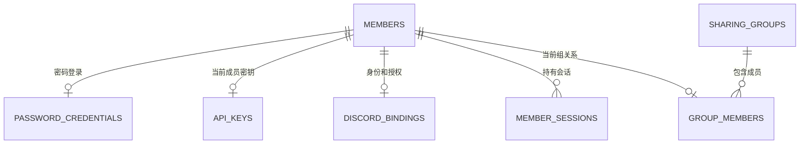
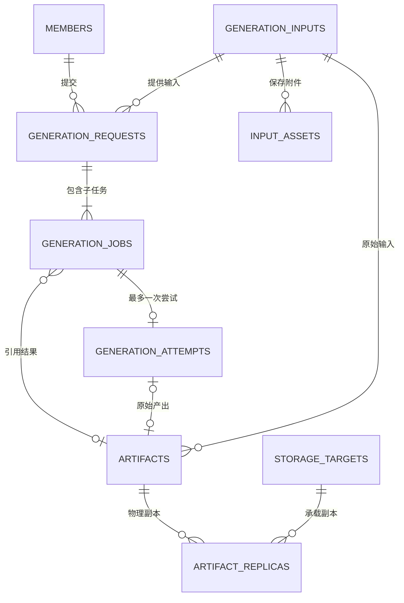
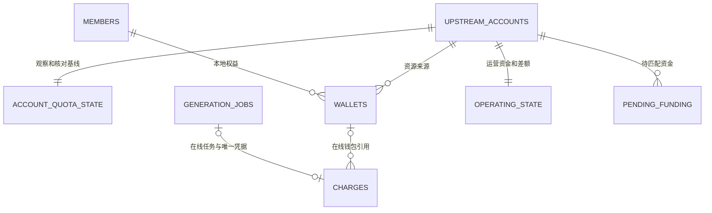
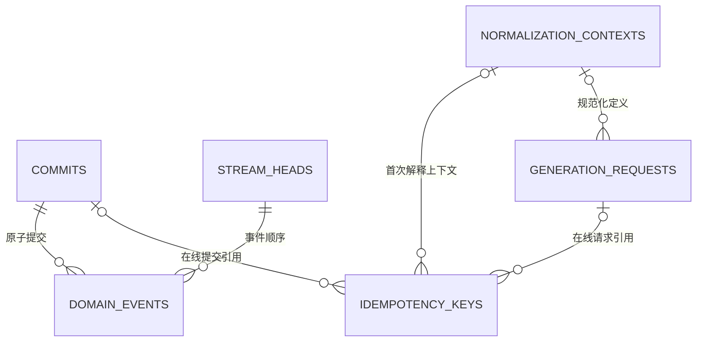

# 数据库与数据模型重构草案

更新日期：2026-11-12，Asia/Taipei。草案版本：0.7。源码核对基线：`55e5826d80a39364b0946547a83e2a2ed2f72711`；实施基于 PR #33 的 `265793c`。

**状态：T1/T2 主体实现已提交，独立审查发现 #34–#38 五项收尾，验收尚未完成、接口未冻结；修复进度见第 9.5 节。现行网关尚未切换，生产未迁移。** 维护者已基本认可新模型方向；完整历史转换成本过高或无法可靠完成时，可以评估封存旧历史、从新开账基线开始。具体迁移路线依据副本试验选择，不把此授权解释为清零余额、删除原图、取消任务或抹去旧键防重。

**已确认的产品决定：D4a 卡密遗留功能、D4b 客户端自带官方 PST 的独立执行模式均淘汰；D8 仅保留为可选政策，具体留存期限后续决定。** 本轮记录决定，功能移除随重构实施；不设置新的自动归档或删除期限。

总跟踪：[#32](https://github.com/Hime-Hina/novelai-shared-gateway/issues/32)。[#30](https://github.com/Hime-Hina/novelai-shared-gateway/issues/30)、[#31](https://github.com/Hime-Hina/novelai-shared-gateway/issues/31) 保留问题证据与回归场景；它们原先的局部兼容瘦身边界不限制本次重构。后续目标规则以本草案及其评审修订为准，当前线上行为仍以已有契约和发布记录为准。

本文定义目标、实体、所有权、迁移选择和验收。API 逐字段行为、金额算法及归档 IO 协议继续由所属契约维护，实施时同步修改对应 owner，避免并行维护多套规范。

## 1. 目标与范围

采用一份业务事件历史、一套关系型当前状态和独立受保护输入。旧模型的解释与转换留在固定版本的离线迁移工具，新运行时只接受新格式。工作可以拆分评审，生产在同一候选版本完成一次格式切换。

**结构去重和模型迁移属于本轮必做范围，不属于暂缓的 D8。** D8 仅决定已有内容保留多久、何时退出在线查询或最终删除；暂缓 D8 不影响 T1-T7 的新模型、去重和一次迁移工作。

| 工作        | 具体含义                                                                                                          | 本轮范围                                         |
| ----------- | ----------------------------------------------------------------------------------------------------------------- | ------------------------------------------------ |
| 结构去重    | 同一输入正文只保存一份，任务/产物引用；同一当前状态采用唯一关系表示；移除无用途搜索正文、旧 ledger 和历史数组副本 | 必做，并验证读取、更新、重启和重放不会再生成副本 |
| 模型迁移    | 按 A 完整转换或 B 归档开账进入新 schema；稳定身份、权益、未决事项和防重按选定路线接续；旧解释器退出正常运行时     | 必做；路线与历史在线范围依据第 6 节确定          |
| D8 留存政策 | 例如将某类旧内容归档或在明确期限后删除，改变未来保留范围                                                          | 可选，后续决定；不新增期限或自动清理任务         |

“消除重复”针对职责重复的持久副本。例如一次带原图和蒙版的四图请求，保存一份输入、两份附件和四条小任务引用；结果产物各自保存。迁移需要证明字段语义相同：不同含义的提示词、不同请求意图不能仅因字符串/摘要相同就合并，真正不同的已知内容仍有明确去向。

事件保存历史决定、关系投影提供当前状态、独立备份用于恢复，各有必要职责。不能以去重为由把它们无条件合成一份或删除历史事实。迁移路线 B 封存历史属于单独明确的能力取舍，不当作无损结构去重的容量收益。

### 1.1 必须保留的需求

| 编号 | 需求                         | 数据模型要求                                       | 当前规则归属                                               |
| ---- | ---------------------------- | -------------------------------------------------- | ---------------------------------------------------------- |
| R01  | 稳定成员身份与私有访问       | 换 Key、改用户名、移除成员不改变历史归属           | `members/`、[成员会话](../architecture/member-sessions.md) |
| R02  | 密码、Discord、API Key、会话 | 凭据与业务状态隔离，撤销和过期持久生效             | `members/`                                                 |
| R03  | 分组、份额和停止接单         | 当前组关系和权重唯一；配置变更守恒且有版本         | `quota/fair-share.ts`                                      |
| R04  | 唯一执行器、当前单绑定账号   | 账号身份与凭据分离，冷却和派发占用明确             | [执行服务](../architecture/executor-service.md)            |
| R05  | 能力、只读报价、费用确认     | 共用规范化规则，受理保留首次授权                   | [成员生成契约](../contracts/member-generation-contract.md) |
| R06  | 生图、放大、Vibe 编码        | 共用持久生命周期，区分输入与产物类型               | `generation/`、`protocols/`                                |
| R07  | 批次、排队、取消和断线继续   | 父请求共享输入；子任务分别结算；取消不停止在途执行 | [请求生命周期](../architecture/request-lifecycle.md)       |
| R08  | 幂等与显式缓存               | 同键重放、不同意图冲突、活动合并和产物复用分别表达 | `generation/admission.ts`                                  |
| R09  | 三类资源账务                 | V5、订阅 Anlas、购买 Anlas 精确预扣、结算和退款    | `quota/`、`generation/accounting.ts`                       |
| R10  | 官方观察和运营核对           | 官方余额、本地权益和消费证据分开，未知保持未知     | [失败核对](../architecture/failure-accounting.md)          |
| R11  | 崩溃恢复、未知消费和迟到结果 | 不重复上游调用；迟到结果不改原退款、不复活余图     | [结果恢复](../architecture/result-recovery.md)             |
| R12  | 输入与结果恢复               | 规范化参数、实际种子、附件原字节、归属和摘要可验证 | 成员生成契约第 6 节                                        |
| R13  | Local/R2/PikPak              | 产物身份与副本位置分开，临时不可读不触发重生成     | `storage/`                                                 |
| R14  | 历史、统计和审计             | 清理展示不绕过收费、防重、免费窗口与批次授权       | `reports/`、现有查询 owner                                 |
| R15  | 备份、迁移与重放             | 事件、输入、凭据和产物形成明确恢复闭包             | [生产发布](../operations/production-release.md)            |

本次继续使用 SQLite 和单执行器。四组政策、单绑定来源及现有 Native/OpenAI/direct 成员入口保持默认范围；多车队、多执行器和多账号选路仍属于[后续扩展](scaling-follow-up-plan.md)。

### 1.2 删除目标

- 删除 `recordFields()`、通用 `app_records` 及同一实体的 `data JSON + 同义影子列` 模式。
- 删除 `event_streams.projection` 大状态 JSON；将状态迁至唯一关系投影。
- 删除 `request.jobs/state.jobs/jobs.data`、`job.request/requestPayload`、图片提示词多处正文副本。
- 删除事件内旧 ledger evidence 与独立 ledger 正文的重复表达；审计改读事件或必要的薄投影。
- 删除当前配置/账户状态中的历史数组、可直接计算的余额合计和重复成员关系。
- 删除 `user_token/image.token` 业务关联；所有权只用稳定身份。
- 删除无生产调用的旧搜索链、冗余提示词列及其索引，保留真实产品查询。
- 删除 `r2.pikpak` 嵌套模型，改为独立副本记录。
- 新运行时不再执行旧 inline、旧表、旧凭据关联或旧 reducer 的兼容分支。
- 按已确认的 D4 移除卡密业务及客户端自带官方 PST 的独立入口、队列和运行路径；历史数据通过迁移或归档处理。

独立业务功能的淘汰以第 8 节为准。结构清理不能自动授权删除还在使用的产品能力。

## 2. 数据所有权与写入规则

| 类别       | 内容                                                             | 权威与恢复边界                                                         |
| ---------- | ---------------------------------------------------------------- | ---------------------------------------------------------------------- |
| 业务事实   | 命令回执、已受理、派发授权、收费、退款、结果发布、政策及观察事件 | 追加事件；金额和历史决定不按当前算法重新计算                           |
| 受保护内容 | 规范化输入、附件、首次上下文、认证材料、必要诊断、产物字节       | 所属模块验证保存；事件仅保留引用和摘要，备份必须包含内容或可靠恢复来源 |
| 当前状态   | 成员业务状态、组关系、钱包、任务、尝试、收费凭据、产物及副本     | 事件在同一事务内更新，能够在新格式中重建                               |
| 瞬时状态   | 预览帧、HTTP waiter、SSE 连接、瞬时进度                          | 内存状态，不作为永久审计事实                                           |

稳定身份、秘密和业务状态的字段所有者须在物理 schema 中明确。凭据及会话不会因为重放业务事件而复活；需要同时提交的认证撤销和成员业务变更仍在同一存储事务完成。

命令统一校验当前授权、意图和相关版本，在一个 SQLite 事务内保存必要输入、回执、事件、关系状态及流版本。提交成功后才替换内存状态和通知。网络调用、产物上传和文件同步在事务外按既有准备/确认协议执行。

事件与当前状态之间允许必要重复：事件保存发生过的决定，状态表支持当前决策和查询。禁止多个可独立回写的完整对象副本。

## 3. 目标实体关系

下面是逻辑实体与基数；同名对象为同一实体。物理表可按独立生命周期、权限、查询需要合并，字段级 DDL 在 T1 固化。关系图不替代实际外键、唯一性和跨实体归属校验。

### 3.1 成员、认证与分组

| 实体                   | 核心字段和约束                                                                                                |
| ---------------------- | ------------------------------------------------------------------------------------------------------------- |
| `members`              | 稳定 ID、展示名、active/disabled/removed、accepting_jobs、auth_epoch、admission_epoch；业务状态与认证资料分离 |
| `password_credentials` | member_id 唯一、登录名、密码验证材料                                                                          |
| `api_keys`             | member_id 唯一、Key 摘要、按产品决定保存的可恢复秘密；当前不新增多 Key 管理功能                               |
| `discord_bindings`     | member_id、唯一 Discord 身份、授权材料、资格观察；网络失败不等于资格撤销                                      |
| `member_sessions`      | Token 摘要、member_id、auth_epoch、owner 绑定、固定期限                                                       |
| `sharing_groups`       | 稳定组 ID、名称、份额；当前四组作为政策约束                                                                   |
| `group_members`        | member_id 唯一、group_id、组内权重；全局有效份额计算得到                                                      |

移除成员撤销认证并执行已确认的权益转移，保留最小历史身份。转移余额不转移原请求和原图所有权。owner 继续采用现有部署配置与身份规则，本次不新增通用 RBAC。

### 3.2 输入、请求、执行与产物

| 实体                  | 目标内容                                                                                                                    |
| --------------------- | --------------------------------------------------------------------------------------------------------------------------- |
| `generation_inputs`   | 稳定 ID、member_id、schema_version、完整度、规范输入、摘要、逻辑大小；常用查询字段与模型参数 JSON 不存同义副本              |
| `input_assets`        | input_id、asset_id、MIME、原长度、SHA-256、BLOB，组合主键 `(input_id, asset_id)`                                            |
| `generation_requests` | 成员、input_id、context_id、来源、批次数、种子意图、费用授权、受理时间；不保存 child 数组                                   |
| `generation_jobs`     | request_id、sample_index、实际种子、状态、队列序号、期限、结果引用、必要成功/保留事实；不保存完整输入或 charge/attempt 对象 |
| `generation_attempts` | job_id 唯一、account_id、凭据代次、派发和实际响应证据、核对状态；有授权不等于已发送                                         |
| `artifacts`           | 所有者、原始 input_id、可空原始 attempt_id、内容摘要/长度/MIME、类型、发布和退休状态；包含图片和编码结果                    |
| `artifact_replicas`   | artifact_id、storage_target_id、对象定位、编码方式、上传确认、内容核验、删除与故障状态                                      |
| `storage_targets`     | Local/R2/PikPak、固定桶/目录/命名空间身份；认证配置独立引用                                                                 |

缓存命中可用小型任务引用已有产物，不产生新尝试。活动任务合并可让不同幂等键指向同一请求。产物的原始输入和尝试不随复用者变化。已发布内容丢失时保留身份和不可用状态，不把旧键变成新生成机会。

历史产物可以没有可证实的原始尝试。只存已知输入的 partial/unavailable 状态，不补造调用。旧 inline job 的目标请求容器映射必须明确记录来源，保留原 job ID 和原回执；无法确定归属的记录进入迁移冲突清单，不能猜当前 owner。

### 3.3 账务与上游状态

| 实体                                         | 目标内容                                                                                                                                                                      |
| -------------------------------------------- | ----------------------------------------------------------------------------------------------------------------------------------------------------------------------------- |
| `upstream_accounts` / `upstream_credentials` | 稳定账号、状态和凭据代次；PST 独立保护，轮换不新建一份余额来源                                                                                                                |
| `sharing_policy`                             | 当前绑定账号、配置版本、免费和 fallback 等政策                                                                                                                                |
| `wallets`                                    | `(account_id, member_id)` 唯一；三类资源可用额，不另存 Anlas 合计                                                                                                             |
| `charges`                                    | 原 job 标识唯一、原成员/账号归属、可空在线 job/wallet/attempt 引用、原资源金额、reserved/settled/refunded、原事件和时间；活动收费必须有在线任务和钱包，历史终态凭据可独立保留 |
| `account_quota_state`                        | 最新采用观察、恢复游标、待匹配扣款、续用债务、未分配额；不保存观察历史数组                                                                                                    |
| `operating_state`                            | 运营可用、未承担缺口、未归属返回、V5 容量差额和关联事实                                                                                                                       |
| `pending_funding`                            | 唯一业务收据、来源/归属、剩余待匹配金额和观察引用                                                                                                                             |

沿用三种明确资源，不新增任意资源 EAV 或通用复式总账。金额沿用 12 位定点 BigInt 算术及规范十进制 TEXT；不经 REAL/SUM(TEXT) 批准余额。缩放整数若采用 SQLite 64 位存储，须另行批准金额范围并检查累计量，不能默默缩小既有范围。

原预扣只能结算或按原资源退款一次。退款后找回产物保留失败与退款。官方余额、成员权益、互斥消费候选和实际消费证据分别表达，未知保持 NULL；不重算历史报价或把聚合缺口归因到单次任务。

每次明确更换上游凭据增加 credential_epoch，观察以账号、代次和请求发起序列排序。旧代次成功/失败均不能覆盖新代次，A→B→A 也不能复活旧 A 的迟到响应。失败不清空钱包，也不使旧快照无限有效。

轻量 job 核心保留免费成功时间和当时告警事实时，可合并独立免费次数投影。计数包含退款后找回的完整免费结果；若仍允许物理删除核心 job，就必须另保留相应成功凭据。历史清理不得重置滚动限额。

### 3.4 命令、事件与幂等

`commits` 保存内部 command 身份、提交序列、指纹、操作者和原安全回执。生成键保存 `(member_id, operation, key_hash)`、意图指纹和原请求/提交引用；两种指纹不可混用。当前授权先于领取旧回执，新受理资格不阻止合法领取旧结果。

图中的可空在线关联用于已归档或内容已删除的凭据：原 request/job/command 标识、原安全回执或其新格式引用、来源和 live/archived/unavailable 解析状态独立保留，不要求原在线行仍存在。新受理必须关联完整在线请求/提交，活动收费必须关联可恢复的在线任务和钱包；历史终态薄凭据可保留原身份并将在线外键置空。原标识与在线 FK 在 T1 分别定义，唯一防重仍按原业务身份，不伪造历史请求、输入或尝试，也不关闭外键绕过检查。

`domain_events` 只表达一份最小事实，不内嵌完整请求、当前账户或旧 ledger DTO。`stream_heads` 只保留 kind/version/cursor。`projection_state` 标记版本、完整提交位置和构建状态，未完成重建不能标为 ready。

`normalization_contexts` 按不可变内容复用实际首次定义，不复制整个 settings 或成员秘密。随机意图与首次实际 seed 分开，输入摘要、幂等指纹、缓存键各司其职。没有历史上下文时明确不可证明，不能用当前 defaults 冒充。

## 4. 输入附件与正文去重

### 4.1 输入附件是什么

输入附件是一次请求带给模型处理的二进制内容：图生图/重绘的源图、局部重绘蒙版、风格或角色参考图、放大所需源图，以及接口支持的参考编码数据。纯文字提示词、负面词和参数属于输入字段；生成出来的图片或 Vibe 编码结果属于 artifact。一个结果以后作为新请求输入时，在那个请求中承担附件角色。

是否为附件取决于业务内容，不取决于 HTTP 上传格式。JSON 内的 Base64 图片和 multipart 文件经规范化后应指向相同附件语义；普通纯文生图可以完全没有附件。

成员输入恢复契约只要求规范化输入、实际首次种子、批次数与附件，不要求逐字保存原 HTTP 正文或编辑器草稿。规范输入保存一种权威表示，协议适配器在边界构造出站字段。

### 4.2 规范输入与附件保存

- 消除已证明同义的 `tag/prompt/fullPrompt` 和顶层参数/`nativeParameters` 复制；实际不同的主体、画师前缀、负向词、多角色 caption 等语义继续表达。
- 展示文本与执行文本相同则不另存；确实不同且产品需要时保留明确可选字段。旧图文本不同于关联 parent 时迁移独立输入，不能覆盖。
- 缺失、NULL、空串仅在契约证明同义时合并。新请求要求完整输入，partial/unavailable 只支持诚实的查询与不可恢复说明，不能进入派发。
- 附件使用 BLOB；同一输入内按长度、摘要和实际字节相等复用。不做跨成员/跨请求全局 blob 去重，也不新增素材库产品。
- body 中的附件槽位只保存 asset 引用；写入验证引用属于同 input、存在、长度和摘要一致，无未引用附件。复用现有槽位白名单，不新增任意路径 DSL。
- 输入、附件、受理事实同事务保存；执行时才生成协议需要的 Base64。列表、排队和 SSE 状态读取不加载附件。
- 读取为“当前授权 → 原请求 → 白名单槽位 → 所属附件”，不能凭摘要或 asset ID 全局取内容。
- 分别计算磁盘字节、协议展开字节和活动输入预算；不能把更小 BLOB 字节直接当作原有载荷上限口径。

首版将输入附件保存在 SQLite，维持受理事务和一致性备份的简单边界。大型结果继续外部副本。未来是否外移输入由独立容量证据决定，不能把移动位置当作总存储减少。

## 5. 产物、存储与留存

### 5.1 副本状态

产物的摘要/原长度/归属保持稳定，Local/R2/PikPak 分别保存副本。桶或目录有稳定身份，更换凭据不等于更换数据来源。配置临时缺失或目录不符时允许原回执与合法缓存引用，读取按现有不可用语义失败，不重新生成。

上传确认、内容回读核验和源删除分别命名。当前 Local→R2 回读核验后删本地，R2→PikPak 在上传回执持久化后删 R2、领取时校验内容；本次不默默把确认上传宣称为内容已验证。若要求 PikPak 回读后才删 R2，作为增强政策单独评审和测量带宽。

### 5.2 D8：可选留存期限，不包含结构去重

D8 已确认为可选留存政策，区分三个动作：缩短在线查询窗口、将历史归档、最终删除内容。**具体期限后续决定，本轮不实施新的保留天数、自动归档或删除规则，保留现有输入、原图及账务可用性。** D8 的具体政策不作为本次模型重构完成的前置条件，也不恢复已取消的单份/总量备份硬容量限制。第 6 节的一次性历史归档开账路线独立评估，不等同于开启日常到期清理。

| 数据                                       | 本次默认                 | 未来调整前必须满足                                                         |
| ------------------------------------------ | ------------------------ | -------------------------------------------------------------------------- |
| 当前钱包、预扣、未决核对、待匹配资金、冷却 | 完整保留                 | 只能由业务事件合法结案或转移，不能按年龄删                                 |
| 幂等、防重复收费、免费窗口证据             | 保留必要核心             | 删除展示历史不得使旧键重执行、重复退款或重置限额                           |
| 已完成历史展示和可重建索引                 | 结构去重；不设新期限     | 在线窗口缩短/归档应明确页面覆盖范围，不能误报为全量历史                    |
| 输入附件和规范化参数                       | 保留                     | 若以后独立到期，要定义参数复用/补查失效和 GET 的不可用语义；不连带删除结果 |
| 原图和其他产物                             | 保留，沿现有冷热规则流转 | 如最终删除，先记录不可用事实并核验请求、旧快照和归档引用；原键不得重新生成 |
| 诊断和临时文件                             | 不新增期限               | 在途恢复、未决核对、审计依赖解除后才可依明确规则清理                       |
| 已过期/撤销会话及短期认证材料              | 沿认证生命周期处理       | 不能删除仍有效凭据，也不能由重放恢复撤销令牌                               |
| 迁移源与历史归档                           | 独立保护                 | 不放进日常轮换前缀；最终删除须有明确决定和剩余恢复证明                     |

当前日常数据库备份仍按最近七份轮换；已去掉的是旧 50 MiB 单份/500 MB 总量硬限制。生产 R2 七天后转 PikPak 描述热层停留时间，原图仍在冷层。以上都不同于“旧数据七天后永久删除”，本草案不改变这些现行规则。

若后续选择具体期限，先做只读清理清单和依赖检查，再审批范围，分批执行并留下删除事实。受保护内容有意删除后，恢复必须识别已删除标记，不能伪造内容或把预期不可用当成功。尚未完成的业务对象不得被年龄规则清理。

## 6. 一次迁移的两条路线

### 6.1 共同前置条件

1. 先在同规模一致性副本输出实体计数、正文大小、账务核对、归属/摘要冲突和预计资源消耗。只上传聚合报告，不上传真实提示词、图片或秘密。
2. 固定源提交切点、源库及必要文件/对象清单、转换器版本和 manifest。源库保持只读；若旧工具必须升级副本，另建工作副本，保留原始证据。
3. 迁移器负责历史解释；新运行时只有新契约。当前 SQL/journal 历史字节不改写，新格式初始化与版本拒绝边界单独设计；如需调整 guard/打包规则，独立评审。
4. 新 writer 拒绝旧/未完成目标，旧 writer 拒绝新库。迁移失败不能留下看似 ready 的半库。
5. 保留原业务 ID、原安全回执、已知时间、NULL 与未知。旧原文/hash 和新规范内容/hash 分别校验并建立来源映射。
6. 先停止新受理和新派发，等待并恢复在途、存储发布和归档工作；queued/pending 及仍未决记录要保留或经明确业务命令结案。原工具停止写入后才能固定最终切点。
7. 迁移期间不发 NAI 请求。切换后有新增写入或外部存储变化时，不能用旧快照覆盖账本回退。

### 6.2 路线 A：完整历史转换

旧一致性源经离线转换器形成新受保护输入、新事件契约和关系状态。保留旧逻辑提交边界、相对顺序、命令回执及可证实决策；旧事件到新事实允许明确的一对多映射。旧事件原文留在源归档，不再复制到在线 payload。

新库从转换后的 opening 和完整新事件重建。原本只有开账快照的时期仍是 opening，不补造逐笔历史；承诺范围限于原系统已有证据支持的历史范围。重放只应用保存的金额和决定，不调用当前报价、时间、网络。

输入、事件或所有权冲突不能挑一份覆盖。若某类历史无法证明转换，报告其数量、涉及权益/接口及处理选择，不无限追加在线兼容分支。

### 6.3 路线 B：封存旧历史，以新格式重新开账

维护者允许在 A 很难或无法可靠完成时考虑 B。B 将“全历史逐条转换”收敛为“核对切点仍生效的状态与凭据”。可用权益、未决责任和防重继续存在，新事件历史从明确新基线开始。

#### 必须带入新基线的内容

| 内容             | 要求                                                                                                                      |
| ---------------- | ------------------------------------------------------------------------------------------------------------------------- |
| 身份、账号、配置 | 稳定成员/账号、有效认证策略、分组和版本；已移除成员的必要历史身份                                                         |
| 钱包与资源核对   | 三资源余额、预扣、待匹配消费、债务、未分配额、运营差额、未归属返回和资金收据                                              |
| 观察与调度       | 原观察时间/有效性、凭据代次、恢复/结算游标、fallback 缓冲、冷却截止/失败计数和排队顺序；迁移不得刷新旧观察时间            |
| 活动与未决任务   | queued/pending、真实在途/未知结果、resultPending、核对截止、原批次授权和完整 child 费用证据；相关输入/附件/上下文必须可用 |
| 防重             | 旧生成键、内部管理/资金收据等必要命令回执、终态收费和退款凭据；不得因新库重建而重复执行                                   |
| 免费限制         | 切点仍影响滚动窗口的成功时间、迟到成功、在途占用及告警事实；不能只迁移一个累计数                                          |
| 结果与在线历史   | 按选定查询范围迁入小型结果/所有权/存储引用或明确的历史不可用凭据，不能把缺失当成可重生成                                  |
| 未决历史关联     | 当前核销、差额、资金登记等所引用的原事实，或经核验的新开账等价记录；新库内必须能够解析                                    |

上述基线保存为**有来源的新格式 opening facts**，可分页/分提交导入，但只有整体校验完成才安装为 ready。只把值写进当前表、不给新重放提供基线，不算完成 B。新基线和切点后事件连同新受保护内容应足以恢复新服务，无需常态运行旧 reducer。

#### 旧历史的查询边界

B 的具体选择报告必须列明：历史列表/热力图/损耗审计、旧请求查询、旧结果领取、输入复用各自仍在线、仅归档可查，或明确不可用。默认尽量保留原结果领取和小型索引；确需缩小功能范围时，将具体接口影响提交维护者决定。

迁入的历史摘要也要有可重建来源。不能导入一张不受 opening/事件覆盖的“历史查询表”，然后声称全库可重放。只保存在归档中的历史不得让新界面静默显示为完整零历史。

#### 原归档必须独立可用

- 保存旧一致性数据库、受保护输入/上下文/回执、必要配置与解密材料，以及固定版本只读审计/导出工具和 manifest。
- 当前数据库备份包不包含原图；必须同时保存匹配产物副本或经过验证的对象清单、原摘要、定位和访问恢复材料。旧数据库单文件不是完整归档。
- 归档脱离日常七份轮换。只被归档引用的 Local/R2/PikPak 对象仍受保留保护，新后台不能把它们当孤儿删除；目录和凭据变更要同步验证归档可读性。
- 如归档沿用可变外部存储，必须把这些对象及其生命周期纳入恢复闭包；仅保存一个可能失效的 URL 不构成归档。
- 旧审计工具离线/只读使用，不接上游、不启动派发、不成为新服务的长期查询 fallback。

B 承诺从新开账点重放；更早逐时点状态由原归档审计。新服务恢复与历史归档恢复分别验收。

### 6.4 路线选择与旧键

先用代表性副本评估 A 的可证明性、运行时间、峰值内存/磁盘和未能转换的类别。若历史只能依赖缺失信息、或者成本和风险不合适，可以选择 B；不为维持 A 引入永久旧解释器。选择报告附保留清单、接口变化、归档恢复演练和截止点，由维护者据此确定切换方案。

两条路线都不能只复制旧 fingerprint 就宣称旧 POST 完全可重放。可以证明的新旧意图转换继续精确比较；无法证明时保留旧键禁止再次执行，并明确返回原查询入口和冲突/不可重放语义。已有结果确实缺失仍返回既有不可用语义。错误码与接口变化在实施契约评审中确定，本草案不擅自更改生产返回值。

幂等证据有意保留为薄记录；它不要求保留一套旧运行模型。不能通过清空键空间、轮换成员 Key 或新建所有成员 ID 来绕过旧请求防重。

## 7. 数据约束、查询与验收

### 7.1 结构性约束

- 唯一 `(member_id, operation, key_hash)`、`(request_id, sample_index)`、attempt.job_id、charge.job_id、`(stream_id, stream_version)`、`(commit_seq, event_index)`。
- 私有输入/请求/产物关联验证稳定成员一致；困难历史关系进入转换报告，不通过空值默认或 token fallback 掩盖。
- 任务、尝试、收费、账户当前行不包含完整 request/charge/attempt/children/history JSON。
- 金额运算集中于既有核心，事件、当前状态和 DTO 的转换边界清楚。
- 关系状态仅由命令事务和重放器写入；外部读模块不能通用更新整个 store，DTO 不能回写成实体。
- 引用完整性、输入长度/摘要和权限在唯一所属模块验证；数据库和类型检查共同覆盖必需边界。
- 新表索引来自成员历史、父子任务、队列、在途收费、待核对和产物读取的实际查询。先测量再新增汇总缓存或全文搜索。
- 注释解释事实来源、事务先后、重试、金额单位和恢复边界；格式继续用现有 Prettier/EditorConfig，不改历史 SQL。

### 7.2 验收矩阵

| 验收           | 必须证明                                                                                     |
| -------------- | -------------------------------------------------------------------------------------------- |
| E01 身份和授权 | 换 Key、暂停、停用、移除、Discord 临时失败、跨成员访问正确                                   |
| E02 受理/幂等  | 并发同键、丢回执、重启、默认变更、不同意图、旧键受限分支均不重复生成                         |
| E03 资金       | 逐来源/逐资源钱包、预扣、终态、运营资金、未知消费一致；无宽泛 epsilon                        |
| E04 输入       | 出站参数语义、实际 seed、原附件字节和摘要一致；空/缺失/不同提示词不被覆盖                    |
| E05 恢复       | 结果准备、文件同步、发布、退款、迟到结果各崩溃窗口仍正确                                     |
| E06 存储       | Local/R2/PikPak 原字节、目录身份、确认/核验差别、临时缺配置、归档引用保护                    |
| E07 重放       | 新空库从选定 A 历史或 B 基线重建；所有承诺的业务状态及历史摘要一致                           |
| E08 不再膨胀   | 受理、查询冷输入、更新、重启、迁移及 replay 后，正文不回填任务/产物/流状态                   |
| E09 查询       | 当前历史/统计/搜索/错误详情有正确覆盖范围；清理不重置免费窗口或批次费用                      |
| E10 容量与性能 | 逻辑内容、表/索引页、WAL、输入 BLOB、压缩备份、归档总量、迁移/恢复峰值和关键查询耗时分别测量 |
| E11 切换       | 源只读、最终切点、旧 writer 拒绝、失败目标不可上线、新写入后的回退边界                       |

生产容量数据目前来自维护者报告，未在本设计工作中读取生产明细。不得把重复内容字节直接当文件释放量，也不得把外移归档当总存储消失。专项反例应能识别错误实现，再运行仓库已有完整验证和真实产物恢复门禁。

E02/E03/E07 必须包含“原目标行已缺失，仅剩旧键或终态退款凭据”的开账反例：B 仍能完成基线并阻止重复执行/扣退，不要求重新加载旧模型、伪造在线实体或关闭外键。

## 8. 决策记录与 D4/D8 澄清

| 决策             | 当前记录                                                                | 尚需落实                                            |
| ---------------- | ----------------------------------------------------------------------- | --------------------------------------------------- |
| D1 历史路线      | 新模型方向基本认可；A 完整转换与 B 归档开账均可评估，A 困难时允许考虑 B | 代表性副本报告及最终切换路线                        |
| D2 不可证明旧键  | 必须继续防重；同意原则不等于批准跳过冲突检查                            | 受影响类别、数量、接口错误和原结果查询              |
| D3 历史清理      | 建议展示隐藏、保留轻量核心事实                                          | 与现有清理接口逐项确认，不能提前物理删除            |
| D4a 卡密遗留     | 已确认淘汰；不涉及成员 Key                                              | 清点未兑权益和历史，明确迁移/归档去向并移除在线结构 |
| D4b 官方凭据模式 | 已确认淘汰客户端自带 PST 的独立任务模式                                 | 移除独立入口/队列；核验历史产物归属、迁移或归档去向 |
| D5 Key 再次查看  | 默认保留现有功能，秘密独立保存                                          | 若改为仅创建时显示，单独批准 UX/认证变更            |
| D6 迁移登出      | 建议允许一次统一登出，尚未确定具体切换行为                              | 记录会话处理和用户通知，不撤销有效 API Key          |
| D7 输入附件      | 默认 SQLite BLOB，结果继续外部副本                                      | 预算、真实字节、输入恢复和备份验证                  |
| D8 留存期限      | 可选，后续决定；本轮不新增期限或自动清理规则                            | 未来按第 5.2 节评审，不阻塞本次模型重构             |

### D4 指的两个特定旧功能

1. **D4a 卡密业务**：旧 `cards` 数据模型和兑换/卡余额流程，区别于现有成员 API Key。当前共享 API 白名单不开放旧兑换入口，但移除前仍要确认生产是否存在未兑权益、需要归档的记录或外部依赖；不能仅因没有入口就丢掉余额责任。
2. **D4b 官方 PST 直连模式**：私有部署允许来访者提供自己的 NAI 官方 PST，走 `officialJobs/createOfficialJob` 独立任务路径。它区别于成员使用网关发放的 Key，由网关调度绑定 Opus 并记成员账务。

`/generate` 是接口路径；用成员 Key 调用它属于当前共享业务，仍保留。Native/OpenAI 成员入口、管理员配置绑定上游账号的 PST 也保留。D4a/D4b 已决定淘汰，目标运行时和正常发布包不保留卡密流程、`OfficialKeyJobs/createOfficialJob` 独立执行路径或重新启用开关；必要旧格式解释仅留在独立迁移/归档工具中。

维护者于 2026-11-11 明确同意淘汰 D4。当前私有模式确有官方直连分支，此项属于已确认的功能退出，不能按无调用死代码处理而遗漏入口和历史数据。历史产物保留真实归属，不自动划给现任 owner；未兑权益须有明确处置，不因删除卡表而消失。

D4 纳入 T6/T7 及 E01/E06/E09/E11 验收：成员 Native/OpenAI/direct 和绑定账号认证继续正常；各生成入口收到客户端自带 PST 时，不创建官方独立任务或发起该模式的上游生成，覆盖私有模式及管理员头绕过原公网守卫的场景；卡密/独立队列没有运行残留；历史权益与产物的迁移或归档可核对。D8 不增加实施删除任务。

## 9. 工作包与交付边界

| 工作包 | 内容和 owner                                                           | 依赖/交付                                    |
| ------ | ---------------------------------------------------------------------- | -------------------------------------------- |
| T0     | 需求、ER、决策和删除清单                                               | 设计基础已提交；评审继续                     |
| T1     | 新 schema、版本、事实/字段所有权和事件契约，`storage/` + `events/`     | T0；字段级 DDL、约束、重建来源               |
| T2     | 规范输入、BLOB、上下文和输入查询，`generation/` + `protocols/`         | T1；E04/E08，复用槽位和归一规则              |
| T3     | 稳定身份、认证隔离、成员移除，`members/`                               | T1；E01，历史归属映射                        |
| T4     | 请求/任务/尝试/收费/钱包关系状态，`generation/` + `quota/` + `events/` | T1-T3 所需接口；E02/E03/E05                  |
| T5     | 产物、副本、冷热恢复与归档引用，`storage/`                             | T1/T2/T4；E06                                |
| T6     | 历史、统计、审计、DTO、旧结构清除与 D4 两项功能退出，既有查询 owner    | T2-T5；E08/E09，实际旧路径删除清单和 D4 验收 |
| T7     | 独立迁移器、A/B 可行性报告、来源 manifest 和开账/重放                  | T1 契约冻结后可并行，最终覆盖 T2-T6；E07/E11 |
| T8     | 同规模副本、恢复、容量性能和切换报告                                   | 完整同一候选；E01-E11                        |

边界通过工作包和可审阅提交控制，不引入长期双写、运行时开关矩阵或同时在线的两套账本。只有完整候选通过验收后再安排生产切换。

T7 的处置报告须列明 D4 的未兑权益、官方模式历史产物、可验证来源及迁移/归档去向；淘汰产品模式不要求删除这些历史证据。

PR #33 本身只修改计划和导航；后续实施基于其 `265793c` 开展。T1/T2 已形成可运行的新格式提交、读取和输入回放链路；T3 的认证适配、T4 的完整业务命令/reducer 和 T5–T8 仍未完成。当前没有切换现行 API、账本、旧 SQL/journal、CI 或生产行为，不关闭 #30/#31/#32。

### 9.1 T1 基础：物理字段、格式和生命周期契约

唯一 DDL 为 [`relational-schema.ts`](../../server/storage/relational-schema.ts)，初始化和格式门禁归 [`relational-storage.ts`](../../server/storage/relational-storage.ts)。不维护第二份 ORM DDL，不把这份新 schema 追加进旧库迁移链；它只创建离线空目标。DDL 位于编译模块内，现有后端编译/打包会一并带入，不新增需要另行复制的 SQL 资产。

格式为 `novelai-relational-v1`，writer/minimumWriter 为 5，新格式 reducer 为 1，事件 schema 为 2。现行运行时继续使用旧格式 writer/reducer 4 和事件 v1。新格式保留仅供格式识别的三项 `app_meta`，用旧 writer 已有的 `event_authority` 检查拒绝误开，不改变旧迁移 hash guard。初始化把完整 DDL、标记和 `building` 状态原子提交；非空目标一律拒绝，DDL 中断整笔回滚。这里不提供跳过核对或直接发布 ready 的接口。

`assertRelationalStorageFormat()` 只读核对格式/源码 DDL hash、实际表/索引/触发器结构和外键开启，供离线 building 目标使用。`assertRelationalStorageReady()` 另核对外键引用、reducer、ready 标记和完整提交游标。`ready` 必须由后续 T4/T7 在业务和受保护内容核对通过后安装；格式门禁本身不证明业务投影或输入摘要正确，也不代替 E07。64 位提交/流/队列序号以十进制字符串穿过 JS 边界，不能先读取为 number 再转换。

| 字段/表归属                                                     | 唯一在线表示与恢复来源                                                                                                                                 | 实际业务 owner                                                                                                   |
| --------------------------------------------------------------- | ------------------------------------------------------------------------------------------------------------------------------------------------------ | ---------------------------------------------------------------------------------------------------------------- |
| `commits` / `domain_events`                                     | 原命令、指纹、操作者和安全回执属于 commit；事件只存决定，按提交内索引及流版本唯一；提交和事件禁止 UPDATE/DELETE                                        | `events/` 的事实校验和提交入口；T4 接入业务命令                                                                  |
| `stream_heads` / `projection_state`                             | 只存版本和游标，不含状态 JSON；由同笔提交及重放构建                                                                                                    | `events/`                                                                                                        |
| `members` / 各认证表 / `member_sessions`                        | 稳定成员行与密码、可恢复 Key、Discord 授权、会话分表；`auth_epoch` 仅由当前私有快照/认证命令恢复，NULL 表示未恢复或撤销；业务事实不携带它              | `members/`，认证材料由私有备份恢复                                                                               |
| `sharing_groups` / `group_members` / `sharing_policy`           | 成员唯一当前组，组关系不再复制到成员数组；份额/权重保留原 number 语义；免费、fallback、告警各有明确字段                                                | `quota/`，T4 接入配置、开账及政策 reducer                                                                        |
| `upstream_accounts` / `upstream_credentials`                    | 账号唯一身份、当前 credential_epoch、冷却及失败次数；PST 只在凭据表，换凭据不新建钱包来源                                                              | `quota/` + `members/`                                                                                            |
| `generation_inputs` / `input_assets` / `normalization_contexts` | 不可变正文/上下文和每个 input 的附件 BLOB；事件保留引用/摘要。SQL 验证格式和附件长度，T2 验证实际摘要、槽位、语义去重及逻辑字节预算                    | `generation/relational-input.ts` 和 `storage/relational-input-store.ts`，复用 `protocols/`；内容从受保护备份恢复 |
| `generation_requests` / `generation_jobs`                       | parent 保存一次输入/上下文引用和确认；child 保存索引、实际 seed、状态、顺序、结果及免费成功事实，无 children/request/charge JSON                       | `generation/`，受理和生命周期事件重建                                                                            |
| `generation_attempts`                                           | job 唯一尝试；响应证据、互斥候选、未知实际消费、核对和待发布描述各自命名。旧凭据代次允许 NULL，不以当前代次补造历史                                    | `generation/accounting.ts` 的新格式接入，T4                                                                      |
| `wallets` / `charges`                                           | 钱包只有三类可用额；原预扣金额在 charge 唯一保存，终态不能再次结算或退款；不另存 Anlas 合计                                                            | `quota/`，金额继续由 `resource-amounts.ts` 计算                                                                  |
| `account_quota_state` / `operating_state` / `pending_funding`   | 最新观察与对账基线分别引用；待匹配扣款、fallback 缓冲、债务、运营差额、剩余资金独立保存，无历史数组。恢复/发放累计和展示合计由保存事实计算，不额外复制 | `quota/`，T4 接入观察、恢复、资金及开账 reducer                                                                  |
| `artifacts` / `artifact_replicas` / `storage_targets`           | 产物稳定所有者、原 input/attempt 和内容身份；副本定位不嵌套。uploaded/verified/deleted 分列，上传确认不冒充内容核验                                    | `storage/`，T5 接入发布与冷热事实；字节独立恢复                                                                  |
| `idempotency_keys`                                              | 原成员/请求/job/命令身份与可空在线 FK 分开；live 必须有当前请求/job、首次上下文和原 commit，归档可只保留原回执和来源，仍按原成员/操作/键唯一           | `generation/admission.ts` 的新格式接入，T4/T7                                                                    |
| `generation_diagnostics`                                        | 错误详情及摘要单独保护，事件只引用；不混入公开响应或普通列表                                                                                           | `generation/` + `storage/`                                                                                       |

`charges` 的 `original_*` 是不可变业务身份；`job_id`、钱包二元键及 `attempt_id` 是在线外键。活动收费必须关联真实任务和同成员钱包；归档终态可将在线外键置空，原 ID、金额、终态、来源和新 opening 事件引用仍在。生成旧键同样分离 `original_*` 和在线引用；有在线 commit 时读取其原回执，不再复制一份 JSON；没有该 commit 的历史薄记录才保存 `archived_receipt`。不能把缺行解释为可重新执行。旧键具体 HTTP 分支仍由 D2/T7 的接口评审落实。

跨成员输入/request、job/artifact、artifact/原尝试和 charge/job 关系由 FK 与触发器共同拒绝；首次输入、成员归属、原收费和原键意图不可被普通 UPDATE 改写。活动任务需要 complete 输入和首次上下文，child 索引不能超过原批次数。新金额列为规范十进制 TEXT，保留 12 位小数和原 BigInt 范围，不转成 SQLite 64 位金额或 REAL；恢复速率和配置权重属于非金额字段。

[`relational-fact-contracts.ts`](../../server/events/relational-fact-contracts.ts) 用同一字段表生成写入类型和运行时校验，补齐生命周期、成员、分组/政策、账号/凭据代次、官方观察、恢复/分配、资金、运营、存储及分型 opening facts。未知事件、额外字段、旧 `OpeningStateRecorded`/`LegacyFactRecorded`、隐私字段、非规范金额和未知输入/上下文版本直接拒绝。opening 按实体保存明确字段和来源，不恢复旧 DTO 或通用状态包。金额仍复用原 12 位定点核心；未知官方值和历史凭据代次保留 NULL。

[`relational-events.ts`](../../server/events/relational-events.ts) 校验完整事件 envelope、固定 schema/金额版本、stream owner 及成员/账号身份；[`relational-event-store.ts`](../../server/events/relational-event-store.ts) 要求外层命令事务和明确流前置版本，在保存点内原子追加原回执、事件、流头及游标。相同命令必须匹配操作者和指纹；缺失、落后、失败或未知 reducer 的投影不能推进。重放保留原事件 ID、顺序、时间和回执，校验 history 与完整提交，断点重复必须与原提交及元数据完全相同，不重算种子、价格或调用网络。这里没有 T4 的账务/任务全量 reducer，也不安装 ready。

有区分力的结构与契约检查在 [`relational-storage.test.mjs`](../../tests/integration/relational-storage.test.mjs)、[`relational-events.test.mjs`](../../tests/unit/relational-events.test.mjs) 与[事件类型测试](../../tests/unit/domain-event-types.test.mjs)：缺失旧目标的薄凭据、重复键/重复退款终态、跨成员关联、精确金额、DDL 回滚、相互拒绝、未来格式、实际 DDL 漂移、>2^53 游标、未知/隐私事实、半提交回滚及原提交重放。它们是合成夹具和新格式原语检查，尚非 T7 迁移或真实容量报告。

### 9.2 T1 基础的本地验证（2026-11-11）

Windows，Node 22.23.4，pnpm 10.32.1；独立 Node 24.22.1 环境复用同版本 better-sqlite3 12.10.0 的 ABI137 依赖。没有重编译或替换共享依赖。结果针对本节基础代码，不能解释为 T2–T8 或 E01–E11 全部完成。

| 实际命令/检查                                                                                             | 结果                                                                                           |
| --------------------------------------------------------------------------------------------------------- | ---------------------------------------------------------------------------------------------- |
| `pnpm run architecture:check`、`pnpm run migration:check --base 55e5826d80a39364b0946547a83e2a2ed2f72711` | 通过；历史 SQL/journal、守卫和基线未改                                                         |
| `pnpm run typecheck`、`pnpm run check`、`pnpm run format:check`                                           | 通过；120 个 JS/MJS 语法检查                                                                   |
| `node --test tests/integration/relational-storage.test.mjs tests/unit/domain-event-types.test.mjs`        | 11/11 通过，保留原有事件类型断言                                                               |
| `pnpm test`                                                                                               | 772 项：767 通过、5 项平台/显式开关跳过、0 失败，约 226 秒；包含现行格式的开账、重放和恢复用例 |
| Web 与 executor 的 `typecheck`、`test`                                                                    | 类型通过；149 与 3 项单元测试通过                                                              |
| `pnpm --filter @novelai-gateway/executor build`、`test:runtime`                                           | 后端和执行器构建通过；实际 Nitro 产物 HTTP 3 通过、1 项平台跳过                                |
| `pnpm --filter @novelai-gateway/web test:executor`                                                        | 真实 Nuxt 开发/生产构建与执行器 HTTP：15 通过、1 项平台跳过                                    |
| 新格式 Node 24 专项                                                                                       | 逐文件 hash 核对的隔离源码及原迁移资产副本，10/10 通过                                         |
| 打包的新模块                                                                                              | 执行器包内编译 JS 的 DDL 与源码相同；空库初始化、building 拒绝及格式门禁 smoke 通过            |
| 文档和差异                                                                                                | 71 个本地文件链接存在，`git diff --check` 通过                                                 |

首次专项直接使用终端默认 Node 24 时，现有共享 SQLite 原生模块为 ABI127，因 ABI 不匹配而未执行结构用例；切到仓库指定 Node 22 后通过，再在独立 ABI137 依赖中验证 Node 24。原始后端、Web、执行器及 Node 24 日志位于本地 `H:\TEMP\novelai-db-model-t1-20261111`。

以上为 2026-11-11 的 T1 基础证据；当时未做 Linux/Docker/远端 CI、同规模生产副本转换、v2 业务重放或容量测量。后续 T1/T2 增量及其验收见下面两节，不能手工把原型目标标为 ready 后上线。

### 9.3 T2：统一输入、附件和首次上下文（2026-11-12）

规范化 owner 为 [`generation/relational-input.ts`](../../server/generation/relational-input.ts)，存储、受理引用和权限过滤归 [`storage/relational-input-store.ts`](../../server/storage/relational-input-store.ts)。它们复用现有 `buildNovelAiParameters()`、Native 解析/图像与 Vibe 校验、`recoveredInput()` 和附件槽位，没有再实现一套协议或价格规则。现有 API 的输入 DTO 和附件 URL 保持原契约；T3/T4 后续通过这些窄方法接入真实认证、报价和调度，不把整个 SQLite 句柄暴露给读取模块。

- **唯一正文**：input schema 固定为 1，只存实际协议正文的一种表示。实际 seed 属于 child，样本数属于 parent，兼容 DTO 和出站 Base64 仅在读取/执行边界临时展开；不存顶层参数别名、`nativeParameters` 或旧 DTO 备份。确有不同语义的展示词和原请求 steps 独立保存；已知空字符串、显式 NULL 与缺失值不互相覆盖。partial/unavailable 开账输入仅保留真实已知字段，不能派发或按当前默认值补造。
- **BLOB**：沿原图、蒙版、V3/V4 Vibe 和 V4.5 Precise 的既有槽位保存原字节，正文仅引用 input 内的 asset ID。单 input 内先比长度/SHA，再比实际字节去重；不按全局摘要跨请求或跨成员合并。读取正文只查附件元数据，不查 BLOB；附件和执行冷读取核验实际长度、SHA、MIME 与保存的原限制，事件和普通列表没有字节或全文。V5 仍沿用原协议支持范围，不放开 Vibe/Precise。
- **首次上下文**：context schema 固定为 1，按 member/native/direct 三种封闭定义保存规范化版本、原枚举/限制、随机种子意图及 direct 首次 defaults；不接受整个 settings 或认证对象。`(schema_version, sha256)` 唯一且复核内容相同后复用原 ID；事实锚定摘要。重启及当前 defaults/枚举变化不覆盖已保存定义，重试可读取首次上下文；后续改变定义结构须显式处理版本。
- **事务和预算**：调用者持有事务并先重验当前授权；当前停用、移除或私有 auth epoch 未恢复时拒绝公开读取/受理。暂停新接单允许原命令重领。首次提交原子保存输入、上下文、父子引用及四类事实；SQL 失败即使被调用者捕获也不留半笔。预算取实际展开协议字节与旧规范 DTO 字节的较大值，沿用现有单请求/活动限制，不因 Base64 改 BLOB 而扩大容量。
- **有界回放**：`replayAcceptedInput()` 从只读 source 校验并复制原输入、上下文、BLOB 和受理事实，按完整提交断点续跑，重复提交零写入。调用者先恢复稳定成员及当前私有认证快照；业务事实不携带或复活 `auth_epoch`。此入口只接受 T2 的四类事实，不代替 T4 账务/生命周期重建或 T7 A/B 转换器，完成后仍为 building。

[`relational-input.test.mjs`](../../tests/integration/relational-input.test.mjs) 覆盖 E04 和输入范围内的 E08：四图共用一份正文、相同原图/蒙版单份 BLOB；三类操作及 JSON/multipart、V3 原图/V4 编码、V4.5 Precise 和 V5 图生图；真实 HTTP mock 的出站语义/计价一致；wraparound 子 seed、首次上下文、跨成员与路径注入、隐私、预算、篡改拒绝、已退休 child、partial 开账，以及只读 source 的重开续跑和原字节回放。首轮用例识别了按当前枚举校验旧上下文、用 Native 清洗覆盖 direct 显式 NULL 的错误，现已在各自 owner 修正并保留回归断言；没有放宽原协议守卫。

本地新格式仍是未发布候选；这次完善了上下文唯一性、输入版本和私有 auth epoch 的 DDL，先前 0.5 原型文件因 schema hash 不同会被拒绝，需重新建立空目标验证，不能手工改 hash 或重写旧库。旧格式 SQL/journal 和运行时 hash guard 未改，生产、归档、D4 退出及 D8 留存未在 T2 提前变更。

### 9.4 T1/T2 增量的本地验证（2026-11-12）

Windows，Node 22.23.4、pnpm 10.32.1；Node 24.22.1 使用新建的隔离源码副本、当前精确依赖和既有 better-sqlite3 12.10.0 ABI137 构建。228 个源码/测试文件逐文件 hash 核对，包含旧迁移资产；没有重编译共享原生依赖。以下结果只覆盖已实施范围。

| 实际命令/检查                                                                                                                                                                                                         | 结果                                                                                               |
| --------------------------------------------------------------------------------------------------------------------------------------------------------------------------------------------------------------------- | -------------------------------------------------------------------------------------------------- |
| `pnpm run architecture:check`、`pnpm run migration:check` 及 `--base 55e5826d80a39364b0946547a83e2a2ed2f72711`                                                                                                        | 通过；守卫、可信基线、旧 SQL/journal 和 CI 未改                                                    |
| 根、Web、executor 的 `typecheck`；`pnpm run check`                                                                                                                                                                    | 通过；122 个 JS/MJS 语法检查                                                                       |
| 新格式专项：`node --test --test-concurrency=4 tests/unit/relational-events.test.mjs tests/integration/relational-input.test.mjs tests/unit/domain-event-types.test.mjs tests/integration/relational-storage.test.mjs` | Node 22 与隔离 Node 24 均 29/29 通过                                                               |
| `pnpm --filter @novelai-gateway/web test`、`pnpm --filter @novelai-gateway/executor test`                                                                                                                             | 149 与 3 项通过                                                                                    |
| `pnpm --filter @novelai-gateway/executor build`、`test:runtime`                                                                                                                                                       | 后端和 executor 构建通过；实际 Nitro 产物 HTTP 3 通过、1 项 Linux SIGTERM 检查在 Windows 跳过      |
| `pnpm --filter @novelai-gateway/web test:executor`                                                                                                                                                                    | 包含真实 Nuxt 开发/生产构建的联调：15 通过、1 项 Linux SIGTERM 检查在 Windows 跳过                 |
| Node 24：`node --test --test-concurrency=1 tests/integration/activity-storage.test.mjs tests/integration/activity-heatmap-http.test.mjs`                                                                              | 12/12 通过，保留现行读取 worker 验证                                                               |
| executor 包内编译 JS 专项                                                                                                                                                                                             | DDL 与源码相同；唯一输入/BLOB/上下文提交、冷读取出站参数、精确回放、重复零写入及 building 拒绝通过 |

源码定稿后的 `pnpm test`：790 项，785 通过、5 项原有平台/开关条件跳过、0 失败，约 214 秒。之后仅扩充同一附件用例的 V4.5 Precise/V5 夹具，Node 22 和 Node 24 均重新完成上述 29 项专项。`pnpm run format:check`、78 个本地文档文件链接及 `git diff --check` 通过。

首轮 Node 24 验证复用的旧依赖目录缺少当前 `webdav`/`fast-xml-parser`，仅类型夹具失败；新建使用当前固定依赖的隔离目录后全项通过。原始日志、隔离副本 hash 清单和编译 JS 检查脚本保留在本地 `H:\TEMP\novelai-db-model-t2-20261112`。新上游 HTTP 检查使用本地 mock，没有调用真实 NAI。

未做本候选的 Linux/Docker/远端 CI、代表性生产副本 A/B 转换、全业务 v2 reducer 重建或物理容量/性能测量。这些仍分别属于 T4/T7/T8；本次未提交生产切换，也未改源生产库、归档或备份。

### 9.5 独立审查收尾（#34–#38）

审查固定在 T1 `5ea8c58`、T2 `e13a8ca`，原专项全绿不能证明接口没有遗漏。以下为修复候选的自验状态；不据此宣称独立审查通过或安装 ready。

| 问题                                                                                  | owner 和修复边界                                                                                                                           | 当前状态                                                                              |
| ------------------------------------------------------------------------------------- | ------------------------------------------------------------------------------------------------------------------------------------------ | ------------------------------------------------------------------------------------- |
| [#34](https://github.com/Hime-Hina/novelai-shared-gateway/issues/34) 入口兼容         | `generation/relational-input.ts` 保存入口 owner 已规范化的执行语义，不再重新套用 Native 业务范围；Native/member 自身的原守卫继续生效       | 修复并通过 direct/OpenAI 两个反例的落盘、重开、出站参数和计价对照                     |
| [#35](https://github.com/Hime-Hina/novelai-shared-gateway/issues/35) 账户流身份       | `events/relational-events.ts` 对全部 account 流要求非空 envelope 账户且与 stream 对齐；payload 的 `accountId`/`originalAccountId` 仍须一致 | 修复并覆盖结算、退款、原预扣及归档开账；T4 仍须在事务中核对真实 job/charge/原预扣关系 |
| [#36](https://github.com/Hime-Hina/novelai-shared-gateway/issues/36) 原提交边界       | `events/relational-event-store.ts` 保留 source `event_count`，先核对两个事件列表的原长度，再验证连续索引和元数据；断点比较同样携带原事件数 | 修复并覆盖两个列表同时截短、单列表截短、重复零写入；提交/事实/流头/游标均不留半笔     |
| [#37](https://github.com/Hime-Hina/novelai-shared-gateway/issues/37) 活动预算历史扫描 | `storage/relational-input-store.ts` 和唯一 DDL；从活动 child 索引起查，按 parent 去重，不新增计数器                                        | 待修复及执行计划验证                                                                  |
| [#38](https://github.com/Hime-Hina/novelai-shared-gateway/issues/38) 新写入口门禁     | 现有 `scripts/check-architecture.mjs`，补齐新事件/输入追加及回放能力，保留合法窄读取和命令 owner                                           | 待修复；守卫修改须随实现 PR 由维护者复核                                              |

正确性反例先在现有用例中失败（direct 两种参数各 422，错账户及截短提交缺少预期拒绝），修复后新格式四文件专项 33/33 通过。回归入口为 [`relational-input.test.mjs`](../../tests/integration/relational-input.test.mjs) 和 [`relational-events.test.mjs`](../../tests/unit/relational-events.test.mjs)。事件的磁盘字段和版本未改；新增 `eventCount` 只属于离线传递对象，不能由过滤后的列表重算，也不要求给受信源对象另建签名协议。完整原提交验证后，各 owner 才能分派各自投影。

第一阶段（#34–#36）本地验证：Node 22/24 四文件专项各 33/33；`pnpm test` 794 项，789 通过、5 项原有条件跳过、0 失败，约 220 秒。后端类型、架构、可信 `55e5826` 基线迁移历史、122 个 JS/MJS 语法和全仓格式检查通过。日志位于本地 `H:\TEMP\novelai-db-model-review-20261112`；此时 #37/#38 和实现 PR 的远端验收尚待完成。

## 10. 事实依据与修订

本草案的当前行为依据固定在 `55e5826`，未来实施需重新核实实际 main：

- [既有领域和不变量](architecture-refactor-plan.md#3-业务语言归属与标识)、[API 契约](../contracts/api-contract.md)、[成员生成契约](../contracts/member-generation-contract.md#6-查询预览参数复用与领取)。
- [通用记录字段和流状态列](../../server/storage/sqlite-schema.ts)、[事件/投影/旧输入开账](../../server/events/event-store.ts)、[尝试与旧 evidence](../../server/generation/accounting.ts)。
- [提示词和出站参数](../../server/protocols/novelai-client.ts)、[Native 输入](../../server/protocols/native-image.ts)、[附件槽位与输入恢复](../../server/generation/member-contract.ts)。
- [API 白名单](../../server/http/api-surface.ts)、[私有官方凭据分支](../../server/gateway-runtime.ts)、[冷存储顺序](../../server/storage/cold-images.ts)。
- [日常备份和轮换](../../scripts/r2-backup.mjs)、[备份包内容](../../scripts/backup-production.py)、[生产存储配置](../operations/production-release.md)。

| 版本 | 日期       | 变更                                                                                                      |
| ---- | ---------- | --------------------------------------------------------------------------------------------------------- |
| 0.1  | 2026-11-11 | 会话提出新模型、ER、工作包和 D1-D8；未写入运行规范                                                        |
| 0.2  | 2026-11-11 | 落实仓库评审草案；澄清 D4/D8/附件；加入获准评估的归档开账路线与恢复闭包；明确未批准的数据删除和产品取舍   |
| 0.3  | 2026-11-11 | 记录维护者确认：淘汰 D4a/D4b，并纳入迁移及退出验收；D8 可选、后续决定，本轮不新增期限或清理任务           |
| 0.4  | 2026-11-11 | 澄清结构去重与模型迁移为本轮必做；D8 仅为可选留存政策，暂缓 D8 不暂缓主体重构；补充去重例子及必要冗余边界 |
| 0.5  | 2026-11-11 | 按 PR #33 开始实施 T1；加入新格式 DDL、初始化/拒绝边界、生命周期类型及结构用例，明确字段归属与未接入范围  |
| 0.6  | 2026-11-12 | 补齐 T1 事实契约与提交/回放原语；完成 T2 新格式统一输入、BLOB、首次上下文和受理/冷读取；仍不切换现行网关  |
| 0.7  | 2026-11-12 | 记录 #34–#38 独立审查收尾；先修入口兼容、账户流身份和原提交事件数，区分主体实现、自验与待完成验收         |
